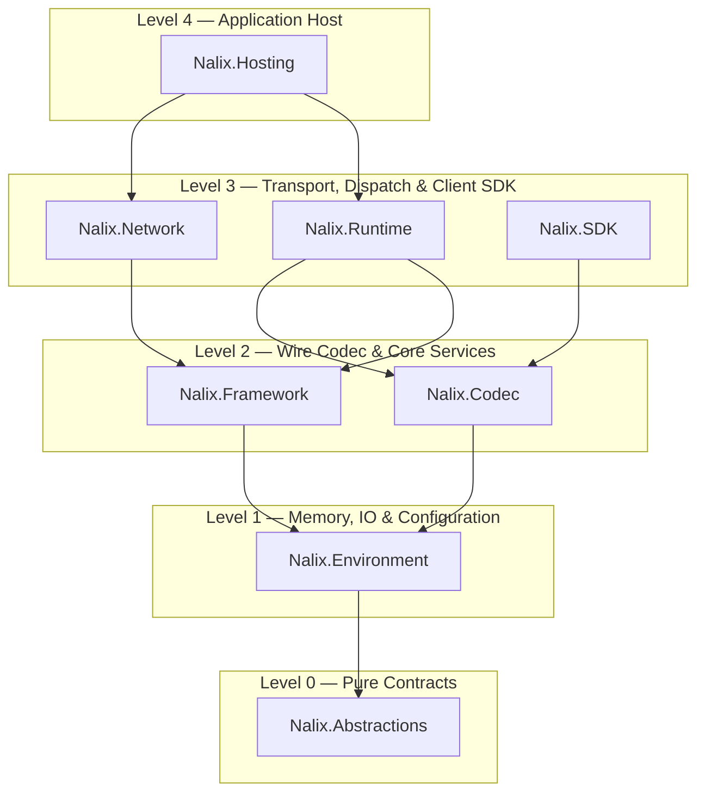

Nalix is organized into a strict 5-level architecture (`Level 0` through `Level 4`) with zero circular dependencies, complemented by compile-time Roslyn analyzers and source generators. You can install the high-level meta-packages for rapid application development or reference lower-level packages independently.

:::tip[Safe defaults]
- **Server:** Install `Nalix.Hosting` — it transitively brings in `Nalix.Network`, `Nalix.Runtime`, `Nalix.Framework`, `Nalix.Codec`, `Nalix.Environment`, and `Nalix.Abstractions`.
- **Client:** Install `Nalix.SDK` — it transitively includes `Nalix.Codec`, `Nalix.Environment`, and `Nalix.Abstractions`.
- **Shared Contracts:** Install `Nalix.Abstractions` and `Nalix.Codec` in the class library shared between your server and client.
:::

## 5-Level Dependency Architecture

## Runtime Package Map

| Level | Package | Purpose | Key Public Types |
| :---: | :--- | :--- | :--- |
| **0** | [**Nalix.Abstractions**](./nalix-abstractions.md) | Zero-dependency interfaces, packet/handler attributes, and validation metadata | `IPacket`, `IConnection`, `IBufferLease`, `IPacketContext<T>`, `PacketOpcodeAttribute`, `PacketHandlerAttribute` |
| **1** | [**Nalix.Environment**](./nalix-environment.md) | Pooled memory primitives, binary reader/writer, INI configuration, monotonic clock, and OS CSPRNG | `BufferLease`, `DataReader`, `DataWriter`, `ConfigurationManager`, `Directories`, `Clock`, `TimingScope`, `Csprng` |
| **2** | [**Nalix.Codec**](./nalix-codec.md) | Compile-time binary serialization, LZ4 compression, AEAD encryption, and packet catalog | `LiteSerializer`, `PacketRegistry`, `LZ4Codec`, `EnvelopeCipher`, `FramePipeline`, `PacketBase<TSelf>`, `PacketFactory<T>` |
| **2** | [**Nalix.Framework**](./nalix-framework.md) | Singleton/service registry, background worker scheduling, Snowflake IDs, and resource pools | `InstanceManager`, `TaskManager`, `Snowflake`, `BufferPoolManager`, `ObjectPoolManager`, `ObjectMap<TKey, TValue>` |
| **3** | [**Nalix.Runtime**](./nalix-runtime.md) | Server-side sharded packet dispatch, middleware pipeline, rate limiting, and session resume | `PacketDispatchChannel`, `PermissionMiddleware`, `RateLimitMiddleware`, `TimeoutMiddleware`, `SessionService` |
| **3** | [**Nalix.Network**](./nalix-network.md) | TCP, UDP, and WebSocket listeners, socket connections, admission guard, and connection hub | `TcpListenerBase`, `UdpListenerBase`, `WebSocketListenerBase`, `Protocol`, `ConnectionHub`, `ConnectionGuard`, `SocketConnection` |
| **3** | [**Nalix.SDK**](./nalix-sdk.md) | Client-side TCP/UDP sessions, X25519 handshakes, auto-reconnect, and correlated requests | `TransportSession`, `TcpSession`, `UdpSession`, `SessionState`, `TransportOptions`, `RequestOptions` |
| **4** | [**Nalix.Hosting**](./nalix-hosting.md) | Fluent server builder, protocol mapping (`MapTcp`/`MapUdp`/`MapWebSocket`), and host lifecycle | `NetworkApplication`, `INetworkApplicationBuilder`, `DefaultProtocol`, `Bootstrap` |

## Compile-Time Tooling (Roslyn Analyzers & Generators)

Nalix ships three compile-time Roslyn packages bundled directly inside the `Nalix.Abstractions` NuGet package under `analyzers/dotnet/cs` (so every project that references any Nalix package gets compile-time analysis and code generation automatically):

| Package | Role | Key Components |
| :--- | :--- | :--- |
| **Nalix.Analyzers** | Enforces 67 compile-time analyzer rules (`NALIX001`–`NALIX078`, `NALIX100`–`NALIX107`) across packets, handlers, serialization, RPC contracts, security, and buffer ownership | `NalixUsageAnalyzer`, `DiagnosticDescriptors` |
| **Nalix.Analyzers.CodeFixes** | Provides 16 IDE quick-fix providers for 20 active analyzer diagnostics | `PacketOpcodeCodeFixProvider`, `SerializeOrderMissingCodeFixProvider`, `ResetForPoolCodeFixProvider`, etc. |
| **Nalix.Analyzers.Generators** | Emits zero-reflection C# source at compile time via 7 source generators (plus 8 generator diagnostics `NALIX059`–`NALIX068`) | `PacketHandlerGenerator`, `InstanceGenerator`, `SerializeFormatterGenerator`, `PacketRegistryGenerator`, `PacketSchemaGenerator`, `ConfigurationGenerator`, `RpcClientGenerator` |

## Minimum Package Sets by Project Type

| Project Role | Recommended NuGet Packages |
| :--- | :--- |
| **Hosted Server** *(recommended)* | `Nalix.Hosting` |
| **Manual Server** *(custom bootstrap)* | `Nalix.Network`, `Nalix.Runtime`, `Nalix.Framework`, `Nalix.Codec`, `Nalix.Environment`, `Nalix.Abstractions` |
| **Client Application** | `Nalix.SDK` |
| **Shared Contracts Library** | `Nalix.Abstractions`, `Nalix.Codec` |

## Package Reference Pages

- [Nalix.Abstractions](./nalix-abstractions.md)
- [Nalix.Environment](./nalix-environment.md)
- [Nalix.Codec](./nalix-codec.md)
- [Nalix.Framework](./nalix-framework.md)
- [Nalix.Runtime](./nalix-runtime.md)
- [Nalix.Network](./nalix-network.md)
- [Nalix.Hosting](./nalix-hosting.md)
- [Nalix.SDK](./nalix-sdk.md)
