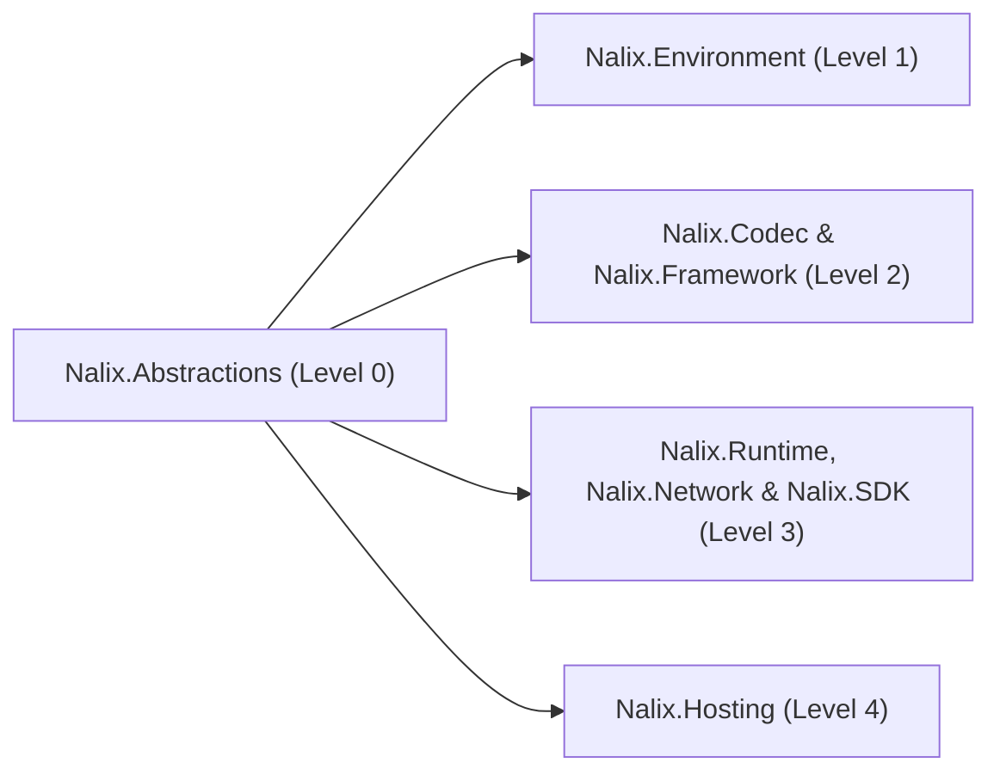

`Nalix.Abstractions` is the **Level 0** foundation of the Nalix ecosystem. It has zero external package dependencies and defines the shared interfaces, value types, attributes, and exceptions consumed by every server, client, and shared contract assembly.

:::tip[Bundled Roslyn Analyzers & Source Generators]
The `Nalix.Abstractions` NuGet package bundles `Nalix.Analyzers.dll`, `Nalix.Analyzers.CodeFixes.dll`, and `Nalix.Analyzers.Generators.dll` under `analyzers/dotnet/cs`. Referencing `Nalix.Abstractions` (directly or transitively) automatically activates all 75 compile-time diagnostics (`NALIX001`–`NALIX107`) and all 7 source generators.
:::

## Where It Fits



## Core Contract Categories

### 1. Packet & Serialization Contracts

These types define wire packets and instruct the Roslyn `SerializeFormatterGenerator` and `PacketRegistryGenerator` how to emit zero-reflection formatters and catalog entries at compile time.

**Key Components**

- `IPacket` — Base interface for all wire packets (`Header`, `Length`, `Serialize`, plus `ResetForPool()` inherited from `IPoolable`).
- `IPacketStaticOpcode` — Static abstract contract (`static abstract ushort StaticOpCode { get; }`) that binds a packet type to its 16-bit wire opcode.
- `IFixedSizeSerializable` — Static abstract contract (`static abstract int Size { get; }`) for fixed-size packets.
- `PacketAttribute` — Marks a packet class for automatic compile-time registration in `PacketRegistry`.
- `GenerateFormatterAttribute` — Instructs `SerializeFormatterGenerator` to generate a strongly-typed binary formatter.
- `SerializePackableAttribute`, `SerializeOrderAttribute`, `SerializeIgnoreAttribute`, `SerializeHeaderAttribute`, `SerializeDynamicSizeAttribute` — Fine-grained binary layout controls (`SerializeLayout.Explicit` or `SerializeLayout.Sequential`).
- `PacketHeader` & `PacketFlags` — The 6-byte wire header (`OpCode`, `Flags`, `Priority`, `SequenceId`) and bitflags (`NONE`, `COMPRESSED`, `ENCRYPTED`, `ALERT`, `FRAGMENTED`, `SYSTEM`).

### 2. Handler & Middleware Contracts

Used on the server to route incoming packets to handler methods and run cross-cutting middleware pipelines.

**Key Components**

- `PacketHandlerAttribute` — Marks a class as a packet handler controller discovered by `PacketHandlerGenerator`.
- `PacketOpcodeAttribute` — Binds a handler method to a specific 16-bit opcode.
- `PacketTransportAttribute` — Restricts a handler method to a specific `NetworkTransport` (`TCP`, `UDP`, `WEBSOCKET`).
- `PacketPermissionAttribute` — Declares the required `PermissionLevel` (`NONE`, `POW_VERIFIED`, `ESTABLISHED`, `GUEST`, `READ_ONLY`, `USER`, `SUPERVISOR`, `TENANT_ADMINISTRATOR`, `SYSTEM_ADMINISTRATOR`, `OWNER`) and `PermissionEvaluation` (`MinimumLevel` or `StrictMatch`).
- `PacketRateLimitAttribute` — Attaches per-endpoint rate limiting (`RequestsPerSecond`, `Burst`) to a handler.
- `PacketTimeoutAttribute` — Enforces an execution timeout (in milliseconds) on a handler method.
- `PacketEncryptionAttribute` — Requires the inbound packet to have arrived encrypted on the wire (`EncryptedOnWire`).
- `PacketIdempotentAttribute` — Marks a request packet as safe for automatic client retry on timeout.
- `IPacketContext<TPacket>` — Carries the deserialized `Packet`, `Connection`, `Sender` (`IPacketSender`), `Attributes`, and `CancellationToken`.
- `IPacketMiddleware<TPacket>` — Pipeline interceptor contract (`InvokeAsync`) ordered by `[MiddlewareOrder]` and `[MiddlewareStage]`.

```csharp
using Nalix.Abstractions.Networking;
using Nalix.Abstractions.Networking.Packets;
using Nalix.Abstractions.Security;

[PacketHandler("SamplePingHandlers")]
public sealed class SamplePingHandlers
{
    [PacketOpcode(0x1001)]
    [PacketTransport(NetworkTransport.TCP)]
    [PacketPermission(PermissionLevel.GUEST)]
    public ValueTask HandlePingAsync(IPacketContext<PingPacket> context)
        => context.Sender.SendAsync(context.Packet);
}
```

:::note[`PacketContext<T>` implementation]
`Nalix.Abstractions` defines the `IPacketContext<TPacket>` interface. The concrete pooled `PacketContext<TPacket>` implementation lives in `Nalix.Runtime.Dispatching`.
:::

### 3. Connection, Session & Transport Contracts

**Key Components**

- `IConnection` — Composite connection contract exposing identity (`ConnectionId`, `NetworkEndpoint`, `UserId`), transport (`TCP`, `UDP`, `WEBSOCKET`), `Attributes` (`IObjectMap<AttributeKey, object>`), `Level` (`PermissionLevel`), `Algorithm` (`CipherSuiteType`), `Secret`, error tracking (`IConnectionErrorTracked`), rate limiting, and traffic metrics (`IConnectionTrafficMetrics`).
- `IConnectionHub` — Server-wide registry for tracking, querying, and broadcasting to active connections.
- `IConnectionGuard` — Socket-level admission control, quota enforcement, and progressive IP banning.
- `IConnectionGroupRegistry` — Manages named connection groups for targeted broadcasts.
- `IProtocol` & `IListener` — Contracts for server transport listeners and frame-processing bridges.
- `ISessionService`, `ISessionStore`, `ISessionFactory`, `SessionSnapshot`, `SessionScope` — Contracts for stateless session persistence and atomic zero-RTT resumption across reconnects.

### 4. Memory, Pooling, Concurrency & DI Contracts

**Key Components**

- `IBufferLease` — Reference-counted/disposable pooled memory lease (`Span`, `Memory`, `Length`, `EncryptedOnWire`, `Retain()`).
- `BorrowedAttribute` — Marks an `IBufferLease` parameter as borrowed (the callee must not dispose it unless transferring ownership via `ref`).
- `SkipCleanAttribute` — Instructs `PacketSchemaGenerator` not to reset a field/property inside the generated `ResetForPool()` method.
- `IPoolable`, `IObjectPoolManager`, `IBufferPoolManager` — Object and buffer pool contracts.
- `ITaskManager`, `IWorker`, `IWorkerHandle`, `IRecurringHandle` — Background worker and recurring job contracts.
- `InjectAttribute`, `InjectableAttribute`, `FromScopeAttribute`, `IPacketScope` — Source-generated dependency injection contracts (`InstanceGenerator` and `PacketHandlerGenerator`).
- `RpcServiceAttribute` — Marks an interface for compile-time typed client extension generation via `RpcClientGenerator`.
- `ValueRangeAttribute`, `AllowedEnumAttribute`, `LengthAttribute`, `RequiredAttribute`, `DurationRangeAttribute`, `IValidatableConfiguration` — Declarative configuration validation attributes compiled by `ConfigurationGenerator`.

## Key API Pages

- [Packet Contracts](../api/abstractions/packet-contracts.md)
- [Connection Contracts](../api/abstractions/connection-contracts.md)
- [Session Contracts](../api/abstractions/session-contracts.md)
- [Packet Attributes](../api/abstractions/packet-attributes.md)
- [Packet Metadata](../api/abstractions/packet-metadata.md)
- [Concurrency Contracts](../api/abstractions/concurrency-contracts.md)
- [Serialization Attributes](../api/abstractions/serialization-attributes.md)
- [Dependency Injection Contracts](../api/abstractions/injection.md)
- [Validation Attributes](../api/abstractions/validation.md)
- [Enumerations](../api/abstractions/enums.md)
- [Control Types](../api/abstractions/protocols/control-type.md)
