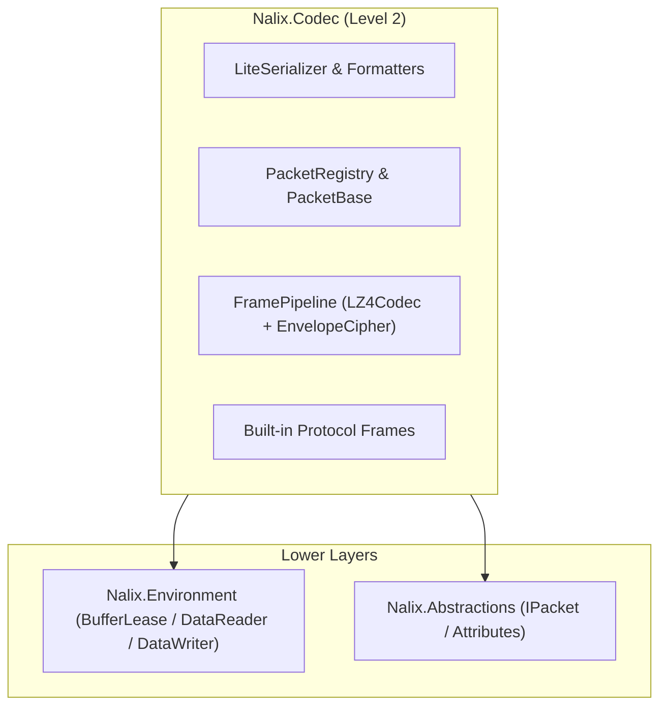
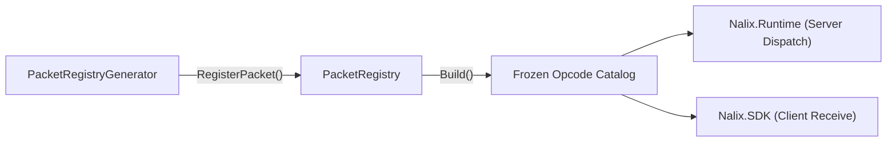

`Nalix.Codec` is the **Level 2** wire transformation package. It converts strongly-typed C# packet objects into framed binary payloads and back, integrating compile-time serialization (`LiteSerializer`), pooled LZ4 compression (`LZ4Codec`), AEAD encryption (`EnvelopeCipher`), fused frame pipelines (`FramePipeline`), and the process-wide `PacketRegistry`.

## Key Responsibilities

- **Serialization (`Nalix.Codec.Serialization`)**: Zero-reflection binary serialization via `LiteSerializer`, `FormatterProvider`, and `IFormatter<T>`.
- **Packet Catalog (`Nalix.Codec.DataFrames`)**: Base packet classes (`FrameBase`, `PacketBase<TSelf>`) and the frozen `PacketRegistry` lookup table.
- **Packet Pooling (`Nalix.Codec.Pooling`)**: `PacketFactory<TPacket>`, `PacketScope<TPacket>`, and `PacketBatchScope<TPacket>` for zero-allocation packet rental.
- **Compression (`Nalix.Codec.LZ4`)**: Pooled, zero-allocation LZ4 block compression and decompression via `LZ4Codec`.
- **Cryptography (`Nalix.Codec.Security`)**: `EnvelopeCipher` (`ChaCha20Poly1305`, `Salsa20Poly1305`, `ChaCha20`, `Salsa20`), `HandshakeX25519`, `ProofOfWork`, `Keccak256`, `HmacKeccak256`, and `Pbkdf2`.
- **Frame Transforms (`Nalix.Codec.Transforms`)**: `FramePipeline`, `FrameCipher`, `FrameCompression`, and `FrameTransformer` for inbound/outbound frame processing.

## Where It Fits



## Packet Registry Flow

At compile time, `PacketRegistryGenerator` discovers every class marked with `[Packet]` and emits a `[ModuleInitializer]` that registers its factory and deserializer into `PacketRegistry`. Calling `PacketRegistry.Build()` (done automatically by `NetworkApplicationBuilder`) freezes the catalog into a fast lookup table.



## Core Components

### `FrameBase` and `PacketBase<TSelf>`

Base classes for all wire packets. `PacketBase<TSelf>` implements `IPacket`, `IPoolable`, header stamping, and pooled deserialization/serialization helpers.

### `LiteSerializer` and `FormatterProvider`

The serialization engine. For packet classes annotated with `[GenerateFormatter]` and `[SerializePackable]`, `SerializeFormatterGenerator` emits a compile-time `IFormatter<T>` implementation and registers it with `FormatterProvider`, avoiding runtime reflection or IL generation.

### `FramePipeline`, `FrameCipher`, and `FrameCompression`

- `FramePipeline.ProcessOutbound(...)` applies outbound transforms in canonical wire order (**compress first, then encrypt**). When both compression and encryption are active, it uses a **fused single-lease path** (`ProcessOutboundFused`) and skips compression automatically if the payload does not shrink by at least 12.5%.
- `FramePipeline.TryProcessInbound(...)` applies inbound transforms in canonical wire order (**decrypt first, then decompress**), setting `EncryptedOnWire = true` and `ZeroOnDispose = true` on decrypted plaintext leases.

### Built-in Protocol Frames (`Nalix.Codec.ProtocolFrames`)

- **Control & Directives**: `Control` (`PING`, `PONG`, `DISCONNECT`, `PUBLIC_KEY_REQUEST`, etc.), `Directive` (throttling/error notices), `TimeSync`.
- **X25519 Handshake**: `SessionTofu`, `SessionInit`, `SessionChallenge`, `SessionProof`, `SessionEstablished`.
- **Session Resume**: `SessionResume` (unified frame using `SessionResumeStage` for `REQUEST` and `RESPONSE`).
- **Proof-of-Work**: `ProofOfWorkChallenge`, `ProofOfWorkProof`.

:::note[Memory and Fragmentation Primitives]
While `Nalix.Codec` performs serialization and frame transforms, the underlying memory primitives (`BufferLease`, `DataReader`, `DataWriter`) and fragmentation types (`FragmentHeader`, `FragmentAssembler`, `FragmentOptions`) reside in **[Nalix.Environment](./nalix-environment.md)**.
:::

## Quick Example

```csharp
using Nalix.Abstractions.Networking.Packets;
using Nalix.Abstractions.Primitives;
using Nalix.Codec.DataFrames;
using Nalix.Codec.ProtocolFrames;

// Freeze the packet catalog (called automatically when using Nalix.Hosting)
PacketRegistry.Build();

// Rent and initialize a built-in SessionInit handshake frame
SessionInit init = SessionInit.Create();
init.Initialize(
    new Bytes32(publicKeyBytes),
    new Bytes32(nonceBytes),
    PacketFlags.SYSTEM);

byte[] wireBytes = init.Serialize();
```

## Key API Pages

- [Serialization Basics](../api/codec/serialization/serialization-basics.md)
- [Packet Serialization](../api/codec/serialization/packet-serialization.md)
- [LZ4 Compression](../api/codec/lz4.md)
- [Frame Model](../api/codec/packets/frame-model.md)
- [Packet Registry](../api/codec/packets/packet-registry.md)
- [Built-in Frames](../api/codec/packets/built-in-frames.md)
- [Fragmentation](../api/codec/packets/fragmentation.md)
- [Cryptography](../api/security/cryptography.md)
