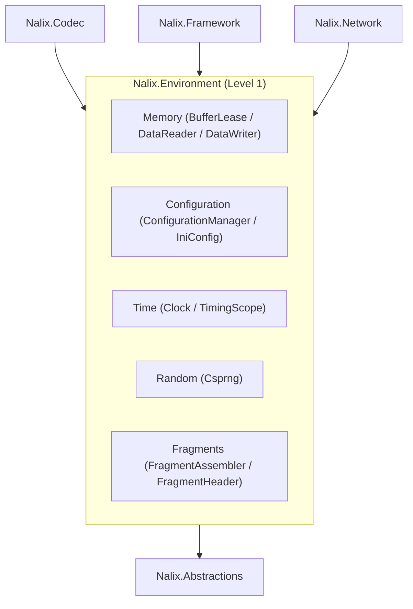

`Nalix.Environment` is the **Level 1** foundation package (depending only on `Nalix.Abstractions`). It provides the low-level memory primitives, configuration loader, monotonic clock, cryptographic random generator, and packet fragmentation engine shared across the entire stack.

## Key Responsibilities

- **Zero-Allocation Memory (`Nalix.Environment.Memory`)**: `BufferLease`, `DataReader`, `DataWriter`, and `Leb128` variable-length integer encoding.
- **Configuration (`Nalix.Environment.Configuration`)**: Typed `.ini` configuration binding via `ConfigurationManager`, `ConfigurationLoader`, and `IniConfig`.
- **Time & Latency (`Nalix.Environment.Time`)**: Drift-adjusted monotonic `Clock` and zero-allocation `TimingScope` measurements.
- **Cryptographic Random (`Nalix.Environment.Random`)**: Thread-safe `Csprng` backed by OS-native entropy (`BCryptGenRandom` on Windows, `getrandom` on Linux/Android, `SecRandomCopyBytes` on Apple platforms, and `/dev/urandom` fallback).
- **Packet Fragmentation (`Nalix.Environment.Fragments`)**: `FragmentHeader`, `FragmentAssembler`, `FragmentStreamId`, and `FragmentAssemblyResult` for splitting and reassembling oversized payloads.
- **Sequencing & Hashing (`Nalix.Environment.Sequencing`, `Nalix.Environment.Hashing`)**: Replay-window `SequenceCounter`, `XxHash32`, and `Sha1`.
- **Standardized Paths (`Nalix.Environment.IO`)**: Cross-platform application directories via `Directories`.

## Where It Fits



## Core Components

### `BufferLease`

A high-performance `IBufferLease` implementation backed by `ArrayPool<byte>.Shared`. It supports transport headroom reservation (`BufferLease.TransportHeadroom`), automatic cryptographic scrubbing on release (`ZeroOnDispose = true`), and reference-count retention (`Retain()`).

### `DataReader` and `DataWriter`

High-speed binary serialization cursor primitives operating directly over `ReadOnlySpan<byte>`, `Span<byte>`, `byte[]`, or `IBufferLease` without intermediate heap allocations.

### `ConfigurationManager` and `ConfigurationLoader`

The central registry for strongly-typed options classes inheriting from `ConfigurationLoader`. The `ConfigurationGenerator` source generator emits reflection-free INI binding and validation code at compile time.

```csharp
using Nalix.Environment.Configuration;
using Nalix.Environment.Options;

MemoryOptions memory = ConfigurationManager.Instance.Get<MemoryOptions>();
memory.Validate();
```

### `Clock` and `TimingScope`

- `Clock` provides high-resolution monotonic and UTC Unix timestamps (`Clock.MonoTicksNow()`, `Clock.MonoTicksToMilliseconds(long)`, `Clock.UnixMillisecondsNow()`, `Clock.UnixSecondsNow()`, `Clock.EpochMillisecondsNow()`, `Clock.NowUtc()`).
- `TimingScope` is a lightweight `readonly struct` (`using TimingScope scope = TimingScope.Start();`) for measuring elapsed microseconds or milliseconds on hot paths without allocating a `Stopwatch`.

### `Csprng`

Static cryptographically strong random number generator (`Csprng.Fill(Span<byte>)`, `Csprng.GetBytes(int)`, `Csprng.CreateNonce(int)`, `Csprng.GetInt32(int, int)`, `Csprng.NextUInt64()`). Uses rejection sampling for unbiased integer ranges and aborts with `CipherException` if OS entropy is unavailable.

### `FragmentAssembler` and `FragmentHeader`

Splits payloads exceeding `FragmentOptions.MaxChunkSize` (default `32_000` bytes) into chunks prefixed with an 8-byte wire `FragmentHeader` (`FragmentHeader.WireSize = 8`: `Magic`, `StreamId`, `ChunkIndex`, `TotalChunks`, `Flags`) and reassembles them safely on the receiver with bounded stream slots (`MaxOpenStreams = 64`) and timeout eviction (`ReassemblyTimeoutMs = 30_000`).

### `Directories`

Provides standardized, lazy-initialized paths (`BaseAssetsDirectory`, `ConfigurationDirectory`, `LogsDirectory`, `DataDirectory`, `TemporaryDirectory`, `StorageDirectory`, `DatabaseDirectory`, `CacheDirectory`, `UploadsDirectory`, `BackupsDirectory`) with Unix permission hardening where applicable.

## Key API Pages

- [Buffer Management](../api/environment/memory/buffer-management.md)
- [Configuration](../api/environment/configuration.md)
- [Directories](../api/environment/directories.md)
- [Clock & TimingScope](../api/environment/clock.md)
- [Random (Csprng)](../api/environment/random.md)
- [Sequencing (SequenceCounter)](../api/environment/sequencing.md)
- [Fragmentation](../api/codec/packets/fragmentation.md)
