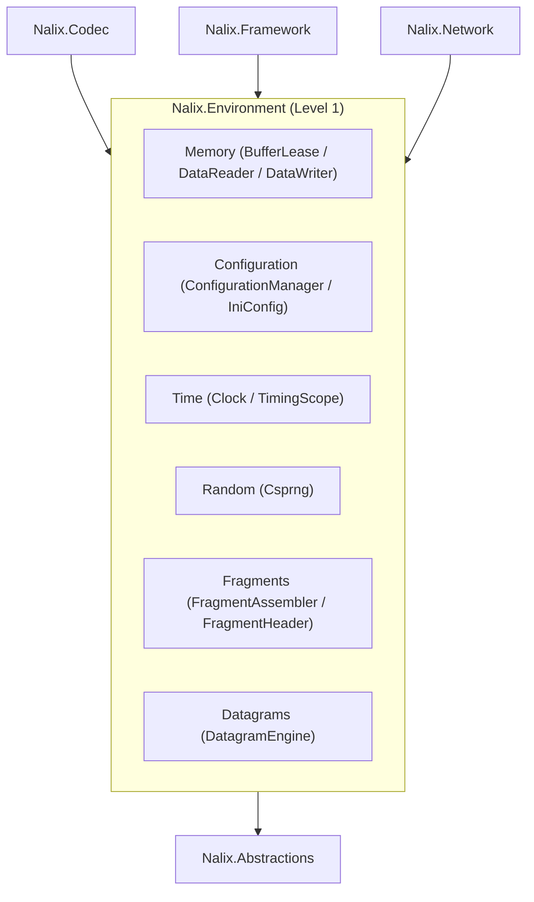

`Nalix.Environment` is the **Level 1** foundation package (depending only on `Nalix.Abstractions`). It provides the low-level memory primitives, configuration loader, monotonic clock, cryptographic random generator, and packet fragmentation engine shared across the entire stack.

## Key Responsibilities

- **Zero-Allocation Memory (`Nalix.Environment.Memory`)**: `BufferLease`, `DataReader`, `DataWriter`, and `Leb128` variable-length integer encoding.
- **Configuration (`Nalix.Environment.Configuration`)**: Typed `.ini` configuration binding via `ConfigurationManager`, `ConfigurationLoader`, and `IniConfig`.
- **Time & Latency (`Nalix.Environment.Time`)**: Drift-adjusted monotonic `Clock` and zero-allocation `TimingScope` measurements.
- **Cryptographic Random (`Nalix.Environment.Random`)**: Thread-safe `Csprng` backed by OS-native entropy (`BCryptGenRandom` on Windows, `getrandom` on Linux/Android, `SecRandomCopyBytes` on Apple platforms, and `/dev/urandom` fallback).
- **Packet Fragmentation (`Nalix.Environment.Fragments`)**: `FragmentHeader`, `FragmentAssembler`, `FragmentStreamId`, and `FragmentAssemblyResult` for splitting and reassembling oversized payloads.
- **Sequencing & Hashing (`Nalix.Environment.Sequencing`, `Nalix.Environment.Hashing`)**: Replay-window `SequenceCounter`, `XxHash32`, and `Sha1`.
- **Datagram Session Engine (`Nalix.Environment.Datagrams`)**: `DatagramEngine`, a socket-free ("sans-IO") protocol engine for one Nalix Datagram Protocol (NDP v1) session, with `DatagramEngineState`, `DatagramCloseCode`, `DatagramPeerLimits`, `IDatagramEngineHandler` and `DatagramEngineOptions`.
- **Standardized Paths (`Nalix.Environment.IO`)**: Cross-platform application directories via `Directories`.

## Where It Fits



## Core Components

### `BufferLease`

A high-performance `IBufferLease` implementation backed by `ArrayPool<byte>.Shared`. It supports transport headroom reservation (`BufferLease.TransportHeadroom`), automatic cryptographic scrubbing on release (`ZeroOnDispose = true`), and reference-count retention (`Retain()`).

### `DataReader` and `DataWriter`

High-speed binary serialization cursor primitives operating directly over `ReadOnlySpan<byte>`, `Span<byte>`, `byte[]`, or `IBufferLease` without intermediate heap allocations.

### `ConfigurationManager` and `ConfigurationLoader`

The central registry for strongly-typed options classes inheriting from `ConfigurationLoader`. The `ConfigurationGenerator` source generator emits reflection-free INI binding and validation code at compile time.

```csharp
using Nalix.Environment.Configuration;
using Nalix.Environment.Options;

MemoryOptions memory = ConfigurationManager.Instance.Get<MemoryOptions>();
memory.Validate();
```

### `Clock` and `TimingScope`

- `Clock` provides high-resolution monotonic and UTC Unix timestamps (`Clock.MonoTicksNow()`, `Clock.MonoTicksToMilliseconds(long)`, `Clock.UnixMillisecondsNow()`, `Clock.UnixSecondsNow()`, `Clock.EpochMillisecondsNow()`, `Clock.NowUtc()`).
- `TimingScope` is a lightweight `readonly struct` (`using TimingScope scope = TimingScope.Start();`) for measuring elapsed microseconds or milliseconds on hot paths without allocating a `Stopwatch`.

### `Csprng`

Static cryptographically strong random number generator (`Csprng.Fill(Span<byte>)`, `Csprng.GetBytes(int)`, `Csprng.CreateNonce(int)`, `Csprng.GetInt32(int, int)`, `Csprng.NextUInt64()`). Uses rejection sampling for unbiased integer ranges and aborts with `CipherException` if OS entropy is unavailable.

### `FragmentAssembler` and `FragmentHeader`

Splits payloads exceeding `FragmentOptions.MaxChunkSize` (default `32_000` bytes) into chunks prefixed with an 8-byte wire `FragmentHeader` (`FragmentHeader.WireSize = 8`: `Magic`, `StreamId`, `ChunkIndex`, `TotalChunks`, `Flags`) and reassembles them safely on the receiver with bounded stream slots (`MaxOpenStreams = 64`) and timeout eviction (`ReassemblyTimeoutMs = 30_000`).

### `DatagramEngine`

`DatagramEngine` (`public sealed partial class DatagramEngine : IDisposable`, namespace `Nalix.Environment.Datagrams`) is the protocol engine of one NDP v1 session. It does no socket I/O: the owner feeds received UDP payloads to `Receive`, sends whatever `Poll` produces, and calls `OnTimer` at `NextTimer`. All times are microseconds from a monotonic clock (`DatagramEngine.NowMicros()`). It implements packet numbers, AEAD protection through `IDatagramProtection`, ACK ranges, loss detection, NewReno congestion control with pacing, path MTU discovery, keepalive, idle timeout, close/draining, path validation, key update, and the `DeliveryMethod` modes on independent channels with fragmentation and advertised receive budgets. It is not thread-safe (the owner serializes all calls) and it owns and disposes the protection.

```csharp
using Nalix.Environment.Datagrams;
using Nalix.Environment.Options;

public DatagramEngine(
    DatagramEngineOptions options, DatagramPeerLimits peerLimits, IDatagramProtection protection,
    ulong connectionId, bool isServer, IDatagramEngineHandler handler, long now);
```

| Member | Description |
| :--- | :--- |
| `State` | Current `DatagramEngineState`. |
| `ConnectionId` | The connection identifier from the ticket. |
| `static bool TryReadConnectionId(ReadOnlySpan<byte>, out ulong)` | Reads the connection id from the cleartext header without authenticating, to route a datagram to its session. |
| `static long NowMicros()` | Monotonic time in microseconds for the `now` arguments. |
| `bool TrySend(ReadOnlySpan<byte> message, DeliveryMethod method, byte channel, byte priority, long now)` | Queues a message (copied). Returns `false` when the session is closing, the message is too large for its method, or the channel send queue is full. Messages above `MaxUnfragmentedMessageSize` are fragmented and need a reliable method. |
| `Task<bool>? TrySendWithReceipt(...)` | Same arguments as `TrySend`; reliable methods only (otherwise `ArgumentException`). The task completes with `true` once every fragment is acknowledged, or `false` if the session closed or a newer `ReliableSequenced` message replaced it. Returns `null` when not queued. |
| `void RaiseReceiveLimits(DatagramPeerLimits limits)` | Raises this side's advertised receive budgets (they never shrink); a LIMITS frame informs the peer. |
| `int Poll(Span<byte> destination, long now, out SocketAddress? path)` | Produces the next datagram (`destination` must be at least `MaxDatagramSize` bytes); returns the length or `0` when nothing is due. Call repeatedly after every `Receive`, `TrySend`, `Close` and `OnTimer`. `path` is non-null only for a path challenge to a non-active address. |
| `bool Receive(ReadOnlySpan<byte> datagram, SocketAddress? from, long now)` | Processes one received datagram; `true` when it authenticated and was processed. `from` is the sender on the server and `null` on the client. |
| `void OnTimer(long now)` | Runs due timers (idle timeout, draining, loss detection, probe timeout, keepalive, path validation retries, key discard, fragment expiry). |
| `long NextTimer` | Time of the next `OnTimer` call, or `long.MaxValue` when none is needed. |
| `void Close(DatagramCloseCode code, string? reason, long now, ulong applicationCode = 0)` | Queues a CLOSE frame for the next `Poll`, then drains. `IdleTimeout` is not allowed (`ArgumentException`); at most 256 UTF-8 bytes of `reason` are sent. |
| `Mtu`, `SmoothedRtt`, `CongestionWindow`, `BytesInFlight` | Current path MTU, smoothed RTT (microseconds), congestion window and bytes in flight. |
| `DatagramsSent`, `DatagramsReceived`, `DatagramsDropped`, `DatagramsLost` | Counters (received counts authenticated datagrams; dropped covers malformed, duplicate or unauthentic ones). |
| `ActivePath` | Validated peer address on the server; `null` before the first authenticated datagram and on the client. |
| `string GenerateReport()` | One-line statistics summary for diagnostics. |
| `Dispose()` | Releases the engine. |

Constants: `MinimumDatagramSize` (13-byte header + 1 + 16-byte tag), `MaxDatagramSize = 1472`, and `MaxUnfragmentedMessageSize` (`DatagramEngineOptions.MinimumMtu` minus header, tag bound and the largest MESSAGE frame header).

### `DatagramEngineState`, `DatagramCloseCode`, `DatagramPeerLimits`

- `DatagramEngineState : byte`: `Pending = 0` (no datagram authenticated yet), `Established = 1`, `Draining = 2` (CLOSE queued, sent or received), `Closed = 3`.
- `DatagramCloseCode : byte`: `NoError = 0`, `InternalError = 1`, `ProtocolViolation = 2`, `FrameEncodingError = 3`, `FlowControlError = 4`, `IdleTimeout = 5` (local only, never sent), `AeadLimitReached = 6`, `ApplicationError = 7`.
- `DatagramPeerLimits(long ReceiveBufferBytes, long ChannelReceiveBufferBytes)` is a `readonly record struct` with the receive budgets a peer advertised. `DatagramPeerLimits.Default` is derived from a default `DatagramEngineOptions`; `DatagramPeerLimits.From(DatagramEngineOptions)` builds the limits a side with those options advertises.

### `IDatagramEngineHandler`

Receives the engine output. Calls happen synchronously from the engine call that produced the event, under the owner's lock, so implementations should hand work off instead of blocking.

```csharp
public interface IDatagramEngineHandler
{
    void OnMessage(BufferLease message, DeliveryMethod method, byte channel);
    void OnClosed(DatagramCloseCode code, ulong applicationCode, string reason, bool remote);
}
```

`OnMessage` transfers ownership of `message` to the handler, which must dispose it. `OnClosed` is raised once; `applicationCode` is meaningful for `ApplicationError`, and `remote` is `true` when the peer closed the session.

### `DatagramEngineOptions`

`DatagramEngineOptions` (`Nalix.Environment.Options`, `sealed partial class : ConfigurationLoader, IValidatableConfiguration`) configures one side of a session; the server advertises channel count, idle timeout, message size and receive budgets in the ticket and the client uses the same values. Constants: `MinimumMtu = 1200`, `MaxChannels = 64`.

| Property | Default | Range |
| :--- | :--- | :--- |
| `ChannelCount` | `8` | 1..64 |
| `IdleTimeoutMs` | `15_000` | 100..3,600,000 |
| `MaxAckDelayMs` | `25` | 1..1,000 |
| `UnreliableExpiryMs` | `100` | 1..60,000 |
| `MaxMessageSize` | `1024 * 1024` | 1..64 MiB |
| `ReceiveBufferBytes` | `4 MiB` | >= 1 |
| `ChannelReceiveBufferBytes` | `2 MiB` | >= 1 |
| `SendQueueBytesPerChannel` | `4 MiB` | >= 1 |
| `MaxOpenFragmentStreams` | `64` | 1..65,535 |
| `FragmentTimeoutMs` | `10_000` | 100..3,600,000 |
| `EnableMtuProbing` | `true` | n/a |
| `KeyUpdatePacketInterval` | `1L << 23` | 16..2^40 |
| `KeyUpdateIntervalMs` | `3,600,000` (1 hour) | 1,000..7 days |

`Validate()` additionally throws `ValidationException` unless `ChannelReceiveBufferBytes >= MaxMessageSize + 65536`, `ReceiveBufferBytes >= ChannelReceiveBufferBytes` and `SendQueueBytesPerChannel >= MaxMessageSize`.

### `Directories`

Provides standardized, lazy-initialized paths (`BaseAssetsDirectory`, `ConfigurationDirectory`, `LogsDirectory`, `DataDirectory`, `TemporaryDirectory`, `StorageDirectory`, `DatabaseDirectory`, `CacheDirectory`, `UploadsDirectory`, `BackupsDirectory`) with Unix permission hardening where applicable.

## Key API Pages

- [Buffer Management](../api/environment/memory/buffer-management.md)
- [Configuration](../api/environment/configuration.md)
- [Directories](../api/environment/directories.md)
- [Clock & TimingScope](../api/environment/clock.md)
- [Random (Csprng)](../api/environment/random.md)
- [Sequencing (SequenceCounter)](../api/environment/sequencing.md)
- [Fragmentation](../api/codec/packets/fragmentation.md)

## Source Mapping

- `src/Nalix.Environment/Datagrams/DatagramEngine.cs`
- `src/Nalix.Environment/Datagrams/DatagramEngine.Types.cs`
- `src/Nalix.Environment/Datagrams/DatagramEngine.Report.cs`
- `src/Nalix.Environment/Datagrams/DatagramEngine.Cleanup.cs`
- `src/Nalix.Environment/Datagrams/DatagramEngineState.cs`
- `src/Nalix.Environment/Datagrams/DatagramCloseCode.cs`
- `src/Nalix.Environment/Datagrams/DatagramPeerLimits.cs`
- `src/Nalix.Environment/Datagrams/IDatagramEngineHandler.cs`
- `src/Nalix.Environment/Options/DatagramEngineOptions.cs`
