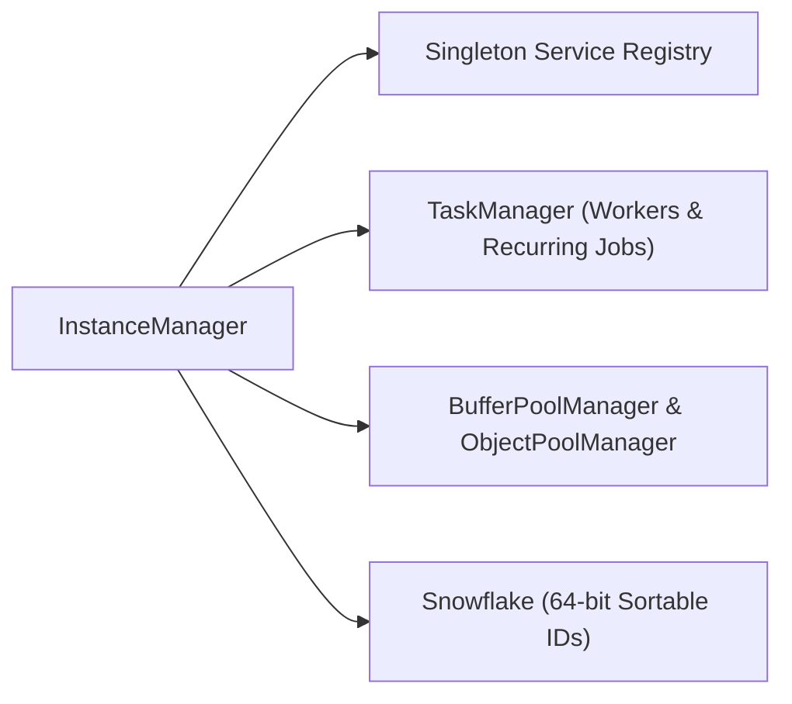

`Nalix.Framework` is the **Level 2** runtime services package (depending on `Nalix.Environment` and `Nalix.Abstractions`). It provides singleton service registration (`InstanceManager`), managed background workers and recurring timers (`TaskManager`), 64-bit sortable identifiers (`Snowflake`), and centralized pool managers (`BufferPoolManager` and `ObjectPoolManager`).

## Runtime Services Map



## Core Components

### `InstanceManager` (Dependency Injection)

`InstanceManager` (`Nalix.Framework.Injection.InstanceManager`) is the thread-safe singleton registry used across the stack to publish and resolve shared infrastructure (`ILogger`, `IConnectionHub`, `IConnectionGuard`, `IBufferPoolManager`, `IObjectPoolManager`, `ISessionService`).

Classes annotated with `[Injectable]` and subclasses of `SingletonBase<T>` have zero-reflection activators and service mappings generated at compile time by `InstanceGenerator` (while `[Inject]` fields and properties on `[PacketHandler]` controllers are wired by `PacketHandlerGenerator`).

```csharp
using Microsoft.Extensions.Logging;
using Nalix.Framework.Injection;
using Nalix.Framework.Tasks;

// Register a shared singleton instance
InstanceManager.Instance.Register<ILogger>(logger);

// Lazily resolve or create a managed service
TaskManager taskManager = InstanceManager.Instance.GetOrCreateInstance<TaskManager>();
```

### `TaskManager` (Background Workers & Recurring Jobs)

`TaskManager` (`Nalix.Framework.Tasks.TaskManager`) schedules and supervises named background workers (`ScheduleWorker`) and periodic recurring jobs (`ScheduleRecurring`) with group concurrency limits, cancellation propagation, and diagnostic reporting (`GenerateReport()`).

```csharp
using Nalix.Framework.Injection;
using Nalix.Framework.Tasks;

TaskManager manager = InstanceManager.Instance.GetOrCreateInstance<TaskManager>();

manager.ScheduleRecurring(
    "session.cleanup",
    TimeSpan.FromSeconds(30),
    async ct => await CleanupExpiredSessionsAsync(ct));
```

### `Snowflake` (64-bit Sortable Identifiers)

`Snowflake` (`Nalix.Framework.Identifier.Snowflake`) generates compact, time-sortable 64-bit identifiers (`ISnowflake`) incorporating machine ID, type tag (`SnowflakeType`), and monotonic sequence counters—ideal for connection IDs, session tokens, and entity identifiers.

### `BufferPoolManager` and `ObjectPoolManager`

While low-level `BufferLease` primitives reside in `Nalix.Environment`, `Nalix.Framework` owns the adaptive pool managers:

- `BufferPoolManager` (`Nalix.Framework.Memory.Buffers.BufferPoolManager`): Manages bucketed byte-array pools (`BufferConfig`), allocation metrics, and adaptive background trimming based on `BufferOptions`.
- `ObjectPoolManager` (`Nalix.Framework.Memory.Objects.ObjectPoolManager`): Manages strongly-typed `TypedObjectPool<T>` instances for `IPoolable` objects (configured via `ObjectPoolOptions`).
- `ObjectMap<TKey, TValue>` (`Nalix.Framework.Memory.Objects.ObjectMap<TKey, TValue>`): Sharded concurrent key-value map for high-read/write runtime lookups.

:::note[Where does `TimingScope` live?]
`TimingScope` lives in **`Nalix.Environment.Time`** so that both `Nalix.Environment` and `Nalix.Codec` can measure hot-path latencies without depending on `Nalix.Framework`.
:::

## Key API Pages

- [Instance Manager (DI)](../api/framework/instance-manager.md)
- [Task Manager](../api/framework/task-manager.md)
- [Snowflake Identifiers](../api/framework/snowflake.md)
- [Object Pooling](../api/framework/memory/object-pooling.md)
- [Typed Object Pools](../api/framework/memory/typed-object-pools.md)
- [Object Map](../api/framework/memory/object-map.md)
- [Buffer Management](../api/environment/memory/buffer-management.md)
- [Clock & TimingScope](../api/environment/clock.md)
