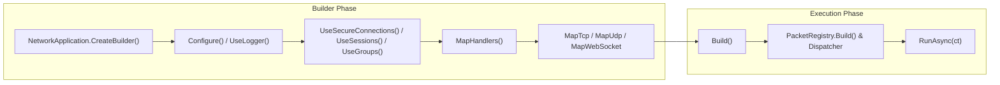

`Nalix.Hosting` is the **Level 4** application host package for Nalix servers. It provides an ASP.NET Core–style fluent builder (`NetworkApplication.CreateBuilder()`) that wires `PacketRegistry`, `PacketDispatchChannel`, `InstanceManager`, configuration files (`server.ini`), security handshakes, sessions, and TCP/UDP/WebSocket listeners into a unified lifecycle.

## Source Mapping

- `src/Nalix.Hosting/NetworkApplication.cs`
- `src/Nalix.Hosting/NetworkApplicationBuilder.cs`
- `src/Nalix.Hosting/INetworkApplicationBuilder.cs`
- `src/Nalix.Hosting/NetworkApplicationBuilder.Extensions.cs`
- `src/Nalix.Hosting/IProtocolBindingBuilder.cs`
- `src/Nalix.Hosting/IWebSocketBindingBuilder.cs`
- `src/Nalix.Hosting/Bootstrap.cs`
- `src/Nalix.Hosting/Protocols/DefaultProtocol.cs`

## Hosting Flow



## Core APIs

### `NetworkApplication`

The runnable server host implementing `IActivatableAsync`, `IReportable`, `IDisposable`, and `IAsyncDisposable`.

- `NetworkApplication.CreateBuilder()` — Creates a new `INetworkApplicationBuilder`.
- `ActivateAsync(CancellationToken)` / `DeactivateAsync(CancellationToken)` — Starts or stops the dispatcher and all bound listeners without blocking.
- `RunAsync(CancellationToken)` — Activates the host and awaits until the cancellation token is triggered, then gracefully deactivates.

### `INetworkApplicationBuilder` & Feature Extensions

| Method | Purpose |
| :--- | :--- |
| `Configure<TOptions>(Action<TOptions>)` | Mutates a `ConfigurationLoader` options instance before services are constructed. |
| `ConfigureDispatchOptions(Action<PacketDispatchOptions<IPacket>>)` | Configures middleware, error handling, and worker loops on the default dispatcher. |
| `ConfigureDispatch(Func<...>)` | Supplies a custom `IPacketDispatch` implementation. |
| `UseLogger(ILogger)` | Registers an `ILogger` into `InstanceManager` and bridges runtime `DiagnosticListener` events. |
| `UseConnectionHub(IConnectionHub)` | Registers a custom `IConnectionHub` instance. |
| `UseConnectionGuard(IConnectionGuard)` | Registers a custom `IConnectionGuard` instance. |
| `UseBufferPoolManager(IBufferPoolManager)` | Registers a custom `IBufferPoolManager` instance. |
| `UseObjectPoolManager(IObjectPoolManager)` | Registers a custom `IObjectPoolManager` instance. |
| `RegisterScoped<TService>(Func<IPacketScope, TService>)` | Registers a per-packet scoped service factory for `[FromScope]` handler parameters. |
| `MapHandlers<THandler>()` / `MapHandlers(Type)` | Registers a `[PacketHandler]` controller class (instance, factory, or `static` class). |
| `MapTcp<TProtocol>()` | Returns an `IProtocolBindingBuilder` (`OnPort(ushort)`, `WithFactory(...)`, `Bind()`) for TCP. |
| `MapUdp<TProtocol>()` | Returns an `IProtocolBindingBuilder` (`OnPort(ushort)`, `WithMode(OperatingMode)`, `WithAuthentication(Func<IConnection, EndPoint, ReadOnlySpan<byte>, bool>)`, `Bind()`) for UDP. |
| `MapWebSocket<TProtocol>()` | Returns an `IWebSocketBindingBuilder` (`OnPort(ushort)`, `WithPath(string)`, `MapGet(...)`, `MapPost(...)`, `Bind()`) for WebSocket. |
| `UseSecureConnections(string? certificatePath = null)` | *(Extension)* Enables X25519 handshake (`HandshakeHandlers`), Proof-of-Work (`ProofOfWorkHandlers`), `SystemControlHandlers`, and `FileCertificateStore`. |
| `UseSessions()` | *(Extension)* Enables stateless session resumption (`SessionHandlers`, `SessionService`, and `SessionPersistenceObserver`). |
| `UseGroups()` | *(Extension)* Registers `IConnectionGroupRegistry` (`InMemoryGroupStore`) and automatic disconnect cleanup (`GroupMembershipObserver`). |
| `UseSystemControl()` / `UseTimeSync()` | *(Extension)* Enables `SystemControlHandlers` or `SystemTimeSyncHandlers`. |

:::note[`MapTcp` / `MapUdp` / `MapWebSocket` replace `Listen*`]
`MapTcp<TProtocol>()`, `MapUdp<TProtocol>()`, and `MapWebSocket<TProtocol>()` are the canonical binding methods. The older `ListenTcp<TProtocol>()`, `ListenUdp<TProtocol>()`, and `ListenWebSocket<TProtocol>()` methods are marked `[Obsolete]` and delegate to `Map*`.
:::

### `Bootstrap` (Module Initializer)

When `Nalix.Hosting` loads, `Bootstrap.Initialize()` automatically sets the configuration path to `server.ini`, materializes default templates for all server option classes, applies `HostingOptions` (`MinWorkerThreads`, `MinCompletionPortThreads`, Windows 1 ms high-precision timer, global exception handlers), and prints the startup diagnostics banner in interactive consoles.

## Minimal Example

```csharp
using Microsoft.Extensions.Logging;
using Nalix.Hosting;
using Nalix.Hosting.Protocols;

await using NetworkApplication app = NetworkApplication.CreateBuilder()
    .UseLogger(logger)
    .UseSecureConnections()
    .UseSessions()
    .UseGroups()
    .MapHandlers<MyPacketHandlers>()
    .MapTcp<DefaultProtocol>().OnPort(57206).Bind()
    .Build();

await app.RunAsync(cts.Token);
```

## Suggested Reading

1. [Network Application API](../api/hosting/network-application.md)
2. [Hosting Options](../api/options/hosting/hosting-options.md)
3. [Nalix.Network](./nalix-network.md)
4. [Nalix.Runtime](./nalix-runtime.md)
