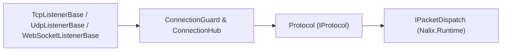

`Nalix.Network` is the **Level 3** server transport layer. It provides high-performance TCP, UDP, and WebSocket listeners, framed socket receive/send loops, connection admission control (`ConnectionGuard`), active connection tracking (`ConnectionHub`), proxy-protocol/forwarded-header parsing, and timing-wheel idle eviction.

:::note[For most projects, start with `Nalix.Hosting`]
`Nalix.Hosting` wraps `Nalix.Network` with a fluent builder (`MapTcp<TProtocol>()`, `MapUdp<TProtocol>()`, `MapWebSocket<TProtocol>()`) that manages listener and protocol lifecycles automatically. Use `Nalix.Network` directly when building a custom server host.
:::

## Where It Fits



## Core Components

### 1. Transport Listeners (`Nalix.Network.Listeners`)

| Listener | Transport | Description |
| :--- | :--- | :--- |
| `TcpListenerBase` | TCP | High-throughput socket listener using pooled `SocketAsyncEventArgs`, framed length-prefix receive loops, and optional PROXY protocol / forwarded headers support. |
| `UdpListenerBase` | UDP | Low-latency datagram listener with `DatagramGuard` source rate limiting and 8-byte session-token authentication. |
| `WebSocketListenerBase` | WebSocket | RFC 6455 WebSocket listener supporting path routing, subprotocol negotiation, and binary frame streaming. |

All listeners implement `IListener`, `IActivatable`, and `IReportable`:

- `Activate(CancellationToken)` / `Deactivate(CancellationToken)`
- `GenerateReport()` / `WriteReportData(Utf8JsonWriter)` for live diagnostics

### 2. Protocol Bridge (`Protocol`)

The `Protocol` abstract class (`Nalix.Network.Protocols.Protocol`) bridges raw transport connections to your packet dispatcher:

- **Frame processor & opcode extractor** — Exposes `abstract IFrameProcessor FrameProcessor { get; }` and `abstract IOpCodeExtractor OpCodeExtractor { get; }` (implemented automatically by `ApplicationProtocol` / `DefaultProtocol` in `Nalix.Hosting`).
- **Connection acceptance** — `ValidateConnection(IConnection)` gates newly accepted connections before registration.
- **Post-accept lifecycle** — `OnAccept(IConnection, CancellationToken)` runs after admission and hub registration.
- **Message processing** — `ProcessMessage(object? sender, IConnectionEventArgs args)` forwards framed `IBufferLease` payloads to `IPacketDispatch.HandlePacket(...)`.
- **Dynamic acceptance toggle** — `IsAccepting` and `SetConnectionAcceptance(bool)` atomically enable or pause new connection acceptance without tearing down active sockets.

```csharp
using Nalix.Abstractions.Networking;
using Nalix.Hosting.Protocols;

public sealed class GameProtocol : ApplicationProtocol
{
    public override void ProcessMessage(object? sender, IConnectionEventArgs args)
        => this.Dispatch.HandlePacket(args.Lease, args.Connection);

    protected override bool ValidateConnection(IConnection connection)
        => true;
}
```

### 3. Connections, Hub & Admission Guard

- **`SocketConnection` & `WebSocketConnection`** — Concrete `IConnection` implementations managing framed TCP/UDP/WebSocket transmission (`IConnectionTransmission`), sequence states, and pooled buffer leases.
- **`ConnectionHub`** — Sharded in-memory registry of active connections supporting lookup by `ISnowflake` ID, broadcast helpers, and diagnostic snapshots.
- **`ConnectionGuard`** — Multi-tier admission and abuse guard enforcing global connection ceilings, per-IP concurrent connection quotas, slowloris/error thresholds, and persistent bans (`FileBanStore`, `FileBlacklistStore`).
- **`TimingWheel`** — Hierarchical O(1) timer wheel that evicts idle connections without per-connection timer allocations.

## Configuration Options (`Nalix.Network.Options`)

| Options Class | Controls |
| :--- | :--- |
| `NetworkSocketOptions` | Port, IPv4/IPv6 dual-mode, backlog, `NoDelay`, buffer sizes, and socket tuning |
| `NetworkWebSocketOptions` | WebSocket bind path, handshake timeout, max frame size, and subprotocols |
| `ConnectionQuotaOptions` | Per-IP concurrent connection limits and connection accept rate limits |
| `ConnectionGuardOptions` | Global connection ceiling, error score thresholds, and progressive ban durations |
| `ConnectionBanStoreOptions` | File persistence and retention policies for dynamic IP bans |
| `ConnectionBlacklistStoreOptions` | Static/dynamic IP and CIDR blacklist file policies |
| `ConnectionHubOptions` | Sharding and capacity settings for `ConnectionHub` |
| `DatagramGuardOptions` | UDP per-endpoint packet rate limiting and state table eviction |
| `TimingWheelOptions` | Tick resolution, wheel slots, and idle connection timeout thresholds |
| `NetworkCallbackOptions` | Concurrency and flood protection thresholds for connection event callbacks |
| `TrustedProxyOptions` | Trusted proxy CIDR ranges for real client IP resolution |
| `ForwardedHeadersOptions` | `X-Forwarded-For` parsing policies |
| `ProxyProtocolOptions` | HAProxy PROXY protocol v1/v2 header parsing |

## Key API Pages

- [Protocol](../api/network/protocol.md)
- [TCP Listener](../api/network/tcp-listener.md)
- [UDP Listener](../api/network/udp-listener.md)
- [WebSocket Listener](../api/network/websocket-listener.md)
- [Connection](../api/network/connection/connection.md)
- [Connection Guard](../api/network/connection/connection-guard.md)
- [Connection Hub](../api/network/connection/connection-hub.md)
- [WebSocket Connection](../api/network/websocket-connection.md)
- [Network Options](../api/options/network/options.md)
