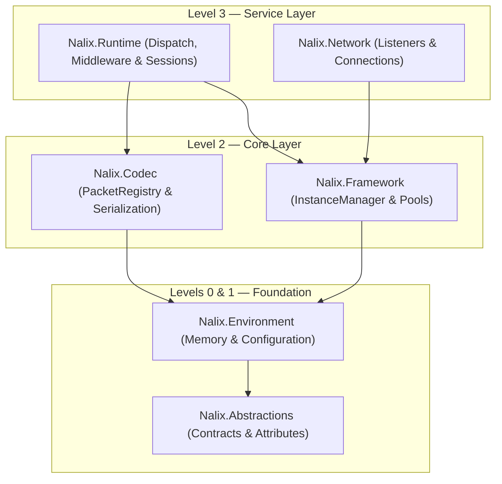

`Nalix.Runtime` is the **Level 3** server-side packet orchestration engine. It powers multi-threaded sharded packet dispatch (`PacketDispatchChannel`), inbound/outbound middleware execution (`MiddlewarePipeline<TPacket>`), zero-reflection handler invocation, rate-limiting primitives, and session resumption (`SessionService`).

## Source Mapping

- `src/Nalix.Runtime/Dispatching/PacketDispatchChannel.cs`
- `src/Nalix.Runtime/Dispatching/PacketDispatcherBase.cs`
- `src/Nalix.Runtime/Dispatching/PacketContext.cs`
- `src/Nalix.Runtime/Dispatching/PacketSender.cs`
- `src/Nalix.Runtime/Middleware/MiddlewarePipeline.cs`
- `src/Nalix.Runtime/Middleware/Standard/PermissionMiddleware.cs`
- `src/Nalix.Runtime/Middleware/Standard/RateLimitMiddleware.cs`
- `src/Nalix.Runtime/Middleware/Standard/TimeoutMiddleware.cs`
- `src/Nalix.Runtime/Handlers/HandshakeHandlers.cs`
- `src/Nalix.Runtime/Handlers/ProofOfWorkHandlers.cs`
- `src/Nalix.Runtime/Handlers/SessionHandlers.cs`
- `src/Nalix.Runtime/Handlers/SystemControlHandlers.cs`
- `src/Nalix.Runtime/Handlers/SystemTimeSyncHandlers.cs`
- `src/Nalix.Runtime/Sessions/SessionService.cs`
- `src/Nalix.Runtime/Groups/InMemoryGroupStore.cs`

:::note[Typically consumed via `Nalix.Hosting`]
Most server applications configure `Nalix.Runtime` through `NetworkApplication.CreateBuilder()` in `Nalix.Hosting` (using `MapHandlers`, `ConfigureDispatchOptions`, `UseSecureConnections`, `UseSessions`, and `UseGroups`). Construct `PacketDispatchChannel` directly only when building a custom host.
:::

## Where It Fits



## Core Components

### 1. Sharded Packet Dispatch (`PacketDispatchChannel`)

`PacketDispatchChannel` is the high-throughput engine that processes incoming network frames:

- **Fair per-connection scheduling & sharded worker loops** — Worker loops scale to CPU core count (or `WithDispatchLoopCount(...)`) and pull from priority-aware queues without head-of-line blocking across connections.
- **Priority queueing** — Frames are scheduled according to `PacketPriority` (`URGENT`, `HIGH`, `MEDIUM`, `LOW`, `NONE`) and `DispatchOptions` drop policies (`DropNewest`, `DropOldest`, `Block`, `Coalesce`).
- **Pre-handler encryption enforcement** — Verifies `[PacketEncryption]` (`context.IsEncrypted`) in `PacketHandler<TPacket>.CanExecute` before invoking the handler.
- **Zero-reflection handler invocation** — Resolves compiled handler delegates generated at build time by `PacketHandlerGenerator` (supporting `IPacketContext<TPacket>`, trailing `[FromScope]` reference-type parameters resolved from `context.Scope`, and `[Inject]` controller fields/properties).

```csharp
using Nalix.Abstractions.Networking.Packets;
using Nalix.Runtime.Dispatching;

PacketDispatchChannel dispatch = new(options =>
{
    options.WithErrorHandling((ex, opcode) =>
           {
               // Custom error hook for unhandled handler exceptions
           })
           .WithMiddleware(new MyAuditMiddleware())
           .WithHandler(() => new AccountHandlers());
});

dispatch.Activate();
```

### 2. Built-in Inbound Middleware (`Nalix.Runtime.Middleware.Standard`)

`Nalix.Runtime` ships three attribute-driven inbound middleware components in `Nalix.Runtime.Middleware.Standard`:

| Middleware | Order | Stage | Behavior |
| :--- | ---: | :--- | :--- |
| `PermissionMiddleware` | `-50` | `Inbound` | Enforces `[PacketPermission]` (`PermissionEvaluation.MinimumLevel` or `PermissionEvaluation.StrictMatch`) against `context.Connection.Level`. |
| `RateLimitMiddleware` | `50` | `Inbound` | Enforces per-opcode `[PacketRateLimit]` policies (`PolicyRateLimiter`) or falls back to global `TokenBucketLimiter`. |
| `TimeoutMiddleware` | `75` | `Inbound` | Wraps handler execution in a linked `CancellationTokenSource` governed by `[PacketTimeout]`. |

:::note[`[PacketPermission]` default-allow behavior]
If a handler method does not declare `[PacketPermission]` (`context.Attributes.Permission is null`), `PermissionMiddleware` allows the packet to proceed to the next stage. Always decorate authenticated or privileged handlers with `[PacketPermission(PermissionLevel.USER)]` (or place `[PacketPermission]` on the controller class).
:::

### 3. Protection & Throttling Primitives

- **`TokenBucketLimiter`**: Per-endpoint token bucket traffic shaper (`TokenBucketOptions`).
- **`PolicyRateLimiter`**: Enforces method-level `[PacketRateLimit]` quotas.
- **`DirectiveGuard`**: Prevents outbound `Directive` amplification under flood conditions (`DirectiveGuardOptions`).

### 4. Built-in Protocol Handlers (`Nalix.Runtime.Handlers`)

- **`HandshakeHandlers` & `ProofOfWorkHandlers`**: Server-side X25519 key exchange, TOFU public key serving, certificate storage (`FileCertificateStore`), and Proof-of-Work verification (`AdaptiveProofOfWorkPolicy`).
- **`SessionHandlers`**: Stateless session resumption (`SessionResume`) with `HmacKeccak256` proof-of-possession and atomic token rotation via `ISessionService`.
- **`SystemControlHandlers` & `SystemTimeSyncHandlers`**: Handles `Control` (`PING`/`PONG`, `DISCONNECT`, `CIPHER_UPDATE`, `PUBLIC_KEY_REQUEST`) and `TimeSync` frames.

### 5. Session Store & Connection Groups

- **`SessionService`, `SessionFactory`, `InMemorySessionStore`, `SessionPersistenceObserver`**: Captures `SessionSnapshot` state on disconnect and restores encryption keys, permission levels, and attributes on valid `SessionResume` requests.
- **`InMemoryGroupStore` & `GroupMembershipObserver`**: Implements `IConnectionGroupRegistry` for room/channel broadcasting and automatically removes disconnected clients from all groups.

## Supported Handler Return Shapes

| Return Type | Runtime Behavior |
| :--- | :--- |
| `void` / `Task` / `ValueTask` | Executes side-effects; sends no automatic reply. |
| `TPacket` / `Task<TPacket>` / `ValueTask<TPacket>` | Serializes and sends the returned packet back on the caller's connection (`ReplyAsync` stamps the request's `SequenceId` when `response.Header.SequenceId == 0`). |
| `IAsyncEnumerable<TPacket>` | Server-streams each yielded packet via `ReplyAsync` with 1-item look-ahead and marks `IPacketStreamable.IsEndOfStream = true` on the final packet. |
| `byte[]` / `Memory<byte>` / `ReadOnlyMemory<byte>` | Sends the raw buffer directly to the caller's connection. |
| `ReturnValidation` | Evaluates declarative validation result before continuing. |

## Related Packages

- [Nalix.Network](./nalix-network.md) — TCP, UDP, and WebSocket transport listeners
- [Nalix.Hosting](./nalix-hosting.md) — Fluent server builder
- [Nalix.Codec](./nalix-codec.md) — Packet registry, serialization, and frame transforms
- [Nalix.Framework](./nalix-framework.md) — DI, workers, and object pools

## Key API Pages

- [Packet Dispatch](../api/runtime/routing/packet-dispatch.md)
- [Packet Dispatch Options](../api/options/runtime/packet-dispatch-options.md)
- [Middleware Pipeline](../api/runtime/middleware/pipeline.md)
- [Permission Middleware](../api/runtime/middleware/permission-middleware.md)
- [Policy Rate Limiter](../api/runtime/middleware/policy-rate-limiter.md)
- [Token Bucket Limiter](../api/runtime/middleware/token-bucket-limiter.md)
- [Timeout Middleware](../api/runtime/middleware/timeout-middleware.md)
- [Handler Return Types](../api/runtime/routing/handler-results.md)
- [Dispatch Options](../api/options/runtime/dispatch-options.md)
- [Session Store & Service](../api/network/session-store.md)
