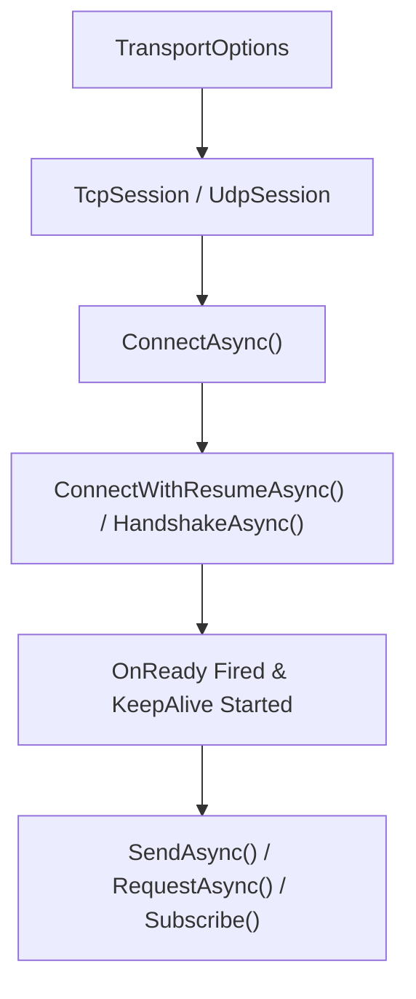

`Nalix.SDK` is the **Level 3** client-side transport package for connecting .NET 10 applications (console, desktop, mobile, or Unity/Godot clients) to a Nalix server over TCP or UDP.

:::tip[Start with `TcpSession`]
`TcpSession` is the primary client session type. It manages socket connection, background framed receive loops, automatic keepalive PING/PONG probes, exponential-backoff reconnects (`ReconnectSupervisor`), X25519 handshakes, and zero-race request/response correlation.
:::

## Client Connection Flow



## Core Components

- **`TransportSession`** — Abstract base class implementing `ITransportSession`, `State` (`SessionState`), `WaitUntilReadyAsync`, `OnConnected`, `OnReady`, `OnDisconnected`, `OnMessageReceived`, `OnError`, keepalive probing, and pending-request correlation.
- **`TcpSession`** — Framed TCP client session with `SocketAsyncEventArgs` pooling and automatic reconnect support.
- **`UdpSession`** — Companion or standalone UDP datagram session that automatically prepends the 8-byte `SessionToken` negotiated on TCP.
- **`SessionState`** — Ephemeral runtime state (`Secret`, `SessionToken`, `EncryptionEnabled`, `LocalPort`) separated from persistent `TransportOptions`.
- **Transport Extensions (`Nalix.SDK.Transport.Extensions`)**:
  - `HandshakeExtensions` (`HandshakeAsync`)
  - `ResumeExtensions` (`ResumeSessionAsync`, `ConnectWithResumeAsync`)
  - `RequestExtensions` (`RequestAsync<TResponse>`, `TryRequestAsync<TResponse>`, `CallAsync<TResponse>`)
  - `StreamExtensions` (`StreamAsync<TResponse>`)
  - `ControlExtensions` & `PingExtensions` (`NewControl`, `SendControlAsync`, `AwaitControlAsync`, `PingAsync`, `SyncTimeAsync`)
  - `CipherExtensions` & `RekeyExtensions` (`UpdateCipherAsync`, `RekeyAsync`)
  - `TransportSessionSubscriptions` (`On<TPacket>`, `OnExact<TPacket>`, `Subscribe(params IDisposable[])`)
- **Thread Dispatching (`Nalix.SDK.Dispatch`)** — `IThreadDispatcher` and `InlineDispatcher` for marshaling received packets onto game-engine or UI main threads.
- **Typed RPC Client Generation (`[RpcService]`)** — `RpcClientGenerator` automatically generates `<ServiceName>_RpcClient` implementations resolved via `session.CreateRpcClient<TService>()` for interfaces annotated with `[RpcService]`.

## Quick Example

```csharp
using Nalix.SDK.Options;
using Nalix.SDK.Transport;
using Nalix.SDK.Transport.Extensions;

TransportOptions options = new()
{
    Address = "127.0.0.1",
    Port = 57206,
    AutoReconnectEnabled = true
};

using TcpSession client = new(options);
client.OnConnected += (_, _) => Console.WriteLine("Socket connected");
client.OnReady += (_, _) => Console.WriteLine("Handshake/resume complete");
client.OnDisconnected += (_, ex) => Console.WriteLine($"Disconnected: {ex?.Message}");

await client.ConnectAsync();
await client.HandshakeAsync(); // Negotiates X25519 session secret & enables encryption

MyResponsePacket reply = await client.RequestAsync<MyResponsePacket>(
    new MyRequestPacket(),
    RequestOptions.Default.WithTimeout(5_000).WithEncrypt());

await client.DisconnectAsync();
```

## `TransportOptions` Reference (`Nalix.SDK.Options`)

`TransportOptions` inherits from `ConfigurationLoader` and can be constructed directly in code or loaded from INI via `ConfigurationManager.Instance.Get<TransportOptions>()`.

| Property | Default | Validation / Source Notes |
| :--- | ---: | :--- |
| `Address` | `"127.0.0.1"` | `[Length(1)]` Server IP address or hostname. |
| `Port` | `57206` | `[ValueRange(1, 65535)]` Target server port. |
| `ConnectTimeoutMillis` | `30000` | `[ValueRange(0, int.MaxValue)]` `0` disables the connect timeout. |
| `NoDelay` | `true` | Controls `TCP_NODELAY` (disables Nagle's algorithm). |
| `BufferSize` | `65536` | `[ValueRange(2048, 1048576)]` Socket send/receive buffer size in bytes. |
| `Algorithm` | `Chacha20Poly1305` | `CipherSuiteType` used when encryption is enabled. |
| `CompressionEnabled` | `true` | Enables LZ4 compression for outbound frames exceeding `CompressionThreshold`. |
| `CompressionThreshold` | `512` | Minimum payload size in bytes to trigger LZ4 compression. |
| `AsyncQueueCapacity` | `1024` | `[ValueRange(1, 65536)]` Reserved capacity setting. |
| `MaxUdpDatagramSize` | `1400` | `[ValueRange(64, 65507)]` Max UDP datagram bytes including the 8-byte session token. |
| `ServerPublicKey` | `null` | Optional pinned X25519 server public key in HEX for MitM protection. |
| `AllowTofu` | `true` | Allows Trust-On-First-Use (TOFU) public key discovery when `ServerPublicKey` is unset. |
| `PersistTofuKey` | `false` | Persists a TOFU-discovered `ServerPublicKey` to configuration storage after verification. |
| `ResumeEnabled` | `true` | Attempts `SessionResume` before falling back to a full X25519 handshake. |
| `ResumeTimeoutMillis` | `3000` | `[ValueRange(100, int.MaxValue)]` Timeout in ms for session resume requests. |
| `ResumeFallbackToHandshake` | `true` | Automatically falls back to a fresh handshake if session resume fails. |
| `AutoReconnectEnabled` | `false` | Automatically reconnects via `ReconnectSupervisor` on unexpected disconnects. |
| `ReconnectBaseDelayMillis` | `500` | `[ValueRange(1, int.MaxValue)]` Initial backoff delay in ms before the first reconnect. |
| `ReconnectMaxDelayMillis` | `30000` | `[ValueRange(1, int.MaxValue)]` Exponential backoff cap in ms between reconnects. |
| `ReconnectMaxAttempts` | `0` | `[ValueRange(0, int.MaxValue)]` Max consecutive reconnect attempts (`0` = unlimited). |
| `KeepAliveIntervalMillis` | `0` | `[ValueRange(0, int.MaxValue)]` Periodic PING interval in ms (`0` = disabled). |
| `KeepAliveTimeoutMillis` | `5000` | `[ValueRange(100, int.MaxValue)]` Timeout in ms for each keepalive PONG reply. |
| `KeepAliveMissThreshold` | `3` | `[ValueRange(1, int.MaxValue)]` Missed PONGs before faulting the socket for reconnect. |
| `TimeSyncEnabled` | `true` | Allows `SyncTimeAsync` to synchronize the local monotonic/Unix clock offset. |
| `TimeOffsetMs` | `0.0` | Current clock offset in milliseconds applied by time synchronization. |

:::note[`SessionState` vs. `TransportOptions`]
Ephemeral session values—`Secret` (`Bytes32`), `SessionToken` (`ulong`), `EncryptionEnabled` (`bool`), and `LocalPort` (`int`)—live on `session.State` (`SessionState`), keeping runtime cryptographic keys cleanly separated from persistent `TransportOptions`.
:::

## `RequestOptions` Reference (`Nalix.SDK.Options`)

| Property | Default | Validation / Source Notes |
| :--- | ---: | :--- |
| `TimeoutMs` | `5000` | Must be `>= 0`; `0` waits indefinitely. Configured via `.WithTimeout(ms)`. |
| `RetryCount` | `0` | Must be `>= 0`; retries occur **only** on `TimeoutException`. Configured via `.WithRetry(count)`. |
| `Encrypt` | `false` | Encrypts the outbound request frame. Configured via `.WithEncrypt(bool)`. |

## Key API Pages

- [Transport Session](../api/sdk/transport-session.md)
- [TCP Session](../api/sdk/tcp-session.md)
- [Handshake Extensions](../api/sdk/handshake-extensions.md)
- [Resume Extensions](../api/sdk/resume-extensions.md)
- [Session Extensions](../api/sdk/tcp-session-extensions.md)
- [Cipher Extensions](../api/sdk/cipher-extensions.md)
- [Request Options](../api/options/sdk/request-options.md)
- [Session Diagnostics](../api/sdk/diagnostics.md)
- [Thread Dispatching](../api/sdk/thread-dispatching.md)
