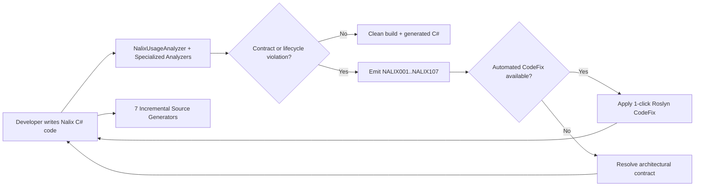

`Nalix.Analyzers` và `Nalix.Analyzers.Generators` cung cấp **75 chẩn đoán Roslyn lúc biên dịch** (`NALIX001`–`NALIX107`), **16 provider sửa lỗi tự động**, và **7 incremental source generator**. Cả hai assembly analyzer được đóng gói tự động trong gói NuGet `Nalix.Abstractions`.

## Ánh xạ mã nguồn

- `analyzers/Nalix.Analyzers/Diagnostics/DiagnosticDescriptors.cs` (67 descriptor của analyzer)
- `analyzers/Nalix.Analyzers.Generators/Internal/GeneratorDiagnosticDescriptors.cs` (8 descriptor của source generator)
- `analyzers/Nalix.Analyzers/Analyzers/NalixUsageAnalyzer.cs`
- `analyzers/Nalix.Analyzers/Analyzers/NalixUsageAnalyzer.SymbolSet.cs`
- `analyzers/Nalix.Analyzers/Analyzers/NalixUsageAnalyzer.InvocationAnalysis.cs`
- `analyzers/Nalix.Analyzers/Analyzers/NalixUsageAnalyzer.RpcService.cs`
- `analyzers/Nalix.Analyzers.CodeFixes/*.cs` (16 provider sửa lỗi)
- `analyzers/Nalix.Analyzers.Generators/*.cs` (7 incremental source generator)

## Luồng analyzer

## Bề mặt chẩn đoán (`NALIX001`–`NALIX107`)

Tập descriptor đang hoạt động gồm **75 chẩn đoán** (67 trong `Nalix.Analyzers` và 8 trong `Nalix.Analyzers.Generators`). Các mã `NALIX007`, `NALIX019`, `NALIX029`, `NALIX031`, `NALIX049` và `NALIX053` đã bị loại bỏ khi các đường dẫn `INetworkBufferMiddleware` và reflection kiểu cũ được gỡ bỏ.

| Khu vực | Mã | Mục đích |
| --- | --- | --- |
| **Điều phối controller & đăng ký gói tin** | `NALIX001`–`NALIX005`, `NALIX008`–`NALIX012`, `NALIX017`–`NALIX018`, `NALIX035`–`NALIX036`, `NALIX047`–`NALIX048`, `NALIX050`, `NALIX052`, `NALIX054`–`NALIX056`, `NALIX058`, `NALIX067`–`NALIX068`, `NALIX106` | Kiểm tra controller `[PacketHandler]`, chữ ký handler `IPacketContext<TPacket>`, tham số `[FromScope]`, tính duy nhất của opcode (`StaticOpCode` & `[PacketOpcode]`), giới hạn số vòng lặp dispatch (`1..64`), và hợp đồng `Deserialize`. |
| **Middleware & metadata định tuyến** | `NALIX006`, `NALIX025`–`NALIX026`, `NALIX030`, `NALIX032`–`NALIX033`, `NALIX038` | Thực thi `[MiddlewareOrder]`, tính tương thích kiểu gói tin của middleware, quy tắc stage của `AlwaysExecute`, các guard của metadata builder, và tính nhất quán opcode trong XML. |
| **Tuần tự hóa & bố cục schema** | `NALIX013`–`NALIX016`, `NALIX021`–`NALIX022`, `NALIX034`, `NALIX046`, `NALIX051`, `NALIX059`–`NALIX060` | Kiểm tra `SerializeLayout.Explicit`, `[SerializeOrder]`, xung đột `[SerializeHeader]`, `IFixedSizeSerializable`, method `Create()` tĩnh trên kiểu tham chiếu `[GenerateFormatter]`, và modifier `partial` trên các kiểu `PacketBase<TSelf>`. |
| **DI, cấu hình, RPC, SDK & hosting** | `NALIX020`, `NALIX023`–`NALIX024`, `NALIX027`–`NALIX028`, `NALIX037`, `NALIX039`–`NALIX045`, `NALIX057`, `NALIX063`–`NALIX066`, `NALIX100`–`NALIX105`, `NALIX107` | Kiểm tra độ đầy đủ của `ResetForPool()`, khả năng bind của `.ini`, giới hạn `RequestOptions`, việc giải phóng `IBufferLease`, thiết lập `NetworkApplicationBuilder`, constructor của `[Injectable]` / `SingletonBase<T>`, khả năng gán lại của field `[Inject]`, và hợp đồng `[RpcService]`. |
| **Bảo mật, pooling & AOT** | `NALIX071`–`NALIX076`, `NALIX078` | Ngăn `IPacketContext<T>` thoát khỏi phạm vi handler (`NALIX076`), bắt buộc `using` cho `PacketScope<T>` (`NALIX075`), và bảo vệ các assembly Nalix Core khỏi mật mã chưa được rà soát, cấp phát bộ nhớ ở endpoint trên hot path, catch không có bộ lọc, và reflection không tương thích AOT. |

Bảng đầy đủ của cả 75 chẩn đoán xem tại [Mã chẩn đoán](./diagnostic-codes.md).

## Độ phủ code fix tự động

`Nalix.Analyzers.CodeFixes` cung cấp 16 provider sửa lỗi Roslyn có mục tiêu, bao phủ **20 mã chẩn đoán đang hoạt động** (cộng với `NALIX031` đã bị loại bỏ):

| Danh mục | Provider sửa lỗi | Chẩn đoán được sửa |
| --- | --- | --- |
| **Hình dạng gói tin & controller** | `PacketHandlerCodeFixProvider`, `PacketOpcodeCodeFixProvider`, `PacketDeserializeCodeFixProvider`, `PacketRegistryDeserializerCodeFixProvider`, `PacketSelfTypeCodeFixProvider`, `GenericPacketHandlerCodeFixProvider` | `NALIX002`, `NALIX008`, `NALIX009`, `NALIX010`, `NALIX011`, `NALIX012`, `NALIX052`, `NALIX058` |
| **Thuộc tính tuần tự hóa** | `SerializeOrderMissingCodeFixProvider`, `DuplicateSerializeOrderCodeFixProvider`, `SerializationConflictCodeFixProvider` | `NALIX013`, `NALIX014`, `NALIX015` |
| **Thiết lập middleware & dispatch** | `MiddlewareCodeFixProvider`, `NullMiddlewareCodeFixProvider`, `DispatchLoopCountCodeFixProvider` | `NALIX030`, `NALIX032`, `NALIX047`, `NALIX056` |
| **Tùy chọn cấu hình & SDK** | `ConfigurationIgnoreCodeFixProvider`, `RequestOptionsConsistencyCodeFixProvider` | `NALIX023`, `NALIX024`, `NALIX057` |
| **Dọn dẹp pooling & vòng đời** | `ResetForPoolCodeFixProvider`, `RedundantPacketCastCodeFixProvider` | `NALIX020`, `NALIX055` |

Xem [Tài liệu tham chiếu Code Fixes](./code-fixes.md) để biết chính xác biến đổi mà từng provider thực hiện.

## Incremental Source Generator

`Nalix.Analyzers.Generators` gồm 7 generator lúc biên dịch:

1. [**Packet Handler Generator** (PacketHandlerGenerator)](./autogen/packet-handler-generator.md) — Biên dịch controller `[PacketHandler]` thành delegate `IPacketHandlerCompiler` không dùng reflection và sinh `InitializeDependencies()` cho các thành viên `[Inject]`.
2. [**Instance Generator** (InstanceGenerator)](./autogen/instance-generator.md) — Sinh các delegate kích hoạt nhiều constructor an toàn với AOT cho service `[Injectable]` và lớp con `SingletonBase<T>`.
3. [**Serialization Generator** (SerializeFormatterGenerator)](./autogen/serialization-generator.md) — Sinh implementation `IFormatter<T>` và `IFillableFormatter<T>` cho kiểu `[GenerateFormatter]`.
4. [**Packet Registry Generator** (PacketRegistryGenerator)](./autogen/packet-registry-generator.md) — Sinh `PacketRegistryGenerated.Initialize()` gọi `PacketRegistry.RegisterGenerated<TPacket>` cho các kiểu `IPacket` cụ thể.
5. [**Packet Schema Generator** (PacketSchemaGenerator)](./autogen/packet-schema-generator.md) — Sinh `Length`, `ResetForPool()` và `Size` (khi implement `IFixedSizeSerializable`) cho các kiểu `PacketBase<TSelf>` là `partial`.
6. [**Configuration Generator** (ConfigurationGenerator)](./autogen/configuration-generator.md) — Sinh `CopyPropertiesTo`, `BindProperties` và `ValidateDataAnnotations` cho các lớp con `ConfigurationLoader`.
7. [**RPC Client Generator** (RpcClientGenerator)](./autogen/index.md#bộ-sinh-rpc-client-rpcclientgenerator) — Sinh các implementation `<Service>_RpcClient` được đăng ký qua `RpcExtensions.RegisterFactory` cho interface `[RpcService]`.

## API liên quan

- [Mã chẩn đoán](./diagnostic-codes.md)
- [Tài liệu tham chiếu Code Fixes](./code-fixes.md)
- [Tổng quan Source Generator](./autogen/index.md)
- [Network Application Builder](../hosting/network-application.md)
- [Serialization Basics](../codec/serialization/serialization-basics.md)
- [Packet Registry](../codec/packets/packet-registry.md)
