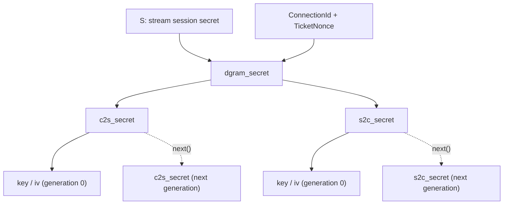

**Namespace:** `Nalix.Codec.Security.Datagram`  
**Assembly:** `Nalix.Codec`

Trang này nói về lớp bảo vệ AEAD của các phiên Nalix Datagram Protocol (NDP v1): `ChaCha20Poly1305DatagramProtection`, factory không trạng thái `ChaCha20Poly1305DatagramProtectionFactory` và lớp tĩnh `DatagramKeySchedule` dùng để dẫn xuất mọi khóa, IV và nonce. Các hợp đồng mà chúng triển khai, `IDatagramProtection` và `IDatagramProtectionFactory`, nằm trong `Nalix.Abstractions.Networking.Datagrams`, nhờ đó tầng truyền tải có thể niêm phong datagram mà không cần tham chiếu đến mã mật mã.

## Source Mapping

- `src/Nalix.Codec/Security/Datagram/ChaCha20Poly1305DatagramProtection.cs`
- `src/Nalix.Codec/Security/Datagram/ChaCha20Poly1305DatagramProtectionFactory.cs`
- `src/Nalix.Codec/Security/Datagram/DatagramKeySchedule.cs`
- `src/Nalix.Abstractions/Networking/Datagrams/IDatagramProtection.cs`
- `src/Nalix.Abstractions/Networking/Datagrams/IDatagramProtectionFactory.cs`
- `src/Nalix.Codec/Security/HkdfKeccak256.cs`
- `src/Nalix.Environment/Datagrams/DatagramEngine.cs` (bên gọi: dựng header và truyền vào làm AAD)
- `src/Nalix.Environment/Datagrams/Wire/DatagramHeader.cs` (bố cục header)

## Public Types at a Glance

| Type | Kind | Role |
| --- | --- | --- |
| `ChaCha20Poly1305DatagramProtection` | `public sealed class`, implements `IDatagramProtection` | Niêm phong và mở datagram; giữ các thế hệ khóa theo từng chiều và trạng thái key-phase (`ChaCha20Poly1305DatagramProtection.cs:16`). |
| `ChaCha20Poly1305DatagramProtectionFactory` | `public sealed class`, implements `IDatagramProtectionFactory` | Factory không trạng thái với `Instance` dùng chung (`ChaCha20Poly1305DatagramProtectionFactory.cs:13-18`). |
| `DatagramKeySchedule` | `public static class` | Dẫn xuất bằng HKDF-Keccak256 các secret theo chiều, khóa, IV, secret kế tiếp và nonce cho từng gói tin (`DatagramKeySchedule.cs:22`). |

:::note[An toàn đa luồng]
`ChaCha20Poly1305DatagramProtection` không an toàn đa luồng; phiên datagram tuần tự hóa các lời gọi (`ChaCha20Poly1305DatagramProtection.cs:15`, `IDatagramProtection.cs:12-14`). Một packet number chỉ được niêm phong tối đa một lần cho mỗi khóa; bên gọi không bao giờ dùng lại (`IDatagramProtection.cs:14`).
:::

## Key Schedule

`DatagramKeySchedule` được xây dựng trên `HkdfKeccak256` (`DatagramKeySchedule.cs:12`). Mỗi bước là một HKDF-Expand một khối với đầu ra 32 byte: `OKM = HMAC-Keccak256(PRK, info || 0x01)` (`HkdfKeccak256.cs:43,63-65`). `info` dài tối đa `HkdfKeccak256.MaxInfoLength = 256` byte (`HkdfKeccak256.cs:20,54`).

```text
dgram_secret = HKDF-Expand(S, "nalix-dgram/v1" || ConnectionId (u64 LE) || TicketNonce)
c2s_secret   = HKDF-Expand(dgram_secret, "nalix-dgram/c2s")
s2c_secret   = HKDF-Expand(dgram_secret, "nalix-dgram/s2c")
key(x)       = HKDF-Expand(x, "key")
iv(x)        = HKDF-Expand(x, "iv")[0..12]
next(x)      = HKDF-Expand(x, "nalix-dgram/ku")
```

(`DatagramKeySchedule.cs:12-20`; nhãn tại `DatagramKeySchedule.cs:34-39`.)



### Inputs and outputs

| Input | Source | Used in |
| --- | --- | --- |
| `sessionSecret` (`Bytes32`) | Secret của phiên stream được chụp lại khi ticket được cấp (`DatagramKeySchedule.cs:44`). | Khóa đầu vào cho HKDF để tạo `dgram_secret` (`DatagramKeySchedule.cs:65`). |
| `connectionId` (`ulong`) | Định danh kết nối datagram (`DatagramKeySchedule.cs:45`). | Được ghi vào `info` dưới dạng `u64` little-endian (`DatagramKeySchedule.cs:62`). |
| `ticketNonce` (16 bytes) | Nonce của ticket (`DatagramKeySchedule.cs:46`). | Được nối vào cuối `info` (`DatagramKeySchedule.cs:63`). |

| Output | Size | Produced by |
| --- | --- | --- |
| Secret chiều client sang máy chủ | 32 byte | `DeriveDirectionSecrets` (`DatagramKeySchedule.cs:68`). |
| Secret chiều máy chủ sang client | 32 byte | `DeriveDirectionSecrets` (`DatagramKeySchedule.cs:69`). |
| Khóa ChaCha20-Poly1305 | 32 byte | `DeriveKey` (`DatagramKeySchedule.cs:81`). |
| IV | 12 byte (`IvSize`) | `DeriveIv`, 12 byte đầu của khối 32 byte (`DatagramKeySchedule.cs:88-99`). |
| Secret của thế hệ kế tiếp | 32 byte | `DeriveNextSecret` (`DatagramKeySchedule.cs:104`). |
| Nonce AEAD | 12 byte | `BuildNonce` (`DatagramKeySchedule.cs:112-117`). |

Bộ đệm `info` cho `dgram_secret` gồm `"nalix-dgram/v1"` (14 byte) + 8 byte của `connectionId` + 16 byte của `ticketNonce`, tổng cộng 38 byte (`DatagramKeySchedule.cs:60`).

## `DatagramKeySchedule`

```csharp
public static class DatagramKeySchedule
{
    public const int TicketNonceSize = 16;
    public const int IvSize = 12;

    public static void DeriveDirectionSecrets(
        Bytes32 sessionSecret, ulong connectionId, ReadOnlySpan<byte> ticketNonce,
        out Bytes32 clientToServer, out Bytes32 serverToClient);

    public static Bytes32 DeriveKey(Bytes32 secret);
    public static void DeriveIv(Bytes32 secret, Span<byte> iv);
    public static Bytes32 DeriveNextSecret(Bytes32 secret);
    public static void BuildNonce(ReadOnlySpan<byte> iv, ulong packetNumber, Span<byte> nonce);
}
```

Chữ ký: `DatagramKeySchedule.cs:27,32,50-52,81,88,104,112`.

| Member | Behavior |
| --- | --- |
| `TicketNonceSize` | `16`, độ dài bắt buộc của ticket nonce (`DatagramKeySchedule.cs:27`). |
| `IvSize` | `12`, kích thước của cả IV được dẫn xuất lẫn nonce AEAD (`DatagramKeySchedule.cs:32`). |
| `DeriveDirectionSecrets(...)` | Dẫn xuất `dgram_secret`, rồi hai secret theo chiều, và xóa sạch `dgram_secret` cùng bản sao của `sessionSecret` (`DatagramKeySchedule.cs:65-75`). Ném `ArgumentException` khi `ticketNonce.Length != 16`; bản sao secret được xóa trước (`DatagramKeySchedule.cs:54-58`). |
| `DeriveKey(secret)` | `HKDF-Expand(secret, "key")`, một khóa ChaCha20-Poly1305 32 byte (`DatagramKeySchedule.cs:81`). |
| `DeriveIv(secret, iv)` | Sao chép 12 byte đầu của `HKDF-Expand(secret, "iv")` vào `iv`, vùng này phải chứa ít nhất 12 byte; khối tạm được xóa sạch (`DatagramKeySchedule.cs:88-99`). |
| `DeriveNextSecret(secret)` | `HKDF-Expand(secret, "nalix-dgram/ku")`, secret của thế hệ khóa kế tiếp cho một chiều (`DatagramKeySchedule.cs:104`). |
| `BuildNonce(iv, packetNumber, nonce)` | Sao chép `iv` 12 byte vào `nonce`, rồi XOR 8 byte cuối với `packetNumber` dưới dạng `u64` big-endian: `iv XOR (0x00000000 \|\| packetNumber)` (`DatagramKeySchedule.cs:109-117`). |

Mọi phương thức nhận `Bytes32` đều nhận theo giá trị và xóa sạch bản sao của chính nó; bên gọi giữ nguyên bản gốc (`DatagramKeySchedule.cs:73-74`, `HkdfKeccak256.cs:45,51,76`). Hàm trợ giúp nội bộ `Wipe(Span<byte>)` không thuộc bề mặt công khai (`DatagramKeySchedule.cs:119`).

## `ChaCha20Poly1305DatagramProtection`

```csharp
public sealed class ChaCha20Poly1305DatagramProtection : IDatagramProtection
{
    public ChaCha20Poly1305DatagramProtection(Bytes32 sendSecret, Bytes32 receiveSecret);

    public static ChaCha20Poly1305DatagramProtection Create(
        Bytes32 sessionSecret, ulong connectionId, ReadOnlySpan<byte> ticketNonce, bool isServer);

    public int TagSize { get; }
    public bool SendKeyPhase { get; }

    public void Seal(ulong packetNumber, ReadOnlySpan<byte> header, ReadOnlySpan<byte> plaintext, Span<byte> destination);
    public bool TryOpen(ulong packetNumber, bool keyPhase, ReadOnlySpan<byte> header, ReadOnlySpan<byte> ciphertextAndTag, Span<byte> plaintext);
    public void UpdateSendKey();
    public void DiscardPreviousReceiveKey();
    public void Dispose();
}
```

Chữ ký: `ChaCha20Poly1305DatagramProtection.cs:35,52,67,70,73,88,124,133,143`.

### Construction

- `new(Bytes32 sendSecret, Bytes32 receiveSecret)` nạp thế hệ gửi và thế hệ nhận từ hai secret theo chiều, đồng thời tính trước thế hệ nhận kế tiếp bằng `DeriveNextSecret(receiveSecret)` (`ChaCha20Poly1305DatagramProtection.cs:37-39`). Cả hai secret đều được sao chép và xóa sạch cục bộ; bên gọi giữ nguyên giá trị của mình (`ChaCha20Poly1305DatagramProtection.cs:30,40-41`).
- `Create(sessionSecret, connectionId, ticketNonce, isServer)` gọi `DeriveDirectionSecrets`, rồi trả về `new(s2c, c2s)` cho máy chủ (gửi bằng secret chiều máy chủ sang client) hoặc `new(c2s, s2c)` cho client; các secret trung gian được xóa sạch trong `finally` (`ChaCha20Poly1305DatagramProtection.cs:54-63`). Ném `ArgumentException` khi `ticketNonce` không dài 16 byte (`DatagramKeySchedule.cs:54-58`).

Mỗi chiều có chuỗi secret và key phase riêng (`ChaCha20Poly1305DatagramProtection.cs:13`). Một thế hệ khóa (`KeySet`) giữ secret dùng để dẫn xuất ra nó, khóa AEAD 32 byte (`DeriveKey`) và IV 12 byte (`DeriveIv`) (`ChaCha20Poly1305DatagramProtection.cs:176-202`).

### Nonce, AAD and layout

| Aspect | Value |
| --- | --- |
| Cipher | ChaCha20-Poly1305 (RFC 8439) (`ChaCha20Poly1305DatagramProtection.cs:12`). |
| `TagSize` | `ChaCha20Poly1305.TagSize`, bằng `16` (`ChaCha20Poly1305DatagramProtection.cs:67`, `ChaCha20Poly1305.cs:63`). |
| Nonce | 12 byte, `iv XOR packetNumber` như trên; được dựng cho mỗi lời gọi trên stack từ IV của thế hệ khóa và packet number 64 bit đầy đủ (`ChaCha20Poly1305DatagramProtection.cs:78-79,166-167`). |
| AAD | Đối số `header`, được truyền nguyên vẹn làm dữ liệu liên kết của AEAD (`ChaCha20Poly1305DatagramProtection.cs:82,171`). |
| Sealed output | `ciphertext || tag` trong `destination`: ciphertext nằm ở `destination[..plaintext.Length]`, theo sau là tag 16 byte (`ChaCha20Poly1305DatagramProtection.cs:83-84`). |
| `destination` size | Tối thiểu `plaintext.Length + TagSize`, nếu không sẽ ném `ArgumentOutOfRangeException` (`ChaCha20Poly1305DatagramProtection.cs:76`). Không được chồng lấn với `plaintext` (`IDatagramProtection.cs:35-36`). |
| Opened input | `ciphertextAndTag`: ciphertext theo sau là tag 16 byte (`ChaCha20Poly1305DatagramProtection.cs:160,171-172`). |

Lớp bảo vệ không tự dựng header. `DatagramEngine` ghi `DatagramHeader` 13 byte vào đầu datagram, truyền nó làm `header`, và niêm phong payload vào phần còn lại (`DatagramEngine.cs:394-395`). Header đó là `u8 Flags (Version 7..4 | KeyPhase 3 | reserved 2..0) · u64 LE ConnectionId · u32 LE PacketNumber (low 32 bits)` (`DatagramHeader.cs:11,15`), nên datagram trên đường truyền có dạng:

```text
| header (13 bytes, cleartext, authenticated as AAD) | ciphertext (n bytes) | tag (16 bytes) |
```

Độ dài datagram là `DatagramHeader.Size + plaintext.Length + TagSize` (`DatagramEngine.cs:396`). Chỉ 32 bit thấp của packet number đi trong header; bên nhận khôi phục số đầy đủ trước khi gọi `TryOpen` (`DatagramEngine.cs:432`), và giá trị 64 bit đầy đủ đó được dùng để tạo nonce.

### `Seal`

Ném `ObjectDisposedException` sau khi `Dispose` (`ChaCha20Poly1305DatagramProtection.cs:75`) và `ArgumentOutOfRangeException` khi `destination` quá ngắn. Luôn mã hóa bằng khóa gửi hiện tại (`ChaCha20Poly1305DatagramProtection.cs:79,82`).

### `TryOpen`

Trả về `false` (không ném ngoại lệ) khi xác thực thất bại, khi `ciphertextAndTag` ngắn hơn tag, hoặc khi `plaintext` ngắn hơn `ciphertextAndTag.Length - TagSize` (`ChaCha20Poly1305DatagramProtection.cs:92-95,160-164,173`). Ném `ObjectDisposedException` sau khi `Dispose` (`ChaCha20Poly1305DatagramProtection.cs:90`). Vùng `plaintext` không được chồng lấn với `ciphertextAndTag` (`IDatagramProtection.cs:50-51`). Việc chọn khóa phụ thuộc vào `keyPhase`:

1. `keyPhase` bằng phase nhận hiện tại: mở bằng khóa nhận hiện tại (`ChaCha20Poly1305DatagramProtection.cs:97-100`).
2. Phase khác, đã có khóa trước đó và `packetNumber < _receivePhaseFirstPacket`: đây là gói tin đến muộn của phase cũ, được mở bằng khóa trước đó (`ChaCha20Poly1305DatagramProtection.cs:103-106`).
3. Còn lại: thử khóa kế tiếp đã tính trước (`ChaCha20Poly1305DatagramProtection.cs:108-111`). Nếu thành công thì phía bên kia đã cập nhật khóa: khóa kế tiếp trở thành hiện tại, khóa hiện tại trở thành khóa trước đó, một secret kế tiếp mới được dẫn xuất từ secret hiện tại mới, phase nhận đổi sang `keyPhase`, và `packetNumber` được ghi lại làm gói tin đầu tiên của phase (`ChaCha20Poly1305DatagramProtection.cs:113-120`). Một lần mở thất bại không làm thay đổi trạng thái nào.

### Key update

- `UpdateSendKey()` thay thế thế hệ gửi bằng `DeriveNextSecret(send secret)` và đảo `SendKeyPhase` (`ChaCha20Poly1305DatagramProtection.cs:128-129`). `SendKeyPhase` là bit phase cần đặt vào header của các gói tin tiếp theo (`ChaCha20Poly1305DatagramProtection.cs:70`, `DatagramEngine.cs:394`).
- `DiscardPreviousReceiveKey()` xóa sạch thế hệ nhận trước đó khi các gói tin đến muộn của phase cũ không thể xuất hiện nữa; không làm gì nếu không có (`ChaCha20Poly1305DatagramProtection.cs:133-140`, `IDatagramProtection.cs:61-62`).
- `Dispose()` là idempotent; nó xóa sạch cả bốn thế hệ (gửi, nhận, kế tiếp, trước đó), sau đó `Seal`, `TryOpen` và `UpdateSendKey` ném `ObjectDisposedException` (`ChaCha20Poly1305DatagramProtection.cs:143-156,75,90,126`).

## `ChaCha20Poly1305DatagramProtectionFactory`

```csharp
public sealed class ChaCha20Poly1305DatagramProtectionFactory : IDatagramProtectionFactory
{
    public static ChaCha20Poly1305DatagramProtectionFactory Instance { get; }

    public IDatagramProtection Create(
        Bytes32 sessionSecret, ulong connectionId, ReadOnlySpan<byte> ticketNonce, bool isServer);
}
```

Chữ ký: `ChaCha20Poly1305DatagramProtectionFactory.cs:13,18,21`.

- `Instance` là thể hiện dùng chung; factory không có trạng thái (`ChaCha20Poly1305DatagramProtectionFactory.cs:14-18`).
- `Create(...)` ủy quyền cho `ChaCha20Poly1305DatagramProtection.Create` và trả kết quả dưới dạng `IDatagramProtection`; bên gọi tự giải phóng nó (`ChaCha20Poly1305DatagramProtectionFactory.cs:21-22`, `IDatagramProtectionFactory.cs:15`). `isServer` là `true` cho phía gửi bằng khóa chiều máy chủ sang client (`IDatagramProtectionFactory.cs:14`).

## Example

Một client và một máy chủ dẫn xuất các lớp bảo vệ khớp nhau từ cùng một secret của phiên, connection ID và ticket nonce. Header 13 byte ở đây thay cho `DatagramHeader` mà `DatagramEngine` thường ghi.

```csharp
using System;
using Nalix.Abstractions.Primitives;
using Nalix.Codec.Security.Datagram;

Bytes32 sessionSecret = /* stream session secret snapshotted at ticket issue */;
ulong connectionId = 0x1122334455667788;
byte[] ticketNonce = /* 16 bytes from the ticket */;

using var client = ChaCha20Poly1305DatagramProtectionFactory.Instance
    .Create(sessionSecret, connectionId, ticketNonce, isServer: false);
using var server = ChaCha20Poly1305DatagramProtectionFactory.Instance
    .Create(sessionSecret, connectionId, ticketNonce, isServer: true);

byte[] header = new byte[13];                 // cleartext header, authenticated as AAD
byte[] payload = "hello"u8.ToArray();
byte[] datagram = new byte[payload.Length + client.TagSize];

ulong packetNumber = 0;                       // never reuse a packet number with the same key
client.Seal(packetNumber, header, payload, datagram);

byte[] plaintext = new byte[payload.Length];
bool ok = server.TryOpen(packetNumber, client.SendKeyPhase, header, datagram, plaintext);

// Rotate the client send key; the server follows on the first packet with the flipped phase bit.
client.UpdateSendKey();
packetNumber++;
client.Seal(packetNumber, header, payload, datagram);
ok = server.TryOpen(packetNumber, client.SendKeyPhase, header, datagram, plaintext);

// Once late packets of the old phase can no longer arrive:
server.DiscardPreviousReceiveKey();
```

## Related APIs

- [Nalix.Codec](../../packages/nalix-codec.md)
- [Cryptography](../security/cryptography.md)
- [UDP Listener](../network/datagram-listener.md)
- [Codec Index](./index.md)
