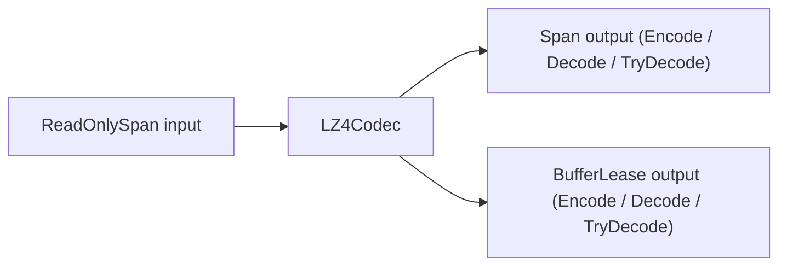

**Namespace:** `Nalix.Codec.LZ4` (`CompressionOptions` nằm trong `Nalix.Codec.Options`)  
**Assembly:** `Nalix.Codec`

Trang này mô tả bề mặt API công khai nén khối LZ4 trong `Nalix.Codec.LZ4` và cấu hình lúc chạy của `CompressionOptions`.

## Ánh xạ mã nguồn

- `src/Nalix.Codec/LZ4/LZ4Codec.cs`
- `src/Nalix.Codec/LZ4/LZ4BlockHeader.cs`
- `src/Nalix.Codec/LZ4/LZ4CompressionConstants.cs`
- `src/Nalix.Codec/LZ4/LZ4BlockEncoder.cs`
- `src/Nalix.Codec/Options/CompressionOptions.cs`

## Các kiểu công khai

| Kiểu | Thành viên công khai |
|---|---|
| `LZ4Codec` | `Encode(ReadOnlySpan<byte>, Span<byte>)`, `Encode(ReadOnlySpan<byte>, out BufferLease, out int)`, `Decode(ReadOnlySpan<byte>, Span<byte>)`, `Decode(ReadOnlySpan<byte>, out BufferLease?, out int)`, `TryDecode(ReadOnlySpan<byte>, Span<byte>, out int)`, `TryDecode(ReadOnlySpan<byte>, out BufferLease?, out int)` |
| `LZ4BlockHeader` | `OriginalLength` (`int`), `CompressedLength` (`int`), `Size = 8` |
| `LZ4BlockEncoder` | `GetMaxLength(int input)`, `GetMinOutputBufferSize(int inputLength)`, `EncodeBlock(ReadOnlySpan<byte> input, Span<byte> output, int* hashTable, int hashBits)` |
| `LZ4CompressionConstants` | `MinMatchLength = 4`, `MaxOffset = 65535`, `MaxBlockSize = 0x40000` (`262_144` / 256 KB), `LastLiteralSize = 5`, `TokenMatchMask = 0x0F`, `TokenLiteralMask = 0x0F` |
| `CompressionOptions` | `Enabled = true`, `MinSizeToCompress = 512`, `MaxDecompressedSize = 33_554_432` (32 MB), `Validate()` |

## Cấu trúc lúc chạy



## Định dạng khối (`LZ4BlockHeader`)

Mỗi khối nén bắt đầu bằng một `LZ4BlockHeader` little-endian 8 byte (`LZ4BlockHeader.Size = 8`):

- `OriginalLength` (`int`, offset 0): Số byte chưa nén của payload.
- `CompressedLength` (`int`, offset 4): Tổng số byte đã mã hóa (bao gồm 8 byte header).

## Các overload Encode

- `int Encode(ReadOnlySpan<byte> input, Span<byte> output)` — Nén `input` vào `output` do bên gọi sở hữu và trả về số byte đã ghi (bao gồm 8 byte `LZ4BlockHeader`). Ném `ArgumentOutOfRangeException` hoặc `LZ4Exception` nếu `output` quá nhỏ.
- `void Encode(ReadOnlySpan<byte> input, out BufferLease lease, out int bytesWritten)` — Thuê một `BufferLease` có kích thước theo `LZ4BlockEncoder.GetMaxLength(input.Length)`, mã hóa khối, commit `bytesWritten`, và trả quyền sở hữu `lease` cho bên gọi.

## Các overload Decode và TryDecode

- `int Decode(ReadOnlySpan<byte> input, Span<byte> output)` — Giải nén `input` vào `output` và trả về số byte đã giải nén được ghi. Ném `LZ4Exception` khi đầu vào sai định dạng hoặc không đủ chỗ trong output.
- `bool TryDecode(ReadOnlySpan<byte> input, Span<byte> output, out int bytesWritten)` — Giải nén span không ném ngoại lệ, dùng trên đường mạng không đáng tin; trả về `false` khi đầu vào sai định dạng hoặc lệch kích thước.
- `void Decode(ReadOnlySpan<byte> input, out BufferLease? lease, out int bytesWritten)` — Thuê một `BufferLease` khớp với `OriginalLength` đã được kiểm tra và giải nén vào đó. Ném `LZ4Exception` khi thất bại.
- `bool TryDecode(ReadOnlySpan<byte> input, out BufferLease? lease, out int bytesWritten)` — Giải nén có pool không ném ngoại lệ; trả về `false` và dispose mọi bộ đệm tạm nếu giải mã thất bại.

## `CompressionOptions` (`Nalix.Codec.Options`)

Được nạp từ mục `[Compression]` của `server.ini` qua `ConfigurationManager.Instance.Get<CompressionOptions>()`:

| Thuộc tính | Kiểu | Mặc định | Kiểm tra | Mô tả |
| --- | --- | ---: | --- | --- |
| `Enabled` | `bool` | `true` | — | Bật hoặc tắt nén khung LZ4. |
| `MinSizeToCompress` | `int` | `512` | `[ValueRange(1, int.MaxValue)]` | Kích thước payload tối thiểu (byte) trước khi thử nén. |
| `MaxDecompressedSize` | `int` | `33_554_432` (32 MB) | `[ValueRange(1024, 268_435_456)]` | `OriginalLength` tối đa được phép để ngăn tấn công cấp phát bộ nhớ kiểu zip-bomb (`MinSizeToCompress <= MaxDecompressedSize`). |

:::tip[Ngưỡng tiết kiệm tối thiểu 12.5% trong `FramePipeline`]
Khi `FramePipeline.ProcessOutbound` nén một gói tin, nó chỉ truyền payload đã nén nếu payload nhỏ đi ít nhất **12.5%** (`compressedLength <= originalLength - (originalLength >> 3)`). Payload không thể nén sẽ được gửi không nén tự động, không đặt `PacketFlags.COMPRESSED`.
:::

## Ví dụ

```csharp
using System;
using Nalix.Codec.LZ4;
using Nalix.Environment.Memory;

ReadOnlySpan<byte> input = payload;

LZ4Codec.Encode(input, out BufferLease compressed, out int written);
using (compressed)
{
    if (LZ4Codec.TryDecode(compressed.Span, out BufferLease? restored, out int restoredBytes) && restored is not null)
    {
        using (restored)
        {
            Console.WriteLine($"Compressed {input.Length}B -> {written}B, restored {restoredBytes}B");
        }
    }
}
```

## API liên quan

- [Frame Pipeline](./frame-pipeline.md)
- [Quản lý bộ đệm](../environment/memory/buffer-management.md)
- [Compression Options](../options/network/compression-options.md)
