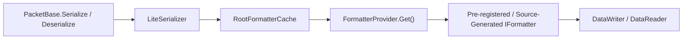

**Không gian tên:** `Nalix.Codec.Serialization`  
**Assembly:** `Nalix.Codec`

Trang này giải thích cách `SerializeFormatterGenerator`, `LiteSerializer` và `FormatterProvider` tuần tự hóa và giải tuần tự hóa các lớp gói tin, struct và collection lồng nhau.

## Ánh xạ mã nguồn

- `analyzers/Nalix.Analyzers.Generators/SerializeFormatterGenerator.cs`
- `src/Nalix.Codec/Serialization/LiteSerializer.cs`
- `src/Nalix.Codec/Serialization/FormatterProvider.cs`
- `src/Nalix.Codec/DataFrames/PacketBase.cs`

## Nhóm kiểu được hỗ trợ

- **Nguyên thủy không quản lý & struct**: `char`, `byte`, `sbyte`, `short`, `ushort`, `int`, `uint`, `long`, `ulong`, `float`, `double`, `decimal`, `bool`, `Guid`, `DateOnly`, `DateTime`, `TimeOnly`, `TimeSpan`, `DateTimeOffset`, `Bytes32`, `PacketHeader`, và các kiểu `struct` không quản lý do người dùng định nghĩa.
- **Chuỗi**: `string` và `string[]` (`StringFormatter`, `StringArrayFormatter`).
- **Kiểu giá trị nullable**: `T?` và `T?[]` (`NullableFormatter<T>`, `NullableArrayFormatter<T>`, `NullableValueListFormatter<T>`).
- **Enum**: Mọi `enum` có kiểu nền là `byte`, `sbyte`, `short`, `ushort`, `int`, `uint`, `long` hoặc `ulong` (`EnumFormatter<T>`).
- **Collection**:
  - `T[]` (`ArrayFormatter<T>` cho `T` không quản lý, `ReferenceArrayFormatter<T>` cho kiểu tham chiếu)
  - `List<T>` (`ListFormatter<T>` cho `T` không quản lý, `ReferenceListFormatter<T>` cho kiểu tham chiếu)
  - `Dictionary<TKey, TValue>` (`DictionaryFormatter<TKey, TValue>`)
  - `Queue<T>`, `Stack<T>`, `HashSet<T>` (hỗ trợ cho `T` không quản lý và `string`)
  - `Memory<T>` và `ReadOnlyMemory<T>` (hỗ trợ cho `T` không quản lý)
- **Tuple**: `ValueTuple` có số đối từ 2 đến 5 (`ValueTupleFormatter<...>`).
- **Lớp & struct phức tạp**: Mọi lớp hoặc struct được chú thích `[GenerateFormatter]` (bao gồm mọi lớp con của `PacketBase<TSelf>`).

## Mô hình thành viên lúc biên dịch (`[GenerateFormatter]`)

Nalix không dùng reflection lúc chạy hay `System.Reflection.Emit` để tuần tự hóa đối tượng. Thay vào đó, `SerializeFormatterGenerator` kiểm tra các kiểu được đánh dấu `[GenerateFormatter]` ngay lúc biên dịch:

1. **`SerializeLayout.Explicit` (mặc định cho `[SerializePackable(SerializeLayout.Explicit)]`)**:
   - Chỉ các trường và thuộc tính có `[SerializeOrder(n)]` (hoặc `[SerializeHeader]`) được tuần tự hóa, sắp xếp theo thứ tự tăng dần của `Order`.
   - `PacketBase<TSelf>` đặt `Header` (`PacketHeader`) ở vị trí `0` qua `[SerializeHeader(0)]`. Các trường người dùng trong lớp con của `PacketBase<TSelf>` cũng bắt đầu `[SerializeOrder]` từ `0` (trình sinh luôn đặt `Header` lên đầu trước các thành viên người dùng).
   - Thành viên công khai không có `[SerializeOrder]` hoặc `[SerializeIgnore]` sẽ kích hoạt cảnh báo analyzer **`NALIX013`**.
2. **`SerializeLayout.Sequential` (`[SerializePackable(SerializeLayout.Sequential)]`)**:
   - Tuần tự hóa mọi trường instance có thể truy cập và thuộc tính tự động theo thứ tự khai báo xuyên suốt chuỗi kế thừa, bỏ qua các thành viên có `[SerializeIgnore]`.
3. **Pooling kiểu tham chiếu (`Create()` và `IFillableFormatter<T>`)**:
   - Kiểu tham chiếu được đánh dấu `[GenerateFormatter]` phải có phương thức tĩnh `Create()` (được thực thi bởi lỗi **`NALIX059`**; được cung cấp tự động bởi `PacketBase<TSelf>.Create()`).
   - Formatter lớp được sinh ra triển khai cả `IFormatter<T>` và `IFillableFormatter<T>`, cho phép `PacketBase<TSelf>.Deserialize` và `LiteSerializer.Fill` điền dữ liệu vào instance gói tin lấy từ pool tại chỗ mà không cấp phát bộ nhớ.

## Luồng phân giải



## Ví dụ: gói tin có struct lồng nhau và collection

```csharp
using System.Collections.Generic;
using Nalix.Abstractions.Networking.Packets;
using Nalix.Abstractions.Serialization;
using Nalix.Codec.DataFrames;

[GenerateFormatter]
[SerializePackable(SerializeLayout.Sequential)]
public partial struct InventoryItem
{
    public uint ItemId { get; set; }
    public ushort Quantity { get; set; }
}

[Packet]
[GenerateFormatter]
[SerializePackable(SerializeLayout.Explicit)]
public sealed partial class InventorySyncPacket : PacketBase<InventorySyncPacket>, IPacketStaticOpcode
{
    public static ushort StaticOpCode => 0x2010;

    [SerializeOrder(0)]
    public ulong AccountId { get; set; }

    [SerializeOrder(1)]
    public List<InventoryItem> Items { get; set; } = [];
}
```

## API liên quan

- [Cơ bản về tuần tự hóa](./serialization-basics.md)
- [Trình sinh tuần tự hóa](../../analyzers/autogen/serialization-generator.md)
- [Trình sinh Packet Schema](../../analyzers/autogen/packet-schema-generator.md)
- [Thuộc tính tuần tự hóa](../../abstractions/serialization-attributes.md)
- [Mô hình Frame](../packets/frame-model.md)
