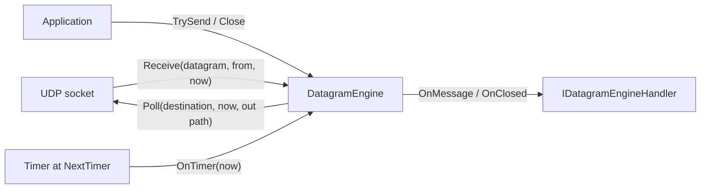
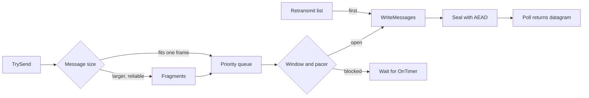
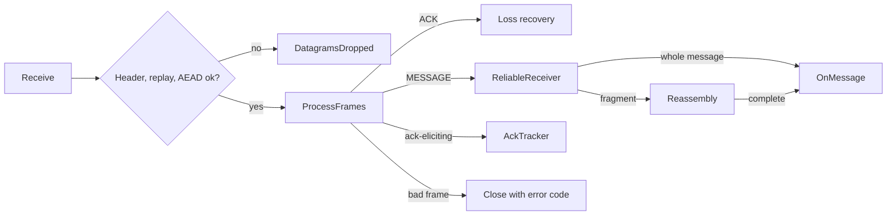
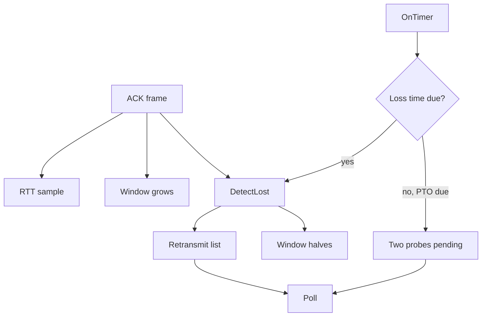
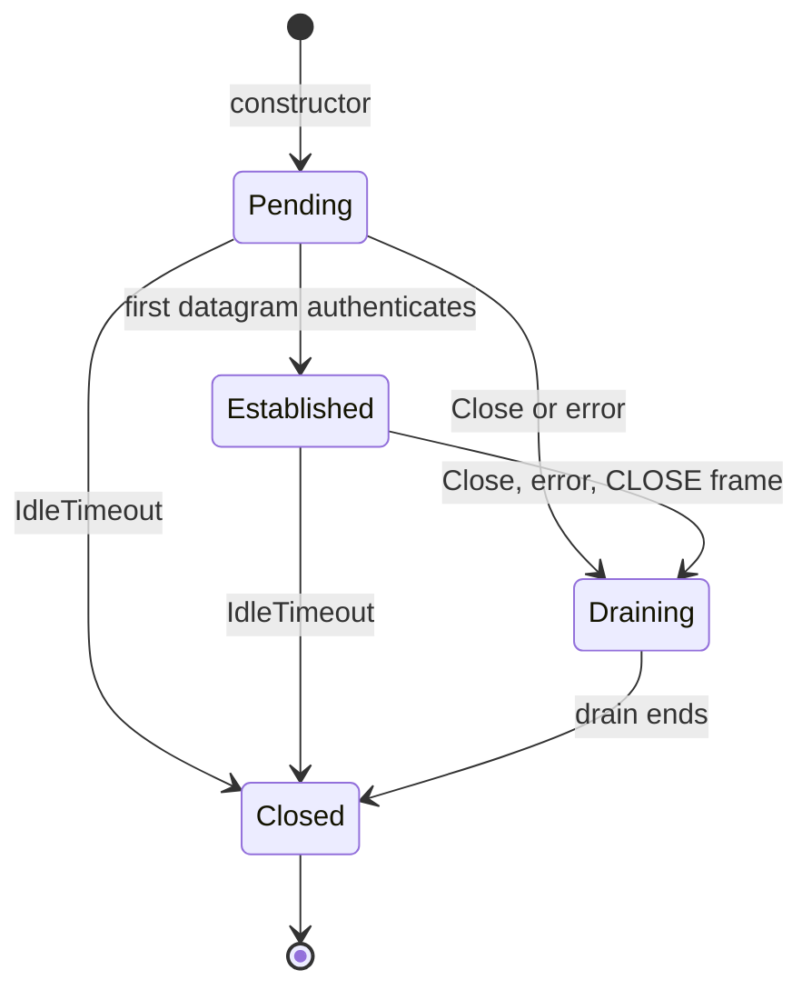

**Namespace:** `Nalix.Environment.Datagrams` (và `Nalix.Environment.Options` cho `DatagramEngineOptions`)  
**Assembly:** `Nalix.Environment`

`DatagramEngine` là engine giao thức của một phiên Nalix Datagram Protocol (NDP v1). Engine không thực hiện I/O socket ("sans-IO"): bên sở hữu đưa các payload UDP nhận được vào `Receive`, gửi đi những gì `Poll` tạo ra và gọi `OnTimer` tại `NextTimer`. Thời gian tính bằng micro giây từ một đồng hồ đơn điệu bất kỳ, ví dụ `DatagramEngine.NowMicros()`.

Engine triển khai số thứ tự gói tin, bảo vệ AEAD qua `IDatagramProtection`, các dải ACK, phát hiện mất gói và kiểm soát tắc nghẽn NewReno có pacing, khám phá MTU của đường truyền, keepalive, thời gian chờ không hoạt động, đóng và draining, xác thực đường truyền, cập nhật khóa, cùng các chế độ `DeliveryMethod` trên các kênh độc lập với phân mảnh và ngân sách nhận được quảng bá. Engine **không an toàn đa luồng**: bên sở hữu phải tuần tự hóa mọi lời gọi. Engine sở hữu và giải phóng phần bảo vệ.

## Source Mapping

- `src/Nalix.Environment/Datagrams/DatagramEngine.cs`
- `src/Nalix.Environment/Datagrams/DatagramEngine.Cleanup.cs`
- `src/Nalix.Environment/Datagrams/DatagramEngine.Report.cs`
- `src/Nalix.Environment/Datagrams/DatagramEngine.Types.cs`
- `src/Nalix.Environment/Datagrams/DatagramEngineState.cs`
- `src/Nalix.Environment/Datagrams/DatagramCloseCode.cs`
- `src/Nalix.Environment/Datagrams/DatagramPeerLimits.cs`
- `src/Nalix.Environment/Datagrams/IDatagramEngineHandler.cs`
- `src/Nalix.Environment/Options/DatagramEngineOptions.cs`

## Vận hành engine

Vòng lặp của owner quanh engine, cho thấy ai gọi thành viên nào.



Sau mỗi lần `Receive`, `TrySend`, `Close` và `OnTimer`, hãy gọi `Poll` liên tục cho đến khi nó trả về `0`.

## Bên trong engine

### Đường gửi

Cách một message trở thành datagram. `TrySend` sao chép message vào hàng đợi ưu tiên, tách thành fragment khi vượt `MaxUnfragmentedMessageSize` (`ReliableSender.cs` L80); `Poll` (`DatagramEngine.cs` L241) ghi bản truyền lại trước, rồi các message trong hàng đợi theo ưu tiên khi cửa sổ tắc nghẽn và pacer cho phép, rồi niêm phong bằng protection.



### Đường nhận

Cách một datagram trở thành message. `Receive` (`DatagramEngine.cs` L423) loại bỏ datagram sai định dạng, trùng hoặc không xác thực, sau đó `ProcessFrames` định tuyến từng khung; message đi qua `ReliableReceiver` theo phương thức giao và tới handler sau khi xử lý xong cả datagram (`DispatchDeliveries`).



### Khôi phục mất gói và bộ đếm thời gian

Cách phát hiện và bù đắp mất gói, do khung ACK và `OnTimer` (`DatagramEngine.Cleanup.cs` L182) điều khiển. Một gói bị coi là mất khi ba gói mới hơn đã được ACK hoặc quá thời điểm mất (`LossRecovery.PacketThreshold`); message mất quay lại danh sách truyền lại và cửa sổ NewReno co lại. Khi không có ACK, probe timeout xếp hai probe để `Poll` gửi được dù cửa sổ đã đầy. `OnTimer` cũng gửi PING keepalive và kết thúc phiên khi idle timeout.



## `DatagramEngine`

`public sealed partial class DatagramEngine : IDisposable` (`DatagramEngine.cs` L34).

### Constructor

```csharp
public DatagramEngine(
    DatagramEngineOptions options, DatagramPeerLimits peerLimits, IDatagramProtection protection,
    ulong connectionId, bool isServer, IDatagramEngineHandler handler, long now);
```

(`DatagramEngine.cs` L108.) `options`, `protection` và `handler` ném `ArgumentNullException` khi là `null`; sau đó constructor gọi `options.Validate()` (xem [Quy tắc Validate()](#quy-tắc-validate)). Số kênh và thời gian chờ không hoạt động phải khớp với bên kia. `peerLimits` là các ngân sách nhận mà bên kia đã quảng bá trong ticket. Client mở phiên bằng một PING; máy chủ chỉ trả lời các datagram đã xác thực (`DatagramEngine.cs` L134-L135).

### Hằng số

| Thành viên | Chữ ký | Mô tả |
| :--- | :--- | :--- |
| `MinimumDatagramSize` | `public const int MinimumDatagramSize` | Datagram hợp lệ nhỏ nhất: header 13 byte, một byte frame, tag 16 byte (`DatagramEngine.cs` L37). |
| `MaxDatagramSize` | `public const int MaxDatagramSize = 1472` | Datagram lớn nhất mà `Poll` tạo ra, cũng là MTU probe lớn nhất (`DatagramEngine.cs` L228). |
| `MaxUnfragmentedMessageSize` | `public const int MaxUnfragmentedMessageSize` | Thông điệp lớn nhất được gửi trong một frame MESSAGE: `DatagramEngineOptions.MinimumMtu` trừ header datagram (13), giới hạn tag (16) và header frame MESSAGE lớn nhất (23), tức 1148 byte (`DatagramEngine.Types.cs` L20-L21). |

### Vòng đời và định tuyến

| Thành viên | Chữ ký | Mô tả |
| :--- | :--- | :--- |
| `State` | `public DatagramEngineState State { get; }` | Trạng thái vòng đời hiện tại (L139). |
| `ConnectionId` | `public ulong ConnectionId { get; }` | Định danh kết nối được truyền cho constructor (L142). |
| `TryReadConnectionId` | `public static bool TryReadConnectionId(ReadOnlySpan<byte> datagram, out ulong connectionId)` | Đọc connection id từ header dạng cleartext mà không xác thực, để định tuyến datagram tới phiên của nó. Trả về `false` với datagram ngắn hơn `MinimumDatagramSize` hoặc có phiên bản không xác định hoặc có bit dành riêng được đặt (L151). |
| `NowMicros` | `public static long NowMicros()` | Thời gian đơn điệu tính bằng micro giây, dùng cho các đối số `now` (L166). |
| `Dispose` | `public void Dispose()` | Giải phóng mọi bộ đệm, đánh dấu thất bại các ACK receipt đang chờ và giải phóng phần bảo vệ. Phát sự kiện đóng với `NoError` nếu phiên chưa đóng (`DatagramEngine.Cleanup.cs` L23). |

### Gửi

| Thành viên | Chữ ký | Mô tả |
| :--- | :--- | :--- |
| `TrySend` | `public bool TrySend(ReadOnlySpan<byte> message, DeliveryMethod method, byte channel, byte priority, long now)` | Đưa một thông điệp vào hàng đợi (có sao chép). Thông điệp lớn hơn `MaxUnfragmentedMessageSize` được phân mảnh và cần phương thức tin cậy có thứ tự hoặc không thứ tự. Trả về `false` khi phiên đang đóng, thông điệp quá lớn so với phương thức của nó, hoặc hàng đợi gửi của kênh đã đầy. `priority` cao hơn được gửi trước; mức trên 7 được coi là 7. Ném `ArgumentOutOfRangeException` với `method` không hợp lệ hoặc `channel` lớn hơn hoặc bằng `ChannelCount` (L183, L740-L747). |
| `TrySendWithReceipt` | `public Task<bool>? TrySendWithReceipt(ReadOnlySpan<byte> message, DeliveryMethod method, byte channel, byte priority, long now)` | Đưa một thông điệp tin cậy vào hàng đợi và trả về một task hoàn tất với `true` khi mọi mảnh đã được xác nhận, hoặc `false` khi phiên đóng trước hoặc một thông điệp `ReliableSequenced` mới hơn đã thay thế nó. Trả về `null` khi không được đưa vào hàng đợi. Ném `ArgumentException` khi `method` không phải phương thức tin cậy (L196). |
| `RaiseReceiveLimits` | `public void RaiseReceiveLimits(DatagramPeerLimits limits)` | Nâng các ngân sách nhận mà phía này quảng bá; một frame LIMITS báo cho bên kia. Ngân sách không bao giờ giảm: mỗi giá trị là giá trị lớn hơn giữa giá trị hiện tại và giá trị được truyền vào (L213). |

### Poll, nhận và bộ đếm thời gian

| Thành viên | Chữ ký | Mô tả |
| :--- | :--- | :--- |
| `Poll` | `public int Poll(Span<byte> destination, long now, out SocketAddress? path)` | Tạo datagram tiếp theo, hoặc trả về `0` khi chưa có gì đến hạn. `destination` phải dài ít nhất `MaxDatagramSize` byte (nếu không sẽ ném `ArgumentOutOfRangeException`). `path` chỉ khác `null` với path challenge gửi tới một địa chỉ không phải đường truyền đang hoạt động (L241). |
| `Receive` | `public bool Receive(ReadOnlySpan<byte> datagram, SocketAddress? from, long now)` | Xử lý một datagram nhận được; trả về `true` khi nó đã xác thực và được xử lý. `from` là địa chỉ người gửi trên máy chủ (được sao chép khi giữ lại) và là `null` trên client. Datagram sai định dạng, quá dài, thuộc connection id khác, trùng lặp hoặc không xác thực được sẽ tăng `DatagramsDropped` và trả về `false` (L423-L433). |
| `OnTimer` | `public void OnTimer(long now)` | Chạy các bộ đếm thời gian đã đến hạn: thời gian chờ không hoạt động, draining, phát hiện mất gói, probe timeout, keepalive, thử lại xác thực đường truyền, hủy khóa và hết hạn mảnh (`DatagramEngine.Cleanup.cs` L182). |
| `NextTimer` | `public long NextTimer { get; }` | Thời điểm của lần gọi `OnTimer` tiếp theo, hoặc `long.MaxValue` khi không cần (`DatagramEngine.Report.cs` L48). |
| `Close` | `public void Close(DatagramCloseCode code, string? reason, long now, ulong applicationCode = 0)` | Đưa một frame CLOSE vào hàng đợi cho lần `Poll` kế tiếp, rồi draining trong ba probe timeout. `IdleTimeout` ném `ArgumentException` (chỉ cục bộ). Tối đa 256 byte UTF-8 của `reason` được gửi. `applicationCode` được dùng với `ApplicationError` (`DatagramEngine.Cleanup.cs` L65). |

### Chẩn đoán

Tất cả nằm trong `DatagramEngine.Report.cs`.

| Thành viên | Chữ ký | Mô tả |
| :--- | :--- | :--- |
| `Mtu` | `public int Mtu { get; }` | MTU hiện tại của đường truyền (byte payload UDP) (L13). |
| `SmoothedRtt` | `public long SmoothedRtt { get; }` | Thời gian khứ hồi đã làm mượt, tính bằng micro giây (L16). |
| `CongestionWindow` | `public long CongestionWindow { get; }` | Cửa sổ tắc nghẽn tính bằng byte (L19). |
| `BytesInFlight` | `public long BytesInFlight { get; }` | Số byte đang bay (L22). |
| `DatagramsSent` | `public long DatagramsSent { get; private set; }` | Số datagram đã gửi (L25). |
| `DatagramsReceived` | `public long DatagramsReceived { get; private set; }` | Số datagram đã xác thực nhận được (L28). |
| `DatagramsDropped` | `public long DatagramsDropped { get; private set; }` | Số datagram nhận được bị loại bỏ (sai định dạng, trùng lặp hoặc không xác thực được) (L31). |
| `DatagramsLost` | `public long DatagramsLost { get; private set; }` | Số datagram đã gửi bị coi là mất (L34). |
| `ActivePath` | `public SocketAddress? ActivePath { get; }` | Địa chỉ bên kia đã xác thực trên máy chủ; `null` trước datagram xác thực đầu tiên và trên client (L43). |
| `GenerateReport` | `public string GenerateReport()` | Bản tóm tắt một dòng (`state`, `mtu`, `srtt`, `cwnd`, `inflight`, `sent`, `received`, `lost`, `dropped`) để chẩn đoán (L87). |

## `DatagramEngineState`

`public enum DatagramEngineState : byte` (`DatagramEngineState.cs` L9). Vòng đời của một `DatagramEngine`.

| Giá trị | Ý nghĩa |
| :--- | :--- |
| `Pending = 0` | Đã tạo; chưa có datagram nào xác thực. |
| `Established = 1` | Một datagram từ bên kia đã xác thực; dữ liệu được truyền (được đặt trong `Receive`, `DatagramEngine.cs` L468). |
| `Draining = 2` | Một frame CLOSE đang nằm trong hàng đợi hoặc đã được gửi hay nhận; phiên bỏ qua các datagram tiếp theo. |
| `Closed = 3` | Đã đóng; không gửi hay nhận gì nữa. |

Engine đi một chiều qua bốn trạng thái; `DatagramCloseCode` cho biết vì sao nó rời `Established`. Đóng bằng `Close`, khung CLOSE, lỗi khung hoặc giới hạn AEAD đều vào `Draining` trước (`DatagramEngine.Cleanup.cs` L108, L76); chỉ idle timeout và khi hết draining mới tới `Closed` (`Terminate`, L151). `Poll` sau đó gửi khung CLOSE đã xếp hàng và draining kéo dài ba lần probe timeout.



## `DatagramCloseCode`

`public enum DatagramCloseCode : byte` (`DatagramCloseCode.cs` L9). Lý do một phiên datagram đóng. Được mang trong frame CLOSE, trừ `IdleTimeout` chỉ có tính cục bộ.

| Giá trị | Ý nghĩa |
| :--- | :--- |
| `NoError = 0` | Đóng bình thường. |
| `InternalError = 1` | Bên kia gặp lỗi nội bộ. |
| `ProtocolViolation = 2` | Bên kia vi phạm giao thức. |
| `FrameEncodingError = 3` | Không thể giải mã một frame, hoặc loại của nó không xác định. |
| `FlowControlError = 4` | Bên kia vượt quá ngân sách nhận đã quảng bá. |
| `IdleTimeout = 5` | Không nhận được gì trong thời gian chờ không hoạt động. Không bao giờ được gửi lên đường truyền. |
| `AeadLimitReached = 6` | Quá nhiều datagram giải mã thất bại. |
| `ApplicationError = 7` | Ứng dụng đóng phiên với mã riêng của nó. |

## `DatagramPeerLimits`

`public readonly record struct DatagramPeerLimits(long ReceiveBufferBytes, long ChannelReceiveBufferBytes)` (`DatagramPeerLimits.cs` L14). Các ngân sách nhận mà bên kia đã quảng bá, đầu tiên trong ticket và sau đó trong các frame LIMITS. Bên gửi giữ số byte tin cậy chưa được giải phóng trong các giới hạn này.

| Thành viên | Chữ ký | Mô tả |
| :--- | :--- | :--- |
| `ReceiveBufferBytes` | `long` (positional) | Tổng số byte bên kia đệm để sắp xếp thứ tự và ghép lại. |
| `ChannelReceiveBufferBytes` | `long` (positional) | Số byte bên kia đệm cho mỗi kênh. |
| `Default` | `public static DatagramPeerLimits Default { get; }` | Giới hạn của một bên dùng `DatagramEngineOptions` mặc định (L19). |
| `From` | `public static DatagramPeerLimits From(DatagramEngineOptions options)` | Giới hạn mà một phía với `options` quảng bá; ném `ArgumentNullException` với `null` (L24-L28). |

## `IDatagramEngineHandler`

`public interface IDatagramEngineHandler` (`IDatagramEngineHandler.cs` L13). Nhận đầu ra của một `DatagramEngine`. Nó được gọi đồng bộ từ lời gọi engine đã tạo ra sự kiện, dưới lock của bên sở hữu, nên các bản triển khai phải chuyển việc đi chỗ khác thay vì chặn.

| Thành viên | Chữ ký | Mô tả |
| :--- | :--- | :--- |
| `OnMessage` | `void OnMessage(BufferLease message, DeliveryMethod method, byte channel)` | Một thông điệp hoàn chỉnh đã được chuyển giao. Quyền sở hữu `message` chuyển sang handler, và handler phải giải phóng nó (L21). |
| `OnClosed` | `void OnClosed(DatagramCloseCode code, ulong applicationCode, string reason, bool remote)` | Phiên đã đóng, do một trong hai bên hoặc do hết thời gian chờ không hoạt động. Chỉ phát một lần. `applicationCode` có ý nghĩa khi `code` là `ApplicationError`; `reason` có thể rỗng; `remote` là `true` khi bên kia đóng phiên (L30). |

`BufferLease` thuộc `Nalix.Environment.Memory`; `DeliveryMethod` thuộc `Nalix.Abstractions.Networking.Datagrams`.

## `DatagramEngineOptions`

`public sealed partial class DatagramEngineOptions : ConfigurationLoader, IValidatableConfiguration` (namespace `Nalix.Environment.Options`, `DatagramEngineOptions.cs` L16). Cấu hình của một phía trong phiên datagram. Máy chủ quảng bá số kênh, thời gian chờ không hoạt động, kích thước thông điệp và các ngân sách nhận trong ticket, và client dùng cùng các giá trị đó. Đây là lớp tùy chọn gắn với `.ini` (xem [Cấu hình](./configuration.md)); tên section là `[DatagramEngine]`.

### Hằng số

| Thành viên | Giá trị | Mô tả |
| :--- | :--- | :--- |
| `MinimumMtu` | `1200` | MTU nhỏ nhất, an toàn trên các đường truyền IPv4 và IPv6; mọi frame đều được định cỡ để vừa trong đó (L19). |
| `MaxChannels` | `64` | Số kênh lớn nhất (L22). |

### Thuộc tính

| Thuộc tính | Kiểu | Mặc định | Phạm vi | Mô tả |
| :--- | :--- | :--- | :--- | :--- |
| `ChannelCount` | `int` | `8` | 1..64 | Số kênh đang dùng (L27). |
| `IdleTimeoutMs` | `int` | `15_000` | 100..3,600,000 | Thời gian chờ không hoạt động, tính bằng mili giây (L32). |
| `MaxAckDelayMs` | `int` | `25` | 1..1,000 | Thời gian trì hoãn tối đa của một acknowledgement, tính bằng mili giây (L37). |
| `UnreliableExpiryMs` | `int` | `100` | 1..60,000 | Thời gian một thông điệp không tin cậy trong hàng đợi được phép chờ trước khi bị loại bỏ (L42). |
| `MaxMessageSize` | `int` | `1048576` (1 MiB) | 1..67,108,864 (64 MiB) | Thông điệp lớn nhất được chấp nhận khi gửi hoặc được ghép lại từ các mảnh (L47). |
| `ReceiveBufferBytes` | `long` | `4194304` (4 MiB) | 1..`long.MaxValue` | Tổng số byte phía này đệm để sắp xếp thứ tự và ghép lại; được quảng bá cho bên kia (L52). |
| `ChannelReceiveBufferBytes` | `long` | `2097152` (2 MiB) | 1..`long.MaxValue` | Số byte phía này đệm cho mỗi kênh; được quảng bá cho bên kia (L57). |
| `SendQueueBytesPerChannel` | `long` | `4194304` (4 MiB) | 1..`long.MaxValue` | Số byte được phép chờ trong hàng đợi gửi của một kênh (L62). |
| `MaxOpenFragmentStreams` | `int` | `64` | 1..65,535 | Số thông điệp phân mảnh lớn nhất được ghép lại cùng lúc (L67). |
| `FragmentTimeoutMs` | `int` | `10_000` | 100..3,600,000 | Thời gian giữ một thông điệp phân mảnh chưa hoàn chỉnh (L72). |
| `EnableMtuProbing` | `bool` | `true` | n/a | Dò MTU của đường truyền trên `MinimumMtu` (L76). |
| `KeyUpdatePacketInterval` | `long` | `8388608` (2^23) | 16..2^40 | Số gói tin được gửi với một khóa trước khi cập nhật khóa (L81). |
| `KeyUpdateIntervalMs` | `long` | `3_600_000` (1 giờ) | 1,000..604,800,000 (7 ngày) | Thời gian một khóa được dùng trước khi cập nhật khóa (L86). |

### Quy tắc Validate()

`public void Validate()` (L92) ném `ValidationException` (`Nalix.Abstractions.Exceptions`) khi:

1. Bất kỳ thuộc tính nào nằm ngoài `[ValueRange]` ở trên (`ValidateDataAnnotations()`, L94).
2. `ChannelReceiveBufferBytes < MaxMessageSize + 65536`: bên kia chỉ giải phóng một thông điệp phân mảnh khi nó đã hoàn chỉnh, nên một thông điệp phải vừa trong ngân sách của kênh cùng với header của các mảnh và chi phí phụ trên mỗi thông điệp (L98-L103).
3. `ReceiveBufferBytes < ChannelReceiveBufferBytes` (L105-L109).
4. `SendQueueBytesPerChannel < MaxMessageSize` (L111-L115).

Các giá trị mặc định thỏa mãn cả ba kiểm tra chéo. Nếu bạn tăng `MaxMessageSize`, hãy tăng cả `ChannelReceiveBufferBytes`, `ReceiveBufferBytes` và `SendQueueBytesPerChannel` theo. Constructor của `DatagramEngine` tự gọi `Validate()` cho bạn.

## Ví dụ sử dụng

Một vòng lặp tối thiểu của bên sở hữu phía máy chủ. Phần bảo vệ, handler và socket là mã của ứng dụng; `connectionId` và `protection` lấy từ ticket và bước trao đổi khóa của bạn.

```csharp
using System.Net;
using Nalix.Abstractions.Networking.Datagrams;
using Nalix.Environment.Datagrams;
using Nalix.Environment.Memory;
using Nalix.Environment.Options;

sealed class SessionHandler : IDatagramEngineHandler
{
    public void OnMessage(BufferLease message, DeliveryMethod method, byte channel)
    {
        // Chuyển việc đi nhanh; handler sở hữu lease.
        using (message)
        {
            // xử lý frame Nalix trên một worker
        }
    }

    public void OnClosed(DatagramCloseCode code, ulong applicationCode, string reason, bool remote)
        => Console.WriteLine($"closed: {code} remote={remote} reason={reason}");
}

DatagramEngineOptions options = new() { ChannelCount = 4, IdleTimeoutMs = 10_000 };
DatagramPeerLimits peer = DatagramPeerLimits.Default;

using DatagramEngine engine = new(
    options, peer, protection, connectionId, isServer: true, new SessionHandler(), DatagramEngine.NowMicros());

// Datagram đến từ socket:
engine.Receive(datagram, remoteEndPoint.Serialize(), DatagramEngine.NowMicros());

// Ứng dụng gửi trên kênh 0, tin cậy và theo thứ tự:
engine.TrySend(payload, DeliveryMethod.ReliableOrdered, channel: 0, priority: 0, DatagramEngine.NowMicros());

// Lấy hết dữ liệu đầu ra:
Span<byte> buffer = stackalloc byte[DatagramEngine.MaxDatagramSize];
int length;
while ((length = engine.Poll(buffer, DatagramEngine.NowMicros(), out SocketAddress? path)) > 0)
{
    // gửi buffer[..length] tới `path` khi không null, nếu không thì gửi tới peer đang hoạt động
}

// Khi bộ hẹn giờ đặt cho engine.NextTimer kích hoạt:
engine.OnTimer(DatagramEngine.NowMicros());

// Tắt êm (sau đó tiếp tục gọi Poll để frame CLOSE được gửi đi):
engine.Close(DatagramCloseCode.NoError, "bye", DatagramEngine.NowMicros());
```

:::note[Trách nhiệm của bên sở hữu]
Engine không bao giờ chạm vào socket hay bộ đếm thời gian. Bên sở hữu phải tuần tự hóa mọi lời gọi, gọi `Poll` cho đến khi nó trả về `0` sau mỗi lần `Receive`, `TrySend`, `Close` và `OnTimer`, và lên lịch `OnTimer` cho `NextTimer`.
:::

## API liên quan

- [Cấu hình](./configuration.md)
- [Clock](./clock.md)
- [Buffer Lease](./memory/buffer-lease.md)
