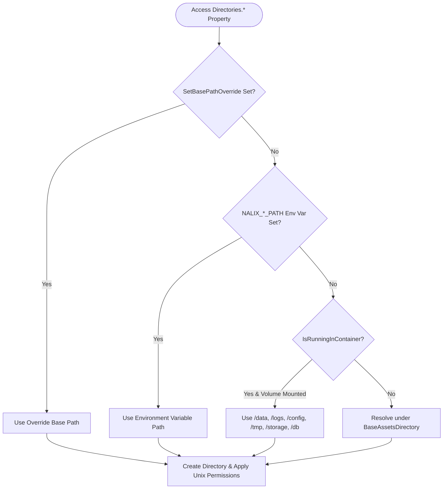

**Không gian tên:** `Nalix.Environment.IO`  
**Assembly:** `Nalix.Environment`

`Directories` là một tiện ích tĩnh an toàn đa luồng, dùng để phân giải, tạo và tăng cường quyền cho các thư mục ứng dụng trên Windows, Linux, macOS và môi trường container (Docker/Kubernetes).

## Ánh xạ mã nguồn

- `src/Nalix.Environment/IO/Directories.Lazy.cs`
- `src/Nalix.Environment/IO/Directories.Properties.cs`
- `src/Nalix.Environment/IO/Directories.PublicMethods.cs`
- `src/Nalix.Environment/IO/Directories.UnixDirPerms.cs`

## Thứ tự ưu tiên phân giải đường dẫn



## Thuộc tính công khai

| Thuộc tính | Ghi đè bằng biến môi trường | Volume container | Đường dẫn mặc định (tương đối với `BaseAssetsDirectory`) | Chế độ Unix |
| :--- | :--- | :--- | :--- | :---: |
| `IsRunningInContainer` | `DOTNET_RUNNING_IN_CONTAINER` / `KUBERNETES_SERVICE_HOST` | — | Nhận diện qua các dấu hiệu `/.dockerenv` và `/proc/1/cgroup` | — |
| `BaseAssetsDirectory` | `NALIX_BASE_PATH` | `/data` | Windows: `%ProgramData%\Nalix`<br/>Unix: `$XDG_DATA_HOME/Nalix` hoặc `~/.local/share/Nalix` | `0750` |
| `LogsDirectory` | `NALIX_LOGS_PATH` | `/logs` | `<BaseAssetsDirectory>/logs` | `0755` |
| `DataDirectory` | `NALIX_DATA_PATH` | `/data` | `<BaseAssetsDirectory>/data` | `0755` |
| `ConfigurationDirectory` | `NALIX_CONFIG_PATH` | `/config` | `<BaseAssetsDirectory>/config` | `0700` |
| `StorageDirectory` | `NALIX_STORAGE_PATH` | `/storage` | `<BaseAssetsDirectory>/storage` | `0750` |
| `DatabaseDirectory` | `NALIX_DB_PATH` | `/db` | `<BaseAssetsDirectory>/db` | `0700` |
| `TemporaryDirectory` | `NALIX_TEMP_PATH` | `/tmp` | `<BaseAssetsDirectory>/data/tmp` (tự động xóa các file cũ hơn `NALIX_TEMP_RETENTION_DAYS`, mặc định `7` ngày) | `0700` |
| `CacheDirectory` | — | — | `<DataDirectory>/caches` | `0755` |
| `UploadsDirectory` | — | — | `<DataDirectory>/uploads` | `0750` |
| `BackupsDirectory` | — | — | `<DataDirectory>/backups` | `0700` |

## Phương thức công khai

| Phương thức | Chữ ký | Mô tả |
| :--- | :--- | :--- |
| `GetFilePath` | `public static string GetFilePath(string directoryPath, string fileName)` | Ghép `directoryPath` và `fileName` đồng thời chặn path traversal (ném `UnauthorizedAccessException` nếu `fileName` thoát khỏi `directoryPath`). |
| `TryWriteNewFile` | `public static bool TryWriteNewFile(string path, string content, bool isPrivate = true)` | Tạo và ghi `content` vào một file mới một cách nguyên tử (áp dụng `0600` trên Unix khi `isPrivate = true`); trả về `false` nếu file đã tồn tại. |
| `DeleteOldFiles` | `public static int DeleteOldFiles(string directoryPath, TimeSpan maxAge, string searchPattern = "*")` | Xóa các file cũ hơn `maxAge` khớp với `searchPattern` và trả về số file đã xóa. |
| `CanAccessAllDirectories` | `public static bool CanAccessAllDirectories()` | Kiểm tra quyền ghi trên mọi thư mục được quản lý bằng cách đọc ACL của hệ điều hành trên Windows (`GetAccessRules`) và `access(path, W_OK)` trên Unix, không ghi file tạm. |
| `SetBasePathOverride` | `public static void SetBasePathOverride(string path)` | Ghi đè `BaseAssetsDirectory` cho các unit/integration test được cô lập và đặt lại mọi cache thư mục lazy. |

## Ví dụ sử dụng

```csharp
using System;
using Nalix.Environment.IO;

// Phân giải một đường dẫn file an toàn bên trong ConfigurationDirectory
string configPath = Directories.GetFilePath(Directories.ConfigurationDirectory, "server.ini");

// Dọn các file log cũ hơn 30 ngày
int removed = Directories.DeleteOldFiles(Directories.LogsDirectory, TimeSpan.FromDays(30), "*.log");
```

## API liên quan

- [Configuration (ConfigurationManager)](./configuration.md)
- [Cài đặt](../../installation.md)
