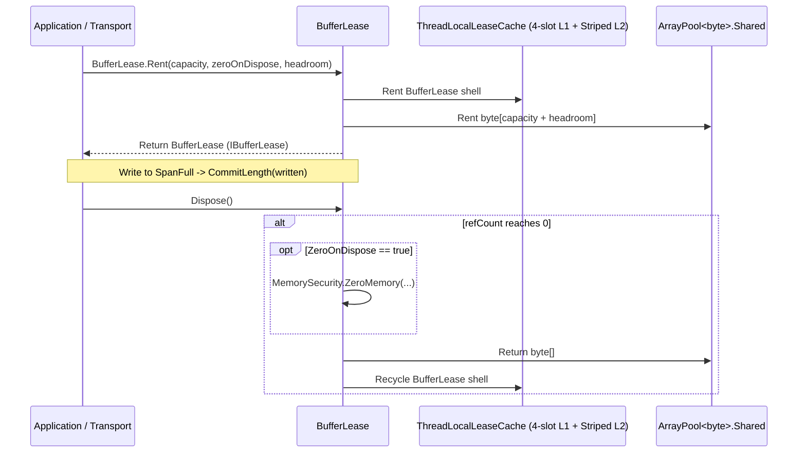

`Nalix.Environment.Memory.BufferLease` và `Nalix.Framework.Memory.Buffers.BufferPoolManager` cung cấp vòng đời bộ đệm byte không cấp phát của Nalix, dựa trên `ArrayPool<byte>.Shared` với cache lớp vỏ theo thread và phát hiện rò rỉ tùy chọn bằng GC sentinel.

## Ánh xạ mã nguồn

- `src/Nalix.Abstractions/IBufferLease.cs`
- `src/Nalix.Environment/Memory/BufferLease.cs`
- `src/Nalix.Environment/Options/MemoryOptions.cs`
- `src/Nalix.Framework/Memory/Buffers/BufferPoolManager.cs`
- `src/Nalix.Framework/Options/BufferOptions.cs`

## Tổng quan kiến trúc



## `BufferPoolManager` (`Nalix.Framework.Memory.Buffers`)

`BufferPoolManager` (`[Injectable(typeof(IBufferPoolManager))]`) triển khai `IBufferPoolManager` và `IDisposable`. Lớp này bọc `ArrayPool<byte>.Shared`, theo dõi số liệu rent/return nguyên tử (`_rentCount`, `_returnCount`, `_totalBytesRented`), và gắn các `BufferSentinel` theo dõi bằng finalizer khi `BufferOptions.EnableBufferLeakDetection` được bật.

### Constructor, thuộc tính & phương thức

| Thành viên | Chữ ký | Mô tả |
| --- | --- | --- |
| `BufferPoolManager` | `public BufferPoolManager(BufferOptions? bufferConfig = null)` | Nạp `BufferOptions` (từ `ConfigurationManager` khi `null`) và kiểm tra tính hợp lệ. |
| `MaxBufferSize` | `public int MaxBufferSize => 0;` | Trả về `0` (kích thước do `ArrayPool<byte>.Shared` quản lý động). |
| `MinBufferSize` | `public int MinBufferSize => 0;` | Trả về `0` (kích thước do `ArrayPool<byte>.Shared` quản lý động). |
| `Rent` | `public byte[] Rent(int minimumLength = 256)` | Thuê một `byte[]` có độ dài ít nhất `minimumLength` byte và ghi nhận số liệu cùng sentinel rò rỉ. |
| `Return` | `public void Return(byte[]? array, bool arrayClear = false)` | Tùy chọn xóa `array` và trả về `ArrayPool<byte>.Shared`, đánh dấu sentinel rò rỉ đang hoạt động là đã trả. |
| `GenerateReport` | `public string GenerateReport()` | Trả về bản tóm tắt chẩn đoán có định dạng gồm số lần rent/return, các buffer chưa trả và các rò rỉ phát hiện được. |
| `WriteReportData` | `public void WriteReportData(Utf8JsonWriter writer)` | Ghi số liệu JSON có cấu trúc cho các endpoint quan sát. |

## `MemoryOptions` (`Nalix.Environment.Options`)

Được cấu hình qua `[Memory]` trong `default.ini` hoặc `builder.Configure<MemoryOptions>(...)` (`src/Nalix.Environment/Options/MemoryOptions.cs`):

| Thuộc tính | Kiểu | Mặc định | Kiểm tra | Mô tả |
| --- | --- | :---: | --- | --- |
| `MaxWriterCapacity` | `int` | `134_217_728` (`128 MiB`) | `[ValueRange(1024, 1073741824)]` | Dung lượng tối đa có thể mở rộng của `DataWriter` ở chế độ thuê từ pool. |
| `BufferLeaseThreadLocalCacheMaxSlots` | `int` | `8` | `[ValueRange(1, 1024)]` | Số slot cache L1 `[ThreadStatic]` cho mỗi thread dành cho lớp vỏ `BufferLease`. |
| `BufferLeaseSharedPoolSize` | `int` | `64` | `[ValueRange(16, 65536)]` | Số slot pool dùng chung có phân mảnh L2 cho lớp vỏ `BufferLease`. |

## `BufferOptions` (`Nalix.Framework.Options`)

Được cấu hình qua `[Buffer]` trong `default.ini` hoặc `builder.Configure<BufferOptions>(...)`:

| Thuộc tính | Kiểu | Mặc định | Kiểm tra | Mô tả |
| --- | --- | :---: | --- | --- |
| `EnableBufferLeakDetection` | `bool` | `false` | — | Gắn một GC finalizer sentinel (`BufferSentinel`) vào mọi `byte[]` đã thuê để phát hiện buffer không được trả. |
| `EnableBufferLeakStackTrace` | `bool` | `false` | — | Ghi lại stack trace lúc cấp phát khi `EnableBufferLeakDetection` được bật (nên tắt trong benchmark production). |
| `SuspiciousThresholdSeconds` | `int` | `30` | `[ValueRange(0, 3600)]` | Ngưỡng tính bằng giây; sau thời gian này, buffer chưa trả sẽ bị đánh dấu đáng ngờ trong báo cáo chẩn đoán. |

## Đăng ký `BufferPoolManager` trong `Nalix.Hosting`

```csharp
using Nalix.Framework.Memory.Buffers;
using Nalix.Framework.Options;
using Nalix.Hosting;

NetworkApplication app = NetworkApplication.CreateBuilder()
    .Configure<BufferOptions>(opts =>
    {
        opts.EnableBufferLeakDetection = false;
        opts.SuspiciousThresholdSeconds = 30;
    })
    .UseBufferPoolManager(new BufferPoolManager())
    .Build();
```

## API liên quan

- [BufferLease](./buffer-lease.md)
- [Object Pooling (ObjectPoolManager)](../../framework/memory/object-pooling.md)
- [Đường đi không cấp phát](../../../concepts/internals/zero-allocation.md)
