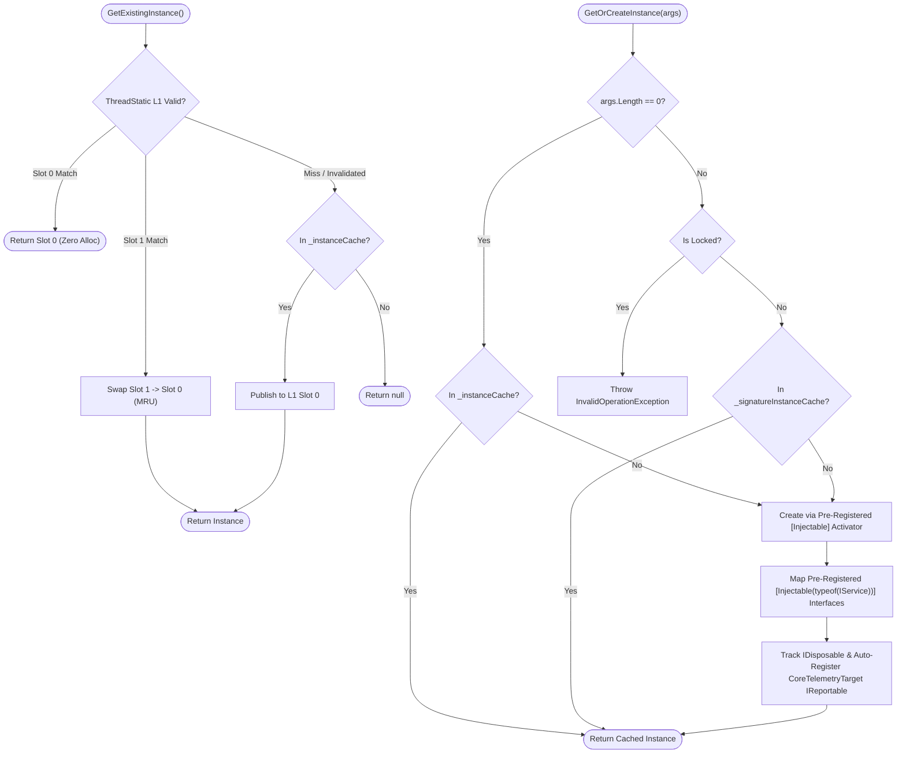

**Không gian tên:** `Nalix.Framework.Injection`  
**Assembly:** `Nalix.Framework`

`InstanceManager` (`public sealed partial class InstanceManager : SingletonBase<InstanceManager>, IReportable`) là registry tiêm phụ thuộc hiệu năng cao, tương thích Native AOT của Nalix. Nó kết hợp cache L1 `[ThreadStatic]` MRU 2 slot với kho lưu trữ đồng thời theo khóa `RuntimeTypeHandle`, cùng các activator lúc biên dịch do `InstanceGenerator` sinh ra.

## Luồng phân giải & đăng ký



## Ánh xạ mã nguồn

- `src/Nalix.Framework/Injection/InstanceManager.cs`
- `src/Nalix.Framework/Injection/InstanceManager.Activators.cs`
- `src/Nalix.Framework/Injection/InstanceManager.Types.cs`
- `src/Nalix.Framework/Injection/InstanceManager.Report.cs`
- `analyzers/Nalix.Analyzers.Generators/InstanceGenerator.cs`

## Các đảm bảo kiến trúc chính

1. **Cache L1 `[ThreadStatic]` MRU 2 slot**: `GetExistingInstance<T>()` kiểm tra hai slot MRU cục bộ theo luồng (`s_tsKey0`/`s_tsKey1`), được bảo vệ bởi bộ đếm vô hiệu hóa đơn điệu (`s_slotsInvalidated`). Sau giai đoạn khởi động, việc phân giải một dịch vụ trên hot path của packet không cần cấp phát bộ nhớ và không cần khóa.
2. **Ánh xạ interface lúc biên dịch (`[Injectable]`)**: Đăng ký interface là tường minh và tương thích AOT. Gắn `[Injectable(typeof(IMyService))]` lên một class khiến `InstanceGenerator` gọi `InstanceManager.RegisterServiceMapping(typeof(MyService), typeof(IMyService))` trong `[ModuleInitializer]` của assembly. Khi gọi `Register(new MyService())` hoặc `GetOrCreateInstance<MyService>()`, mọi interface dịch vụ đã ánh xạ sẽ được điền tự động.
3. **Activator Native AOT 100%**: Việc tạo động (`GetOrCreateInstance`, `CreateInstance`, `CreateInstanceWithInjection`) dùng các delegate factory được `InstanceGenerator` đăng ký trước qua `InstanceManager.RegisterActivator`. Cố gắng khởi tạo động một kiểu không có `[Injectable]` sẽ ném `InvalidOperationException`.
4. **Giới hạn cache cứng & `Lockdown()`**: Cả `_instanceCache` và `_signatureInstanceCache` đều giới hạn `4096` mục (`MaxCachedInstances = 4096`, `MaxSignatureInstances = 4096`). Gọi `Lockdown()` sau khi khởi động sẽ đóng băng registry, khiến các lệnh gọi `Register<T>`, `RegisterForClassOnly<T>`, `RemoveInstance`, `Clear`, `GetOrCreateInstance(Type, args)`, hoặc `GetOrCreateInstance<T>(args)` (khi `args.Length > 0`) ném `InvalidOperationException`.
5. **Vòng đời IDisposable & IReportable an toàn**: Instance `IDisposable` bị thay thế hoặc gỡ bỏ chỉ được dispose một lần (và chỉ khi không còn type handle nào khác tham chiếu tới cùng instance). Các dịch vụ `IReportable` `CoreTelemetryTarget` tích hợp sẵn (`ITaskManager`, `IConnectionHub`, `IBufferPoolManager`, `IObjectPoolManager`, `ISessionService`, v.v.) được tự động đăng ký vào `ReportRegistry.Instance` (các dịch vụ `IReportable` tùy chỉnh có thể đăng ký tường minh qua `ReportRegistry.Instance.Register(key, instance)`).

## Tham chiếu API công khai

### Đăng ký & bảo mật

| Phương thức | Chữ ký | Mô tả |
| :--- | :--- | :--- |
| `Register<T>` | `public void Register<T>(T instance) where T : class` | Đăng ký hoặc thay thế nguyên tử `instance` dưới `typeof(T)` và mọi interface được ánh xạ qua `[Injectable(typeof(IService))]`. Theo dõi các instance `IDisposable` và `IReportable` `CoreTelemetryTarget`. |
| `RegisterForClassOnly<T>` | `public void RegisterForClassOnly<T>(T instance) where T : class` | Bí danh của `Register<T>(instance)`. |
| `RegisterActivator` | `public static void RegisterActivator(Type type, Func<object?[], object> factory)` | Đăng ký một delegate factory lúc biên dịch (được `InstanceGenerator` gọi tự động). |
| `RegisterServiceMapping` | `public static void RegisterServiceMapping(Type concreteType, Type serviceType)` | Ánh xạ `concreteType` sang `serviceType` (được `InstanceGenerator` gọi tự động). |
| `Lockdown` | `public void Lockdown()` | Đóng băng trạng thái manager. Sau đó, các lệnh gọi `Register<T>`, `RegisterForClassOnly<T>`, `RemoveInstance`, `Clear()`, `GetOrCreateInstance(Type, args)`, hoặc `GetOrCreateInstance<T>(args)` (khi `args.Length > 0`) sẽ ném `InvalidOperationException`. |

### Phân giải & tạo

| Phương thức | Chữ ký | Mô tả |
| :--- | :--- | :--- |
| `GetExistingInstance<T>` | `public T? GetExistingInstance<T>() where T : class` | Tra cứu không khóa trên hot path qua cache L1 MRU `[ThreadStatic]` 2 slot và `_instanceCache`. Trả về `null` nếu chưa đăng ký. |
| `GetOrCreateInstance<T>` | `public T GetOrCreateInstance<T>(params object?[] args) where T : class` | Trả về instance `T` đã cache, hoặc tạo và cache một instance mới bằng activator `[Injectable]` của nó (khi `args.Length > 0`, chuyển sang `GetOrCreateInstance(typeof(T), args)` và áp dụng `Lockdown()`). |
| `GetOrCreateInstance` | `public object GetOrCreateInstance(Type type, params object?[] args)` | Phân giải/tạo không generic theo `Type` (dùng cache chữ ký `ActivatorKey` khi có `args`; ném `InvalidOperationException` nếu `Lockdown()` đang bật). |
| `CreateInstance` | `public object CreateInstance(Type type, params object?[] args)` | Tạo instance mới bằng activator `[Injectable]` mà không cache. |
| `CreateInstanceWithInjection<T>` | `public T CreateInstanceWithInjection<T>() where T : class` | Tạo instance `T` mới, chưa cache, bằng cách chọn constructor public có nhiều tham số nhất mà mọi tham số đều phân giải được từ `_instanceCache`. |
| `CreateInstanceWithInjection` | `public object CreateInstanceWithInjection(Type type)` | Overload không generic của constructor injection tham lam. |
| `HasInstance<T>` | `public bool HasInstance<T>()` | Trả về `true` nếu `typeof(T)` hiện có trong `_instanceCache`. |

### Gỡ bỏ, dọn dẹp & chẩn đoán

| Thành phần | Chữ ký | Mô tả |
| :--- | :--- | :--- |
| `CachedInstanceCount` | `public int CachedInstanceCount { get; }` | Tổng số instance đã cache trong `_instanceCache` và `_signatureInstanceCache`. |
| `RemoveInstance` | `public bool RemoveInstance(Type type)` | Gỡ `type` (cùng các interface được ánh xạ và các instance theo chữ ký) và dispose instance nếu không còn được tham chiếu. |
| `Clear` | `public void Clear(bool dispose = true)` | Xóa mọi cache và vô hiệu hóa các slot L1; dispose các instance `IDisposable` đang theo dõi khi `dispose = true`. |
| `GenerateReport` | `public string GenerateReport()` | Trả về bảng chẩn đoán định dạng gồm các instance đã cache, activator, và bộ đếm hit/tạo mới. |
| `WriteReportData` | `public void WriteReportData(Utf8JsonWriter writer)` | Ghi các chỉ số chẩn đoán JSON có cấu trúc. |

## Ví dụ sử dụng

```csharp
using Nalix.Abstractions.Injection;
using Nalix.Framework.Injection;

public interface IPlayerRepository
{
    bool Exists(ulong playerId);
}

[Injectable(typeof(IPlayerRepository))]
public sealed class InMemoryPlayerRepository : IPlayerRepository
{
    public bool Exists(ulong playerId) => playerId != 0;
}

// 1. Đăng ký khi khởi động (điền cả InMemoryPlayerRepository và IPlayerRepository)
InstanceManager.Instance.Register(new InMemoryPlayerRepository());

// 2. Đóng băng đăng ký sau khi khởi động
InstanceManager.Instance.Lockdown();

// 3. Phân giải trên hot path, không cấp phát bộ nhớ
IPlayerRepository? repo = InstanceManager.Instance.GetExistingInstance<IPlayerRepository>();
```

## API liên quan

- [Thuộc tính Injection (`[Injectable]`, `[Inject]`, `[FromScope]`)](../abstractions/injection.md)
- [Instance Generator](../analyzers/autogen/instance-generator.md)
- [SingletonBase\<T\>](./singleton-base.md)
- [Trình quản lý tác vụ](./task-manager.md)
