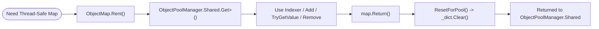

**Không gian tên:** `Nalix.Framework.Memory.Objects`  
**Assembly:** `Nalix.Framework`

`ObjectMap<TKey, TValue>` (`public sealed class ObjectMap<TKey, TValue> : IObjectMap<TKey, TValue> where TKey : notnull`) là bản đồ khóa-giá trị an toàn đa luồng, có pool, được hỗ trợ bởi `ConcurrentDictionary<TKey, TValue>` và được tái sử dụng qua `ObjectPoolManager.Shared`. Nó được dùng cho `IConnection.Attributes` theo từng kết nối (`IObjectMap<AttributeKey, object>`) và các bảng tra cứu đồng thời tạm thời.

## Vòng đời thuê & trả



## Ánh xạ mã nguồn

- `src/Nalix.Abstractions/IObjectMap.cs`
- `src/Nalix.Framework/Memory/Objects/ObjectMap.cs`

## Thành viên tĩnh & thể hiện công khai

| Thành phần | Chữ ký | Mô tả |
| :--- | :--- | :--- |
| `Rent()` | `public static ObjectMap<TKey, TValue> Rent()` | Lấy một `ObjectMap<TKey, TValue>` đã được xóa từ `ObjectPoolManager.Shared` (yêu cầu `ObjectPoolManager.Shared` đã được cấu hình). |
| `Return()` | `public void Return()` | Xóa bản đồ (`ResetForPool()`) và trả về `ObjectPoolManager.Shared`. |
| `ResetForPool()` | `public void ResetForPool()` | Xóa mọi mục khỏi `ConcurrentDictionary<TKey, TValue>` bên dưới, đồng thời giữ lại dung lượng bucket nội bộ. |
| `this[TKey key]` | `public TValue this[TKey key] { get; set; }` | Lấy hoặc đặt giá trị cho `key` (gán sẽ thêm mới hoặc ghi đè; lấy sẽ ném `KeyNotFoundException` nếu thiếu). |
| `Add(TKey, TValue)` | `public void Add(TKey key, TValue value)` | Thêm `(key, value)` vào bản đồ; ném `ArgumentException` nếu `key` đã tồn tại. |
| `Add(KeyValuePair)` | `public void Add(KeyValuePair<TKey, TValue> item)` | Thêm `item` vào bản đồ; ném `ArgumentException` nếu `item.Key` đã tồn tại. |
| `TryGetValue` | `public bool TryGetValue(TKey key, [MaybeNullWhen(false)] out TValue value)` | Cố gắng lấy giá trị gắn với `key`. |
| `ContainsKey` | `public bool ContainsKey(TKey key)` | Trả về `true` nếu `key` tồn tại trong bản đồ. |
| `Contains(KeyValuePair)` | `public bool Contains(KeyValuePair<TKey, TValue> item)` | Trả về `true` nếu `item.Key` tồn tại và giá trị của nó bằng `item.Value`. |
| `Remove(TKey)` | `public bool Remove(TKey key)` | Xóa `key` khỏi bản đồ; trả về `true` nếu đã xóa. |
| `Remove(KeyValuePair)` | `public bool Remove(KeyValuePair<TKey, TValue> item)` | Chỉ xóa `item` khi cả khóa và giá trị đều khớp. |
| `CopyTo` | `public void CopyTo(KeyValuePair<TKey, TValue>[] array, int arrayIndex)` | Sao chép các cặp khóa-giá trị của bản đồ vào `array` bắt đầu từ `arrayIndex`. |
| `GetEnumerator()` | `public IEnumerator<KeyValuePair<TKey, TValue>> GetEnumerator()` | Trả về enumerator an toàn đa luồng trên các cặp khóa-giá trị của bản đồ. |
| `Clear()` | `public void Clear()` | Xóa mọi mục khỏi bản đồ. |
| `Count` | `public int Count { get; }` | Số phần tử hiện có trong bản đồ. |
| `Keys` / `Values` | `ICollection<TKey>` / `ICollection<TValue>` | Các tập hợp snapshot gồm khóa và giá trị. |
| `IsReadOnly` | `public bool IsReadOnly => false;` | Luôn trả về `false`. |

## Ví dụ sử dụng

```csharp
using Nalix.Framework.Memory.Objects;

ObjectMap<string, ulong> activeRooms = ObjectMap<string, ulong>.Rent();
try
{
    // Dùng indexer để thêm hoặc ghi đè một cách an toàn
    activeRooms["lobby"] = 1001UL;

    // Hoặc Add (ném ArgumentException khi trùng khóa)
    activeRooms.Add("match-1", 2002UL);

    if (activeRooms.TryGetValue("lobby", out ulong roomId))
    {
        // Dùng roomId
    }
}
finally
{
    activeRooms.Return();
}
```

:::caution[Không truy cập sau `Return()`]
Không bao giờ đọc hay thay đổi một `ObjectMap<TKey, TValue>` sau khi gọi `Return()`. Instance bị xóa ngay lập tức và có thể được thuê bởi luồng khác.
:::

## API liên quan

- [Pool đối tượng (ObjectPoolManager)](./object-pooling.md)
- [Pool đối tượng theo kiểu](./typed-object-pools.md)
- [Hợp đồng kết nối (IConnection.Attributes)](../../abstractions/connection-contracts.md)
