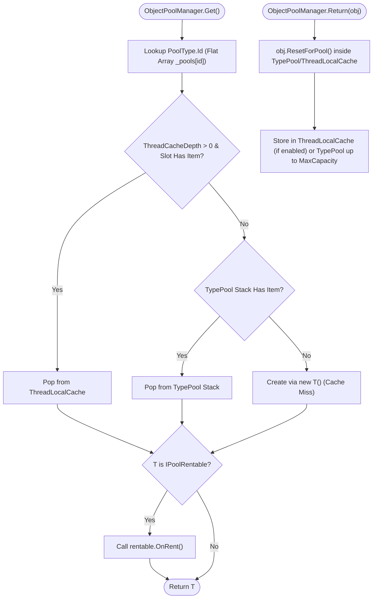

**Không gian tên:** `Nalix.Framework.Memory.Objects` (và `Nalix.Framework.Options`)  
**Assembly:** `Nalix.Framework`

`ObjectPoolManager` (`[Injectable(typeof(IObjectPoolManager))] public sealed partial class ObjectPoolManager : IObjectPoolManager, IDisposable`) quản lý các instance lớp có thể tái sử dụng, triển khai `IPoolable`, trên toàn bộ stack Nalix (packet, `PacketContext<T>`, `PacketSender`, `ObjectMap<K,V>`, vỏ `BufferLease`, và event args của socket).

## Kiến trúc pool đối tượng



## Ánh xạ mã nguồn

- `src/Nalix.Abstractions/IPoolable.cs`
- `src/Nalix.Abstractions/IObjectPoolManager.cs`
- `src/Nalix.Framework/Memory/Objects/ObjectPoolManager.cs`
- `src/Nalix.Framework/Memory/Objects/ObjectPoolManager.Cleanup.cs`
- `src/Nalix.Framework/Memory/Objects/ObjectPoolManager.Report.cs`
- `src/Nalix.Framework/Memory/Objects/TypedObjectPool.cs`
- `src/Nalix.Framework/Options/ObjectPoolOptions.cs`

## Hợp đồng lõi (`IPoolable` & `IPoolRentable`)

```csharp
namespace Nalix.Abstractions;

public interface IPoolable
{
    void ResetForPool();
}

public interface IPoolRentable
{
    void OnRent();
}
```

- **`IPoolable.ResetForPool()`**: Được gọi tự động khi một đối tượng được trả về pool (`Return<T>(obj)`). Các triển khai phải xóa tham chiếu và đặt lại các trường có thể thay đổi.
- **`IPoolRentable.OnRent()`**: Hook tùy chọn được `ObjectPoolManager.Get<T>()` gọi ngay trước khi trả instance đã thuê về cho người gọi.
- **Chống trả về hai lần (`IPoolStateTracked`)**: Các đối tượng triển khai `IPoolStateTracked` (`MarkRented()` / `TryMarkReturned()`) được kiểm tra khi `Return<T>(obj)`, nên việc trả trùng lặp sẽ bị từ chối an toàn (`TotalRejectedReturnCount`).

## Tham chiếu API `ObjectPoolManager`

### Cấu hình tĩnh

| Thành phần | Chữ ký | Mô tả |
| :--- | :--- | :--- |
| `Shared` | `public static ObjectPoolManager Shared { get; }` | Trả về `ObjectPoolManager` toàn cục đã được cấu hình (ném `InvalidOperationException` nếu truy cập trước khi gọi `Configure`). |
| `Configure` | `public static void Configure(ObjectPoolManager manager)` | Đặt instance `ObjectPoolManager.Shared` cho toàn tiến trình (được `NetworkApplicationBuilder` nối tự động). |

### Constructor, thuộc tính & phương thức

| Thành phần | Chữ ký | Mô tả |
| :--- | :--- | :--- |
| `ObjectPoolManager()` | `public ObjectPoolManager()` | Tải `ObjectPoolOptions` từ `ConfigurationManager.Instance` và lập lịch tác vụ định kỳ `obj.trim` nếu `EnableObjectTrimming` là `true`. |
| `ObjectPoolManager(ObjectPoolOptions)` | `public ObjectPoolManager(ObjectPoolOptions config)` | Khởi tạo trình quản lý pool với `ObjectPoolOptions` tường minh. |
| `PoolCount` / `PeakPoolCount` | `int` | Số lượng pool theo kiểu đang quản lý hiện tại và cao nhất. |
| `TotalGetOperations` / `TotalReturnOperations` | `long` | Bộ đếm trọn đời của các thao tác `Get<T>()` và `Return<T>(obj)`. |
| `TotalCacheHits` / `TotalCacheMisses` | `long` | Tổng số lần trúng pool so với cấp phát mới (`new T()`). |
| `CacheHitRate` | `double` | Tỷ lệ trúng cache tổng thể theo phần trăm (`0.0..100.0`). |
| `Uptime` | `TimeSpan` | Thời gian đã trôi qua kể từ khi manager được tạo hoặc `ResetStatistics()` được gọi. |
| `UnhealthyPoolCount` | `int` | Số pool bị đánh dấu không lành mạnh trong lần `PerformHealthCheck()` gần nhất. |
| `Get<T>()` | `public T Get<T>() where T : IPoolable, new()` | Thuê hoặc tạo instance `T` qua tra cứu mảng phẳng `PoolType<T>.Id` (cấp phát trước `DefaultPreallocate` mục khi truy cập lần đầu một kiểu mới). |
| `Return<T>(T)` | `public void Return<T>(T obj) where T : IPoolable` | Đặt lại `obj` (`ResetForPool()`) và trả nó về pool (ném `ArgumentNullException` nếu `obj` là `null`). |
| `GetTypedPool<T>()` | `public TypedObjectPool<T> GetTypedPool<T>() where T : IPoolable, new()` | Trả về adapter `TypedObjectPool<T>` gắn với manager này. |
| `Prealloc<T>(int)` | `public int Prealloc<T>(int count) where T : IPoolable, new()` | Cấp phát trước `count` instance vào pool của `T` (`count > 0`) và trả về số instance đã thêm. |
| `SetMaxCapacity<T>(int)` | `public bool SetMaxCapacity<T>(int maxCapacity) where T : IPoolable` | Đặt dung lượng giữ lại tối đa cho pool của `T` (`maxCapacity >= 0`). |
| `GetTypeInfo<T>()` | `public Dictionary<string, object> GetTypeInfo<T>() where T : IPoolable` | Trả về từ điển chỉ số (`AvailableCount`, `MaxCapacity`, `TotalGets`, `TotalReturns`, `CacheHitRate`, `Outstanding`, `PeakOutstanding`, `Status`, và các percentile vòng đời khi `EnableDiagnostics = true`). |
| `ClearPool<T>()` / `ClearAllPools()` | `public int ClearPool<T>()` / `public int ClearAllPools()` | Xóa các instance trong pool và trả về số đối tượng đã loại bỏ. |
| `PerformHealthCheck()` | `public int PerformHealthCheck()` | Đánh giá tỷ lệ miss theo cửa sổ trên các pool đang hoạt động và trả về số pool không lành mạnh. |
| `ResetMetrics()` / `ResetStatistics()` | `public void ResetMetrics()` / `public void ResetStatistics()` | Đặt lại bộ đếm toàn cục và theo từng pool. |
| `GenerateReport()` / `WriteReportData` | `public string GenerateReport()` / `public void WriteReportData(Utf8JsonWriter writer)` | Tạo báo cáo văn bản dễ đọc hoặc JSON có cấu trúc. |

## `ObjectPoolOptions` (`Nalix.Framework.Options`)

Được cấu hình qua `[ObjectPool]` trong `default.ini` hoặc `builder.Configure<ObjectPoolOptions>(...)`:

| Thuộc tính | Kiểu | Mặc định | Ràng buộc | Mô tả |
| :--- | :--- | :---: | :--- | :--- |
| `EnableDiagnostics` | `bool` | `false` | — | Bật theo dõi `PoolSentinel` cho vòng đời đối tượng (`Avg`/`p95`/`Max`) và các lần thuê bất thường kéo dài. |
| `EnableMetrics` | `bool` | `true` | — | Bật bộ đếm hit/miss và `Outstanding` nhẹ, dùng nguyên tử (an toàn cho production). |
| `CaptureStackTraces` | `bool` | `false` | — | Ghi stack trace cấp phát khi `Get<T>()` nếu `EnableDiagnostics = true` (tốn kém; chỉ dùng khi gỡ lỗi rò rỉ). |
| `SuspiciousThresholdSeconds` | `int` | `30` | `[ValueRange(0, 3600)]` | Ngưỡng tính bằng giây; sau thời gian này, đối tượng chưa được trả sẽ bị đánh dấu đáng ngờ. |
| `EnableLeakDetection` | `bool` | `false` | — | Dùng finalizer của `PoolSentinel` để phát hiện đối tượng đã thuê bị GC thu hồi mà không gọi `Return<T>()` (yêu cầu `EnableDiagnostics = true` để `PoolSentinel` được gắn khi `Get<T>()`). |
| `LifetimeReservoirSize` | `int` | `64` | `[ValueRange(16, 1024)]` | Số mẫu thời lượng thuê gần nhất giữ cho mỗi pool, dùng để tính `p95LifetimeMs`. |
| `EnableObjectTrimming` | `bool` | `true` | — | Lập lịch tác vụ định kỳ `TaskManager` (`obj.trim`) để giải phóng các đối tượng pool đang rảnh. |
| `TrimIntervalMinutes` | `int` | `5` | `[ValueRange(1, 60)]` | Khoảng thời gian (phút) giữa các chu kỳ cắt tỉa thông thường. |
| `DeepTrimIntervalMinutes` | `int` | `30` | `[ValueRange(5, 120)]` | Khoảng thời gian (phút) giữa các chu kỳ cắt tỉa sâu/mạnh. |
| `BaseKeepPercentage` | `int` | `75` | `[ValueRange(50, 90)]` | Phần trăm dung lượng được giữ lại trong chu kỳ cắt tỉa thông thường. |
| `DeepTrimPercentage` | `int` | `25` | `[ValueRange(10, 45)]` | Phần trăm dung lượng được giữ lại trong chu kỳ cắt tỉa sâu. |
| `TrimDecayFactor` | `double` | `0.5` | `[ValueRange(0.1, 1.0)]` | Tỷ lệ đối tượng dư thừa bị loại bỏ mỗi chu kỳ cắt tỉa (suy giảm theo cấp số nhân). |
| `HotHitRateThreshold` | `double` | `85.0` | `[ValueRange(75.0, 98.0)]` | Tỷ lệ trúng (phần trăm) mà trên đó một pool được coi là "nóng" và chỉ được cắt tỉa nhẹ. |
| `MinimumKeepObjects` | `int` | `8` | `[ValueRange(4, 64)]` | Ngưỡng tối thiểu luôn được giữ trong mỗi pool khi cắt tỉa. |
| `DefaultMaxPoolSize` | `int` | `2048` | `[ValueRange(1024, 1_000_000)]` | Dung lượng tối đa mặc định cho các pool theo kiểu mới tạo. |
| `DefaultPreallocate` | `int` | `8` | `[ValueRange(0, 1_000_000)]` | Số instance được cấp phát trước khi một pool theo kiểu được tạo lần đầu. |
| `ThreadCacheDepth` | `int` | `0` | `[ValueRange(0, 4)]` | Độ sâu `ThreadLocalCache<T>` theo từng luồng (`0` = tắt mặc định để các continuation `async`/`await` chạy trên các luồng ThreadPool khác nhau không làm kẹt đối tượng trong pool). |

## `ListPool<T>` (`Nalix.Framework.Memory.Pools`)

`ListPool<T>` (`src/Nalix.Framework/Memory/Pools/ListPool.cs`) là pool an toàn đa luồng, chứa các instance `List<T>` có thể tái sử dụng. `ListPool<T>.Instance` là singleton dùng chung (kích thước pool tối đa mặc định `1024`, dung lượng ban đầu `16`); constructor public `ListPool(int maxPoolSize, int initialCapacity)` tạo một pool tùy chỉnh.

- `Rent(int minimumCapacity = 0)` / `Return(List<T> list, bool clearItems = true)` — thuê và trả một list.
- `Prealloc(int count, int capacity = 0)`, `Trim(int maximumSize = 0)`, `Clear()` — bảo trì pool.
- `AvailableCount`, `CreatedCount`, `RentedCount`, `TotalRentOperations`, `TotalReturnOperations`, `TrimmedCount`, `UptimeMs`, `GetStatistics()`, `ResetStatistics()` — thống kê.

## API liên quan

- [Pool đối tượng theo kiểu (TypedObjectPool<T>)](./typed-object-pools.md)
- [Bản đồ đối tượng (ObjectMap<TKey, TValue>)](./object-map.md)
- [Quản lý bộ đệm](../../environment/memory/buffer-management.md)
- [Đường đi không cấp phát bộ nhớ (Zero-Allocation)](../../../concepts/internals/zero-allocation.md)
