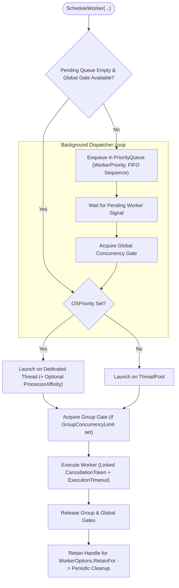

**Không gian tên:** `Nalix.Framework.Tasks` (và `Nalix.Framework.Options`)  
**Assembly:** `Nalix.Framework`

`TaskManager` (`[Injectable(typeof(ITaskManager))] public sealed partial class TaskManager : ITaskManager, IDisposable`) điều phối các worker nền chạy một lần hoặc chạy lâu và các tác vụ định kỳ, với kiểm soát đồng thời theo nhóm và toàn cục, hàng đợi ưu tiên, điều chỉnh đồng thời động theo tải CPU, và telemetry `IReportable`.

## Ánh xạ mã nguồn

- `src/Nalix.Abstractions/Concurrency/ITaskManager.cs`
- `src/Nalix.Framework/Tasks/TaskManager.cs`
- `src/Nalix.Framework/Tasks/TaskManager.PrivateMethods.cs`
- `src/Nalix.Framework/Tasks/TaskManager.Affinity.cs`
- `src/Nalix.Framework/Tasks/TaskManager.Cleanup.cs`
- `src/Nalix.Framework/Tasks/TaskManager.Report.cs`
- `src/Nalix.Framework/Options/TaskManagerOptions.cs`

## Kiến trúc lập lịch & đồng thời

## Constructor & thuộc tính công khai

| Thành phần | Kiểu / Chữ ký | Mô tả |
| :--- | :--- | :--- |
| `TaskManager()` | `public TaskManager()` | Khởi tạo `TaskManager` bằng `ConfigurationManager.Instance.Get<TaskManagerOptions>()`. |
| `TaskManager(TaskManagerOptions?)` | `public TaskManager(TaskManagerOptions? options = null)` | Khởi tạo `TaskManager` với `TaskManagerOptions` tường minh và kiểm tra tính hợp lệ. |
| `Title` | `string` | Tóm tắt trạng thái ngắn gọn (`"Workers: X running / Y total \| Recurring: Z"`). |
| `ConcurrencyLimitRatio` | `double` | Tỷ lệ (`0.0..1.0`) giữa giới hạn đồng thời động hiện tại và `TaskManagerOptions.MaxWorkers`. |
| `AverageWorkerUptime` | `double` | Thời gian thực thi trung bình của các worker đã hoàn thành, tính bằng mili giây. |
| `AverageRecurringExecutionTime` | `double` | Thời gian thực thi trung bình của các lần chạy tác vụ định kỳ, tính bằng mili giây. |
| `AverageWorkerWaitTime` | `double` | Thời gian chờ trung bình trong hàng đợi trước khi worker bắt đầu chạy, tính bằng mili giây. |
| `P95WorkerUptime` | `double` | Xấp xỉ percentile thứ 95 của thời gian thực thi worker, tính bằng mili giây. |
| `P99WorkerUptime` | `double` | Xấp xỉ percentile thứ 99 của thời gian thực thi worker, tính bằng mili giây. |
| `PeakRunningWorkerCount` | `int` | Mức cao nhất từng đạt của số worker chạy đồng thời. |
| `WorkerErrorCount` | `int` | Tổng số ngoại lệ không được xử lý từ worker đã ghi nhận. |
| `RecurringErrorCount` | `int` | Tổng số ngoại lệ không được xử lý từ tác vụ định kỳ đã ghi nhận. |

## Phương thức công khai

### Lập lịch & thực thi

| Phương thức | Chữ ký | Mô tả |
| :--- | :--- | :--- |
| `ScheduleWorker` (delegate async) | `public IWorkerHandle ScheduleWorker(string name, string group, Func<IWorkerContext, CancellationToken, ValueTask> work, IWorkerOptions? options = null)` | Lập lịch một worker được quản lý, có kiểm soát theo nhóm/toàn cục, xếp hàng ưu tiên và theo dõi tiến độ. |
| `ScheduleWorker` (`IWorker`) | `public IWorkerHandle ScheduleWorker(IWorker worker)` | Lập lịch một instance `IWorker`, đọc metadata `[Worker(name, group, ...)]` nếu có (trả về `NoOpWorkerHandle.Instance` khi `Enabled = false`). |
| `ScheduleWorker<TState>` (fire-and-forget) | `public void ScheduleWorker<TState>(string name, Action<TState> work, TState state)` | Đưa một callback trạng thái nhẹ trực tiếp vào `ThreadPool.UnsafeQueueUserWorkItem`, đồng thời theo dõi telemetry hoàn thành/lỗi. |
| `ScheduleRecurring` | `public IRecurringHandle ScheduleRecurring(string name, TimeSpan interval, Func<CancellationToken, ValueTask> work, IRecurringOptions? options = null)` | Khởi động một vòng lặp nền định kỳ có tên (`interval > TimeSpan.Zero`; ném `InternalErrorException` nếu trùng `name`). |
| `RunOnceAsync` | `public ValueTask RunOnceAsync(string name, Func<CancellationToken, ValueTask> work, CancellationToken ct = default)` | Thực thi `work` ngay tại chỗ một lần, kèm ghi log lỗi chẩn đoán. |

### Điều khiển runtime, hủy & truy vấn

| Phương thức | Chữ ký | Mô tả |
| :--- | :--- | :--- |
| `SetGroupConcurrencyLimit` | `public void SetGroupConcurrencyLimit(string group, int limit)` | Cập nhật số worker đồng thời tối đa cho `group` ngay khi chạy. |
| `PauseRecurring` | `public void PauseRecurring(string name)` | Tạm dừng các lần thực thi của tác vụ định kỳ `name` cho đến khi gọi `ResumeRecurring`. |
| `ResumeRecurring` | `public void ResumeRecurring(string name)` | Tiếp tục một tác vụ định kỳ đã tạm dừng. |
| `CancelWorker` | `public void CancelWorker(ISnowflake id)` | Hủy một worker cụ thể theo định danh `ISnowflake`. |
| `CancelGroup` | `public int CancelGroup(string group)` | Hủy mọi worker trong `group` và trả về số worker đã hủy. |
| `CancelAllWorkers` | `public int CancelAllWorkers()` | Hủy mọi worker đang hoạt động và trả về số worker đã hủy. |
| `CancelRecurring` | `public void CancelRecurring(string? name)` | Hủy và gỡ một tác vụ định kỳ theo `name`. |
| `GetWorkers` | `public IReadOnlyCollection<IWorkerHandle> GetWorkers(bool runningOnly = true, string? group = null)` | Trả về snapshot các worker, có thể lọc theo `runningOnly` và khớp chính xác `group`. |
| `TryGetWorker` | `public bool TryGetWorker(ISnowflake id, [NotNullWhen(true)] out IWorkerHandle? handle)` | Tra cứu handle worker theo ID `ISnowflake`. |
| `GetRecurring` | `public IReadOnlyCollection<IRecurringHandle> GetRecurring()` | Trả về snapshot mọi tác vụ định kỳ đã đăng ký. |
| `TryGetRecurring` | `public bool TryGetRecurring(string name, [NotNullWhen(true)] out IRecurringHandle? handle)` | Tra cứu handle tác vụ định kỳ theo `name`. |
| `WaitGroupAsync` | `public Task WaitGroupAsync(string group, CancellationToken ct = default)` | Chờ mọi worker hiện có trong `group` hoàn thành (hỗ trợ ký tự đại diện tiền tố khi `group` kết thúc bằng `*`, ví dụ `"net.*"`). |
| `GenerateReport` / `WriteReportData` | `public string GenerateReport()` / `public void WriteReportData(Utf8JsonWriter writer)` | Xuất chẩn đoán dạng văn bản dễ đọc hoặc JSON có cấu trúc. |

## `TaskManagerOptions` (`Nalix.Framework.Options`)

Được cấu hình qua `[TaskManager]` trong `default.ini` hoặc `builder.Configure<TaskManagerOptions>(...)`:

| Thuộc tính | Kiểu | Mặc định | Ràng buộc | Mô tả |
| :--- | :--- | :---: | :--- | :--- |
| `IsEnableLatency` | `bool` | `true` | — | Bật theo dõi độ trễ thực thi và histogram thời gian chờ. |
| `DynamicAdjustmentEnabled` | `bool` | `true` | — | Khởi động worker nội bộ `task.monitor` để điều chỉnh đồng thời toàn cục theo tải CPU. |
| `MaxWorkers` | `int` | `100` | `> 0` | Số worker đồng thời tối đa toàn cục. |
| `ThresholdHighCpu` | `double` | `80.0` | `[ValueRange(0.0, 100.0)]` | Mức sử dụng CPU (phần trăm) mà trên đó số đồng thời toàn cục bị giảm (`>= ThresholdLowCpu`). |
| `ThresholdLowCpu` | `double` | `40.0` | `[ValueRange(0.0, 100.0)]` | Mức sử dụng CPU (phần trăm) mà dưới đó số đồng thời toàn cục được tăng trở lại về `MaxWorkers`. |
| `ObservingInterval` | `TimeSpan` | `00:00:05` (`5s`) | `> TimeSpan.Zero` | Khoảng thời gian giữa các lần quan sát tải CPU. |
| `CpuWarmupDuration` | `TimeSpan` | `00:01:00` (`60s`) | `>= TimeSpan.Zero` | Thời gian khởi động làm nóng trước khi bắt đầu điều chỉnh đồng thời theo CPU. |
| `AdjustmentStreakRequired` | `int` | `3` | `[ValueRange(1, 64)]` | Số mẫu CPU cao/thấp liên tiếp cần có trước khi điều chỉnh đồng thời (hysteresis). |
| `BusyWaitThreshold` | `TimeSpan` | `200 µs` (`2000` ticks) | `>= TimeSpan.Zero` | Ngưỡng tối đa cho spin-wait độ chính xác cao của bộ hẹn giờ định kỳ. |
| `BackoffMaxPower` | `int` | `5` (`32x`) | `[ValueRange(0, 16)]` | Số mũ tối đa ($2^n$) cho backoff khi tác vụ định kỳ lỗi. |
| `BackoffBaseInterval` | `TimeSpan` | `00:00:01` (`1s`) | `>= 10 ms` | Khoảng cơ sở được nhân với $2^{\text{failures}}$ trong backoff của tác vụ định kỳ. |
| `CleanupInterval` | `TimeSpan` | `00:00:30` (`30s`) | `>= 1 s` | Khoảng thời gian mà các worker đã hoàn thành và vượt quá cửa sổ `RetainFor` sẽ bị xóa. |

## `TaskExtensions` (`Nalix.Framework.Extensions`)

`TaskExtensions` (`src/Nalix.Framework/Extensions/TaskExtensions.cs`) là lớp static chứa các helper để dùng task từ mã không `async`:

- `Await(this Task)`, `Await(this Task, bool continueOnCapturedContext)`, `Await(this ValueTask)`, `Await<TResult>(this Task<TResult>)`, `Await<TResult>(this ValueTask<TResult>)` — chặn cho đến khi hoàn thành và ném lại lỗi gốc.
- `WithTimeout<T>(this Task<T>, int msTimeout)` — trả về kết quả, hoặc `default` nếu hết thời gian chờ trước.
- `LinkCancellation<T>(this TaskCompletionSource<T>, CancellationToken)` — đánh dấu TCS là đã hủy khi token kích hoạt; trả về một `IDisposable` đăng ký.

## API liên quan

- [WorkerOptions](./options/worker-options.md)
- [RecurringOptions](./options/recurring-options.md)
- [Hợp đồng Concurrency (ITaskManager, IWorker)](../abstractions/concurrency-contracts.md)
