**Không gian tên:** `Nalix.Hosting`, `Nalix.Hosting.Protocols`  
**Assembly:** `Nalix.Hosting`

`Nalix.Hosting` cung cấp một builder fluent theo phong cách Microsoft (`INetworkApplicationBuilder` / `NetworkApplicationBuilder`) và host máy chủ (`NetworkApplication`), điều phối việc nạp cấu hình, đăng ký phụ thuộc, nối handler packet lúc biên dịch, và vòng đời listener đa transport (TCP, UDP và WebSocket).

## Ánh xạ mã nguồn

- `src/Nalix.Hosting/NetworkApplication.cs`
- `src/Nalix.Hosting/INetworkApplicationBuilder.cs`
- `src/Nalix.Hosting/NetworkApplicationBuilder.cs`
- `src/Nalix.Hosting/NetworkApplicationBuilder.Extensions.cs`
- `src/Nalix.Hosting/IProtocolBindingBuilder.cs`
- `src/Nalix.Hosting/IWebSocketBindingBuilder.cs`
- `src/Nalix.Hosting/Protocols/DefaultProtocol.cs`
- `src/Nalix.Hosting/Protocols/DefaultFrameProcessor.cs`
- `src/Nalix.Hosting/Protocols/DefaultOpCodeExtractor.cs`

## Luồng khởi động & vòng đời

```mermaid
flowchart LR
    subgraph Phase1["1. Fluent Configuration"]
        CB["NetworkApplication.CreateBuilder()"] --> Opts["Configure<TOptions>() / UseLogger()"]
        Opts --> Feat["UseSecureConnections() / UseSessions() / UseGroups()"]
        Feat --> Map["MapHandlers<THandler>() / RegisterScoped<T>()"]
        Map --> Bind["MapTcp<T>() / MapUdp<T>() / MapWebSocket<T>().Bind()"]
    end

    subgraph Phase2["2. Build()"]
        Bind --> Bld["Build()"]
        Bld --> RegPkt["RegisterPacketRegistry() + ApplyOptions()"]
        RegPkt --> Factories["Capture Dispatch & Listener Factories"]
    end

    subgraph Phase3["3. ActivateAsync() / RunAsync()"]
        Factories --> Prep["Register Logger, Hub, Guard, BufferPool, ObjectPool"]
        Prep --> Disp["Create & Activate IPacketDispatch"]
        Disp --> Listen["Construct & Activate TCP / UDP / WebSocket Listeners"]
    end
```



## Tham chiếu `NetworkApplication`

```csharp
public sealed class NetworkApplication : IActivatableAsync, IAsyncDisposable
{
    public static NetworkApplicationBuilder CreateBuilder();
    public static NetworkApplication CreateMinimal(ushort? port = null);

    public Task RunAsync(CancellationToken cancellationToken = default);
    public Task ActivateAsync(CancellationToken cancellationToken = default);
    public Task DeactivateAsync(CancellationToken cancellationToken = default);
    public ValueTask DisposeAsync();
    public void Dispose();
}
```

### Chi tiết phương thức

| Phương thức | Mô tả |
| :--- | :--- |
| `CreateBuilder()` | Tạo một `NetworkApplicationBuilder` mới, được khởi tạo với `HostingBuilderContext` rỗng. |
| `CreateMinimal(ushort? port = null)` | Tạo một `NetworkApplication` sẵn sàng chạy, được gắn với `MapTcp<DefaultProtocol>()` trên `port` (hoặc `NetworkSocketOptions.Port` khi `null`). Lưu ý: việc quét assembly lúc chạy bị bỏ qua để đảm bảo an toàn cho Native AOT; handler được phân giải qua `PacketHandlerRegistry` lúc biên dịch hoặc `MapHandlers<T>()`. |
| `ActivateAsync(CancellationToken)` | Lấy cổng khóa vòng đời, gọi `PrepareCallbacks` (đăng ký `ILogger`, `IConnectionHub`, `IConnectionGuard`, `IBufferPoolManager`, và `IObjectPoolManager`), tạo và kích hoạt `IPacketDispatch`, khởi tạo từng listener đã gắn (`TcpServerListener`, `UdpServerListener`, `UdpPassthroughListener`, `WebSocketServerListener`), đăng ký chúng vào `ReportRegistry`, và kích hoạt chúng. Hoàn tác phần đã kích hoạt nếu có lỗi. |
| `RunAsync(CancellationToken)` | Gọi `ActivateAsync(cancellationToken)`, chờ `Task.Delay(Timeout.InfiniteTimeSpan, cancellationToken)`, và đảm bảo `DeactivateAsync(CancellationToken.None)` được gọi trong khối `finally`. |
| `DeactivateAsync(CancellationToken)` | Hủy kích hoạt và dispose mọi listener theo thứ tự ngược với lúc đăng ký, dispose mọi protocol theo thứ tự ngược, hủy kích hoạt `IPacketDispatch`, và chờ `TaskManager.WaitGroupAsync("net/*", ct)` cùng `WaitGroupAsync("time/*", ct)` để không worker nền nào bị rò rỉ qua các lần khởi động lại. |
| `DisposeAsync()` / `Dispose()` | Gọi `DeactivateAsync(CancellationToken.None)` một cách idempotent và dispose `SemaphoreSlim` gate nội bộ. |

---

## Tham chiếu `INetworkApplicationBuilder`

### Các phương thức builder cốt lõi

| Phương thức | Mô tả |
| :--- | :--- |
| `Configure<TOptions>(Action<TOptions>)` | Xếp hàng một bộ biến đổi cấu hình cho `TOptions : ConfigurationLoader, new()`. Trong `Build()`, lấy `ConfigurationManager.Instance.Get<TOptions>()`, chạy delegate, gọi `Validate()` nếu `TOptions` triển khai `IValidatableConfiguration`, và đánh dấu kiểu tùy chọn này là đã cấu hình thủ công. |
| `ConfigureDispatchOptions(Action<PacketDispatchOptions<IPacket>>)` | Đăng ký callback để cấu hình middleware, rate limiter, các stage xử lý kết quả handler, hoặc xử lý lỗi tùy chỉnh trên [PacketDispatchOptions&lt;IPacket&gt;](../options/runtime/packet-dispatch-options.md). |
| `ConfigureDispatch(Func<Action<PacketDispatchOptions<IPacket>>, IPacketDispatch>)` | Thay thế `PacketDispatchChannel` mặc định bằng một triển khai `IPacketDispatch` tùy chỉnh (ví dụ `PacketRouter` đồng bộ). |
| `UseLogger(ILogger)` | Đăng ký `logger` ngay vào `InstanceManager` và gắn listener sự kiện `DiagnosticChannel` nội bộ. |
| `UseConnectionHub(IConnectionHub)` | Đăng ký `IConnectionHub` tùy chỉnh (và `IConnectionBroadcaster` nếu được triển khai). Khi bỏ qua, một `ConnectionHub` mặc định được tạo trong `ActivateAsync`. |
| `UseConnectionGuard(IConnectionGuard)` | Đăng ký `IConnectionGuard` tùy chỉnh (và `IProofOfWorkPolicy` nếu được triển khai). Khi bỏ qua, một `ConnectionGuard` mặc định được tạo trong `ActivateAsync`. |
| `UseBufferPoolManager(IBufferPoolManager)` | Đăng ký `IBufferPoolManager` tùy chỉnh và gắn `BufferLease.ByteArrayPool`. |
| `UseObjectPoolManager(IObjectPoolManager)` | Đăng ký `IObjectPoolManager` tùy chỉnh và cấu hình `BufferLease`, `PacketRegistry`, và `ObjectPoolManager`. |
| `RegisterScoped<TService>(Func<IPacketScope, TService>)` | Đăng ký factory dịch vụ theo phạm vi từng packet (`where TService : class`) trong `ScopedServiceRegistry.Instance`, dành cho các tham số handler `[FromScope]`. |
| `MapHandlers<THandler>()` | Kiểm tra và đăng ký một class `[PacketController]`, được tạo qua `InstanceManager.Instance.CreateInstanceWithInjection(typeof(THandler))`. |
| `MapHandlers<THandler>(Func<THandler>)` | Kiểm tra và đăng ký một class `[PacketController]`, được tạo qua một delegate factory tường minh. |
| `MapHandlers(Type)` | Kiểm tra và đăng ký trực tiếp một kiểu `[PacketController]` (hỗ trợ các class handler tĩnh). |
| `MapTcp<TProtocol>()` | Bắt đầu một binding listener TCP fluent (`IProtocolBindingBuilder`) cho `TProtocol : class, IProtocol`. |
| `MapUdp<TProtocol>()` | Bắt đầu một binding listener UDP fluent (`IProtocolBindingBuilder`) cho `TProtocol : class, IProtocol`. |
| `MapWebSocket<TProtocol>()` | Bắt đầu một binding listener WebSocket fluent ([IWebSocketBindingBuilder](./websocket-binding.md)) cho `TProtocol : class, IProtocol`. |
| `Build()` | Áp dụng các tùy chọn, đăng ký registry packet lúc biên dịch, và trả về một `NetworkApplication` đã được cấu hình. |

:::warning[Các phương thức binding đã lỗi thời]
`ListenTcp<TProtocol>()`, `ListenUdp<TProtocol>()`, và `ListenWebSocket<TProtocol>()` được đánh dấu `[Obsolete]` trong `INetworkApplicationBuilder`. Trong mã mới, luôn dùng `MapTcp<TProtocol>()`, `MapUdp<TProtocol>()`, và `MapWebSocket<TProtocol>()`.
:::

---

## Phương thức mở rộng tính năng (`NetworkApplicationBuilderExtensions`)

`Nalix.Hosting` cung cấp các phương thức mở rộng tùy chọn (opt-in) trên `INetworkApplicationBuilder` cho các hệ thống con runtime tích hợp sẵn:

| Phương thức mở rộng | Handler & dịch vụ được đăng ký |
| :--- | :--- |
| `UseTimeSync()` | Đăng ký `SystemTimeSyncHandlers` (`ControlType.TIMESYNCREQUEST`). |
| `UseSystemControl()` | Đăng ký idempotent `SystemControlHandlers` (`PING`, `DISCONNECT`, `CIPHER_UPDATE`, `PUBLIC_KEY_REQUEST`, v.v.). |
| `UseSecureConnections(string? certificatePath = null)` | Đăng ký `FileCertificateStore` làm `ICertificateStore` (nếu chưa có), đăng ký idempotent `HandshakeHandlers`, `ProofOfWorkHandlers`, và `SystemControlHandlers`, và khởi tạo chứng chỉ máy chủ X25519 tĩnh (`HandshakeHandlers.SetCertificatePath(certificatePath)` hoặc `HandshakeHandlers.Initialize()`). |
| `UseSessions()` | Đăng ký `SessionHandlers` và gọi `ServiceRegistrar.RegisterSessions()` để đăng ký `ISessionService` (`SessionService`) và `SessionPersistenceObserver`. |
| `UseGroups()` | Gọi `ServiceRegistrar.RegisterGroups()` để đăng ký `IConnectionGroupRegistry` (`InMemoryGroupStore`) và `GroupMembershipObserver`. |
| `UseSessionService(SessionService)` | Đăng ký một instance `SessionService` tùy chỉnh làm `ISessionService`. |
| `UseSessionStore(ISessionStore)` | Đăng ký một `ISessionStore` lưu trữ tùy chỉnh (ví dụ Redis) cho `SessionService`. |
| `UseSessionFactory(ISessionFactory)` | Đăng ký một `ISessionFactory` tùy chỉnh cho `SessionService`. |

---

## Tham chiếu `IProtocolBindingBuilder` (TCP & UDP)

`MapTcp<TProtocol>()` và `MapUdp<TProtocol>()` trả về một `IProtocolBindingBuilder`:

```csharp
public interface IProtocolBindingBuilder
{
    IProtocolBindingBuilder OnPort(ushort port);
    IProtocolBindingBuilder WithMode(OperatingMode mode);
    IProtocolBindingBuilder WithFactory(Func<IPacketDispatch, IProtocol> factory);
    IProtocolBindingBuilder WithAuthentication(Func<IConnection, EndPoint, ReadOnlySpan<byte>, bool> authen);
    INetworkApplicationBuilder Bind();
}
```

| Phương thức | Áp dụng cho | Mô tả |
| :--- | :--- | :--- |
| `OnPort(ushort port)` | TCP & UDP | Ghi đè `NetworkSocketOptions.Port` (`57206`) cho binding listener cụ thể này. |
| `WithFactory(Func<IPacketDispatch, IProtocol>)` | TCP & UDP | Cung cấp factory tùy chỉnh để khởi tạo `TProtocol`. Khi bỏ qua, `NetworkApplicationBuilder` tự động phân giải các constructor khớp với `(ILogger, IPacketDispatch)`, `(IPacketDispatch, ILogger)`, `(IPacketDispatch)`, hoặc `()`. |
| `WithMode(OperatingMode mode)` | Chỉ UDP | Chọn `OperatingMode.Server` (`0`, mặc định, `UdpListenerBase` có xác thực) hoặc `OperatingMode.Passthrough` (`1`, `UdpPassthroughListener` thô, không có khung session/MAC của Nalix). |
| `WithAuthentication(Func<IConnection, EndPoint, ReadOnlySpan<byte>, bool>)` | UDP (chế độ `Server`) | Cung cấp predicate xác thực datagram tùy chỉnh cho `UdpServerListener`. Ném `InvalidOperationException` nếu kết hợp với `OperatingMode.Passthrough`. |
| `Bind()` | TCP & UDP | Hoàn tất binding và trả về `INetworkApplicationBuilder` cha. |

---

## Tham chiếu `DefaultProtocol`

Với các ứng dụng đẩy mọi khung trực tiếp vào `IPacketDispatch` mà không cần máy trạng thái ở tầng protocol riêng, `Nalix.Hosting.Protocols.DefaultProtocol` giúp bạn không cần tự viết một lớp con `Protocol`:

```csharp
[Injectable]
public sealed class DefaultProtocol : Protocol
{
    public DefaultProtocol(ILogger logger, IPacketDispatch dispatch);
    public override IFrameProcessor FrameProcessor { get; }
    public override IOpCodeExtractor OpCodeExtractor { get; }
    public override void ProcessMessage(object? sender, IConnectionEventArgs args);
}
```

- Đặt `IsAccepting = true` và `KeepConnectionOpen = true` khi khởi tạo.
- Dùng `DefaultFrameProcessor` và `DefaultOpCodeExtractor` (đọc `payload.AsHeaderRef().OpCode` từ `PacketHeader`).
- Chuyển trực tiếp `args.Lease` và `args.Connection` cho `_dispatch.HandlePacket(args.Lease, args.Connection)`.

---

## Ví dụ sử dụng thực tế

```csharp
using System.Threading;
using System.Threading.Tasks;
using Microsoft.Extensions.Logging;
using Nalix.Hosting;
using Nalix.Hosting.Protocols;
using Nalix.Network.Options;
using Nalix.Runtime.Middleware;

public static class Program
{
    public static async Task Main(string[] args)
    {
        using ILoggerFactory loggerFactory = LoggerFactory.Create(b => b.AddConsole());
        ILogger logger = loggerFactory.CreateLogger("GameServer");

        await using NetworkApplication app = NetworkApplication.CreateBuilder()
            .UseLogger(logger)
            .Configure<NetworkSocketOptions>(opt =>
            {
                opt.Port = 57206;
                opt.EnableDualStack = true;
            })
            .UseSecureConnections()
            .UseSessions()
            .UseGroups()
            .UseTimeSync()
            .ConfigureDispatchOptions(dispatch =>
            {
                dispatch.WithMiddleware(new TokenBucketMiddleware());
            })
            .MapHandlers<PlayerController>()
            .MapTcp<DefaultProtocol>().OnPort(57206).Bind()
            .MapUdp<DefaultProtocol>().OnPort(57206).Bind()
            .Build();

        using CancellationTokenSource cts = new();
        Console.CancelKeyPress += (_, e) =>
        {
            e.Cancel = true;
            cts.Cancel();
        };

        await app.RunAsync(cts.Token);
    }
}
```

## API liên quan

- [Ràng buộc WebSocket Hosting](./websocket-binding.md)
- [Tùy chọn Hosting](../options/hosting/hosting-options.md)
- [Protocol](../network/protocol.md)
- [TCP Listener](../network/tcp-listener.md)
- [UDP Listener](../network/udp-listener.md)
- [Packet Dispatch Channel & Router](../runtime/routing/dispatch-channel-and-router.md)
- [Tùy chọn Packet Dispatch](../options/runtime/packet-dispatch-options.md)
