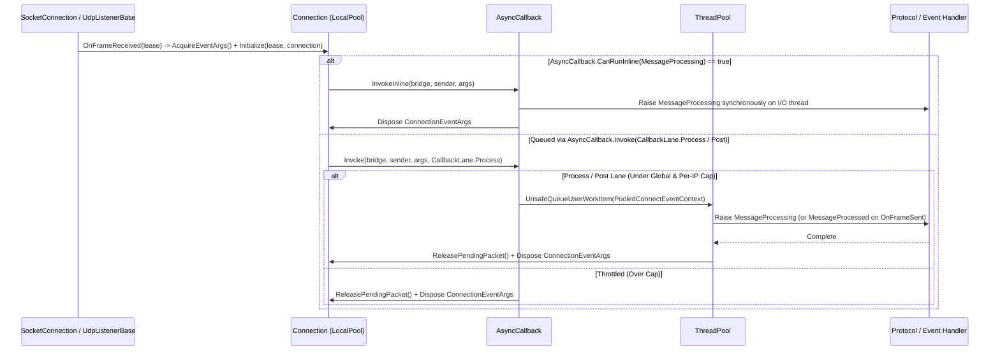

**Namespace:** `Nalix.Network.Connections`  
**Assembly:** `Nalix.Network`

Các sự kiện mạng trên `IConnection` (`MessageProcessing`, `MessageProcessed` và `ConnectionClosed`) được mang bởi các instance `ConnectionEventArgs` lấy từ pool và được lập lịch qua bộ điều phối đa làn nội bộ `AsyncCallback` (`CallbackLane.Process`, `CallbackLane.Post` và `InvokeHighPriority`).

## Nguồn mã

- `src/Nalix.Abstractions/Networking/IConnectionEventArgs.cs`
- `src/Nalix.Network/Connections/Connection.EventArgs.cs`
- `src/Nalix.Network/Connections/Connection.cs`
- `src/Nalix.Network/Internal/Transport/AsyncCallback.cs`
- `src/Nalix.Network/Options/NetworkCallbackOptions.cs`

## Pipeline thực thi sự kiện



## `ConnectionEventArgs` (`public sealed class`)

```csharp
namespace Nalix.Network.Connections;

public sealed class ConnectionEventArgs : EventArgs, IConnectionEventArgs, IPoolable, IPoolRentable
{
    public IBufferLease? Lease { get; }
    public IConnection Connection { get; }
    public INetworkEndpoint NetworkEndpoint { get; }

    public IBufferLease? ExchangeLease([Borrowed] IBufferLease? newLease);
    public void OnRent();
    public void ResetForPool();
    public void Dispose();
}
```

- **`ExchangeLease(newLease)`**: Hoán đổi nguyên tử `IBufferLease?` bên dưới (được `TcpListenerBase` / `WebSocketListenerBase` dùng sau khi `FramePipeline.ProcessInbound` giải mã hoặc giải nén khung đến tại chỗ) và trả về lease trước đó để bên gọi dispose.
- **Pool hai tầng**: `Connection` và `WebSocketConnection` duy trì một `LocalPool` lock-free 8 slot cho `ConnectionEventArgs` và `PooledConnectEventContext`, và chuyển sang `ObjectPoolManager.Shared` khi pool cục bộ của kết nối đã đầy.

:::warning[Tuyệt đối không giữ `ConnectionEventArgs`]
`ConnectionEventArgs` và `Lease` của nó được tự động trả về pool ngay khi cầu nối sự kiện hoàn tất (trừ khi quyền sở hữu `Lease` đã được chuyển qua `Retain()` hoặc `ExchangeLease(null)`). Không bao giờ lưu `args` sau khi handler kết thúc.
:::

## Ba làn điều phối trong `AsyncCallback`

| Sự kiện | Làn `AsyncCallback` | Giới hạn toàn cục | Giới hạn theo IP | Hành vi |
| :--- | :--- | ---: | ---: | :--- |
| `MessageProcessing` | `CallbackLane.Process` (hoặc `InvokeInline`) | `MaxPendingNormalCallbacks` (`10,000`) | `MaxPendingPerIp` (`64`) | Giải mã/giải nén khung (`FramePipeline.ProcessInbound`), kiểm tra sequence và gọi `IProtocol.ProcessMessage`. Thực thi inline qua `AsyncCallback.CanRunInline` / `InvokeInline` khi được gắn với một subscriber `IFrameProcessor { SupportsInlineProcessing: true }` duy nhất. |
| `MessageProcessed` | `CallbackLane.Post` | `MaxPendingPostCallbacks` (`5,000`) | `MaxPendingPostPerIp` (`32`) | Được kích hoạt bởi `Connection.OnFrameSent` khi việc gửi khung đi hoàn tất; gọi `IProtocol.PostProcessMessage` (số liệu và việc đóng `KeepConnectionOpen`). |
| `ConnectionClosed` | `InvokeHighPriority` | Không giới hạn | Không giới hạn | Bỏ qua mọi cơ chế backpressure của làn thường và làn post, để việc dọn dẹp khi ngắt kết nối và hủy đăng ký không bị nghẽn khi có lũ yêu cầu. |

### Kế toán công bằng theo IP (`FairnessMapSize = 16384`)

`AsyncCallback` băm `IConnectionEventArgs.NetworkEndpoint` vào các mảng `long[FairnessMapSize]` có kích thước cố định (`s_perIpProcessMap` và `s_perIpPostMap`, mặc định `16,384` slot), đóng gói `((long)(uint)hash << 32) | count` vào mỗi slot 64-bit để theo dõi số callback đang chờ theo từng IP từ xa mà không cấp phát heap. Các callback chậm vượt quá `MaxCallbackExecutionMs` (`50` ms) được đếm trong `AsyncCallbackMetrics.SlowCallbacks` và ghi log qua chẩn đoán có giới hạn tần suất.

## API liên quan

- [Connection](./connection.md)
- [Socket Connection](../socket-connection.md)
- [Network Callback Options](../../options/network/network-callback-options.md)
