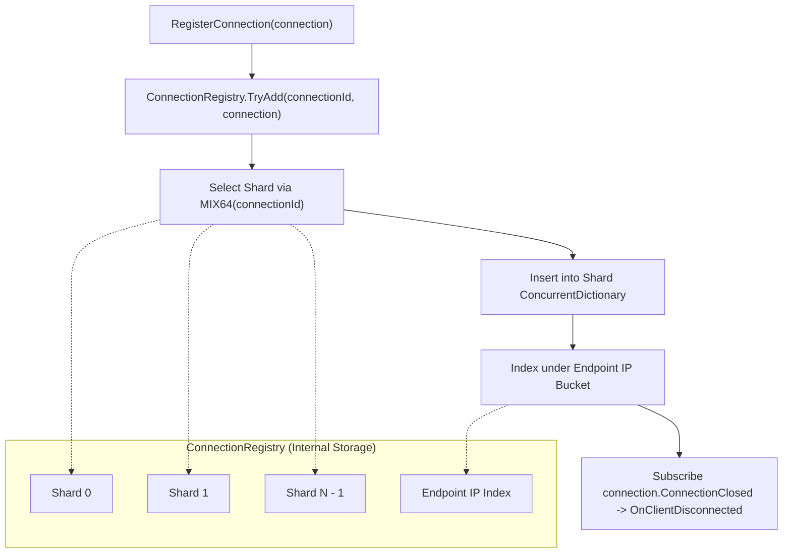

**Namespace:** `Nalix.Network.Connections`  
**Assembly:** `Nalix.Network`

`ConnectionHub` (`public sealed partial class ConnectionHub : IConnectionHub, IConnectionBroadcaster`) là registry trung tâm an toàn đa luồng cho mọi kết nối client đang hoạt động. Nó ủy thác lưu trữ cho một `ConnectionRegistry` phân mảnh, theo dõi thông lượng vào/ra trượt trong 1 giây (`"hub.throughput"`), và cung cấp broadcast snapshot zero-allocation.

## Nguồn mã

- `src/Nalix.Abstractions/Networking/IConnection.Hub.cs`
- `src/Nalix.Abstractions/Networking/IConnection.Broadcaster.cs`
- `src/Nalix.Abstractions/Networking/IConnectionSender.cs`
- `src/Nalix.Abstractions/Networking/IConnectionGroupRegistry.cs`
- `src/Nalix.Network/Connections/ConnectionHub.cs`
- `src/Nalix.Network/Connections/ConnectionHub.Broadcast.cs`
- `src/Nalix.Network/Internal/Connections/ConnectionRegistry.cs`
- `src/Nalix.Runtime/Extensions/ConnectionExtensions.Broadcast.cs`

## Kiến trúc



## Thuộc tính, sự kiện và phương thức công khai (`IConnectionHub`)

| Thành phần | Chữ ký | Mô tả |
| :--- | :--- | :--- |
| `RecurringName` | `public static readonly string RecurringName = "hub.throughput";` | Tiền tố tên của tác vụ tính thông lượng định kỳ 1 giây. |
| `Count` | `public int Count { get; }` | Tổng số kết nối đang hoạt động trên tất cả shard. |
| `ConnectionUnregistered` | `public event Action<IConnection>? ConnectionUnregistered;` | Được phát sau khi kết nối bị xóa khỏi `ConnectionRegistry` (`SessionPersistenceObserver` theo dõi sự kiện này). |
| `RegisterConnection` | `public void RegisterConnection(IConnection connection)` | Đăng ký `connection`, đặt `ConnectionAttributes.OwnerHub` và đăng ký vào `connection.ConnectionClosed`. Ném `ObjectDisposedException` nếu hub đã bị dispose hoặc `InternalErrorException` khi trùng `ConnectionId`. |
| `UnregisterConnection` | `public void UnregisterConnection(IConnection connection)` | Xóa `connection` khỏi shard và chỉ mục endpoint, hủy đăng ký `ConnectionClosed` và phát `ConnectionUnregistered`. |
| `GetConnection(ulong)` | `public IConnection? GetConnection(ulong id)` | Tra cứu shard theo `ConnectionId` 64-bit trong $O(1)$. |
| `GetConnection(ReadOnlySpan<byte>)` | `public IConnection? GetConnection(ReadOnlySpan<byte> id)` | Đọc `ulong` little-endian 8 byte (`BinaryPrimitives.ReadUInt64LittleEndian(id)`) và tra cứu kết nối (dùng trên đường nóng của datagram UDP). |
| `ListConnections()` | `public IReadOnlyCollection<IConnection> ListConnections()` | Trả về snapshot tại một thời điểm của tất cả kết nối đang hoạt động. |
| `ListConnections(INetworkEndpoint)` | `public IReadOnlyCollection<IConnection> ListConnections(INetworkEndpoint networkEndpoint)` | Trả về các kết nối khớp với `networkEndpoint` qua chỉ mục IP phụ. |
| `GenerateReport` / `WriteReportData` | `public string GenerateReport()` / `public void WriteReportData(Utf8JsonWriter writer)` | Xuất số lượng kết nối, số shard, B/s vào/ra, thống kê theo cipher và quyền, trạng thái hàng đợi `AsyncCallback` và thống kê `TimingWheel`. |
| `Dispose` | `public void Dispose()` | Dừng tác vụ thông lượng và dispose song song mọi kết nối đã đăng ký (`ConnectionHubOptions.ParallelDisconnectDegree`). |

## Broadcast và multicast theo nhóm (`IConnectionBroadcaster`)

### 1. Broadcast và multicast dựa trên gói tin (khuyến nghị)

Dùng các phương thức `ConnectionExtensions` trong `Nalix.Runtime.Extensions`, các phương thức này tuần tự hóa và nén LZ4 gói tin **một lần**, rồi áp dụng mã hóa AEAD cho từng kết nối:

```csharp
using Nalix.Abstractions.Networking;
using Nalix.Runtime.Extensions;

IConnectionHub hub = /* resolved from InstanceManager */;
IConnectionGroupRegistry groups = /* resolved when .UseGroups() is enabled */;

// 1. Broadcast tới tất cả kết nối đang hoạt động
await hub.BroadcastAsync(serverNoticePacket, NetworkTransport.TCP, enableEncrypt: true, ct);

// 2. Multicast tới một nhóm có tên
await hub.MulticastAsync(groups, "lobby:eu-1", roomStatePacket, NetworkTransport.TCP, enableEncrypt: true, ct);

// 3. Multicast tới một nhóm, loại trừ người gửi
await hub.MulticastExceptAsync(groups, "lobby:eu-1", senderConnection, chatPacket, NetworkTransport.TCP, enableEncrypt: true, ct);
```

### 2. Sender dạng struct zero-allocation (`IConnectionSender<TState>`)

`ConnectionHub` cung cấp các phương thức fan-out generic dựa trên struct, tránh cấp phát delegate/closure và dùng `RentedConnectionSnapshot` (`ArrayPool<IConnection>.Shared`):

```csharp
public Task BroadcastAsync<TState, TSender>(
    TState state,
    TSender sender,
    CancellationToken cancellationToken = default)
    where TSender : struct, IConnectionSender<TState>;

public Task MulticastAsync<TState, TSender>(
    IConnectionGroupRegistry groupProvider,
    string groupName,
    TState state,
    TSender sender,
    CancellationToken cancellationToken = default)
    where TSender : struct, IConnectionSender<TState>;

public Task MulticastExceptAsync<TState, TSender>(
    IConnectionGroupRegistry groupProvider,
    string groupName,
    IConnection excludedConnection,
    TState state,
    TSender sender,
    CancellationToken cancellationToken = default)
    where TSender : struct, IConnectionSender<TState>;
```

### 3. Overload buffer thô cũ (`[Obsolete]` — `NALIX_NET001`)

`BroadcastAsync(ReadOnlyMemory<byte>, ...)`, `BroadcastWhereAsync(ReadOnlyMemory<byte>, ...)`, `MulticastAsync(..., ReadOnlyMemory<byte>, ...)` và `MulticastExceptAsync(..., ReadOnlyMemory<byte>, ...)` được đánh dấu `[Obsolete(..., DiagnosticId = "NALIX_NET001")]` vì gửi buffer đã tuần tự hóa sẵn sẽ bỏ qua mã hóa theo từng kết nối và việc đánh số sequence.

## API liên quan

- [Connection](./connection.md)
- [Connection Extensions](./connection-extensions.md)
- [Connection Hub Options](../../options/network/connection-hub-options.md)
- [Session Store & Service](../session-store.md)
