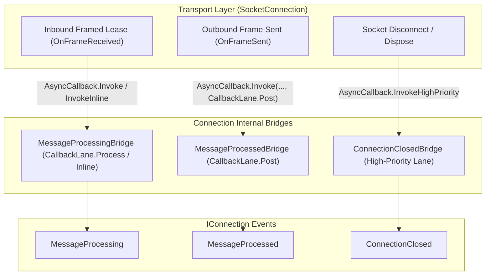

**Namespace:** `Nalix.Network.Connections`  
**Assembly:** `Nalix.Network`

`Connection` (`public sealed partial class Connection : IConnection, IConnectionErrorTracked, IConnectionTrafficMetrics, IPooledConnectContextPool, TimingWheel.ITimeoutTrackedConnection`) là đại diện phía máy chủ cho một phiên client đã kết nối. Nó sở hữu `SocketConnection` bên dưới, các transport TCP và UDP tùy chọn, trạng thái mật mã (`Secret`, `Algorithm`, `Level`), `Attributes` lấy từ pool, và các cầu nối sự kiện `AsyncCallback` hai làn.

## Nguồn mã

- `src/Nalix.Abstractions/Networking/IConnection.cs`
- `src/Nalix.Abstractions/Networking/IConnection.Transmission.cs`
- `src/Nalix.Abstractions/Networking/IConnection.ErrorTracked.cs`
- `src/Nalix.Abstractions/Networking/IConnection.TrafficMetrics.cs`
- `src/Nalix.Network/Connections/Connection.cs`
- `src/Nalix.Network/Internal/Connections/ConnectionBacking.cs`

## Pipeline kiến trúc

## Hàm dựng công khai

| Hàm dựng | Chữ ký | Mô tả |
| :--- | :--- | :--- |
| Chuẩn | `public Connection(Socket socket, IOpCodeExtractor packetClassifier)` | Tạo kết nối dùng `socket.RemoteEndPoint` làm `NetworkEndpoint` và gán một `ConnectionId` `SnowflakeType.Session` mới. |
| Proxy Protocol | `public Connection(Socket socket, IOpCodeExtractor packetClassifier, EndPoint realEndPoint)` | Tạo kết nối với `NetworkEndpoint` được ghi đè bằng `realEndPoint` lấy từ header PROXY v1/v2. |

## Thuộc tính và sự kiện công khai

| Thành phần | Kiểu | Mô tả |
| :--- | :--- | :--- |
| `ConnectionId` | `ulong` | Mã định danh phiên 64-bit duy nhất (`Snowflake.NewId(SnowflakeType.Session).ToUInt64()`). |
| `UserId` | `string?` | Mã người dùng ứng dụng tùy chọn (được điền bởi `ConnectionUserExtensions.MapToUserAsync`). |
| `NetworkEndpoint` | `INetworkEndpoint` | Endpoint client từ xa (ảnh chụp `SocketEndpoint`; giữ IP client thật khi đứng sau PROXY Protocol). |
| `PacketClassifier` | `IOpCodeExtractor` | Bộ trích xuất opcode được gắn bởi `IProtocol` của listener. |
| `TCP` | `IConnection.ITransport` | Transport tin cậy chính (`SocketTcpTransport`). Ném `ObjectDisposedException` nếu đã dispose. |
| `UDP` | `IConnection.ITransport?` | Transport UDP đi kèm (`SocketUdpTransport`), hoặc `null` khi UDP chưa được thiết lập cho kết nối này. |
| `IsUdpCreated` | `bool` | `true` khi `UDP` đã được tạo. |
| `Attributes` | `IObjectMap<AttributeKey, object>` | Bản đồ attribute lấy từ pool, được thuê khi cần (`ObjectMap<AttributeKey, object>`) để lưu trạng thái theo kết nối. |
| `RateLimitCache` | `ConcurrentDictionary<ushort, object>` | Bộ đệm `ScopedEndpoint` theo kết nối, được `PolicyRateLimiter` dùng. |
| `Level` | `PermissionLevel` | Mức ủy quyền hiện tại (mặc định là `PermissionLevel.NONE`). |
| `Algorithm` | `CipherSuiteType` | Bộ mã hóa đối xứng đã thương lượng (mặc định là `CipherSuiteType.Chacha20Poly1305`). |
| `Secret` | `Bytes32` | Khóa phiên 32 byte được dẫn xuất trong handshake X25519 (bị xóa về 0 khi dispose). |
| `UpTime` | `long` | Thời gian sống đã trôi qua của kết nối, tính bằng mili-giây. |
| `LastPingTime` | `long` | Timestamp Unix đơn điệu (ms) của khung hoặc ping nhận gần nhất. |
| `IdleTimeoutMs` | `int` | Ngưỡng timeout nhàn rỗi của kết nối tính bằng mili-giây (mặc định là `TimingWheelOptions.IdleTimeoutMs`). |
| `ExcludeFromIdleTimeout` | `bool` | Khi là `true`, miễn kết nối này khỏi việc thu hồi nhàn rỗi của `TimingWheel`. |
| `PendingPackets` | `int` | Số gói đang chờ trong `CallbackLane.Process`. |
| `ErrorCount` | `int` | Tổng số lỗi protocol/transport được ghi nhận qua `IncrementErrorCount()`. |
| `BytesSent` / `BytesReceived` | `long` | Tổng byte trên dây đã truyền qua TCP và UDP. |
| `PacketsDropped` | `long` | Tổng số gói bị loại của kết nối do backpressure hoặc kiểm tra hợp lệ thất bại. |
| `IsDisposed` | `bool` | `true` khi backing của kết nối đã được dispose và trả về pool. |
| `MessageProcessing` | `event EventHandler<IConnectionEventArgs>` | Được phát qua `OnFrameReceived` (`CallbackLane.Process` hoặc `InvokeInline`) khi có khung đến. |
| `MessageProcessed` | `event EventHandler<IConnectionEventArgs>` | Được phát qua `OnFrameSent` trên `CallbackLane.Post` khi `SocketConnection` gửi xong một khung đi. |
| `ConnectionClosed` | `event EventHandler<IConnectionEventArgs>` | Được phát đúng một lần trong quá trình hủy kết nối, trước khi `Attributes` được trả về pool. |

## Phương thức công khai

| Phương thức | Chữ ký | Hành vi |
| :--- | :--- | :--- |
| `Disconnect` | `public void Disconnect(string? reason = null)` | Ghi log lý do ngắt kết nối (nếu có) và bắt đầu dispose kết nối một cách idempotent (`Dispose()`). |
| `UpdateIdleTimeout` | `public void UpdateIdleTimeout(int newTimeoutMs)` | Cập nhật `IdleTimeoutMs` (phải `> 0`, nếu không sẽ ném `ArgumentOutOfRangeException`) và đăng ký lại kết nối trong `TimingWheel`. |
| `IncrementErrorCount` | `public void IncrementErrorCount()` | Tăng `ErrorCount` một cách nguyên tử; tự động gọi `Disconnect("Exceeded maximum error threshold.")` khi `ErrorCount >= ConnectionGuardOptions.MaxErrorThreshold` (`50`). |
| `IncrementBytesSent` / `IncrementBytesReceived` | `public void IncrementBytesSent(int bytes)` / `IncrementBytesReceived(int bytes)` | Cộng nguyên tử vào bộ đếm lưu lượng của kết nối. |
| `IncrementPacketsDropped` | `public void IncrementPacketsDropped()` | Tăng nguyên tử `PacketsDropped`. |
| `Dispose` | `public void Dispose()` | Phát `ConnectionClosed` khi `Attributes` vẫn còn đọc được, xóa `Secret` về 0, trả `backing.Attributes?.Return()` về pool, bỏ tham chiếu `TimingWheel.TimeoutTask` để GC thu hồi ngay, dispose các socket, và trả `ConnectionBacking` về `ObjectPoolManager.Shared`. |

## API liên quan

- [Socket Connection](../socket-connection.md)
- [Connection Hub](./connection-hub.md)
- [Connection Events](./connection-events.md)
- [Connection Extensions](./connection-extensions.md)
