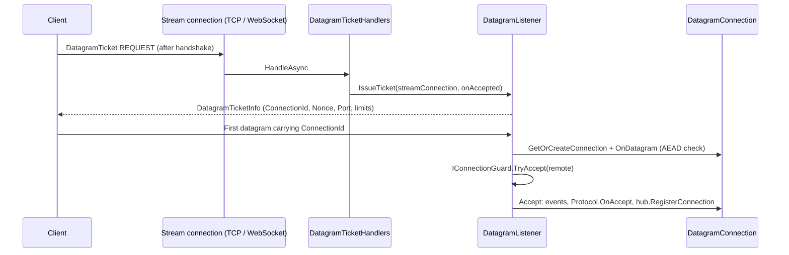

**Không gian tên:** `Nalix.Network.Listeners.Datagram`  
**Assembly:** `Nalix.Network`

`DatagramListener` (`public sealed partial class DatagramListener : IListener, IDatagramTicketIssuer`) là listener UDP của Nalix Datagram Protocol (NDP). Nó thay thế cặp `UdpListenerBase` / `UdpPassthroughListener` trước đây: không còn chế độ đi kèm dùng token cộng MAC và cũng không còn chế độ passthrough thô.

Client trước hết hoàn tất handshake trên một kết nối stream (TCP hoặc WebSocket), sau đó yêu cầu một **ticket** datagram. Listener trả lời bằng định danh kết nối, một nonce và các giới hạn của phiên, rồi biến ticket thành một `DatagramConnection` khi datagram đầu tiên mang định danh đó được xác thực.

:::note[Vị trí trang]
`UdpListenerBase`, `UdpPassthroughListener`, `PassthroughConnection`, `DatagramGuard` và `DatagramGuardOptions` không còn tồn tại trong mã nguồn.
:::

## Nguồn mã

- `src/Nalix.Network/Listeners/Datagram/DatagramListener.Core.cs`
- `src/Nalix.Network/Listeners/Datagram/DatagramListener.PublicMethods.cs`
- `src/Nalix.Network/Listeners/Datagram/DatagramListener.Receive.cs`
- `src/Nalix.Network/Listeners/Datagram/DatagramListener.SocketConfig.cs`
- `src/Nalix.Network/Listeners/Datagram/DatagramListener.Metrics.cs`
- `src/Nalix.Network/Listeners/Datagram/DatagramListener.Types.cs`
- `src/Nalix.Network/Connections/DatagramConnection.cs`
- `src/Nalix.Network/Connections/DatagramConnection.Transport.cs`
- `src/Nalix.Network/Options/DatagramOptions.cs`
- `src/Nalix.Abstractions/Networking/Datagrams/IDatagramTicketIssuer.cs`

## Luồng ticket và phiên



`DatagramTicketHandlers` (`src/Nalix.Runtime/Handlers/DatagramTicketHandlers.cs`) từ chối yêu cầu với `ProtocolReason.UNAUTHENTICATED` khi kết nối stream chưa hoàn tất handshake hoặc không có khóa bí mật, `STATE_VIOLATION` khi chính kết nối đó là một transport datagram, và `SERVICE_UNAVAILABLE` khi chưa đăng ký `IDatagramTicketIssuer` nào hoặc `IssueTicket` ném `InvalidOperationException`.

## Định tuyến datagram (`DatagramListener.Receive.cs`)

1. Mỗi worker nhận đọc vào một buffer được ghim có kích thước `DatagramEngine.MaxDatagramSize + 1` byte (`MaxDatagramSize = 1472`), nhờ đó datagram quá lớn được phát hiện thay vì bị cắt cụt.
2. `Route` loại datagram (`DroppedMalformed`) khi nó dài hơn `MaxDatagramSize` hoặc không có header NDP để `DatagramEngine.TryReadConnectionId` đọc định danh kết nối.
3. Một định danh đã biết trong bảng phiên được chuyển cho `DatagramConnection.OnDatagram`; một định danh có ticket đang chờ đi qua `TryPromote`; mọi trường hợp khác bị loại (`DroppedUnknown`). Datagram chưa xác thực không bao giờ được phản hồi.
4. Datagram của một phiên đã biết nhưng xác thực thất bại, hoặc là bản phát lại, được tính là `DroppedUnauthenticated`.
5. Khi nâng cấp, listener gọi `IConnectionGuard.TryAccept(remote)` (nếu có truyền guard). Bị từ chối thì phiên bị dispose và được tính vào `TotalGuardRejections`; nếu không, phiên giữ slot của guard cho tới khi đóng. Sau đó phiên nâng `MessageProcessing` tới `Protocol.FrameProcessor.ProcessFrame`, `MessageProcessed` tới `Protocol.PostProcessMessage`, gọi `Protocol.OnAccept`, và đăng ký vào `IConnectionHub`.

Lỗi socket `ConnectionReset` và `MessageSize` được tính là loại do sai định dạng; các `SocketException` khác được tính vào `TotalErrors` và lùi lại tối đa một giây.

## Ticket

- `IssueTicket` ném `InvalidOperationException` khi listener chưa hoạt động, khi bên gọi chính là một `DatagramConnection`, khi kết nối stream không có khóa bí mật, hoặc khi `SessionCount + PendingTicketCount` đã đạt `DatagramOptions.MaxSessions`.
- Định danh kết nối lấy từ CSPRNG (không phải Snowflake) để không thể đoán trước.
- Mỗi kết nối stream chỉ có tối đa một ticket đang chờ: yêu cầu mới thay thế ticket trước.
- Ticket không được xác thực trong `DatagramOptions.TicketLifetimeSeconds` sẽ bị loại bởi bộ quét mỗi giây và được tính vào `TicketsExpired`.
- Người dùng, mức quyền, bộ mật mã và khóa bí mật của kết nối stream được sao chép vào phiên khi ticket được cấp. Ngắt kết nối stream **không** đóng phiên datagram; hãy ngắt `DatagramConnection` có `StreamConnectionId` khớp.

## API công khai

```csharp
namespace Nalix.Network.Listeners.Datagram;

public sealed partial class DatagramListener : IListener, IDatagramTicketIssuer
{
    public DatagramListener(
        ushort port, IProtocol protocol, IConnectionHub hub, IDatagramProtectionFactory protectionFactory,
        IConnectionGuard? guard = null, DatagramOptions? options = null, DatagramEngineOptions? engineOptions = null);

    public DMetrics Metrics { get; }
    public ushort Port { get; }
    public bool IsListening { get; }
    public int SessionCount { get; }
    public int PendingTicketCount { get; }

    public void Activate(CancellationToken cancellationToken = default);
    public void Deactivate(CancellationToken cancellationToken = default);
    public DatagramTicketInfo IssueTicket(IConnection streamConnection, Action<IConnection>? onAccepted = null);

    public string GenerateReport();
    public void WriteReportData(Utf8JsonWriter writer);
    public void Dispose();

    public sealed class DMetrics { /* các bộ đếm, xem bên dưới */ }
}
```

- `port` bằng `0` sẽ chọn một cổng trống; `Port` trả về cổng đã bind sau khi kích hoạt.
- `options` và `engineOptions` mặc định lấy từ `ConfigurationManager.Instance.Get<DatagramOptions>()` và `Get<DatagramEngineOptions>()`; cả hai được kiểm tra hợp lệ trong constructor.
- `Activate` bind socket, khởi động `DatagramOptions.ReceiveWorkers` worker nhận, timing wheel của datagram và bộ quét ticket, đồng thời ném `ObjectDisposedException` hoặc `SocketException`. Gọi `Activate` lần hai khi chưa dừng sẽ bị bỏ qua.
- `Deactivate` ngắt mọi phiên với `"Server is shutting down."`, loại bỏ các ticket đang chờ và đóng socket.
- `guard` bằng `null` thì chấp nhận mọi phiên đã xác thực.
- Các hook kiểu `IsAuthenticated` và `TryResolveConnection` không còn tồn tại; việc xác thực chính là kiểm tra AEAD của `IDatagramProtectionFactory`. Package hosting dùng `ChaCha20Poly1305DatagramProtectionFactory.Instance`.

### `DMetrics` (`DatagramListener.DMetrics`)

| Thuộc tính | Ý nghĩa |
| :--- | :--- |
| `DatagramsReceived`, `BytesReceived` | Số datagram và số byte đọc từ socket. |
| `DroppedMalformed` | Quá lớn hoặc không có header NDP. |
| `DroppedUnknown` | Định danh kết nối không xác định. |
| `DroppedUnauthenticated` | Phiên đã biết nhưng chưa được xác thực (hoặc là bản phát lại). |
| `TotalDropped` | Tổng của ba bộ đếm loại bỏ. |
| `TicketsIssued`, `TicketsExpired` | Số ticket đã cấp, và số ticket hết hạn trước datagram xác thực đầu tiên. |
| `TotalAccepted` | Số phiên đã chấp nhận. |
| `TotalGuardRejections` | Số phiên đã xác thực bị `IConnectionGuard` từ chối. |
| `TotalErrors` | Lỗi nhận, xử lý và chấp nhận. |

## Thiết lập socket (`DatagramListener.SocketConfig.cs`)

- Socket IPv6 dual-stack khi `NetworkSocketOptions.EnableDualStack` được bật và máy chủ hỗ trợ IPv6 (`DualMode = NetworkSocketOptions.DualMode`); quay về IPv4 khi họ địa chỉ không được hỗ trợ.
- `SO_REUSEADDR` không bao giờ được đặt (bất kể `NetworkSocketOptions.ReuseAddress` quy định gì); trên Windows `ExclusiveAddressUse = true`.
- `ReceiveBufferSize` / `SendBufferSize` lấy từ `DatagramOptions.SocketReceiveBufferSize` / `SocketSendBufferSize`, không lấy từ `NetworkSocketOptions.BufferSize`.
- `DontFragment = true` được thử đặt để việc dò path-MTU thấy datagram quá lớn bị loại; nếu thất bại thì bỏ qua.

## `DatagramConnection`

`public sealed partial class DatagramConnection : IConnection, IConnectionErrorTracked, IConnectionTrafficMetrics, IPooledConnectContextPool, IDatagramTransport` được listener tạo ra (constructor của nó là internal).

- `ConnectionId` là một Snowflake mới (`SnowflakeType.Session`); `DatagramConnectionId` là định danh trên đường truyền lấy từ ticket; `StreamConnectionId` là `ConnectionId` của kết nối stream đã yêu cầu ticket.
- `Transport` trả về chính kết nối. `Send` / `SendAsync` thông thường dùng `DeliveryMethod.ReliableOrdered` trên kênh 0.
- `SendAsync(ReadOnlyMemory<byte> message, DeliveryMethod method, byte channel, CancellationToken)` và `WithDelivery(DeliveryMethod method, byte channel)` chọn phương thức gửi (`Unreliable`, `UnreliableSequenced`, `ReliableUnordered`, `ReliableOrdered`, `ReliableSequenced`) và kênh; `WithDelivery` ném `ArgumentOutOfRangeException` với phương thức không xác định hoặc kênh không nhỏ hơn số kênh của phiên.
- `EngineReport` trả về báo cáo của protocol engine.
- `ExcludeFromIdleTimeout` là `true`; thời gian chờ nhàn rỗi do protocol engine áp dụng (`DatagramEngineOptions.IdleTimeoutMs`), không phải `TimingWheel`. `UpdateIdleTimeout` chỉ kiểm tra đối số của nó.

## API liên quan

- [TCP Listener](./tcp-listener.md)
- [Connection](./connection/connection.md)
- [Tùy chọn Datagram](../options/network/datagram-options.md)
- [Tùy chọn Network Socket](../options/network/network-socket-options.md)
- [Connection Limiter](./connection/connection-limiter.md)
- [Network Application](../hosting/network-application.md)
