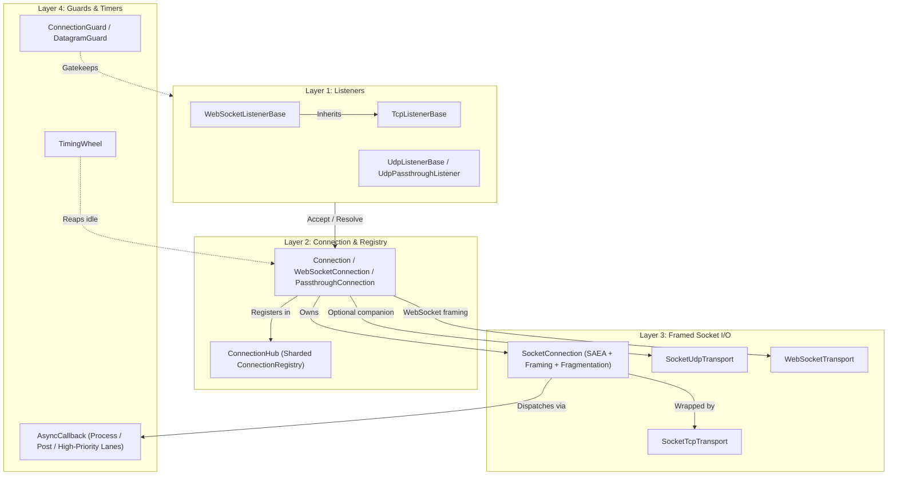

**Namespaces:** `Nalix.Network.Connections`, `Nalix.Network.Listeners.Tcp`, `Nalix.Network.Listeners.Udp`, `Nalix.Network.Listeners.Web`, `Nalix.Network.Protocols`, `Nalix.Network.RateLimiting`, `Nalix.Network.Options`  
**Assembly:** `Nalix.Network`

`Nalix.Network` là bộ máy transport phía máy chủ. Nó quản lý socket TCP, UDP và WebSocket thô, thực thi kiểm soát chấp nhận nhiều lớp và backpressure của callback, duy trì registry kết nối phân mảnh, và chuyển các payload đã đóng khung vào `IProtocol`.

## Bản đồ transport tổng thể

## Thứ tự đọc từ đầu

1. [Socket Connection](./socket-connection.md) — Bộ máy nhận và gửi SAEA nội bộ, khung độ dài/VarInt, phân mảnh và giới hạn gói chờ ở Layer 1.
2. [TCP Listener](./tcp-listener.md) và [UDP Listener](./udp-listener.md) — Kích hoạt socket, kiểm soát chấp nhận qua `ConnectionGuard` / `DatagramGuard`, phân tích PROXY protocol, và xác thực UDP bằng 8-byte token + 4-byte MAC.
3. [Connection](./connection/connection.md) — Triển khai `IConnection` mức cao, sở hữu định danh (`ConnectionId`), ngữ cảnh mật mã (`Secret`, `Algorithm`), `Attributes` và các cầu nối sự kiện.
4. [Connection Hub](./connection/connection-hub.md) — `ConnectionRegistry` phân mảnh (băm phân mảnh `MIX64`), broadcast snapshot zero-allocation và telemetry `IReportable`.
5. [Timing Wheel](./time/timing-wheel.md) — Bộ hẹn giờ hashed wheel để thu hồi kết nối nhàn rỗi với chi phí thấp.

## Các khu vực chính

### Hệ thống kết nối

- [Connection](./connection/connection.md)
- [Connection Hub](./connection/connection-hub.md)
- [Connection Events](./connection/connection-events.md)
- [Connection Extensions](./connection/connection-extensions.md)
- [Connection Guard](./connection/connection-guard.md)
- [Connection Limiter](./connection/connection-limiter.md)

### Giao thức và transport

- [Protocol](./protocol.md)
- [Socket Connection](./socket-connection.md)
- [TCP Listener](./tcp-listener.md)
- [UDP Listener](./udp-listener.md)
- [Session Store & Service](./session-store.md)
- [Timing Wheel](./time/timing-wheel.md)

### Tùy chọn mạng

- [Options Overview](../options/network/options.md)
- [Network Socket Options](../options/network/network-socket-options.md)
- [Connection Quota Options](../options/network/connection-quota-options.md)
- [Connection Guard Options](../options/network/connection-guard-options.md)
- [Trusted Proxy Options](../options/network/trusted-proxy-options.md)
- [Connection Ban Store Options](../options/network/connection-ban-store-options.md)
- [Connection Blacklist Store Options](../options/network/connection-blacklist-store-options.md)
- [Connection Hub Options](../options/network/connection-hub-options.md)
- [Timing Wheel Options](../options/network/timing-wheel-options.md)
- [Pooling Options](../options/network/pooling-options.md)
- [Network Callback Options](../options/network/network-callback-options.md)
- [Session Store Options](../options/network/session-store-options.md)
- [Compression Options](../options/network/compression-options.md)

## API liên quan

- [Runtime Overview](../runtime/index.md)
- [Network Application (Hosting)](../hosting/network-application.md)
- [SDK Overview](../sdk/index.md)
