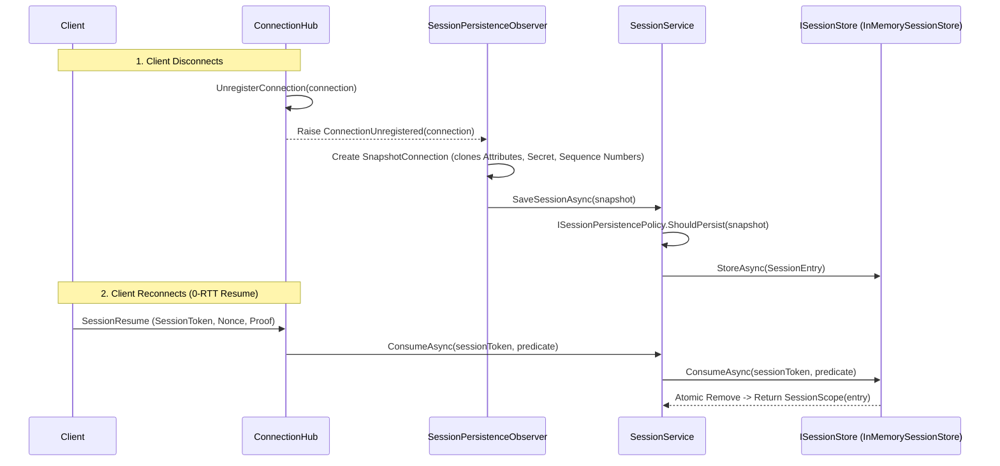

**Namespaces:** `Nalix.Abstractions.Networking.Sessions`, `Nalix.Runtime.Sessions`  
**Assembly:** `Nalix.Runtime`

`SessionService`, `InMemorySessionStore`, `SessionFactory`, `DefaultSessionPersistencePolicy` và `SessionPersistenceObserver` quản lý các ảnh chụp phiên có thể tiếp tục (`SessionEntry` / `SessionScope`) khi client ngắt kết nối và sau đó kết nối lại qua giao thức `SessionResume` 0-RTT (`SessionResumeStage.REQUEST`).

## Nguồn mã

- `src/Nalix.Abstractions/Networking/Sessions/ISessionService.cs`
- `src/Nalix.Abstractions/Networking/Sessions/ISessionStore.cs`
- `src/Nalix.Abstractions/Networking/Sessions/ISessionFactory.cs`
- `src/Nalix.Abstractions/Networking/Sessions/ISessionPersistencePolicy.cs`
- `src/Nalix.Abstractions/Networking/Sessions/SessionEntry.cs`
- `src/Nalix.Abstractions/Networking/Sessions/SessionScope.cs`
- `src/Nalix.Runtime/Sessions/SessionService.cs`
- `src/Nalix.Runtime/Sessions/InMemorySessionStore.cs`
- `src/Nalix.Runtime/Sessions/SessionFactory.cs`
- `src/Nalix.Runtime/Sessions/DefaultSessionPersistencePolicy.cs`
- `src/Nalix.Runtime/Sessions/SessionPersistenceObserver.cs`
- `src/Nalix.Runtime/Options/SessionStoreOptions.cs`

## Vòng đời lưu và tiếp tục phiên



## Hợp đồng công khai và triển khai

### 1. `ISessionService` và `SessionService`

```csharp
namespace Nalix.Runtime.Sessions;

public sealed class SessionService : ISessionService, IDisposable, IReportable
{
    public SessionService(
        ISessionFactory? factory = null,
        ISessionStore? store = null,
        ISessionPersistencePolicy? policy = null);

    public ValueTask SaveSessionAsync(
        IConnection connection,
        CancellationToken cancellationToken = default);

    public ValueTask<SessionScope> ConsumeAsync(
        ulong sessionToken,
        Func<SessionEntry, bool>? predicate = null,
        CancellationToken cancellationToken = default);

    public string GenerateReport();
    public void WriteReportData(Utf8JsonWriter writer);
    public void Dispose();
}
```

- **Lập lịch bộ quét dọn**: Khi `_store` triển khai `IWorker` (như `InMemorySessionStore`), `SessionService` tự động lập lịch nó trên `TaskManager.ScheduleWorker(hostedWorker)` và dispose `IWorkerHandle` khi gọi `SessionService.Dispose()`.
- **An toàn với pool**: Nếu `_store.StoreAsync(entry, ct)` ném một ngoại lệ không nghiêm trọng, `SessionService` gọi ngay `entry.Return()` để `SessionEntry` lấy từ pool và `ObjectMap<AttributeKey, object>` đã thuê của nó không bị rò rỉ.

### 2. `InMemorySessionStore` (`ISessionStore`, `IWorker`, `IReportable`)

```csharp
namespace Nalix.Runtime.Sessions;

public sealed class InMemorySessionStore : ISessionStore, IWorker, IReportable
{
    public const int DefaultMaxSessions = 65_536;
    public int MaxSessions { get; set; }

    public ValueTask StoreAsync(
        SessionEntry entry,
        CancellationToken cancellationToken = default);

    public ValueTask<SessionScope> ConsumeAsync(
        ulong sessionToken,
        Func<SessionEntry, bool>? predicate = null,
        CancellationToken cancellationToken = default);

    public ValueTask ExecuteAsync(IWorkerContext context, CancellationToken cancellationToken);
}
```

- **Tiêu thụ một lần, nguyên tử (`SEC-33`)**: `ConsumeAsync` kiểm tra `entry.Snapshot.ExpiresAtUnixMilliseconds > Clock.UnixMillisecondsNow()`, đánh giá `predicate(entry)` tùy chọn TRƯỚC khi xóa entry (nếu `predicate` trả về `false` thì không xóa), và dùng thao tác xóa khóa-giá trị nguyên tử (`ICollection<KeyValuePair<ulong, SessionEntry>>.Remove`) để chỉ một lời gọi đồng thời có thể tiêu thụ một token hợp lệ. Trả về `SessionScope` (`scope.IsValid == true` khi đã tiêu thụ; dispose `SessionScope` sẽ trả `SessionEntry` về pool).
- **Chỉ mục hết hạn theo nhóm phút (`_expiryBuckets`)**: Gom các session token vào các bucket 60 giây (`ExpiresAtUnixMilliseconds / 60_000`) để tác vụ nền `ExecuteAsync` chỉ duyệt các bucket đã đến hạn.
- **Loại bỏ khi đầy (`DefaultMaxSessions = 65,536`)**: Khi `_store.Count >= MaxSessions`, xóa các entry đã hết hạn trước, sau đó đến các entry cũ nhất, và gọi `entry.Return()`.

### 3. `DefaultSessionPersistencePolicy` và `SessionPersistenceObserver`

- `SessionPersistenceObserver` đăng ký vào `IConnectionHub.ConnectionUnregistered`, chụp một `SnapshotConnection` (sao chép `Attributes`, `Secret`, `Level`, `Algorithm` và bộ đếm sequence TCP/UDP trước khi `Connection.Dispose()` xóa chúng về 0), rồi gọi `SaveSessionAsync` trong nền.
- `DefaultSessionPersistencePolicy.ShouldPersist(IConnection)` đánh giá ba quy tắc theo thứ tự:
  1. **Policy 1 (Cổng handshake)**: Nếu `!connection.GetRuntimeState().HandshakeEstablished`, trả về `false`.
  2. **Policy 2 (Phiên mật mã đang hoạt động)**: Nếu `!connection.Secret.IsZero` (đã thiết lập khóa mã hóa 32 byte đang hoạt động), trả về `true` ngay.
  3. **Policy 3 (Dự phòng theo số lượng attribute)**: Nếu không, trả về `connection.Attributes.Count > _options.MinAttributesForPersistence` (mặc định `10`).

## API liên quan

- [Session Store Options](../options/network/session-store-options.md)
- [Session Resume](../security/session-resume.md)
- [Connection Hub](./connection/connection-hub.md)
- [Connection](./connection/connection.md)
