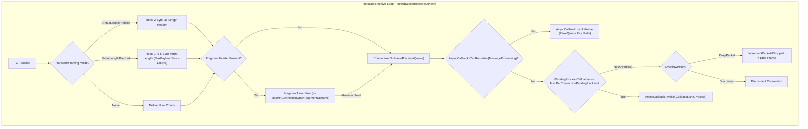

**Namespace:** `Nalix.Network.Internal.Transport`  
**Assembly:** `Nalix.Network`

`SocketConnection` (`internal sealed partial class SocketConnection : IDisposable, IPoolable`) là bộ máy transport TCP có khung nội bộ, làm nền cho `Connection.TCP` (`SocketTcpTransport`). Nó dùng các `PooledSocketReceiveContext` (`SocketAsyncEventArgs`) lấy từ pool, pool mảng byte `BufferLease`, và đóng khung đa chế độ để duy trì 10,000+ kết nối đồng thời mà không cấp phát heap cho mỗi gói tin.

:::warning[Kiểu triển khai nội bộ]
`SocketConnection` là `internal sealed` và không được mã ứng dụng tham chiếu trực tiếp. Mã ứng dụng tương tác với socket TCP qua `IConnection` và `connection.TCP` (`IConnection.ITransport`).
:::

## Nguồn mã

- `src/Nalix.Network/Internal/Transport/SocketConnection.cs`
- `src/Nalix.Network/Internal/Transport/SocketConnection.Framing.cs`
- `src/Nalix.Network/Internal/Transport/SocketConnection.Receive.VarInt.cs`
- `src/Nalix.Network/Internal/Transport/SocketConnection.Send.cs`
- `src/Nalix.Network/Internal/Transport/SocketConnection.Send.VarInt.cs`
- `src/Nalix.Network/Internal/Transport/SocketTcpTransport.cs`
- `src/Nalix.Network/Options/NetworkCallbackOptions.cs`
- `src/Nalix.Network/Options/VarIntFramingOptions.cs`

## Pipeline nhận và gửi kiến trúc

## Các trách nhiệm kỹ thuật chính

### 1. Đóng khung transport đa chế độ (`TransportFraming`)

Được cấu hình qua `connection.TCP.UseFraming(this.Framing)` trong `Protocol.OnAccept` (bị khóa khi `BeginReceive` bắt đầu):

| Chế độ | Tiền tố trên dây | Kích thước khung tối đa | File nguồn |
| :--- | :--- | :--- | :--- |
| `TransportFraming.UInt16LengthPrefixed` (mặc định) | `ushort` little-endian 2 byte, là tổng độ dài khung | `65,535` byte (payload lớn hơn dùng `FragmentStream`) | `SocketConnection.Framing.cs` |
| `TransportFraming.VarIntLengthPrefixed` | Độ dài payload VarInt LEB128 từ 1 đến 5 byte | `VarIntFramingOptions.MaxPayloadSize` (`131,072` byte / 128 KB) | `SocketConnection.Receive.VarInt.cs`, `SocketConnection.Send.VarInt.cs` |
| `TransportFraming.None` | Các đoạn stream không khung | Giới hạn bởi buffer nhận | `SocketConnection.cs` |

### 2. Giới hạn Layer 1 cho mỗi kết nối và `OverflowPolicy` (`Connection.OnFrameReceived`)

Khi `SocketConnection.PROCESS_FRAME_FROM_BUFFER` hoàn tất một khung (hoặc ghép lại toàn bộ các đoạn qua `FragmentAssembler`), nó gọi `_connectionOwner?.OnFrameReceived(lease)` trên `Connection` sở hữu:

- **Đường nhanh inline (`AsyncCallback.CanRunInline`)**: Nếu `MessageProcessing` có một subscriber duy nhất gắn với `IFrameProcessor` có `SupportsInlineProcessing == true`, `Connection.OnFrameReceived` chạy `AsyncCallback.InvokeInline(...)` đồng bộ trên luồng hoàn tất nhận mà không xếp hàng.
- **Giới hạn theo kết nối**: Nếu không, `Connection.OnFrameReceived` tăng `backing.PendingProcessCallbacks` và kiểm tra `NetworkCallbackOptions.MaxPerConnectionPendingPackets` (mặc định `16`):
  - Khi `OverflowPolicy == NetworkOverflowPolicy.DropPacket` (mặc định): tăng `PacketsDropped`, hoàn tác `PendingProcessCallbacks`, dispose lease và loại khung trước khi nó chạm tới `ThreadPool`.
  - Khi `OverflowPolicy == NetworkOverflowPolicy.Disconnect`: hoàn tác bộ đếm, dispose lease và gọi ngay `Disconnect()` lên peer đang gây lũ.
  - Khi còn trong ngân sách: lấy một `ConnectionEventArgs` từ pool và phát qua `AsyncCallback.Invoke(..., CallbackLane.Process, releasePendingPacketOnCompletion: true)`.

### 3. Tự động phân mảnh và ghép lại (`FragmentAssembler`)

- **Chiều đi**: Payload vượt quá `FragmentOptions.MaxChunkSize` được chia thành nhiều khung có tiền tố `FragmentHeader`.
- **Chiều đến**: `SocketConnection` ghép lại các stream bị phân mảnh qua `FragmentAssembler`, thực thi `NetworkCallbackOptions.MaxPerConnectionOpenFragmentStreams` (mặc định `4`) và loại bỏ các stream từng phần đã hết hạn ở mỗi chu kỳ nhận.

### 4. Chèn byte đã đọc trước (`InjectPreReadBytes`)

Khi `TcpListenerBase` hoặc `WebSocketListenerBase` đọc các byte đầu tiên trong lúc phân tích PROXY Protocol v1/v2 hoặc HTTP Upgrade, mọi byte payload còn thừa đã được đọc từ socket sẽ được chèn vào `SocketConnection` qua `InjectPreReadBytes(ReadOnlySpan<byte>)` để chúng được xử lý trước lần đọc socket của hệ điều hành tiếp theo.

## API liên quan

- [Connection](./connection/connection.md)
- [Connection Events](./connection/connection-events.md)
- [Protocol](./protocol.md)
- [Network Callback Options](../options/network/network-callback-options.md)
