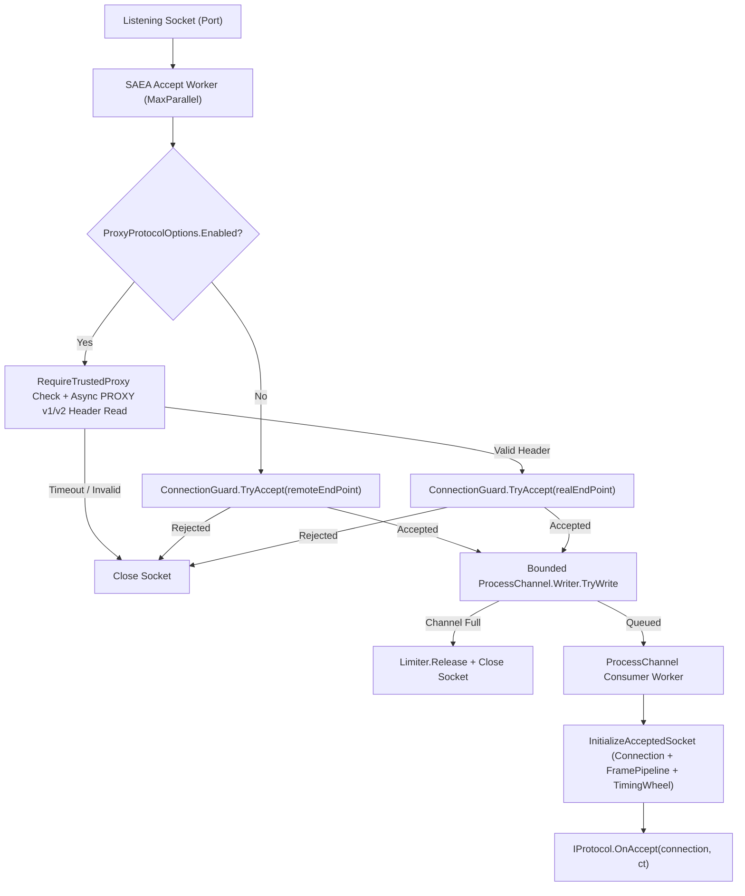

**Namespace:** `Nalix.Network.Listeners.Tcp`  
**Assembly:** `Nalix.Network`

`TcpListenerBase` (`public abstract partial class TcpListenerBase : IListener`) là listener TCP cơ sở của `Nalix.Network` (và là lớp cơ sở của `WebSocketListenerBase`). Nó quản lý việc bind socket, các vòng accept `SocketAsyncEventArgs` đa worker, trích xuất IP thật qua PROXY Protocol v1/v2 (tùy chọn), kiểm soát chấp nhận bằng `ConnectionGuard`, một kênh xử lý accept có giới hạn, và đăng ký với `TimingWheel`.

## Nguồn mã

- `src/Nalix.Abstractions/Networking/IListener.cs`
- `src/Nalix.Network/Listeners/TcpListener/TcpListener.Core.cs`
- `src/Nalix.Network/Listeners/TcpListener/TcpListener.PublicMethods.cs`
- `src/Nalix.Network/Listeners/TcpListener/TcpListener.Handle.cs`
- `src/Nalix.Network/Listeners/TcpListener/TcpListener.ProcessChannel.cs`
- `src/Nalix.Network/Listeners/TcpListener/TcpListener.ProxyProtocol.cs`
- `src/Nalix.Network/Listeners/TcpListener/TcpListener.SocketConfig.cs`
- `src/Nalix.Network/Listeners/TcpListener/TcpListener.Synchronization.cs`
- `src/Nalix.Network/Listeners/TcpListener/TcpListener.Metrics.cs`
- `src/Nalix.Network/Options/NetworkSocketOptions.cs`
- `src/Nalix.Network/Options/ProxyProtocolOptions.cs`

## Pipeline accept và khởi tạo



## Hàm dựng và API công khai

```csharp
namespace Nalix.Network.Listeners.Tcp;

public abstract partial class TcpListenerBase : IListener
{
    protected TcpListenerBase(ushort port, IProtocol protocol, IConnectionHub hub, IConnectionGuard guard);
    protected TcpListenerBase(IProtocol protocol, IConnectionHub hub, IConnectionGuard guard);

    public int ProcessChannelCount { get; }
    public LMetrics Metrics { get; }
    protected internal IConnectionGuard Limiter { get; }

    public virtual void Activate(CancellationToken cancellationToken = default);
    public virtual void Deactivate(CancellationToken cancellationToken = default);

    public virtual string GenerateReport();
    public virtual void WriteReportData(Utf8JsonWriter writer);
    public void Dispose();
    protected virtual void Dispose(bool disposing);
}
```

## Số liệu (`TcpListenerBase.LMetrics`)

`TcpListenerBase.LMetrics` (`Nalix.Network.Listeners.Tcp`, `TcpListener.Metrics.cs`) là lớp lồng public sealed được lộ ra qua `TcpListenerBase.Metrics`. Nó theo dõi các bộ đếm vòng đời kết nối bằng các lần đọc atomic không khóa. Tất cả thành phần đều là thuộc tính `long` chỉ đọc:

| Thuộc tính | Ý nghĩa |
| :--- | :--- |
| `TotalAccepted` | Số kết nối đã chấp nhận. |
| `TotalErrors` | Số lỗi khi accept. |
| `TotalRejected` | Số kết nối bị từ chối, gồm cả từ chối do hàng đợi đầy và do limiter/guard. |
| `TotalProxyProtocolErrors` | Số lỗi handshake PROXY protocol. |
| `TotalQueueFullRejections` | Số lần từ chối do hàng đợi đầy. |
| `TotalLimiterRejections` | Số lần bị limiter/guard từ chối. |

## Các hệ thống con chính

### 1. Bind và tinh chỉnh socket (`TcpListener.SocketConfig.cs`)

- **Dual-stack IPv6 / IPv4 dự phòng**: Khi `NetworkSocketOptions.EnableDualStack` là `true` (mặc định), `TcpListenerBase` bind một socket `InterNetworkV6` với `DualMode = _config.DualMode` (`true`), và chuyển sang `InterNetwork` (IPv4) nếu hệ điều hành không hỗ trợ dual-stack IPv6.
- **Tùy chọn socket**: Cấu hình `ReuseAddress`, `ReusePort`, `TcpFastOpen`, `Backlog` (`512`), `NoDelay` (`true`), `SendBufferSize`/`ReceiveBufferSize` (`BufferSize = 65536`), và các probe TCP Keep-Alive đa nền tảng (`3s` thời gian, `1s` khoảng cách, `3` lần thử lại).

### 2. PROXY Protocol v1/v2 (`TcpListener.ProxyProtocol.cs`)

Khi `ProxyProtocolOptions.Enabled` là `true`:

- Nếu `ProxyProtocolOptions.RequireTrustedProxy` là `true`, chỉ những peer vật lý khớp với `TrustedProxyOptions` mới được phép gửi header PROXY.
- Giới hạn số lần đọc header PROXY đang xử lý đồng thời ở `ProxyProtocolOptions.MaxPendingProxyConnections` (`1024`), với thời gian chờ `HeaderTimeoutMs` (`2000` ms).
- Phân tích header PROXY v1 hoặc v2 qua `ProxyProtocolParser`, lấy `EndPoint` client thật, truyền vào `ConnectionGuard.TryAccept`, và chèn các byte còn thừa vào `Connection` qua `InjectPreReadBytes`.

### 3. Kênh xử lý accept có giới hạn (`TcpListener.ProcessChannel.cs`)

- Các kết nối đã accept được ghi vào một `Channel.CreateBounded<AcceptConnectionResult>` có kích thước `NetworkSocketOptions.ProcessChannelCapacity` (`256`).
- Nếu luồng tiêu thụ bị quá tải và `TryWrite` trả về `false`, listener gọi `_limiter.Release(remoteEndPoint)` và đóng socket ngay.
- Trong `Deactivate`, listener chờ tối đa `NetworkSocketOptions.ProcessChannelDrainTimeout` (`5000` ms) để các accept trong hàng đợi được xử lý nốt một cách nhẹ nhàng.
- Hỗ trợ ghim CPU tùy chọn cho luồng tiêu thụ dispatch qua `NetworkSocketOptions.DispatchProcessorAffinity` (mặc định `-1`).

## API liên quan

- [UDP Listener](./udp-listener.md)
- [WebSocket Binding](../hosting/websocket-binding.md)
- [Protocol](./protocol.md)
- [Network Socket Options](../options/network/network-socket-options.md)
- [Connection Guard](./connection/connection-guard.md)
