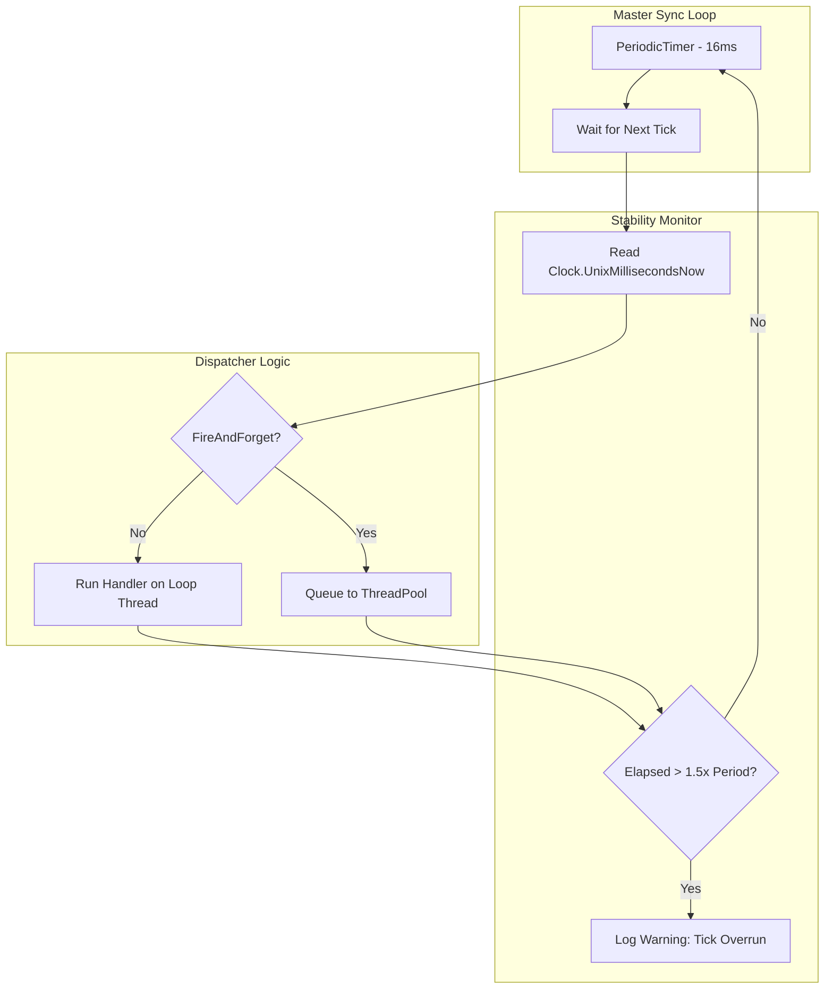

`TimeSynchronizer` là dịch vụ có độ chính xác cao, độ trễ thấp, phát các "tick" định kỳ để đồng bộ trạng thái trên máy chủ. Nó thường được dùng cho logic heartbeat 60Hz, đồng bộ bước vật lý, hoặc xả lưu lượng định kỳ.

## Nguồn mã

- `src/Nalix.Runtime/Timekeeping/TimeSynchronizer.cs`

## Lý do tồn tại của kiểu này

Duy trì nhịp "thời gian máy chủ" nhất quán là yếu tố then chốt đối với các hệ thống thời gian thực mang tính xác định. `TimeSynchronizer` cung cấp:

- **Nhịp cố định**: Hỗ trợ sẵn các tick khoảng 16ms (~60 FPS) dùng bộ hẹn giờ độ chính xác cao.
- **Cô lập worker**: Chạy trong một worker nền được quản lý để logic ứng dụng không làm trôi đồng hồ chủ của máy chủ.
- **Phát hiện trôi nhịp**: Tự động nhận diện và ghi log "Tick Overrun" khi một handler chặn đường đồng bộ quá lâu.

## Pipeline đồng bộ

Sơ đồ sau cho thấy vòng lặp nội bộ và cách nó phân phối tín hiệu thời gian tới các handler đã đăng ký.

## Trách nhiệm nội bộ (đã kiểm chứng từ mã nguồn)

### 1. Định thời độ chính xác cao

Bộ đồng bộ dùng `PeriodicTimer` của .NET, hiệu quả hơn `Task.Delay` cho các vòng lặp chạy lâu dài. Mặc định là chu kỳ **16ms** (tương đương 62.5 tick mỗi giây), tạo nền tảng ổn định cho mạng thời gian thực.

### 2. Chế độ thực thi (FireAndForget)

Bạn có thể kiểm soát cách handler được thực thi qua thuộc tính `FireAndForget`:

- **FireAndForget = false (Mặc định)**: Handler chạy trực tiếp trên luồng đồng bộ. Cách này có độ trễ thấp nhất nhưng có rủi ro "Tick Overrun" nếu logic handler nặng.
- **FireAndForget = true**: Handler được đẩy vào `ThreadPool`. Cách này bảo vệ độ chính xác của vòng đồng bộ nhưng thêm một chút độ trễ điều phối.

:::tip[Mẹo hiệu năng]
Nếu handler `TimeSynchronized` của bạn thực hiện bất kỳ I/O hoặc tính toán nặng nào, hãy bật `FireAndForget = true` để tránh làm giảm độ ổn định của nhịp heartbeat máy chủ.
:::

### 3. Giám sát độ ổn định

Nếu một tick mất nhiều hơn **150% chu kỳ đã cấp** để hoàn tất, bộ đồng bộ phát cảnh báo:
`[NW.TimeSynchronizer] tick overrun elapsed=Xms period=Yms`
Đây là chẩn đoán quan trọng để xác định các nút thắt trên đường nóng thời gian thực.

## API công khai

- `event TimeSynchronized`: Sự kiện chính được phát mỗi tick, cung cấp timestamp Unix hiện tại tính bằng mili-giây.
- `Period`: Lấy hoặc đặt khoảng cách giữa các tick (mặc định 16ms). Đặt giá trị này khi đang chạy sẽ kích hoạt `Restart()` nội bộ.
- `Activate() / Deactivate()`: Khởi động hoặc dừng vòng đồng bộ nền một cách tường minh.
- `FireAndForget`: Chuyển đổi giữa thực thi handler đồng bộ và bất đồng bộ.

## Đường dẫn thông tin liên quan

- [Real-time Engine Concept](../../../concepts/internals/real-time-engine.md)
- [Clock Infrastructure](../../environment/clock.md)
- [Task Manager](../../framework/task-manager.md)
- [Worker Options](../../framework/options/worker-options.md)
