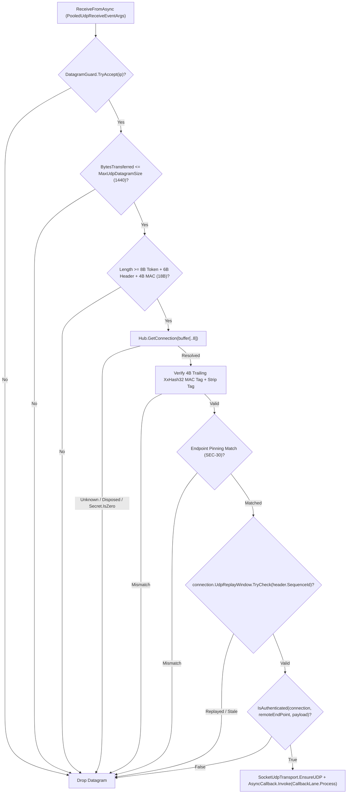

**Namespace:** `Nalix.Network.Listeners.Udp`  
**Assembly:** `Nalix.Network`

`Nalix.Network.Listeners.Udp` cung cấp hai triển khai listener UDP:

1. **`UdpListenerBase`** (`public abstract partial class UdpListenerBase : IListener`): Listener UDP đi kèm đã xác thực, giải quyết mỗi datagram thành một `Connection` đã xác thực qua TCP đang có trong `IConnectionHub`, dựa trên tiền tố `SessionToken` 8 byte và thẻ MAC `XxHash32` 4 byte ở cuối.
2. **`UdpPassthroughListener`** (`public sealed class UdpPassthroughListener : UdpListenerBase`): Listener UDP thô không kết nối, bỏ qua kiểm tra token/MAC và chuyển datagram thô tới `IProtocol` bằng các instance `PassthroughConnection` nhẹ được theo dõi trong `TimingWheel`.

## Nguồn mã

- `src/Nalix.Network/Listeners/UdpListener/UdpListener.Core.cs`
- `src/Nalix.Network/Listeners/UdpListener/UdpListener.PublicMethods.cs`
- `src/Nalix.Network/Listeners/UdpListener/UdpListener.Receive.cs`
- `src/Nalix.Network/Listeners/UdpListener/UdpListener.SocketConfig.cs`
- `src/Nalix.Network/Listeners/UdpListener/UdpListener.Metrics.cs`
- `src/Nalix.Network/Listeners/UdpListener/UdpPassthroughListener.cs`
- `src/Nalix.Network/Connections/PassthroughConnection.cs`
- `src/Nalix.Network/RateLimiting/Datagram.Guard.cs`
- `src/Nalix.Network/Options/DatagramGuardOptions.cs`

## 1. Bố cục datagram đã xác thực (`UdpListenerBase`)

Mọi datagram UDP đến đã xác thực đều có một **envelope xác thực 12 byte** (`8-byte SessionToken prefix` + `4-byte XxHash32 MAC suffix`) bọc gói Nalix:

```text
+-----------------------------------+-----------------------------------+-----------------------------------+
|  SessionToken (8B, LE UInt64)     |  Packet Payload (>= 6B Header)    |  UdpMacTag (4B, LE UInt32)        |
|  = ConnectionId (ISnowflake)      |  [OpCode(2)..SequenceId(2)..Body] |  XxHash32(Secret, seed: Hash(0..N))|
+-----------------------------------+-----------------------------------+-----------------------------------+
  Bytes 0..7                          Bytes 8..(Length - 5)               Bytes (Length - 4)..(Length - 1)
```

### Pipeline kiểm tra nhiều cổng (`UdpListener.Receive.cs`)



1. **Cổng kiểm tra tốc độ và kích thước theo IP**: Kiểm tra `_rateLimiter.TryAccept(ip)` (`DatagramGuard`) và loại các datagram lớn hơn `NetworkSocketOptions.MaxUdpDatagramSize` (`1440` byte).
2. **Phân giải phiên**: Đọc `SessionToken` 8 byte (`buffer[..8]`) và phân giải `Connection` đang hoạt động từ `IConnectionHub`. Loại nếu kết nối không tồn tại hoặc `connection.Secret.IsZero` (handshake chưa hoàn tất).
3. **Xác thực MAC `XxHash32` có khóa (`UdpMacTagSize = 4`)**:
   - Đặt `dataLen = lease.Length - 4`.
   - Tính `uint payloadHash = XxHash32.Compute(lease.Span[..dataLen])`.
   - Tính `uint computedTag = XxHash32.Compute(connection.Secret.AsSpan(), seed: payloadHash)`.
   - So sánh `computedTag` với thẻ little-endian 4 byte ở cuối (`lease.Span.Slice(dataLen, 4)`) và loại thẻ 4 byte đó (`lease.CommitLength(dataLen)`).
4. **Ghim endpoint (`SEC-30`)**: Xác minh IP nguồn UDP (và cổng, khi được ghim) khớp với `connection.NetworkEndpoint`.
5. **Cửa sổ replay trượt (`SEC-27`)**: Kiểm tra `header.SequenceId` 16-bit (`ushort`) với `connection.UdpReplayWindow` (`DatagramGuardOptions.UdpReplayWindowSize = 512` bit).
6. **Hook tùy chỉnh và xử lý khung**: Gọi `IsAuthenticated(connection, remoteEndPoint, payload)`, gắn `SocketUdpTransport.EnsureUDP`, bỏ tiền tố `SessionToken` 8 byte, và chuyển gói qua `AsyncCallback` (`FramePipeline.ProcessInbound` $\rightarrow$ `IProtocol.ProcessMessage`).

## 2. Chế độ passthrough thô (`UdpPassthroughListener`)

Được đăng ký qua `builder.MapUdp<TProtocol>(port, passthrough: true)` khi bạn triển khai các protocol UDP tùy chỉnh của bên thứ ba (như RakNet hoặc UDP nhị phân tùy chỉnh):

- Bỏ qua `SessionToken` 8 byte, thẻ MAC `XxHash32` 4 byte, `UdpReplayWindow` và `FramePipeline`.
- Theo dõi mỗi `IPEndPoint` từ xa dưới dạng một `PassthroughConnection` (`public sealed class PassthroughConnection : IConnection, IConnectionTrafficMetrics, TimingWheel.ITimeoutTrackedConnection`), được `IConnectionGuard` kiểm soát chấp nhận, giới hạn ở `MaxPendingPackets = 64` gói đang chờ đồng thời cho mỗi endpoint, và đăng ký vào `TimingWheel` để tự động loại bỏ khi nhàn rỗi.
- `PassthroughConnection` lộ `UDP` (`IConnection.ITransport`) được gắn với socket listener dùng chung để gửi phản hồi, còn truy cập `PassthroughConnection.TCP` sẽ ném `NotSupportedException`.

## API công khai và protected (`UdpListenerBase`)

```csharp
namespace Nalix.Network.Listeners.Udp;

public abstract partial class UdpListenerBase : IListener
{
    protected UdpListenerBase(ushort port, IProtocol protocol, IConnectionHub hub);
    protected UdpListenerBase(IProtocol protocol, IConnectionHub hub);

    public bool IsListening { get; }
    public UMetrics Metrics { get; }
    protected IProtocol Protocol { get; }
    protected Socket? ListenerSocket { get; }

    public void Activate(CancellationToken cancellationToken = default);
    public void Deactivate(CancellationToken cancellationToken = default);

    public virtual bool TryResolveConnection(
        IConnectionHub hub,
        ReadOnlySpan<byte> sessionToken,
        out Connection? connection);
    public abstract bool IsAuthenticated(
        IConnection connection,
        EndPoint remoteEndPoint,
        ReadOnlySpan<byte> payload);
    protected virtual void ProcessDatagram(BufferLease lease, EndPoint? remoteEndPoint);

    public string GenerateReport();
    public void WriteReportData(Utf8JsonWriter writer);
    public void Dispose();
    protected virtual void Dispose(bool disposing);
}
```

## API liên quan

- [TCP Listener](./tcp-listener.md)
- [Connection](./connection/connection.md)
- [Network Socket Options](../options/network/network-socket-options.md)
- [Connection Limiter (DatagramGuard)](./connection/connection-limiter.md)
