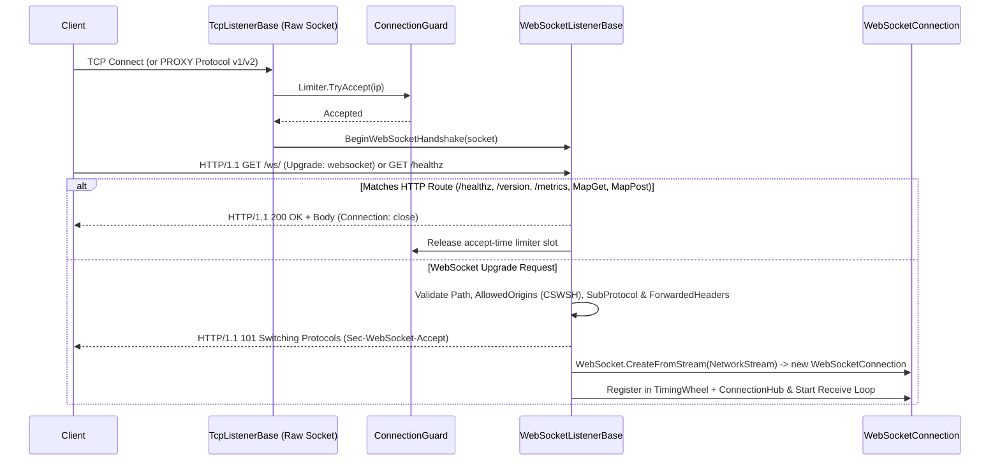

**Không gian tên:** `Nalix.Network.Listeners.Web`  
**Assembly:** `Nalix.Network`

`WebSocketListenerBase` (`public abstract partial class WebSocketListenerBase : TcpListenerBase`) cung cấp một listener WebSocket RFC 6455 và HTTP/1.1 control-plane không cấp phát bộ nhớ, chạy trên raw socket, được xây dựng trực tiếp trên [TcpListenerBase](./tcp-listener.md) (listener **không** dùng `System.Net.HttpListener` và **không** yêu cầu URL ACL của Windows hay quyền quản trị viên).

## Ánh xạ mã nguồn

- `src/Nalix.Network/Listeners/WebListener/WebSocketListener.Core.cs`
- `src/Nalix.Network/Listeners/WebListener/WebSocketListener.Handle.cs`
- `src/Nalix.Network/Listeners/WebListener/WebSocketListener.Headers.cs`
- `src/Nalix.Network/Listeners/WebListener/WebSocketListener.Http.cs`
- `src/Nalix.Network/Listeners/WebListener/WebSocketListener.HttpResponses.cs`
- `src/Nalix.Network/Listeners/WebListener/HttpRequestView.cs`
- `src/Nalix.Network/Options/NetworkWebSocketOptions.cs`
- `src/Nalix.Network/Options/ForwardedHeadersOptions.cs`

## 1. Pipeline nâng cấp và xử lý yêu cầu HTTP



### Hành vi kiến trúc chính

1. **Bộ quét timeout handshake**: Khi `Activate()` được gọi, `WebSocketListenerBase` lên lịch một tác vụ lặp lại mỗi giây (`TaskManager.ScheduleRecurring`) để quét các ngữ cảnh nâng cấp HTTP bị treo vượt quá `NetworkWebSocketOptions.HandshakeTimeoutMs` (mặc định `5000` ms), đóng socket của chúng ngoài lock và giải phóng các slot `ConnectionGuard`.
2. **Endpoint HTTP DevOps có sẵn**: Khi `NetworkWebSocketOptions.EnableDevOpsEndpoints = true` (mặc định), listener đăng ký các handler `GET` HTTP không cấp phát bộ nhớ trên cùng cổng:
   - `/healthz`, `/health`, `/livez`, `/readyz`, `/startupz`, `/ping` $\rightarrow$ `200 OK` (`Healthy`)
   - `/version` $\rightarrow$ `200 OK` JSON (`{"name":"Nalix","version":"1.0.0","status":"running"}`)
   - `/metrics` $\rightarrow$ `200 OK` định dạng văn bản Prometheus (`nalix_active_connections`)
3. **Kiểm soát Origin chống CSWSH**: Kiểm tra header `Origin` qua `NetworkWebSocketOptions.IsOriginAllowed(origin)` trước khi gửi `101 Switching Protocols`. Yêu cầu bị từ chối sẽ nhận `HTTP/1.1 403 Forbidden` và kết nối bị đóng ngay.
4. **Forwarded header ở tầng L7 (`ForwardedHeadersOptions`)**: Khi `ForwardedHeadersOptions.Enabled = true`, lấy IP client thật từ `CF-Connecting-IP`, `X-Real-IP` hoặc `X-Forwarded-For` (được chọn theo `ForwardedHeadersOptions.ClientIpHeader`, mặc định `Auto`) (áp dụng `TrustedProxyOptions` khi `RequireTrustedProxy = true`) và chuyển slot `ConnectionGuard` từ IP của proxy sang IP client thật.

---

## 2. Tham chiếu API `WebSocketListenerBase`

```csharp
namespace Nalix.Network.Listeners.Web;

public abstract partial class WebSocketListenerBase : TcpListenerBase
{
    protected WebSocketListenerBase(
        ushort port,
        string path,
        IProtocol protocol,
        IConnectionHub hub,
        IConnectionGuard guard);

    protected WebSocketListenerBase(
        IProtocol protocol,
        IConnectionHub hub,
        IConnectionGuard guard);

    protected WebSocketListenerBase(
        string path,
        IProtocol protocol,
        IConnectionHub hub,
        IConnectionGuard guard);

    // Minimal HTTP/1.1 control-plane routing on the WebSocket port
    public void MapGet(string path, HttpRouteHandler handler);
    public void MapPost(string path, HttpRouteHandler handler);

    public override void Activate(CancellationToken cancellationToken = default);
    public override void Deactivate(CancellationToken cancellationToken = default);
}
```

---

## 3. Kiểu định tuyến HTTP tối giản (`HttpRequestView.cs`)

`Nalix.Network.Listeners.Web` cung cấp các kiểu `ref struct` không cấp phát bộ nhớ để xử lý các route HTTP `GET` và `POST` tùy chỉnh được đăng ký qua `WebSocketListenerBase.MapGet` / `MapPost` hoặc `IWebSocketBindingBuilder.MapGet` / `MapPost`:

### `HttpMethodType` và `HttpRouteHandler`

```csharp
public enum HttpMethodType : byte
{
    Get = 1,
    Post = 2,
    Options = 3
}

public delegate void HttpRouteHandler(
    in HttpRequestView request,
    ref HttpResponseWriter response);
```

### `HttpRequestView` (`readonly ref struct`)

| Thuộc tính | Kiểu | Mô tả |
| :--- | :--- | :--- |
| `Method` | `ReadOnlySpan<byte>` | Byte phương thức HTTP thô (ví dụ: `"GET"u8`, `"POST"u8`). |
| `Path` | `ReadOnlySpan<byte>` | Đường dẫn yêu cầu, không có query string (ví dụ: `"/metrics"u8`). |
| `Query` | `ReadOnlySpan<byte>` | Query string thô không có dấu `'?'` đứng đầu, hoặc rỗng nếu không có. |
| `Body` | `ReadOnlySpan<byte>` | Byte nội dung của yêu cầu (với yêu cầu `POST`, tối đa `MaxUpgradeRequestSize`), hoặc rỗng. |
| `ContentType` | `ReadOnlySpan<byte>` | Giá trị header `Content-Type`, hoặc rỗng nếu không có. |
| `Origin` | `ReadOnlySpan<byte>` | Giá trị header `Origin`, hoặc rỗng nếu không có. |
| `RemoteEndPoint` | `EndPoint?` | Endpoint client đã phân giải (tính đến PROXY Protocol v1/v2 hoặc `ForwardedHeadersOptions` đáng tin cậy). |

### `HttpResponseWriter` (`ref struct`)

Thuê buffer từ `BufferLease.ByteArrayPool` (dung lượng tối đa của body là `1_048_576` byte) và tự động trả lại sau khi phản hồi được gửi.

| Thành phần | Chữ ký | Mô tả |
| :--- | :--- | :--- |
| `StatusCode` | `public int StatusCode { get; set; }` | Mã trạng thái HTTP (mặc định `200`). |
| `ContentType` | `public ReadOnlySpan<byte> ContentType { readonly get; set; }` | Byte của header `Content-Type` (mặc định `"text/plain; charset=utf-8"u8`). |
| `WrittenCount` | `public int WrittenCount { get; }` | Số byte body đã ghi cho đến nay. |
| `WrittenSpan` | `public readonly ReadOnlySpan<byte> WrittenSpan { get; }` | Body phản hồi đã ghi dưới dạng span byte chỉ đọc. |
| `GetSpan(int)` | `public Span<byte> GetSpan(int sizeHint = 0)` | Trả về một `Span<byte>` có thể ghi với kích thước ít nhất là `sizeHint` byte. |
| `Advance(int)` | `public void Advance(int count)` | Tăng `WrittenCount` sau khi ghi vào `GetSpan`. |
| `Write(ReadOnlySpan<byte>)` | `public void Write(ReadOnlySpan<byte> bytes)` | Thêm byte UTF-8 hoặc nhị phân thô vào body phản hồi. |
| `WriteUtf8(ReadOnlySpan<char>)` | `public void WriteUtf8(ReadOnlySpan<char> text)` | Mã hóa và thêm một span ký tự dưới dạng UTF-8. |
| `WriteJson(ReadOnlySpan<char>)` | `public void WriteJson(ReadOnlySpan<char> json)` | Đặt `ContentType` thành `"application/json; charset=utf-8"u8` và ghi payload JSON UTF-8. |
| `WriteInt32(int)` / `WriteInt64(long)` | `public void WriteInt32(int value)` / `WriteInt64(long value)` | Định dạng số nguyên thành các chữ số UTF-8 vào body phản hồi mà không cấp phát bộ nhớ. |

## Ví dụ sử dụng

```csharp
using Nalix.Hosting;
using Nalix.Hosting.Protocols;
using Nalix.Network.Listeners.Web;

var app = NetworkApplication.CreateBuilder()
    .MapWebSocket<DefaultProtocol>()
        .OnPort(57207)
        .WithPath("/ws/")
        .MapGet("/status", (in HttpRequestView req, ref HttpResponseWriter res) =>
        {
            res.StatusCode = 200;
            res.WriteJson("{\"ready\":true}");
        })
        .Bind()
    .Build();
```

## API liên quan

- [WebSocket Binding (IWebSocketBindingBuilder)](../hosting/websocket-binding.md)
- [Kết nối WebSocket](./websocket-connection.md)
- [Tùy chọn WebSocket (NetworkWebSocketOptions)](../options/network/websocket-options.md)
- [TCP Listener](./tcp-listener.md)
