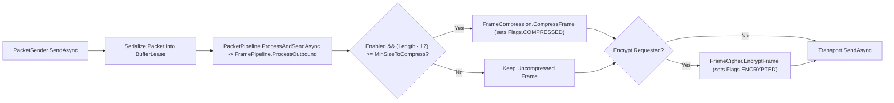

**Không gian tên:** `Nalix.Codec.Options`  
**Assembly:** `Nalix.Codec`

`CompressionOptions` quyết định khung gói tin gửi đi có được nén bằng LZ4 hay không (`Enabled`), kích thước payload tối thiểu trước khi bắt đầu nén (`MinSizeToCompress`), và kích thước payload giải nén tối đa cho phép với khung gói tin đến (`MaxDecompressedSize`).

## Ánh xạ mã nguồn

- `src/Nalix.Codec/Options/CompressionOptions.cs`
- `src/Nalix.Codec/Transforms/FrameCompression.cs`
- `src/Nalix.Codec/Transforms/FramePipeline.cs`
- `src/Nalix.Runtime/Internal/Pipelines/PacketPipeline.cs`
- `src/Nalix.Runtime/Dispatching/PacketSender.cs`

## Giá trị mặc định và kiểm tra hợp lệ

| Thuộc tính | Kiểu | Mặc định | Kiểm tra hợp lệ | Tác động lúc chạy |
| :--- | :--- | ---: | :--- | :--- |
| `Enabled` | `bool` | `true` | Không có | Bật nén khung LZ4 tự động cho khung gửi đi khi kích thước payload đạt `MinSizeToCompress`. |
| `MinSizeToCompress` | `int` | `512` | `[ValueRange(1, int.MaxValue)]` | Kích thước payload tối thiểu tính bằng byte (không tính header gói tin 12 byte) trước khi thử nén khung gửi đi. |
| `MaxDecompressedSize` | `int` | `33_554_432` (`32 MB`) | `[ValueRange(1024, 268_435_456)]` (`1 KB..256 MB`) | Kích thước payload giải nén tối đa cho phép tính bằng byte đối với khung `COMPRESSED` đến (chống tấn công zip-bomb / DoS do cấp phát bộ nhớ). |

`Validate()` thực thi `this.ValidateDataAnnotations()` và kiểm tra ràng buộc liên trường `MinSizeToCompress <= MaxDecompressedSize` (ném `ValidationException` nếu không thỏa).

## Hành vi pipeline gửi và nhận (`FramePipeline` và `PacketPipeline`)

`PacketPipeline.ProcessAndSendAsync` (khi gửi đi) và `TcpListenerBase`/`UdpListenerBase`/`WebSocketListenerBase` (khi nhận) thực thi các phép biến đổi khung thông qua `FramePipeline`:



### Thứ tự biến đổi (`Compress-then-Encrypt`)

| Chiều | Thứ tự | Chi tiết |
| :--- | :--- | :--- |
| **Gửi đi** (`FramePipeline.ProcessOutbound`) | **Nén $\rightarrow$ Mã hóa** | Được gọi bởi `PacketPipeline.ProcessAndSendAsync`; kiểm tra `(current.Length - PacketConstants.HeaderSize) >= minSizeToCompress`. Bản mã có entropy cao không thể nén, nên việc nén LZ4 luôn chạy trước khi mã hóa AEAD. |
| **Nhận về** (`FramePipeline.ProcessInbound`) | **Giải mã $\rightarrow$ Giải nén** | Giải mã các khung `PacketFlags.ENCRYPTED` trước, đọc lại `PacketFlags` đã khôi phục, và nếu `PacketFlags.COMPRESSED` được đặt, kiểm tra độ dài gốc khai báo với `MaxDecompressedSize` trước khi gọi `FrameCompression.DecompressFrame(...)`. |

:::note[Tính độc lập của giải nén khi nhận]
`CompressionOptions.Enabled` chỉ điều khiển việc bên gửi cục bộ có nén khung gửi đi hay không. Khung đến mang `PacketFlags.COMPRESSED` luôn được giải nén miễn là kích thước giải nén khai báo không vượt quá `MaxDecompressedSize`.
:::

## Ví dụ cấu hình

### Cấu hình bằng code

```csharp
using Nalix.Codec.Options;
using Nalix.Hosting;

INetworkApplicationBuilder builder = NetworkApplication.CreateBuilder();

builder.Configure<CompressionOptions>(options =>
{
    options.Enabled = true;
    options.MinSizeToCompress = 512;
    options.MaxDecompressedSize = 16 * 1024 * 1024; // 16 MB
});
```

### Cấu hình INI (`default.ini`)

```ini
[Compression]
Enabled = true
MinSizeToCompress = 512
MaxDecompressedSize = 33554432
```

## API liên quan

- [Nén gói tin](../../codec/frame-pipeline.md)
- [Packet Sender](../../runtime/routing/packet-sender.md)
- [Tùy chọn mạng](./options.md)
