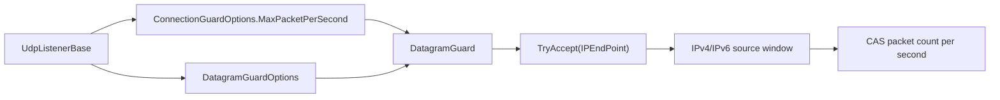

`DatagramGuardOptions` cấu hình việc theo dõi cửa sổ nguồn có giới hạn được `DatagramGuard` của listener UDP sử dụng. Guard giới hạn tốc độ gói theo từng nguồn thông qua `ConnectionGuardOptions.MaxPacketPerSecond`, trong khi kiểu tùy chọn này kiểm soát số lượng cửa sổ nguồn IPv4/IPv6 có thể được theo dõi cùng lúc và cách dọn dẹp các cửa sổ đã cũ.

## Ánh xạ mã nguồn

- `src/Nalix.Network/Options/DatagramGuardOptions.cs`
- `src/Nalix.Network/RateLimiting/Datagram.Guard.cs`
- `src/Nalix.Network/Listeners/UdpListener/UdpListener.Core.cs`

## Kết nối với UDP listener

`UdpListenerBase` nạp và kiểm tra hợp lệ các tùy chọn này trong static constructor của nó:

```csharp
s_datagramGuardOptions = ConfigurationManager.Instance.Get<DatagramGuardOptions>();
s_datagramGuardOptions.Validate();
```

Mỗi instance listener sau đó tạo một `DatagramGuard` với:

- `ConnectionGuardOptions.MaxPacketPerSecond`
- `DatagramGuardOptions.IPv4Windows`
- `DatagramGuardOptions.IPv6Windows`
- `DatagramGuardOptions.CleanupInterval`
- `DatagramGuardOptions.IdleTimeout`
- `DatagramGuardOptions.IPv4Capacity`
- `DatagramGuardOptions.IPv6Capacity`



## Giá trị mặc định và kiểm tra hợp lệ

| Thuộc tính | Mặc định | Phạm vi hợp lệ | Hành vi trong mã nguồn |
| --- | ---: | --- | --- |
| `IPv4Windows` | `65_536` | `1..10_000_000` | Số cửa sổ nguồn IPv4 tối đa được theo dõi cùng lúc. |
| `IPv6Windows` | `16_384` | `1..10_000_000` | Số cửa sổ nguồn IPv6 tối đa được theo dõi cùng lúc. |
| `IPv4Capacity` | `1024` | `1..10_000_000` | Gợi ý dung lượng ban đầu cho bản đồ nguồn IPv4. |
| `IPv6Capacity` | `64` | `1..10_000_000` | Gợi ý dung lượng ban đầu cho bản đồ nguồn IPv6. |
| `CleanupInterval` | `00:01:00` | `00:00:01..01:00:00` | Khoảng thời gian giữa các lượt loại bỏ cửa sổ nguồn đã cũ. |
| `IdleTimeout` | `00:00:10` | `00:00:01..01:00:00` | Thời gian giữ cửa sổ nguồn không hoạt động trước khi bị loại bỏ. |
| `FailOpenWhenFull` | `false` | Boolean | Khi `true`, cho phép gói đi qua khi bản đồ theo dõi đã đầy, tránh việc khóa người dùng hợp lệ trong lúc bị flood với nguồn giả mạo. Khi `false` (mặc định), guard từ chối gói đến khi bản đồ đầy (fail-closed). |
| `UdpReplayWindowSize` | `512` | `64..65536` | Kích thước bit của cửa sổ trượt chống phát lại UDP; cửa sổ lớn hơn tốn nhiều bộ nhớ hơn nhưng chịu được gói đến không đúng thứ tự tốt hơn. |

`Validate()` chạy kiểm tra DataAnnotation và ném `ValidationException` khi vi phạm ràng buộc.

## Hành vi lúc chạy

`DatagramGuard.TryAccept(IPEndPoint)` trả về `false` khi:

- guard đã bị hủy;
- endpoint là `null`;
- bản đồ cửa sổ nguồn IPv4 hoặc IPv6 đã đạt giới hạn cấu hình;
- nguồn đã đạt `MaxPacketPerSecond` trong giây hiện tại.

Guard lưu mỗi nguồn trong một `WindowSlot` với một `long` đóng gói duy nhất:

| Trường đóng gói | Ý nghĩa |
| --- | --- |
| 32 bit cao | token của giây hiện tại từ `Environment.TickCount64 / 1000` |
| 32 bit thấp | số gói trong giây đó |

Việc cập nhật dùng `Interlocked.CompareExchange`, nên đường nóng không dùng lock nhưng vẫn giữ được bộ đếm gói chính xác theo từng giây cho mỗi nguồn.

## Theo dõi IPv4 và IPv6

| Họ địa chỉ | Kiểu khóa | Ghi chú nguồn |
| --- | --- | --- |
| IPv4 | `uint` từ `IPAddress.Address` | Được chọn để tránh cấp phát khóa `IPAddress` và chi phí băm. |
| IPv6 | `string` từ `IPAddress.ToString()` | Được dùng làm đường dự phòng ít gặp hơn cho các kịch bản DDoS qua UDP. |

## Dọn dẹp và giải phóng

Constructor khởi động `CleanupLoopAsync` ngay lập tức. Vòng lặp chờ `CleanupInterval`, sau đó loại bỏ các cửa sổ có giây được thấy lần cuối cũ hơn `IdleTimeout`.

`Dispose()` đánh dấu guard đã bị hủy, hủy và giải phóng token source của tác vụ dọn dẹp, rồi xóa cả bản đồ IPv4 và IPv6.

## Hướng dẫn vận hành

- Chỉ tăng `IPv4Windows` / `IPv6Windows` khi số lượng nguồn hợp lệ đủ lớn để cần thiết.

- Giữ `IdleTimeout` ngắn đối với các endpoint UDP công khai khi đang chịu áp lực từ nguồn giả mạo.
- Điều chỉnh `ConnectionGuardOptions.MaxPacketPerSecond` riêng biệt; đây là giới hạn tốc độ gói theo từng nguồn mà `DatagramGuard` sử dụng.

## API liên quan

- [Tùy chọn mạng](./options.md)
- [Tùy chọn Connection Quota](./connection-quota-options.md)
- [Tùy chọn Connection Guard](./connection-guard-options.md)
- [Tùy chọn Trusted Proxy](./trusted-proxy-options.md)
- [UDP Listener](../../network/udp-listener.md)
