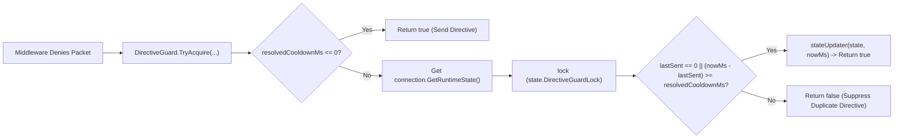

**Không gian tên:** `Nalix.Runtime.Options`  
**Assembly:** `Nalix.Runtime`

`DirectiveGuardOptions` (`public sealed partial class DirectiveGuardOptions : ConfigurationLoader, IValidatableConfiguration`) cấu hình thời gian chờ theo từng kết nối mà `DirectiveGuard` áp dụng trước khi gửi lại các directive thất bại đầu vào lặp lại (`UNAUTHORIZED`, `RATE_LIMITED` và `TIMEOUT`).

## Ánh xạ mã nguồn

- `src/Nalix.Runtime/Options/DirectiveGuardOptions.cs`
- `src/Nalix.Runtime/Internal/RateLimiting/DirectiveGuard.cs`
- `src/Nalix.Runtime/Internal/RuntimeConnectionState.cs`
- `src/Nalix.Runtime/Extensions/ConnectionExtensions.cs`
- `src/Nalix.Runtime/Middleware/Standard/PermissionMiddleware.cs`
- `src/Nalix.Runtime/Middleware/Standard/RateLimitMiddleware.cs`
- `src/Nalix.Runtime/Middleware/Standard/TimeoutMiddleware.cs`

## Tham chiếu thuộc tính

Được nạp từ mục `[DirectiveGuard]` của `default.ini` thông qua `ConfigurationManager.Instance.Get<DirectiveGuardOptions>()`:

| Thuộc tính | Kiểu | Mặc định | Kiểm tra hợp lệ | Mô tả |
| :--- | :--- | :---: | :--- | :--- |
| `DefaultCooldownMs` | `int` | `1_000` (`1000` ms) | `[ValueRange(0, 60000)]` | Khoảng thời gian tối thiểu tính bằng mili giây giữa các directive lặp lại cùng loại trên mỗi kết nối (`0` tắt chặn lặp). |

## Cách `DirectiveGuard` hoạt động

Khi một middleware đầu vào từ chối hoặc hết thời gian chờ một gói tin, nó gọi:

```csharp
DirectiveGuard.TryAcquire(
    IConnection connection,
    Func<RuntimeConnectionState, long> stateSelector,
    Action<RuntimeConnectionState, long> stateUpdater,
    int? cooldownMs = null)
```



### Dấu thời gian theo từng loại trên `RuntimeConnectionState`

`DirectiveGuard` theo dõi ba dấu thời gian `Environment.TickCount64` độc lập trên `RuntimeConnectionState` của mỗi kết nối (được bảo vệ bởi `state.DirectiveGuardLock`):

| Middleware | Lý do directive | Thuộc tính của `RuntimeConnectionState` |
| :--- | :--- | :--- |
| `PermissionMiddleware` | `ProtocolReason.UNAUTHORIZED` | `InboundDirectiveUnauthorizedLastSentAtMs` |
| `RateLimitMiddleware` | `ProtocolReason.RATE_LIMITED` | `InboundDirectiveRateLimitedLastSentAtMs` |
| `TimeoutMiddleware` | `ProtocolReason.TIMEOUT` | `InboundDirectiveTimeoutLastSentAtMs` |

Việc chặn một `Directive` trùng lặp chỉ ngăn khuếch đại phản hồi đi ra ngoài — gói bị từ chối vẫn bị loại bỏ và không bao giờ đến được handler.

## API liên quan

- [Permission Middleware](../../runtime/middleware/permission-middleware.md)
- [Policy Rate Limiter](../../runtime/middleware/policy-rate-limiter.md)
- [Timeout Middleware](../../runtime/middleware/timeout-middleware.md)
- [Tùy chọn Token Bucket](./token-bucket-options.md)
