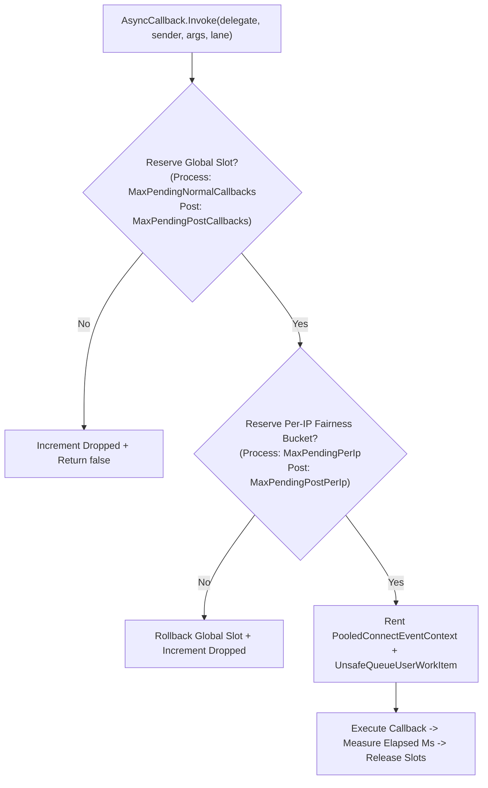

**Không gian tên:** `Nalix.Network.Options`  
**Assembly:** `Nalix.Network`

`NetworkCallbackOptions` cấu hình hai lớp áp lực callback độc lập:
1. **Lớp 1 (ngưỡng theo từng kết nối trong `SocketConnection`)**: Giới hạn số gói nhận đang chờ (`MaxPerConnectionPendingPackets`) và số luồng phân mảnh đang mở (`MaxPerConnectionOpenFragmentStreams`) cho mỗi kết nối, áp dụng `OverflowPolicy` (`DropPacket` hoặc `Disconnect`) khi vượt ngưỡng.
2. **Lớp 2 (làn công bằng toàn cục và theo IP trong `AsyncCallback`)**: Áp dụng ngân sách riêng cho callback xử lý đầu vào (`CallbackLane.Process`) và callback hậu xử lý đầu ra (`CallbackLane.Post`), trên các bộ đếm toàn cục và mảng công bằng băm theo endpoint không dùng lock (`FairnessMapSize`).

## Ánh xạ mã nguồn

- `src/Nalix.Network/Options/NetworkCallbackOptions.cs`
- `src/Nalix.Abstractions/Networking/NetworkOverflowPolicy.cs`
- `src/Nalix.Network/Internal/Transport/SocketConnection.cs`
- `src/Nalix.Network/Internal/Transport/AsyncCallback.cs`
- `src/Nalix.Network/Connections/Connection.cs`
- `src/Nalix.Network/Internal/Pooling/PooledConnectEventContext.cs`

## Giá trị mặc định và kiểm tra hợp lệ

| Thuộc tính | Kiểu | Mặc định | Phạm vi hợp lệ | Tác động lúc chạy |
| :--- | :--- | ---: | :--- | :--- |
| `MaxPerConnectionPendingPackets` | `int` | `16` | `1..1024` | Giới hạn lớp 1 cho các gói đường nhận đã xếp hàng cho một kết nối (`MessageProcessing`) nhưng chưa hoàn tất. |
| `MaxPerConnectionOpenFragmentStreams` | `int` | `4` | `1..256` | Giới hạn lớp 1 cho số luồng gói phân mảnh đang mở đồng thời trên một kết nối. |
| `OverflowPolicy` | `NetworkOverflowPolicy` | `DropPacket` (`0`) | `DropPacket` (`0`), `Disconnect` (`1`) | Hành động khi một kết nối vượt quá `MaxPerConnectionPendingPackets`: bỏ gói đến (`DropPacket`) hoặc đóng kết nối ngay (`Disconnect`). |
| `MaxPendingNormalCallbacks` | `int` | `10_000` | `100..1_000_000` | Giới hạn lớp 2 toàn cục cho callback xử lý đầu vào (`CallbackLane.Process`) đang chờ trong `AsyncCallback`. |
| `CallbackWarningThreshold` | `int` | `5_000` | `0..1_000_000` | Phát cảnh báo áp lực ngược mỗi `1,000` callback khi số callback thường đang chờ đạt ngưỡng này (`0` tắt cảnh báo). |
| `MaxPendingPerIp` | `int` | `64` | `1..10_000` | Giới hạn công bằng lớp 2 theo endpoint cho callback `CallbackLane.Process`. |
| `MaxPendingPostCallbacks` | `int` | `5_000` | `100..1_000_000` | Giới hạn lớp 2 toàn cục cho callback hậu xử lý (`MessageProcessed` / `CallbackLane.Post`). |
| `MaxPendingPostPerIp` | `int` | `32` | `1..10_000` | Giới hạn công bằng lớp 2 theo endpoint cho callback `CallbackLane.Post`. |
| `MaxCallbackExecutionMs` | `int` | `50` | `1..60_000` | Ngưỡng thời gian thực thi (ms) của một callback; vượt ngưỡng sẽ ghi cảnh báo callback chậm và tăng `SlowCallbacks`. |
| `MaxPooledCallbackStates` | `int` | `1_000` | `64..100_000` | Giới hạn cấu hình cho các wrapper trạng thái callback có thể tái sử dụng. |
| `FairnessMapSize` | `int` | `16_384` | `1_024..65_536` | Kích thước của các bucket công bằng `long[]` cố định (`s_perIpProcessMap` và `s_perIpPostMap`) dùng để đếm callback theo endpoint. |

### Quy tắc kiểm tra hợp lệ

`Validate()` chạy kiểm tra DataAnnotations, sau đó kiểm tra ba ràng buộc liên trường:
- `CallbackWarningThreshold < MaxPendingNormalCallbacks` (khi `CallbackWarningThreshold > 0`)
- `MaxPendingPerIp <= MaxPendingNormalCallbacks`
- `MaxPendingPostPerIp <= MaxPendingPostCallbacks`

## Lớp 1: Ngưỡng nhận dữ liệu theo từng kết nối (`Connection.OnFrameReceived` và `SocketConnection`)

Khi một khung hoàn chỉnh được lắp ráp trong `SocketConnection.PROCESS_FRAME_FROM_BUFFER`, nó gọi `_connectionOwner?.OnFrameReceived(lease)` trên `Connection` sở hữu. Khi `AsyncCallback.CanRunInline(backing.MessageProcessing)` là `false`, `Connection.OnFrameReceived` tăng `backing.PendingProcessCallbacks` trước khi xếp hàng khung:

- Nếu bộ đếm vượt quá `MaxPerConnectionPendingPackets`:
  - Bộ đếm được giảm ngay lập tức, `IncrementPacketsDropped()` được gọi và lease của khung được giải phóng.
  - Nếu `OverflowPolicy == NetworkOverflowPolicy.Disconnect`, kết nối bị đóng ngay (`Disconnect()`) để bảo vệ máy chủ khỏi lạm dụng kiểu consumer chậm / flood.
  - Nếu `OverflowPolicy == NetworkOverflowPolicy.DropPacket` (mặc định), gói bị loại bỏ và kết nối vẫn mở.
- Ngược lại, khung được bọc trong `ConnectionEventArgs` và được điều phối qua:
  ```csharp
  AsyncCallback.Invoke(
      s_messageProcessingBridge,
      this,
      args,
      CallbackLane.Process,
      releasePendingPacketOnCompletion: true);
  ```
  Khi callback thực thi xong, `PooledConnectEventContext` thông báo cho kết nối (`ReleasePendingPacket()`) để giảm `backing.PendingProcessCallbacks`.

### Giới hạn luồng phân mảnh

Khi một khung phân mảnh đến và mở một luồng mới trong `FragmentAssembler`, `SocketConnection` áp dụng `MaxPerConnectionOpenFragmentStreams`. Nếu số lượng vượt quá `MaxPerConnectionOpenFragmentStreams`, luồng bị từ chối và khung bị loại bỏ. Các luồng phân mảnh đã hết hạn được loại bỏ định kỳ qua `FragmentAssembler.EvictExpired(...)`.

## Lớp 2: Áp lực ngược hai làn của `AsyncCallback`

`AsyncCallback` tách các callback thường thành hai làn độc lập (`CallbackLane.Process` cho `MessageProcessing` và `CallbackLane.Post` cho `MessageProcessed`), cùng một làn dọn dẹp ưu tiên cao (`InvokeHighPriority` cho `ConnectionClosed`):



### Làn dọn dẹp ưu tiên cao

`AsyncCallback.InvokeHighPriority(...)` được `Connection` dùng khi phát sinh `ConnectionClosed`. Làn này bỏ qua `MaxPendingNormalCallbacks` và `MaxPendingPerIp`, để việc dọn dẹp ngắt kết nối và giải phóng tài nguyên luôn được thực thi kể cả khi callback đang bão hòa nghiêm trọng.

## Chẩn đoán (`AsyncCallbackMetrics`)

`AsyncCallback.GetStatistics()` trả về một `internal readonly struct AsyncCallbackMetrics`:

| Thuộc tính | Kiểu | Mô tả |
| :--- | :--- | :--- |
| `PendingProcess` | `int` | Số lượng callback `CallbackLane.Process` đang xếp hàng tại thời điểm hiện tại. |
| `PendingPost` | `int` | Số lượng callback `CallbackLane.Post` đang xếp hàng tại thời điểm hiện tại. |
| `Total` | `long` | Tổng số callback đã lên lịch trên tất cả các làn từ trước đến nay. |
| `Dropped` | `long` | Tổng số callback bị từ chối do áp lực toàn cục, theo IP hoặc của ThreadPool từ trước đến nay. |
| `SlowCallbacks` | `long` | Tổng số callback có thời gian thực thi vượt `MaxCallbackExecutionMs` từ trước đến nay. |
| `FairnessCollisions` | `long` | Tổng số va chạm bucket băm được phát hiện trong các bản đồ công bằng theo IP từ trước đến nay. |
| `FairnessEvictions` | `long` | Tổng số lần loại bỏ bucket công bằng khi các slot rảnh được thu hồi từ trước đến nay. |

## Ví dụ cấu hình INI

```ini
[NetworkCallback]
MaxPerConnectionPendingPackets = 16
MaxPerConnectionOpenFragmentStreams = 4
OverflowPolicy = DropPacket
MaxPendingNormalCallbacks = 10000
CallbackWarningThreshold = 5000
MaxPendingPerIp = 64
MaxPendingPostCallbacks = 5000
MaxPendingPostPerIp = 32
MaxCallbackExecutionMs = 50
MaxPooledCallbackStates = 1000
FairnessMapSize = 16384
```

## API liên quan

- [Sự kiện kết nối](../../network/connection/connection-events.md)
- [Socket Connection](../../network/socket-connection.md)
- [Tùy chọn Connection Guard](./connection-guard-options.md)
- [Tùy chọn Pooling](./pooling-options.md)
- [Tùy chọn mạng](./options.md)
