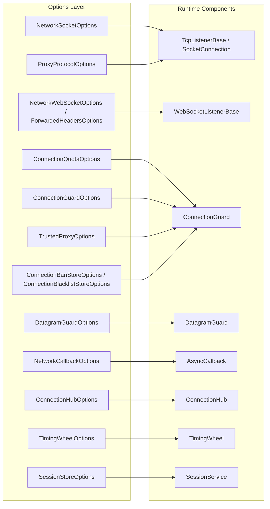

**Không gian tên:** `Nalix.Network.Options`, `Nalix.Runtime.Options`, `Nalix.Codec.Options`  
**Assembly:** `Nalix.Network`, `Nalix.Runtime`, `Nalix.Codec`

Các lớp option mạng và runtime kế thừa từ `ConfigurationLoader` và ánh xạ trực tiếp tới các mục INI trong `default.ini` (thông qua `ConfigurationManager.Instance.Get<TOptions>()` hoặc `builder.Configure<TOptions>(...)`).

## Cấu trúc cấu hình

## Ma trận sở hữu tùy chọn

| Loại tùy chọn | Namespace / Package | Mục INI | Vai trò chính |
| :--- | :--- | :--- | :--- |
| [NetworkSocketOptions](./network-socket-options.md) | `Nalix.Network.Options` | `[NetworkSocket]` | Cổng (`57206`), backlog (`512`), IPv6 dual-stack (`EnableDualStack = true`), buffer (`65536`), mức song song khi accept, và giới hạn datagram UDP (`1440`). |
| `NetworkWebSocketOptions` | `Nalix.Network.Options` | `[NetworkWebSocket]` | Cổng WebSocket (`57207`), đường dẫn (`"/ws/"`), subprotocol (`"nalix.v1"`), endpoint DevOps (`/healthz`, `/version`, `/metrics`), và `AllowedOrigins` chống CSWSH. |
| `ProxyProtocolOptions` | `Nalix.Network.Options` | `[ProxyProtocol]` | Lấy IP client thật từ PROXY Protocol v1/v2 của HAProxy / AWS NLB (`Enabled`, `RequireTrustedProxy`, `HeaderTimeoutMs = 2000`, `MaxPendingProxyConnections = 1024`). |
| `ForwardedHeadersOptions` | `Nalix.Network.Options` | `[ForwardedHeaders]` | Phân tích header proxy ở tầng L7 cho `WebSocketListenerBase` (thứ tự ưu tiên: `CF-Connecting-IP`, `X-Real-IP`, `X-Forwarded-For`; proxy phải xóa các giá trị do client gửi lên). |
| `VarIntFramingOptions` | `Nalix.Network.Options` | `[VarIntFraming]` | Kích thước payload tối đa của khung VarInt (`MaxPayloadSize = 131_072`). |
| [ConnectionQuotaOptions](./connection-quota-options.md) | `Nalix.Network.Options` | `[ConnectionQuota]` | Giới hạn đồng thời theo IP (`10`) và theo subnet (`50`), cửa sổ tốc độ (`5s`), phát hiện bùng phát, và Proof-of-Work thích ứng (`AdaptivePowMinDifficulty = 12`). |
| [ConnectionGuardOptions](./connection-guard-options.md) | `Nalix.Network.Options` | `[ConnectionGuard]` | Trần kết nối toàn cục (`MaxConnections = 2000`), cấm lũy tiến (`EnableProgressiveBanning = true`), ngưỡng lỗi (`50`), và tốc độ gói UDP (`128` gói/s). |
| [TrustedProxyOptions](./trusted-proxy-options.md) | `Nalix.Network.Options` | `[TrustedProxy]` | Danh sách cho phép các reverse proxy / CDN đáng tin cậy (`"trusted_proxies.txt"`) và trần kết nối nới lỏng (`5000`). |
| [ConnectionBanStoreOptions](./connection-ban-store-options.md) | `Nalix.Network.Options` | `[ConnectionBanStore]` | Lưu bền vững xuống đĩa (`"banned_ips.bin"`) và cửa sổ suy giảm 7 ngày cho các lệnh cấm IP động. |
| [ConnectionBlacklistStoreOptions](./connection-blacklist-store-options.md) | `Nalix.Network.Options` | `[ConnectionBlacklistStore]` | Danh sách chặn IP/CIDR cố định, nạp từ `"blacklist.txt"`. |
| `DatagramGuardOptions` | `Nalix.Network.Options` | `[DatagramGuard]` | Cửa sổ nguồn UDP IPv4 (`65,536`) / IPv6 (`16,384`) có giới hạn và kích thước cửa sổ chống phát lại (`UdpReplayWindowSize = 512` bit). |
| [ConnectionHubOptions](./connection-hub-options.md) | `Nalix.Network.Options` | `[ConnectionHub]` | Số shard (`max(1, ProcessorCount)`), gom lô broadcast, mức song song khi ngắt kết nối hàng loạt, và ghi log độ trễ. |
| [TimingWheelOptions](./timing-wheel-options.md) | `Nalix.Network.Options` | `[TimingWheel]` | Số bucket (`512`), chu kỳ tick (`1000` ms), và thời gian chờ không hoạt động của kết nối (`60,000` ms). |
| [NetworkCallbackOptions](./network-callback-options.md) | `Nalix.Network.Options` | `[NetworkCallback]` | Số gói đang chờ tối đa trên mỗi kết nối (`16`), `OverflowPolicy`, giới hạn callback toàn cục/theo IP (`10,000` / `64`), và `FairnessMapSize` (`16,384`). |
| [SessionStoreOptions](./session-store-options.md) | `Nalix.Runtime.Options` | `[SessionStore]` | TTL để tiếp tục phiên sau khi ngắt kết nối (`SessionTtl = 5m`) và `MinAttributesForPersistence` (`10`). |
| [CompressionOptions](./compression-options.md) | `Nalix.Codec.Options` | `[Compression]` | Ngưỡng nén LZ4 khi gửi (`MinSizeToCompress = 512`) và chốt chặn zip-bomb khi nhận (`MaxDecompressedSize = 32 MB`). |
| [TokenBucketOptions](./token-bucket-options.md) | `Nalix.Runtime.Options` | `[TokenBucket]` | Cấu hình burst/refill của bộ giới hạn tốc độ micro-token có phân shard (`CapacityTokens = 64`, `RefillTokensPerSecond = 32.0`). |
| [DirectiveGuardOptions](./directive-guard-options.md) | `Nalix.Runtime.Options` | `[DirectiveGuard]` | Thời gian chờ theo kết nối (`DefaultCooldownMs = 1000`) để chặn các directive lỗi lặp lại. |

## Cấu hình khung VarInt (`VarIntFramingOptions`)

`VarIntFramingOptions` (`src/Nalix.Network/Options/VarIntFramingOptions.cs`) ánh xạ tới mục `[VarIntFraming]` trong `default.ini` và cấu hình kích thước khung tối đa cho các giao thức dùng khung có tiền tố độ dài VarInt LEB128 (`TransportFraming.VarIntLengthPrefixed`, như các luồng tương thích Minecraft):

| Thuộc tính | Kiểu | Mặc định | Mô tả |
| :--- | :--- | ---: | :--- |
| `MaxPayloadSize` | `int` | `131_072` (128 KB) | Kích thước payload tối đa cho phép tính bằng byte đối với một gói có khung VarInt. Kết nối gửi khung lớn hơn giới hạn này sẽ bị ngắt ngay lập tức. |

## API liên quan

- [Hệ thống cấu hình](../../environment/configuration.md)
- [Tổng quan mạng](../../network/index.md)
- [Tổng quan runtime](../../runtime/index.md)
