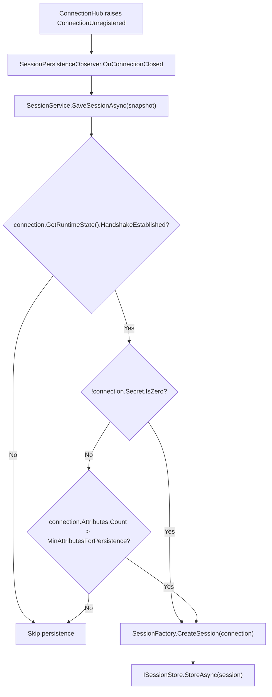

**Không gian tên:** `Nalix.Runtime.Options`  
**Assembly:** `Nalix.Runtime`

`SessionStoreOptions` kiểm soát thời gian các phiên đã ngắt kết nối được giữ lại để tiếp tục (`SessionTtl`) và ngưỡng số thuộc tính tối thiểu (`MinAttributesForPersistence`) mà `DefaultSessionPersistencePolicy` yêu cầu trước khi trạng thái của một kết nối đang đóng được lưu lại.

## Ánh xạ mã nguồn

- `src/Nalix.Runtime/Options/SessionStoreOptions.cs`
- `src/Nalix.Runtime/Sessions/SessionService.cs`
- `src/Nalix.Runtime/Sessions/InMemorySessionStore.cs`
- `src/Nalix.Runtime/Sessions/SessionFactory.cs`
- `src/Nalix.Runtime/Sessions/DefaultSessionPersistencePolicy.cs`
- `src/Nalix.Runtime/Sessions/SessionPersistenceObserver.cs`

## Giá trị mặc định và kiểm tra hợp lệ

| Thuộc tính | Kiểu | Mặc định | Kiểm tra hợp lệ | Thành phần sử dụng khi chạy |
| :--- | :--- | ---: | :--- | :--- |
| `SessionTtl` | `TimeSpan` | `00:05:00` (5 phút) | `[Required]`, `> TimeSpan.Zero` | `SessionFactory.CreateSession(IConnection)` đặt `ExpiresAtUnixMilliseconds`. |
| `MinAttributesForPersistence` | `int` | `10` | `[ValueRange(0, int.MaxValue)]` | `DefaultSessionPersistencePolicy.ShouldPersist(IConnection)` dùng làm giá trị dự phòng khi `Secret.IsZero`. |

`Validate()` chạy kiểm tra DataAnnotations (`ValidationException`) và xác minh `SessionTtl > TimeSpan.Zero` (`ValidationException`).

:::note[TTL của phiên so với Idle Timeout]
`SessionTtl` giữ trạng thái phiên đã ngắt trong `ISessionStore` để client có thể tiếp tục sau khi kết nối lại. Thuộc tính này không kiểm soát việc ngắt socket đang hoạt động do nhàn rỗi — hãy dùng [TimingWheelOptions.IdleTimeoutMs](./timing-wheel-options.md) để thu hồi các kết nối đang hoạt động.
:::

## Luồng lưu trữ phiên



Khi `SessionFactory.CreateSession(IConnection connection)` chụp nhanh một kết nối đang đóng thành một `SessionEntry` lấy từ pool:
- `SessionToken` được đặt bằng `connection.ConnectionId`.
- `CreatedAtUnixMilliseconds` và `ExpiresAtUnixMilliseconds` (`now + (long)_options.SessionTtl.TotalMilliseconds`) được ghi lại bằng `Clock.UnixMillisecondsNow()`.
- `Secret`, `Algorithm`, `Level` và bộ đếm sequence TCP/UDP được sao chép từ kết nối.
- `connection.Attributes` được sao chép vào một `ObjectMap<AttributeKey, object>` lấy từ pool.

## Chính sách lưu trữ tự động (`DefaultSessionPersistencePolicy`)

`SessionPersistenceObserver` đăng ký nhận sự kiện `IConnectionHub.ConnectionUnregistered` và gọi `SessionService.SaveSessionAsync(snapshot)` bất đồng bộ. `DefaultSessionPersistencePolicy.ShouldPersist(IConnection)` đánh giá ba quy tắc theo thứ tự:
1. **Chính sách 1 (Cổng bắt tay)**: Nếu `!connection.GetRuntimeState().HandshakeEstablished`, trả về `false`.
2. **Chính sách 2 (Phiên mật mã đang hoạt động)**: Nếu `!connection.Secret.IsZero` (đã thiết lập khóa mã hóa 32 byte đang hoạt động), trả về `true` ngay lập tức.
3. **Chính sách 3 (Dự phòng theo số lượng thuộc tính)**: Ngược lại, trả về `connection.Attributes.Count > _options.MinAttributesForPersistence` (mặc định `10`).

## Cơ chế của `InMemorySessionStore`

Khi không có `ISessionStore` tùy chỉnh nào được inject vào `SessionService`, hệ thống tạo một `InMemorySessionStore` (dung lượng mặc định `MaxSessions = 65_536`) và đăng ký nó như một `IWorker` trên `TaskManager`:
- **Hết hạn theo bucket theo phút**: Các phiên được lập chỉ mục trong `ConcurrentDictionary<ulong, SessionEntry>` cùng với các bucket hết hạn 1 phút (`BucketSpanMilliseconds = 60_000`), để worker dọn dẹp `IWorker` chạy nền chỉ kiểm tra những bucket có dấu thời gian đã trôi qua.
- **Tiêu thụ nguyên tử một lần**: `ConsumeAsync(ulong sessionToken, Func<SessionEntry, bool>? predicate, CancellationToken)` kiểm tra thời gian hết hạn và `predicate` tùy chọn trước khi xóa nguyên tử entry và trả về `ValueTask<SessionScope>` (`new SessionScope(null)` với `scope.IsValid == false` nếu không tìm thấy, đã hết hạn hoặc bị `predicate` từ chối). Khi dispose một `SessionScope` hợp lệ, `SessionEntry` và `ObjectMap<AttributeKey, object>` của nó tự động được trả về pool.

## Ví dụ cấu hình

### Cấu hình bằng code

```csharp
using System;
using Nalix.Hosting;
using Nalix.Runtime.Options;

INetworkApplicationBuilder builder = NetworkApplication.CreateBuilder();

builder.Configure<SessionStoreOptions>(options =>
{
    options.SessionTtl = TimeSpan.FromMinutes(10);
    options.MinAttributesForPersistence = 3;
});
```

### Cấu hình INI (`default.ini`)

```ini
[SessionStore]
SessionTtl = 00:05:00
MinAttributesForPersistence = 10
```

## API liên quan

- [Kho phiên](../../network/session-store.md)
- [Tiếp tục phiên](../../security/session-resume.md)
- [Tùy chọn Timing Wheel](./timing-wheel-options.md)
- [Tùy chọn mạng](./options.md)
