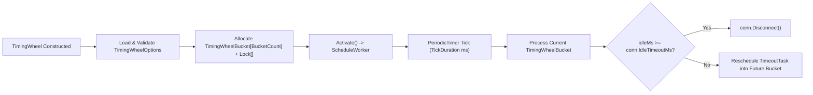

**Không gian tên:** `Nalix.Network.Options`  
**Assembly:** `Nalix.Network`

`TimingWheelOptions` (`public sealed partial class TimingWheelOptions : ConfigurationLoader, IValidatableConfiguration`) cấu hình bộ hẹn giờ hashed wheel ([TimingWheel](../../network/time/timing-wheel.md)) mà `Nalix.Network` dùng để phát hiện và đóng các kết nối nhàn rỗi.

## Ánh xạ mã nguồn

- `src/Nalix.Network/Options/TimingWheelOptions.cs`
- `src/Nalix.Network/Internal/Time/TimingWheel.cs`
- `src/Nalix.Network/Connections/Connection.cs`

## Giá trị mặc định và kiểm tra hợp lệ

Được tải từ mục `[TimingWheel]` trong `default.ini`:

| Thuộc tính | Kiểu | Mặc định | Kiểm tra hợp lệ | Tác động khi chạy |
| :--- | :--- | ---: | :--- | :--- |
| `BucketCount` | `int` | `512` | `[ValueRange(1, int.MaxValue)]` | Số lượng slot `TimingWheelBucket` trong wheel (giá trị lũy thừa của 2 cho phép đánh chỉ mục bằng bitmask). |
| `TickDuration` | `int` | `1000` | `[ValueRange(1, int.MaxValue)]` | Khoảng tick tính bằng mili giây cho vòng lặp worker `PeriodicTimer` chạy nền. |
| `IdleTimeoutMs` | `int` | `60_000` (`60s`) | `[ValueRange(1, int.MaxValue)]` | Ngưỡng nhàn rỗi mặc định của kết nối tính bằng mili giây trước khi `Disconnect()` được gọi. |
| `WheelDrainTimeoutMs` | `int` | `5000` (`5s`) | `[ValueRange(0, 60000)]` | Thời gian chờ tối đa tính bằng mili giây để worker timing wheel xả hết công việc một cách êm thuận trong `Deactivate`. |

`Validate()` chạy `this.ValidateDataAnnotations()` và ném `ValidationException` khi vi phạm ràng buộc.

:::note[Idle Timeout và Session TTL]
`IdleTimeoutMs` đóng một kết nối đang hoạt động ngừng gửi khung dữ liệu. Thuộc tính này tách biệt với [SessionStoreOptions.SessionTtl](./session-store-options.md), thuộc tính kiểm soát thời gian một snapshot phiên đã ngắt kết nối có thể tiếp tục được.
:::

## Luồng bucket và tác vụ khi chạy

- Mỗi `TimingWheelBucket` dùng danh sách liên kết đôi gồm các instance `TimeoutTask` lấy từ pool, được bảo vệ bằng khóa monitor riêng của bucket (`lock (bucket)`) để chèn và xóa với độ phức tạp $O(1)$.
- `Connection`, `WebSocketConnection` và `PassthroughConnection` khởi tạo `IdleTimeoutMs` riêng cho từng kết nối từ `TimingWheelOptions.IdleTimeoutMs`, và có thể ghi đè động qua `connection.UpdateIdleTimeout(newTimeoutMs)`.

## API liên quan

- [Timing Wheel](../../network/time/timing-wheel.md)
- [TCP Listener](../../network/tcp-listener.md)
- [Tùy chọn Session Store](./session-store-options.md)
- [Tùy chọn mạng](./options.md)
