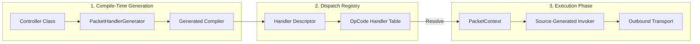

`Nalix.Runtime.Handlers` cung cấp mẫu controller cốt lõi và các handler giao thức tích hợp sẵn, quản lý luồng bắt tay cơ bản, quản lý phiên và logic điều khiển hệ thống của framework Nalix.

## Mô hình thực thi Packet Controller

Sơ đồ sau minh họa cách các lớp controller của bạn được biến đổi thành các đơn vị thực thi hiệu năng cao trong quá trình khởi động.



## Handler tích hợp sẵn

Nalix đi kèm các handler mạnh mẽ cho các tính năng giao thức tiêu chuẩn. Bạn có thể xem cách triển khai trong thư mục `src/Nalix.Runtime/Handlers`.

### `HandshakeHandlers`

Quản lý luồng **X25519 Handshake** phía server thông qua các khung giao thức phiên.

- **Session Init**: `HandleSessionInitAsync(IPacketContext<SessionInit>)` xử lý khung `SessionInit` của client, sinh khóa tạm thời phía server, tính shared secret và phản hồi bằng `SessionChallenge`.
- **Session Proof**: `HandleSessionProofAsync(IPacketContext<SessionProof>)` xác minh bằng chứng của client, suy ra khóa phiên, đặt `connection.Secret` và `connection.Algorithm`, lưu trạng thái phiên có thể tiếp tục và phản hồi bằng `SessionEstablished`.
- **Bảo mật**: Được đánh dấu bằng `[ReservedOpcodePermitted]`, `[PacketEncryption(false)]` và `[PacketPermission(PermissionLevel.NONE)]` vì quá trình bắt tay diễn ra trước khi các kênh giao tiếp an toàn được thiết lập.
- **Tích hợp phiên**: Tự động tạo một mục phiên có thể tiếp tục khi bắt tay thành công.

### `SessionHandlers`

Quản lý giao thức **Tiếp tục phiên (Session Resumption)**.

- **Xác minh token**: Kiểm tra session token với `ISessionService`.
- **Khôi phục trạng thái**: Nạp lại khóa bí mật, mức quyền và thuộc tính kết nối để khôi phục ngay một kết nối bị rớt.

### `SystemControlHandlers`

Xử lý **Control Signaling** toàn cục (`ProtocolOpCode.SYSTEM_CONTROL`).

- **Heartbeats**: Phản hồi Ping bằng Pong.
- **Tiện ích**: Xử lý yêu cầu TimeSync và xác nhận CipherUpdate.
- **Teardown**: Quản lý trình tự ngắt kết nối có thứ tự.

## Triển khai Controller (đã xác minh từ mã nguồn)

Để triển khai một handler tùy chỉnh, hãy dùng mẫu sau:

```csharp
[PacketHandler("MyModule")]
public class MyController 
{
    [PacketOpcode(0x1000)]
    public async ValueTask HandleRequestAsync(IPacketContext<MyPacket> context)
    {
        // Logic nghiệp vụ tại đây
        // ReplyAsync sao chép SequenceId của yêu cầu để RequestAsync phía client có thể khớp với phản hồi.
        await context.Sender.ReplyAsync(new MyResponse());
    }
}
```

### Thuộc tính chính

- `[PacketHandler(string tag)]`: Đánh dấu một lớp là ứng viên để `PacketHandlerGenerator` sinh mã.
- `[PacketOpcode(ushort opcode)]`: Ánh xạ một opcode cụ thể tới một method.
- `[PacketEncryption(bool, CipherSuiteType)]`: Ghi đè yêu cầu bảo mật và thuật toán mặc định cho handler này.
- `[PacketPermission(PermissionLevel)]`: Áp dụng mức truy cập cụ thể trước khi bắt đầu thực thi. Mặc định là `PermissionLevel.USER`.

## Thông tin liên quan

- [Triển khai Packet Handler](../../../guides/application/packet-handlers.md)
- [Packet Attributes](../../abstractions/packet-attributes.md)
- [Packet Metadata](../../abstractions/packet-metadata.md)
- [Các kiểu kết quả của handler](../routing/handler-results.md)
