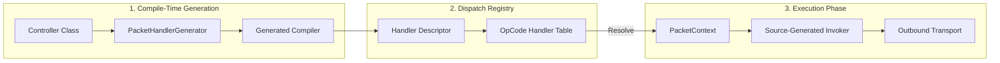

`Nalix.Runtime.Handlers` cung cấp mẫu controller cốt lõi và các handler giao thức tích hợp sẵn, quản lý luồng bắt tay cơ bản, quản lý phiên và logic điều khiển hệ thống của framework Nalix.

## Mô hình thực thi Packet Controller

Sơ đồ sau minh họa cách các lớp controller của bạn được biến đổi thành các đơn vị thực thi hiệu năng cao trong quá trình khởi động.



## Handler tích hợp sẵn

Nalix đi kèm các handler mạnh mẽ cho các tính năng giao thức tiêu chuẩn. Bạn có thể xem cách triển khai trong thư mục `src/Nalix.Runtime/Handlers`.

### `HandshakeHandlers`

Quản lý luồng **X25519 Handshake** phía server thông qua các khung giao thức phiên.

- **Session Init**: `HandleSessionInitAsync(IPacketContext<SessionInit>)` xử lý khung `SessionInit` của client, sinh khóa tạm thời phía server, tính shared secret và phản hồi bằng `SessionChallenge`.
- **Session Proof**: `HandleSessionProofAsync(IPacketContext<SessionProof>)` xác minh bằng chứng của client, suy ra khóa phiên, đặt `connection.Secret` và `connection.Algorithm`, lưu trạng thái phiên có thể tiếp tục và phản hồi bằng `SessionEstablished`.
- **Bảo mật**: Được đánh dấu bằng `[ReservedOpcodePermitted]`, `[PacketEncryption(false)]` và `[PacketPermission(PermissionLevel.NONE)]` vì quá trình bắt tay diễn ra trước khi các kênh giao tiếp an toàn được thiết lập.
- **Tích hợp phiên**: Tự động tạo một mục phiên có thể tiếp tục khi bắt tay thành công.

### `SessionHandlers`

Quản lý giao thức **Tiếp tục phiên (Session Resumption)** (`HandleAsync(IPacketContext<SessionResume>)`, opcode `ProtocolOpCode.SESSION_SIGNAL`).

- **Xác minh token**: Kiểm tra session token với `ISessionService`.
- **Khôi phục trạng thái**: Nạp lại khóa bí mật, mức quyền và thuộc tính kết nối để khôi phục ngay một kết nối bị rớt.
- **Chỉ dành cho stream**: Trả về mà không làm gì khi `context.Connection.Transport` là một `IDatagramTransport`.

### `ProofOfWorkHandlers`

Xử lý gói tin lời giải của client (`HandleAsync(IPacketContext<ProofOfWorkProof>)`, opcode `ProtocolOpCode.POW_PROOF`). Handler này là `static` và đồng bộ (`void`), bỏ qua các kết nối datagram và trả về sớm khi kết nối đã ở mức `PermissionLevel.POW_VERIFIED` trở lên.

### `SystemControlHandlers`

Xử lý **Control Signaling** toàn cục (`ProtocolOpCode.SYSTEM_CONTROL`, `HandleAsync(IPacketContext<Control>)`).

- **Teardown**: Quản lý trình tự `DISCONNECT` có thứ tự.
- **Điều khiển bảo mật**: `SESSION_REKEY`, `CIPHER_UPDATE`, `POW_REQUEST` và `PUBLIC_KEY_REQUEST` được trả lời tại đây; `ERROR`, `FAIL` và `NOTICE` được ghi log.
- **PING / TIMESYNCREQUEST**: không được xử lý ở đây; `PING` là no-op trong handler này vì `SystemTimeSyncHandlers` đảm nhiệm chúng.

### `SystemTimeSyncHandlers`

Xử lý `ProtocolOpCode.SYSTEM_TIMESYNC` (`HandleAsync(IPacketContext<TimeSync>)`): trả lời `PING` bằng `PONG` (lặp lại `Timestamp` và `MonoTicks`) và `TIMESYNCREQUEST` bằng `TIMESYNCRESPONSE`.

### `DatagramTicketHandlers`

Cấp **vé phiên datagram** qua một kết nối stream đã được thiết lập (`[PacketHandler("Nalix.Datagram")]`, opcode `ProtocolOpCode.DATAGRAM_TICKET`, `HandleAsync(IPacketContext<DatagramTicket>)`). Handler chỉ trả lời các khung `DatagramTicketStage.REQUEST` và phản hồi bằng một vé từ `IDatagramTicketIssuer` đã đăng ký, hoặc bằng lý do từ chối:

| Điều kiện | Từ chối (`ProtocolReason`) |
| :--- | :--- |
| Bắt tay chưa được thiết lập hoặc `connection.Secret` bằng không | `UNAUTHENTICATED` |
| Chính yêu cầu đến qua một `IDatagramTransport` | `STATE_VIOLATION` |
| Chưa đăng ký `IDatagramTicketIssuer`, hoặc `IssueTicket` ném `InvalidOperationException` | `SERVICE_UNAVAILABLE` |

Kết nối datagram kế thừa bắt tay đã hoàn tất của kết nối stream (`HandshakeEstablished = true`). Nguồn: `src/Nalix.Runtime/Handlers/DatagramTicketHandlers.cs`. Phía client là [DatagramSession](../../sdk/datagram-session.md).

### Cấu hình tĩnh (`HandshakeHandlers`)

`HandshakeHandlers` còn cung cấp `Initialize()` (nạp `certificate.private` từ thư mục cấu hình một lần), `SetCertificatePath(string path)`, `ConfigureContextPool(int maxCapacity, int preallocCount = 0)` và thuộc tính `ServerPublicKey` (`Bytes32`). Giống các handler phiên khác, `HandleSessionInitAsync` bỏ qua các kết nối datagram. Chứng chỉ được nạp và lưu qua `FileCertificateStore` (`ICertificateStore.Load(path)` / `Save(path, privateKey, publicKey)`), lớp này sinh cặp khóa X25519 khi chưa có tệp.

## Triển khai Controller (đã xác minh từ mã nguồn)

Để triển khai một handler tùy chỉnh, hãy dùng mẫu sau:

```csharp
[PacketHandler("MyModule")]
public class MyController 
{
    [PacketOpcode(0x1000)]
    public async ValueTask HandleRequestAsync(IPacketContext<MyPacket> context)
    {
        // Logic nghiệp vụ tại đây
        // ReplyAsync sao chép SequenceId của yêu cầu để RequestAsync phía client có thể khớp với phản hồi.
        await context.Sender.ReplyAsync(new MyResponse());
    }
}
```

### Thuộc tính chính

- `[PacketHandler(string tag)]`: Đánh dấu một lớp là ứng viên để `PacketHandlerGenerator` sinh mã.
- `[PacketOpcode(ushort opcode)]`: Ánh xạ một opcode cụ thể tới một method.
- `[PacketEncryption(bool, CipherSuiteType)]`: Ghi đè yêu cầu bảo mật và thuật toán mặc định cho handler này.
- `[PacketPermission(PermissionLevel)]`: Áp dụng mức truy cập cụ thể trước khi bắt đầu thực thi. Mặc định là `PermissionLevel.USER`.

## Thông tin liên quan

- [Triển khai Packet Handler](../../../guides/application/packet-handlers.md)
- [Packet Attributes](../../abstractions/packet-attributes.md)
- [Packet Metadata](../../abstractions/packet-metadata.md)
- [Các kiểu kết quả của handler](../routing/handler-results.md)
