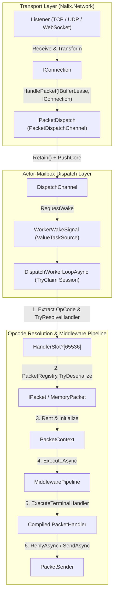

**Không gian tên:** `Nalix.Runtime.Dispatching`, `Nalix.Runtime.Routing`, `Nalix.Runtime.Middleware`, `Nalix.Runtime.Middleware.Standard`, `Nalix.Runtime.Throttling`, `Nalix.Runtime.Handlers`, `Nalix.Runtime.Sessions`, `Nalix.Runtime.Options`  
**Assembly:** `Nalix.Runtime`

`Nalix.Runtime` là engine thực thi phía server, kết nối các khung transport thô (`IBufferLease`) với các controller `[PacketHandler]` có kiểu mạnh. Nó quản lý các hàng đợi điều phối tách biệt theo từng kết nối, pipeline middleware, bộ giới hạn tốc độ theo endpoint và theo chính sách, các handler bắt tay, phiên và điều khiển tích hợp sẵn, cùng các context thực thi lấy từ pool.

## Bức tranh thực thi lúc chạy

## Các namespace và kiểu công khai cốt lõi

### 1. Điều phối và định tuyến (`Nalix.Runtime.Dispatching`, `Nalix.Runtime.Routing`)

| Kiểu | Vai trò | Tham chiếu |
| :--- | :--- | :--- |
| `IPacketDispatch` | Interface điểm vào (`HandlePacket(IBufferLease, IConnection)`, `IActivatable`, `IReportable`) mà listener dùng để chuyển giao khung. | [Hợp đồng điều phối](./routing/dispatch-contracts.md) |
| `IDispatchChannel<TPacket>` / `IDispatchSession` | Hợp đồng hàng đợi kiểu mailbox của actor, đảm bảo thứ tự nghiêm ngặt theo từng kết nối giữa nhiều vòng lặp worker đồng thời. | [Hợp đồng điều phối](./routing/dispatch-contracts.md) |
| `PacketDispatchChannel` | Bộ điều phối cho production với đánh thức `WorkerWakeSignal` được gộp lại, xả theo ưu tiên round-robin có trọng số và đường dẫn đồng bộ không cấp phát bộ nhớ. | [Điều phối gói tin](./routing/packet-dispatch.md) |
| `PacketDispatcherBase<TPacket>` | Lớp cơ sở trừu tượng giữ `PacketDispatchOptions<TPacket>`. | [Dispatch Channel và Router](./routing/dispatch-channel-and-router.md) |
| `PacketDispatchOptions<TPacket>` | Builder fluent (`WithHandler`, `WithMiddleware`, `WithErrorHandling`, `WithDispatchLoopCount`) và bảng handler $O(1)$ gồm 65,536 slot. | [Tùy chọn Packet Dispatch](../options/runtime/packet-dispatch-options.md) |
| `PacketContext<TPacket>` | Context thực thi lấy từ pool (`IPacketContext<TPacket>`), mang `Packet`, `Connection`, `Attributes`, `Sender`, `Scope`, `IsReliable` và `EncryptedOnWire`. | [Packet Context](./routing/packet-context.md) |
| `PacketSender` | Sender gửi đi có nhận biết metadata (`SendAsync`, `ReplyAsync`), gắn với `PacketContext<TPacket>`. | [Packet Sender](./routing/packet-sender.md) |

### 2. Middleware và điều tiết (`Nalix.Runtime.Middleware`, `Nalix.Runtime.Throttling`)

| Kiểu | Vai trò | Tham chiếu |
| :--- | :--- | :--- |
| `MiddlewarePipeline<TPacket>` | Pipeline ba giai đoạn (`Inbound`, `OutboundAlways`, `Outbound`) với các runner `PooledPipelineContext` lấy từ pool. | [Middleware Pipeline](./middleware/pipeline.md) |
| `PermissionMiddleware` | Chốt bảo mật inbound fail-closed (`Order = -50`), thực thi `[PacketPermission]`. | [Permission Middleware](./middleware/permission-middleware.md) |
| `RateLimitMiddleware` | Chốt giới hạn tốc độ inbound (`Order = 50`), định tuyến giữa `PolicyRateLimiter` và `TokenBucketLimiter`. | [Tổng quan Middleware](./middleware/index.md) |
| `TimeoutMiddleware` | Chốt thời gian chờ thực thi inbound (`Order = 75`), dùng các `PooledCancellationTokenSource` lấy từ pool. | [Timeout Middleware](./middleware/timeout-middleware.md) |
| `PolicyRateLimiter` | Bộ đánh giá `[PacketRateLimit]` không trạng thái, dựa trên cache `ScopedEndpoint` và `TokenBucketLimiter` dùng chung. | [Policy Rate Limiter](./middleware/policy-rate-limiter.md) |
| `TokenBucketLimiter` | Bộ giới hạn tốc độ micro-token dạng fixed-point, phân mảnh, có điều chỉnh theo CPU và leo thang từ khóa mềm sang khóa cứng. | [Token Bucket Limiter](./middleware/token-bucket-limiter.md) |

### 3. Tùy chọn cấu hình (`Nalix.Runtime.Options`)

- [DispatchOptions](../options/runtime/dispatch-options.md) — Giới hạn hàng đợi theo kết nối (`MaxPerConnectionQueue = 4096`), `DropPolicy` và `PriorityWeights`.
- [PacketDispatchOptions và PacketDrainOptions](../options/runtime/packet-dispatch-options.md) — Số vòng lặp worker, ghim lõi CPU và ngân sách xả theo mỗi lần đánh thức.
- [TokenBucketOptions](../options/network/token-bucket-options.md) — Dung lượng burst, tốc độ nạp, số shard và cửa sổ vi phạm mềm/cứng.
- [DirectiveGuardOptions](../options/network/directive-guard-options.md) — Cooldown theo kết nối (`DefaultCooldownMs = 1000`) chặn các directive lỗi lặp lại.

## API liên quan

- [Tổng quan Routing](./routing/index.md)
- [Tổng quan Middleware](./middleware/index.md)
- [Kiểu trả về của Handler](./routing/handler-results.md)
- [Packet Handler Generator](../analyzers/autogen/packet-handler-generator.md)
