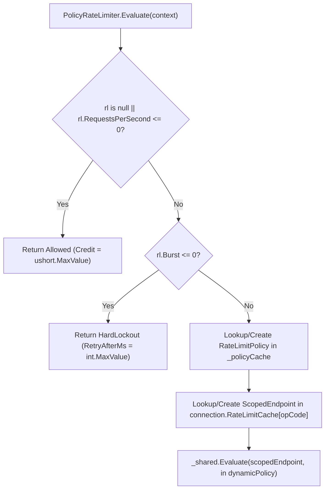

**Không gian tên:** `Nalix.Runtime.Throttling`, `Nalix.Runtime.Middleware.Standard`  
**Assembly:** `Nalix.Runtime`

`PolicyRateLimiter` (`[Injectable] public sealed class PolicyRateLimiter : IReportable, IDisposable`) đánh giá các chính sách `[PacketRateLimit]` ở mức handler bằng một cache `RateLimitPolicy` không trạng thái, cache `ScopedEndpoint` theo từng kết nối (`connection.RateLimitCache`) và engine `TokenBucketLimiter` singleton dùng chung.

## Ánh xạ mã nguồn

- `src/Nalix.Runtime/Throttling/PolicyRateLimiter.cs`
- `src/Nalix.Runtime/Middleware/Standard/RateLimitMiddleware.cs`
- `src/Nalix.Abstractions/Networking/Packets/PacketRateLimitAttribute.cs`
- `src/Nalix.Runtime/Throttling/TokenBucketLimiter.cs`
- `src/Nalix.Runtime/Options/TokenBucketOptions.cs`

## Thuộc tính `[PacketRateLimit]`

```csharp
[AttributeUsage(AttributeTargets.Method, AllowMultiple = false, Inherited = true)]
public sealed class PacketRateLimitAttribute(
    int requestsPerSecond,
    double burst = 1.0) : Attribute
{
    public int RequestsPerSecond { get; } = requestsPerSecond;
    public double Burst { get; } = burst;
    public string? PolicyId { get; init; }
    public int HardLockoutSeconds { get; init; } = -1;
    public int MaxSoftViolations { get; init; } = -1;
}
```

| Thuộc tính | Kiểu | Mặc định | Mô tả |
| :--- | :--- | :---: | :--- |
| `RequestsPerSecond` | `int` | — | Tốc độ nạp duy trì tính bằng yêu cầu/giây (`<= 0` bỏ qua giới hạn chính sách). |
| `Burst` | `double` | `1.0` | Dung lượng bucket tính bằng token (`<= 0` được xử lý như một lần từ chối khóa cứng không hợp lệ). |
| `HardLockoutSeconds` | `int` | `-1` | Thời lượng khóa cứng tính bằng giây khi các vi phạm mềm leo thang (`<= 0` quay về `TokenBucketOptions.HardLockoutSeconds`). |
| `MaxSoftViolations` | `int` | `-1` | Số vi phạm mềm trước khi leo thang lên khóa cứng (`<= 0` quay về `TokenBucketOptions.MaxSoftViolations`). |
| `PolicyId` | `string?` | `null` | Định danh nhóm chính sách dùng chung tùy chọn. Các handler có cùng `PolicyId` chia sẻ cùng một bucket token theo IP qua nhiều opcode. |

## Cách `RateLimitMiddleware` và `PolicyRateLimiter` phối hợp

`RateLimitMiddleware` (`[MiddlewareOrder(50)] [MiddlewareStage(MiddlewareStage.Inbound)]`) kiểm tra `context.Attributes.RateLimit`:

- **Khi có `[PacketRateLimit]`**: Gọi `_policy.Evaluate(context)`.
- **Khi không có `[PacketRateLimit]`**: Gọi `_global.Evaluate(context.Connection.NetworkEndpoint)` bằng `TokenBucketLimiter` endpoint toàn cục.
- **Khi bị từ chối (`!decision.Allowed`)**: Nếu `DirectiveGuard.TryAcquire` cho phép (dựa trên `RuntimeConnectionState.InboundDirectiveRateLimitedLastSentAtMs`), gửi `Directive(ControlType.FAIL, ProtocolReason.RATE_LIMITED, ProtocolAdvice.RETRY, sequenceId, ControlFlags.IS_TRANSIENT, arg0: OpCode, arg1: (uint)decision.RetryAfterMs, arg2: decision.Credit)`.

## Quản lý trạng thái trực tiếp và `ScopedEndpoint` không cấp phát



Để tránh cấp phát bộ nhớ và tra cứu bảng băm trên đường nóng xử lý gói tin:

1. **Khóa hợp thành (`ScopedEndpoint`)**: Cô lập bucket theo `(PolicyId ?? OpCode, Remote IP Address)` (bỏ qua cổng từ xa để tránh lách bằng cách đổi cổng).
2. **Cache theo kết nối (`connection.RateLimitCache`)**: `ScopedEndpoint` của một `OpCode` được cấp phát một lần cho mỗi kết nối và lưu trong `connection.RateLimitCache`.
3. **Tham chiếu `EndpointState` trực tiếp (`ScopedEndpoint.CachedState`)**: Ở lần đánh giá đầu tiên, `TokenBucketLimiter` cache tham chiếu `EndpointState` đã phân giải và `Generation` trực tiếp trên `ScopedEndpoint`. Các gói tin sau trên kết nối đó bỏ qua hoàn toàn tra cứu `ConcurrentDictionary` của shard!

## Chẩn đoán (`IReportable`)

- `GenerateReport()` in ra `Evaluate Counter` (`CheckCounter`), theo sau là `--- Shared TokenBucket Engine Report ---` nhúng (`_shared.GenerateReport()`).
- `WriteReportData(Utf8JsonWriter)` ghi `UtcNow`, `CheckCounter` và đối tượng JSON `SharedEngine` lồng nhau.

## API liên quan

- [Token Bucket Limiter](./token-bucket-limiter.md)
- [Tùy chọn Token Bucket](../../options/network/token-bucket-options.md)
- [Middleware Pipeline](./pipeline.md)
- [Packet Attributes](../../abstractions/packet-attributes.md)
