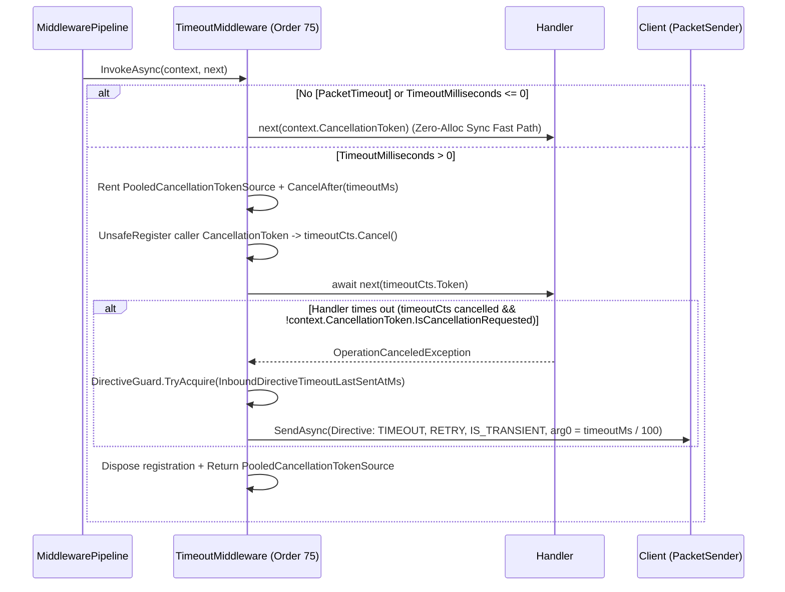

**Không gian tên:** `Nalix.Runtime.Middleware.Standard`  
**Assembly:** `Nalix.Runtime`

`TimeoutMiddleware` (`[MiddlewareOrder(75)] [MiddlewareStage(MiddlewareStage.Inbound)] public sealed class TimeoutMiddleware : IPacketMiddleware<IPacket>`) thực thi giới hạn thời gian chạy theo từng handler, được cấu hình qua `[PacketTimeout(timeoutMilliseconds)]`.

## Ánh xạ mã nguồn

- `src/Nalix.Runtime/Middleware/Standard/TimeoutMiddleware.cs`
- `src/Nalix.Abstractions/Networking/Packets/PacketTimeoutAttribute.cs`
- `src/Nalix.Runtime/Internal/RateLimiting/DirectiveGuard.cs`
- `src/Nalix.Codec/ProtocolFrames/Directive.cs`

## Kiến trúc bộ hẹn giờ dùng pool (`PooledCancellationTokenSource`)

Để tránh cấp phát một `CancellationTokenSource` mới cho mỗi gói tin có timeout, `TimeoutMiddleware` duy trì một lớp nội bộ `PooledCancellationTokenSource`, được đăng ký trong `ObjectPoolManager.Shared` (`MaxCapacity = 2048`, `Prealloc = 16`) và gọi `CancellationTokenSource.TryReset()` khi được trả về pool.



## Định dạng directive timeout

Khi `timeoutCts.Token` kích hoạt trong khi `context.CancellationToken` **chưa** bị hủy (để phân biệt timeout của handler với việc ngắt kết nối thông thường), và `DirectiveGuard` cho phép gửi, `TimeoutMiddleware` gửi một `Directive` (`0x0008`, 21 byte) lấy từ pool bằng `CancellationToken.None`:

| Trường | Giá trị |
| :--- | :--- |
| `Type` | `ControlType.TIMEOUT` |
| `Reason` | `ProtocolReason.TIMEOUT` |
| `Action` | `ProtocolAdvice.RETRY` |
| `SequenceId` | `context.Packet.Header.SequenceId` |
| `Control` | `ControlFlags.IS_TRANSIENT` |
| `Arg0` | `(uint)(timeoutMilliseconds / 100)` |

## Ví dụ sử dụng

```csharp
using System.Threading;
using System.Threading.Tasks;
using Nalix.Abstractions.Networking.Packets;
using Nalix.Runtime.Middleware.Standard;

// 1. Đăng ký TimeoutMiddleware trong PacketDispatchOptions
builder.ConfigureDispatch(options =>
{
    options.WithMiddleware(new TimeoutMiddleware());
});

// 2. Gắn [PacketTimeout] cho các handler chậm hoặc phụ thuộc I/O
[PacketHandler]
public sealed class MatchmakingController
{
    [PacketOpcode(0x4001)]
    [PacketTimeout(3000)] // 3000 ms (3 giây)
    public async ValueTask FindMatchAsync(IPacketContext<FindMatchPacket> context, CancellationToken ct)
    {
        // ct được tự động liên kết với PooledCancellationTokenSource 3 giây
        await MatchmakerService.WaitForOpponentAsync(context.Connection, ct);
    }
}
```

## API liên quan

- [Middleware Pipeline](./pipeline.md)
- [Permission Middleware](./permission-middleware.md)
- [Policy Rate Limiter](./policy-rate-limiter.md)
- [Tùy chọn Directive Guard](../../options/network/directive-guard-options.md)
