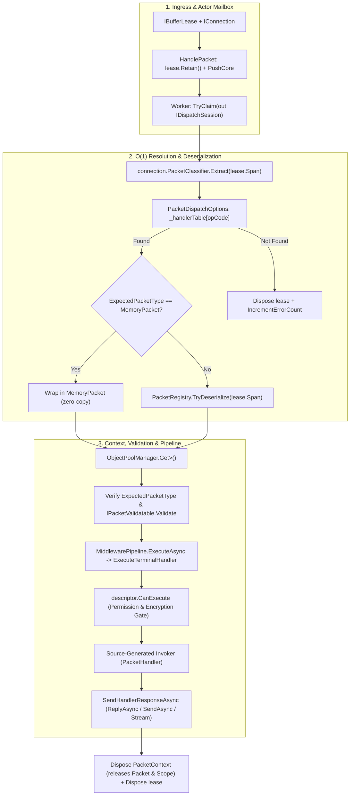

**Namespaces:** `Nalix.Runtime.Dispatching`, `Nalix.Runtime.Routing`  
**Assembly:** `Nalix.Runtime`

`Nalix.Runtime.Dispatching` và `Nalix.Runtime.Routing` chứa các API thực thi, biến các khung `IBufferLease` đã được giữ lại thành các lần gọi handler có kiểu rõ ràng, với thứ tự nghiêm ngặt theo từng kết nối và các đường nhanh đồng bộ không cấp phát bộ nhớ.

## Pipeline điều phối theo OpCode

## Luồng thực thi nội bộ (đã đối chiếu với mã nguồn)

1. **Phân giải handler $O(1)$**: `PacketDispatchOptions<TPacket>` lưu các descriptor `PacketHandler<TPacket>` đã biên dịch trong một mảng phẳng gồm 65.536 phần tử (`HandlerSlot?[ushort.MaxValue + 1]`). Phân giải một opcode chỉ là một lần đọc `Volatile.Read` theo chỉ số mảng.
2. **Giành quyền session trên actor-mailbox**: `DispatchChannel<IPacket>` nhóm các khung đang xếp hàng theo kết nối và theo mức ưu tiên (từ `URGENT` xuống `NONE`). Một worker giành quyền sở hữu độc quyền một kết nối qua `TryClaim(out IDispatchSession session)`, đảm bảo các gói tin của cùng một kết nối được xử lý tuần tự theo thứ tự đến/ưu tiên mà không có tranh chấp giữa các worker.
3. **`PacketContext<TPacket>` có pool**: Trước khi gọi middleware hoặc handler, runtime thuê một `PacketContext<TPacket>` từ `ObjectPoolManager.Shared` (cấp phát sẵn `128` instance) và khởi tạo với `ownsPacket: true`. Khi context bị dispose, nó tự động dispose cả gói tin đã giải tuần tự lẫn các service `[FromScope]` có phạm vi.
4. **Các cổng kiểu, xác thực, quyền và mã hóa tích hợp sẵn**:
   - Kiểm tra kiểu lúc chạy (`expectedType.IsInstanceOfType(context.Packet)`) sẽ gửi `Directive(FAIL, REQUEST_INVALID, FIX_AND_RETRY)` khi không khớp.
   - Xác thực cấu trúc (`IPacketValidatable.Validate(out string? failureReason)`) sẽ gửi `Directive(FAIL, MALFORMED_PACKET, FIX_AND_RETRY)` khi payload không hợp lệ.
   - Kiểm tra policy ở cuối (`descriptor.CanExecute`) xác minh `[PacketEncryption]` (`context.EncryptedOnWire`) và `[PacketPermission]` (`context.Connection.Level`) ngay cả khi không có middleware nào được đăng ký.
5. **Dispatch giá trị trả về**: Các invoker được sinh ra hỗ trợ `void`, `Task`, `ValueTask`, `TPacket` / `IPacket`, `byte[]`, `Memory<byte>`, `ReadOnlyMemory<byte>` và `IAsyncEnumerable<TPacket>` (streaming, tự động đánh dấu `IPacketStreamable.IsEndOfStream` trên phần tử cuối).

## Bề mặt công khai

- [Dispatch Contracts (IPacketDispatch, IDispatchChannel<TPacket>, IDispatchSession)](./dispatch-contracts.md)
- [Packet Dispatch (PacketDispatchChannel)](./packet-dispatch.md)
- [Dispatch Channel và Router (DispatchChannel<TPacket>, PacketDispatcherBase<TPacket>)](./dispatch-channel-and-router.md)
- [Packet Context (PacketContext<TPacket>)](./packet-context.md)
- [Packet Sender (PacketSender)](./packet-sender.md)
- [Kiểu trả về của Handler](./handler-results.md)

## API liên quan

- [Packet Dispatch Options](../../options/runtime/packet-dispatch-options.md)
- [Dispatch Options](../../options/runtime/dispatch-options.md)
- [Packet Handler Generator](../../analyzers/autogen/packet-handler-generator.md)
- [Middleware Pipeline](../middleware/pipeline.md)
