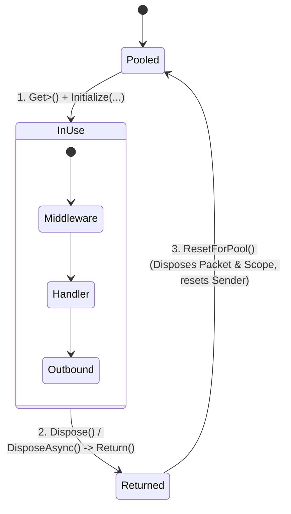

**Namespace:** `Nalix.Runtime.Dispatching`  
**Assembly:** `Nalix.Runtime`

`PacketContext<TPacket>` (`public sealed class PacketContext<TPacket> : IPacketContext<TPacket>, IPoolable, IDisposable, IAsyncDisposable where TPacket : IPacket`) là đối tượng có pool cụ thể, đại diện cho một lần thực thi gói tin. Handler và middleware của ứng dụng sử dụng nó thông qua `IPacketContext<TPacket>`.

## Ánh xạ mã nguồn

- `src/Nalix.Abstractions/Networking/Packets/IPacketContext.cs`
- `src/Nalix.Runtime/Dispatching/PacketContext.cs`
- `src/Nalix.Runtime/Dispatching/PacketScope.cs`

## Vòng đời & pool của context

Static constructor cấu hình sẵn `ObjectPoolManager.Shared` với `SetMaxCapacity<PacketContext<TPacket>>(128)` và `Prealloc<PacketContext<TPacket>>(128)`.

## Thuộc tính công khai (`IPacketContext<TPacket>`)

| Thuộc tính | Kiểu | Mô tả |
| :--- | :--- | :--- |
| `Packet` | `TPacket` | Gói tin yêu cầu đã giải tuần tự cho lần gọi hiện tại. |
| `Connection` | `IConnection` | Kết nối client đã gửi gói tin. |
| `Attributes` | `PacketMetadata` | Metadata của handler lúc biên dịch/đăng ký (`PacketOpcode`, `Timeout`, `Permission`, `Encryption`, `Transport`, `RateLimit`, `CustomAttributes`). |
| `Sender` | `IPacketSender` | `PacketSender` gắn với context, được khởi tạo với `Connection`, `Attributes`, `IsReliable` và `SequenceId` của yêu cầu. |
| `Scope` | `IPacketScope` | Scope dependency injection theo từng gói tin, dùng để phân giải các tham số `[FromScope]` của handler (`GetRequiredService<T>`, `GetService<T>`, `GetOrAdd<T>`). |
| `CancellationToken` | `CancellationToken` | Token được liên kết với vòng lặp worker dispatch (và được `TimeoutMiddleware` bọc lại khi `[PacketTimeout]` đang hoạt động). |
| `IsReliable` | `bool` | `true` khi gói tin đến qua transport đáng tin cậy (TCP/WebSocket); `false` khi đến qua UDP. |
| `EncryptedOnWire` | `bool` | `true` khi khung đến đã được mã hóa và được `FramePipeline` / `FrameCipher` xác thực/giải mã. |
| `SkipOutbound` | `bool` | Khi `true`, bỏ qua giai đoạn middleware `Outbound` thông thường (tự động đặt `true` cho handler kiểu `void`, `Task` và `ValueTask`). |

## Quy tắc vòng đời & quyền sở hữu

1. **Tự động dispose gói tin & scope**: `ExecuteResolvedHandlerAsync` khởi tạo `PacketContext<TPacket>` với `ownsPacket: true`. Khi `ResetForPool()` / `DisposeAsync()` chạy ở cuối dispatch:
   - Nếu `Packet` triển khai `IDisposable` (như bất kỳ lớp con `PacketBase<TSelf>` nào), `Packet.Dispose()` được gọi tự động để trả gói tin về object pool.
   - `Scope` (`PacketScope`) được dispose (hỗ trợ cả service có phạm vi `IAsyncDisposable` lẫn `IDisposable`) và reset để tái sử dụng.
2. **Không lưu `IPacketContext<TPacket>` ra ngoài phạm vi handler**: Vì context, `Packet` và `Scope` được tái chế ngay khi `ValueTask`/`Task` của handler hoàn tất, không bao giờ được giữ `context` hoặc `context.Packet` trong tác vụ nền hay static field (được analyzer **`NALIX076`** kiểm tra).
3. **Trả về có tính idempotent**: `Dispose()` và `DisposeAsync()` chuyển `_state` từ `InUse` sang `Returned` một cách nguyên tử bằng `Interlocked.Exchange`, ngăn lỗi trả về hai lần.

## `PacketContextBridge`

`PacketContextBridge` (`public static class PacketContextBridge`, `src/Nalix.Runtime/Dispatching/PacketContextBridge.cs`) cho phép một handler cần kiểu gói tin cụ thể chạy từ một pipeline được định kiểu theo kiểu gói tin cơ sở, mà không dùng reflection.

- `Create<TConcrete, TBase>(PacketContext<TBase> baseContext, TConcrete concretePacket)` thuê một `PacketContext<TConcrete>` từ `ObjectPoolManager.Shared` và khởi tạo với kết nối, attribute, `IsReliable`, `EncryptedOnWire`, `CancellationToken` và `Scope` của context cơ sở. Nó dùng `ownsPacket: false`, nên context cơ sở vẫn giữ quyền sở hữu gói tin.
- `Return<TConcrete>(PacketContext<TConcrete> bridgeContext)` dispose context cầu nối và trả về pool mà không dispose gói tin được mượn.
- `WrapStream<TConcrete, TChunk>(IAsyncEnumerable<TChunk> source, PacketContext<TConcrete> bridgeContext)` giữ context cầu nối cho đến khi stream được tiêu thụ hết hoặc enumerator bị dispose, để handler streaming không đọc một context đã được trả về pool.

## API liên quan

- [Packet Sender (PacketSender)](./packet-sender.md)
- [Packet Metadata](../../abstractions/packet-metadata.md)
- [Packet Dispatch (PacketDispatchChannel)](./packet-dispatch.md)
- [Object Pooling](../../framework/memory/object-pooling.md)
