**Namespace:** `Nalix.Runtime.Dispatching`  
**Assembly:** `Nalix.Runtime`

`PacketDispatchChannel` (`public sealed class PacketDispatchChannel : PacketDispatcherBase<IPacket>, IPacketDispatch, IDisposable, IActivatable`) là cầu nối lúc chạy giữa các buffer transport (`IBufferLease`) và các method `[PacketHandler]`. Nó quản lý các vòng lặp worker chạy nền, đánh thức worker gộp (`WorkerWakeSignal`), phân giải opcode O(1), giải tuần tự qua `PacketRegistry`, và dispose lease/gói tin một cách xác định.

## Ánh xạ mã nguồn

- `src/Nalix.Runtime/Dispatching/PacketDispatchChannel.cs`
- `src/Nalix.Runtime/Internal/Routing/DispatchChannel.cs`
- `src/Nalix.Runtime/Internal/Routing/WorkerWakeSignal.cs`
- `src/Nalix.Runtime/Dispatching/Options/PacketDispatchOptions.cs`
- `src/Nalix.Runtime/Options/PacketDrainOptions.cs`

## Luồng chạy

```mermaid
flowchart LR
    A["Transport IBufferLease"] --> B["HandlePacket(lease, connection)"]
    B --> C["lease.Retain() + _dispatch.PushCore(...)"]
    C -->|readyEmitted == true| D["RequestWake() -> WorkerWakeSignal.Set()"]
    D --> E["DispatchWorkerLoopAsync: _dispatch.TryClaim(out session)"]
    E --> F["Extract OpCode & Options.TryResolveHandler"]
    F --> G["PacketRegistry.TryDeserialize / MemoryPacket"]
    G --> H["ExecuteResolvedHandlerAsync (Middleware + Handler)"]
    H --> I["Dispose PacketContext + Dispose lease"]
```



## Ngữ nghĩa bàn giao trong `HandlePacket`

`HandlePacket(IBufferLease lease, IConnection connection)` chạy trên luồng nhận của transport:

1. Dispose `lease` và trả về ngay nếu `lease` hoặc `connection` là `null`.
2. Nếu `connection.TCP.Framing == TransportFraming.UInt16LengthPrefixed` và `lease.Length < PacketConstants.HeaderSize` (`6` byte), dispose `lease`, gọi `connection.IncrementErrorCount()` rồi trả về.
3. Gọi `lease.Retain()` để tăng số tham chiếu của buffer trước khi bàn giao bất đồng bộ.
4. Đưa vào hàng đợi qua `_dispatch.PushCore(connection, lease, out bool readyEmitted, noBlock: true)`. Nếu hàng đợi từ chối gói tin (đầy hoặc kết nối đã đóng), dispose `lease` đã retain và tăng `_totalDropped`.
5. Nếu `readyEmitted` là `true` (kết nối vừa trở thành có thể claim), gọi `RequestWake()` để đánh thức một worker đang chờ.

## Kích thước vòng lặp worker & ghim CPU (`Activate`)

`Activate(CancellationToken)` lên lịch các vòng lặp worker thông qua `TaskManager.ScheduleWorker` (`net.dispatch.process.{i}` trong nhóm `net/dispatch` với `WorkerPriority.HIGH`). Số vòng lặp (`_dispatchLoops`) được xác định theo thứ tự ưu tiên:

| Điều kiện | `_dispatchLoops` đã xác định | Chế độ thực thi |
| :--- | :--- | :--- |
| `Options.Drain.DispatchProcessorAffinities` không rỗng (ví dụ `"0,2,4,6"`) | Số chỉ số core đã phân tích (`affinityCores.Length`) | Luồng OS riêng (`OSPriority = ThreadPriority.Normal`) được ghim vào `affinityCores[i]` |
| `Options.Drain.Count > 0` (đặt qua `WithDispatchLoopCount(n)` hoặc INI) | `Options.Drain.Count` | Worker `ThreadPool` bất đồng bộ |
| Mặc định (`Options.Drain.Count == 0` và không có affinity) | `Math.Clamp(Environment.ProcessorCount, Options.Drain.MinDispatchLoops, Options.Drain.MaxDispatchLoops)` | Worker `ThreadPool` bất đồng bộ |

## Đánh thức gộp & cơ chế rút hàng đợi

Mỗi worker sở hữu một `WorkerWakeSignal` không cấp phát bộ nhớ (được hỗ trợ bởi `ManualResetValueTaskSourceCore<bool>`) và một cờ parked nguyên tử (`_parked[i]`):

- **Ngân sách rút (`_maxDrainPerWake`)**: Được tính trong constructor như sau:
  ```csharp
  Math.Clamp(
      Environment.ProcessorCount * Options.Drain.MaxDrainPerWakeMultiplier,
      Options.Drain.MinDrainPerWake,
      Options.Drain.MaxDrainPerWake)
  ```
- **Lan tỏa khi bùng phát (Burst Fan-Out)**: Khi một worker claim được một kết nối (`_dispatch.TryClaim(out session)`) và thấy `_dispatch.HasClaimableConnection == true`, nó gọi ngay `RequestWake()` để một worker đang parked khác thức dậy song song.
- **Ngăn mất tín hiệu đánh thức (Lost-Wake Prevention)**: Trước khi park, worker đặt `_parked[index] = 1` qua `Interlocked.Exchange`, spin ngắn (`16` vòng lặp `Thread.SpinWait(8)`), rồi kiểm tra lại `_dispatch.HasClaimableConnection` trước khi chờ `signal.WaitAsync()`.

## Đảm bảo thực thi và dispose (`ExecutePacketAsync`)

Với mỗi `IBufferLease` được rút ra khỏi hàng đợi:

1. **Trích xuất OpCode**: Gọi `connection.PacketClassifier.Extract(lease.Span)` và đọc `lease.IsReliable` cùng `lease.EncryptedOnWire`.
2. **Tra cứu handler sớm**: Gọi `Options.TryResolveHandler(opcode, out handler)` **trước** khi giải tuần tự. Nếu không có handler nào đăng ký cho `opcode`, ghi một cảnh báo đã được throttle, dispose `lease`, gọi `connection.IncrementErrorCount()` và bỏ qua hoàn toàn việc giải tuần tự.
3. **Giải tuần tự / đường nhanh `MemoryPacket`**:
   - Nếu `handler.ExpectedPacketType == typeof(MemoryPacket)`, bọc trực tiếp `lease.Memory` trong một `MemoryPacket` mà không gọi `PacketRegistry`.
   - Ngược lại gọi `PacketRegistry.TryDeserialize(lease.Span, out IPacket? deserialized)`. Nếu thất bại, tăng `_deserializationErrors`, dispose `lease` và gọi `connection.IncrementErrorCount()`.
4. **Hoàn tất đồng bộ hay bất đồng bộ**:
   - Gọi `Options.ExecuteResolvedHandlerAsync(in handler, packet, connection, isReliable, encryptedOnWire, ct)`.
   - Nếu `ValueTask` hoàn tất đồng bộ (`IsCompletedSuccessfully`), dispose `lease` ngay trên vòng lặp worker mà không cấp phát continuation.
   - Nếu handler chờ I/O bất đồng bộ, thuê một `DispatchContinuation` có pool từ `ObjectPoolManager.Shared` (`workItem.Initialize(connection, lease, pending.AsTask(), ct)`) để vòng lặp worker không bị chặn, và `lease` được dispose khi task kết thúc.

## Chẩn đoán (`IReportable`)

`GenerateReport()` và `WriteReportData(Utf8JsonWriter)` xuất ra:

- **Chỉ số worker & kênh**: `Running`, `DispatchLoops`, `WakeSignals`, `WakeReads`, `IdleWorkers`, `TotalPackets`, `PeakPackets`, `TotalConnections`, `ReadyConnections` và `PendingPerPriority` (từ `URGENT` xuống `NONE`).
- **Chỉ số pipeline (`Options.Metrics`)**: `ActiveExecutions`, `TotalExecutions`, `TotalDropped` (`_totalDropped + _dispatch.TotalEvicted`), `TotalErrors`, `DeserializationErrors`, `AverageTimeMs`, `MaxTimeMs` và phân tích theo từng middleware (`MiddlewareMetrics`).

## `InlinePacketDispatcher`

`InlinePacketDispatcher` (`public sealed class InlinePacketDispatcher : PacketDispatcherBase<IPacket>, IPacketDispatch, IActivatable`, `src/Nalix.Runtime/Dispatching/InlinePacketDispatcher.cs`) là một lựa chọn nhẹ thay cho `PacketDispatchChannel`, không có hàng đợi dispatch hay vòng lặp worker. Nó nhận cùng tham số tùy chọn `Action<PacketDispatchOptions<IPacket>>` trong constructor.

- `Activate` / `Deactivate` chỉ bật/tắt cờ đang chạy. Khi đã deactivate, `HandlePacket` dispose lease và trả về.
- `HandlePacket` loại bỏ (và dispose) một lease `UInt16LengthPrefixed` ngắn hơn `PacketConstants.HeaderSize` và gọi `connection.IncrementErrorCount()`; ngược lại gọi `lease.Retain()` và xếp công việc vào hàng đợi bằng `ThreadPool.UnsafeQueueUserWorkItem(..., preferLocal: true)` để luồng IO không bị chặn.
- Công việc trong hàng đợi sau đó đi theo cùng các bước tra cứu opcode, đường nhanh `MemoryPacket` và giải tuần tự như `ExecutePacketAsync` ở trên. Không có thứ tự theo từng kết nối, hàng đợi ưu tiên hay ngân sách rút.

## API liên quan

- [Dispatch Contracts](./dispatch-contracts.md)
- [Packet Dispatch Options](../../options/runtime/packet-dispatch-options.md)
- [Dispatch Channel và Router](./dispatch-channel-and-router.md)
- [Middleware Pipeline](../middleware/pipeline.md)
