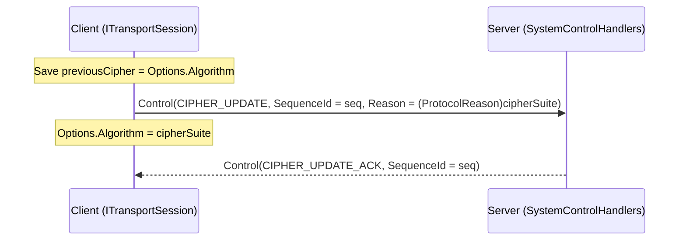
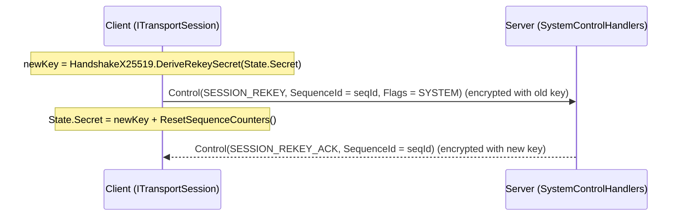

**Namespace:** `Nalix.SDK.Transport.Extensions`  
**Assembly:** `Nalix.SDK`

`Nalix.SDK.Transport.Extensions` cung cấp hai extension quản lý mật mã sau khi bắt tay trên `ITransportSession`:
1. **`CipherExtensions.UpdateCipherAsync`**: Thương lượng chuyển đổi `CipherSuiteType` đối xứng ngay trong phiên (`ControlType.CIPHER_UPDATE` $\rightarrow$ `CIPHER_UPDATE_ACK`) mà không cần chạy lại handshake X25519.
2. **`RekeyExtensions.RekeyAsync`**: Xoay `SessionState.Secret` 32 byte bằng `HandshakeX25519.DeriveRekeySecret` (`ControlType.SESSION_REKEY` $\rightarrow$ `SESSION_REKEY_ACK`) và đặt lại bộ đếm sequence.

## Ánh xạ mã nguồn

- `src/Nalix.SDK/Transport/Extensions/CipherExtensions.cs`
- `src/Nalix.SDK/Transport/Extensions/RekeyExtensions.cs`
- `src/Nalix.Abstractions/Security/CipherSuiteType.cs`
- `src/Nalix.Codec/ProtocolFrames/Control.cs`
- `src/Nalix.Abstractions/Networking/Protocols/ControlType.cs`

## Chữ ký công khai

```csharp
namespace Nalix.SDK.Transport.Extensions;

public static class CipherExtensions
{
    public static ValueTask UpdateCipherAsync(
        this ITransportSession session,
        CipherSuiteType cipherSuite,
        int timeoutMs = 5000,
        CancellationToken ct = default);
}

public static class RekeyExtensions
{
    public static ValueTask RekeyAsync(
        this ITransportSession session,
        CancellationToken ct = default);
}
```

## 1. Chuyển bộ mật mã trực tiếp (`UpdateCipherAsync`)



- **Điều kiện trước**: Ném `ArgumentNullException` nếu `session` là `null`.
- **Thương lượng & hoàn tác**: Gửi một gói `Control` với `Type = ControlType.CIPHER_UPDATE`, `SequenceId = seq` và `Reason = (ProtocolReason)cipherSuite`, sau đó chuyển ngay `session.Options.Algorithm = cipherSuite` để `CIPHER_UPDATE_ACK` đã mã hóa có thể được giải mã bằng cipher mới, rồi chờ `Control(ControlType.CIPHER_UPDATE_ACK, SequenceId == seq)` trong tối đa `timeoutMs` (hoàn tác `session.Options.Algorithm = previousCipher` nếu server không xác nhận).

:::caution[Chỉ chuyển sang bộ AEAD]
Cả client lẫn server đều không từ chối bộ không phải AEAD: server chấp nhận mọi `CipherSuiteType` đã định nghĩa trừ `None`. `CipherSuiteType.Chacha20` và `CipherSuiteType.Salsa20` chỉ mã hóa — chúng không mang thẻ xác thực. Sau khi chuyển sang các bộ này, bất kỳ ai trên đường truyền có thể lật bit của bản mã và các bit bản rõ tương ứng thay đổi mà không bị phát hiện; tiêu đề gói tin cũng không còn được xác thực. Hãy dùng `Chacha20Poly1305` (mặc định của handshake) hoặc `Salsa20Poly1305`.
:::

## 2. Xoay khóa giữa phiên (`RekeyAsync`)



- **Dẫn xuất khóa**: Cả client và server đều dẫn xuất `newKey` qua `HandshakeX25519.DeriveRekeySecret(currentSecret)`.
- **Đặt lại bộ đếm sequence & hoàn tác**: Ngay sau khi gửi `SESSION_REKEY`, cập nhật `session.State.Secret = newKey` và gọi `session.ResetSequenceCounters()`, rồi chờ `Control(ControlType.SESSION_REKEY_ACK, SequenceId == seqId)` (hoàn tác `session.State.Secret = previousKey` khi hết thời gian chờ hoặc gặp lỗi).

## Ví dụ sử dụng

```csharp
using Nalix.Abstractions.Security;
using Nalix.SDK.Transport.Extensions;

// 1. Chuyển từ Chacha20Poly1305 mặc định sang Salsa20Poly1305
await session.UpdateCipherAsync(CipherSuiteType.Salsa20Poly1305, timeoutMs: 5_000);

// 2. Xoay khóa phiên 32 byte
await session.RekeyAsync();
```

## API liên quan

- [Handshake Extensions](./handshake-extensions.md)
- [Resume Extensions](./resume-extensions.md)
- [AEAD Cipher Suites](../security/aead-and-envelope.md)
- [Key Agreement & HKDF](../security/hashing-and-mac.md)
