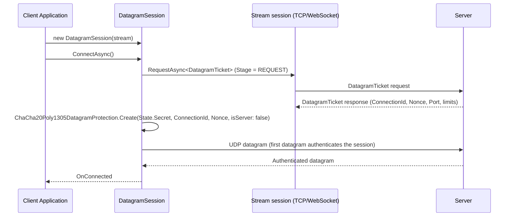

**Namespace:** `Nalix.SDK.Transport`
**Assembly:** `Nalix.SDK`

`DatagramSession` (`[UnsupportedOSPlatform("browser")] public sealed class DatagramSession : TransportSession`) là phía client của một phiên Nalix Datagram Protocol (NDP trên UDP). Nó lấy một **ticket** qua phiên stream đã thiết lập (`TcpSession` hoặc `WebSocketSession`), dẫn xuất khóa riêng từ secret của phiên stream đó, rồi chạy hoàn toàn trên UDP: việc đóng stream sau đó không ảnh hưởng đến nó.

:::note[Thay thế `UdpSession`]
`UdpSession`, tùy chọn transport về kích thước datagram UDP, và cặp `UdpFrameReader` / `UdpFrameSender` (định dạng datagram `[8B SessionToken][Payload][4B XxHash32 MAC]`) không còn tồn tại.
:::

## Ánh xạ mã nguồn

- `src/Nalix.SDK/Transport/DatagramSession.cs`
- `src/Nalix.Abstractions/Networking/Datagrams/IDatagramTicketIssuer.cs`
- `src/Nalix.Abstractions/Networking/Datagrams/DeliveryMethod.cs`
- `src/Nalix.Codec/ProtocolFrames/Datagram/DatagramTicket.cs`
- `src/Nalix.Codec/Security/Datagram/ChaCha20Poly1305DatagramProtection.cs`
- `src/Nalix.Environment/Datagrams/DatagramEngine.cs`

## Cách một phiên được thiết lập



1. `ConnectAsync` yêu cầu một `DatagramTicket` qua phiên stream (`RequestOptions.WithTimeout(Math.Max(1000, Options.ConnectTimeoutMillis))`). Nếu bị từ chối (`response.Reason != ProtocolReason.NONE`) sẽ ném `NetworkException("The server refused the datagram ticket: ...")`.
2. Nó phân giải `host` (mặc định: `Options.Address` của phiên stream), kết nối một `Socket` UDP tới `port` (mặc định: `Ticket.Port`) và đặt `DontFragment` khi nền tảng cho phép.
3. Nó tạo một `ChaCha20Poly1305DatagramProtection` từ `State.Secret`, `ConnectionId` và `Nonce` của ticket, rồi khởi động một `DatagramEngine` được cấu hình theo ticket (`ChannelCount`, `IdleTimeoutMs`, `MaxMessageSize`, `ReceiveBufferBytes`, `ChannelReceiveBufferBytes`).
4. Nó chờ đến khi máy chủ xác thực datagram đầu tiên, tối đa `Ticket.ExpiresInSeconds` giây, nếu không sẽ ném `NetworkException("The datagram session was not established before the ticket expired.")`.

Mỗi datagram đều được phiên niêm phong bằng ChaCha20-Poly1305, nên các khung **không bị mã hóa lần thứ hai**: đối số `encrypt` của các phương thức gửi trong `TransportSession` bị bỏ qua.

## Tham chiếu API công khai

```csharp
namespace Nalix.SDK.Transport;

[UnsupportedOSPlatform("browser")]
public sealed class DatagramSession : TransportSession
{
    public DatagramSession(TransportSession stream);

    public override TransportOptions Options { get; }          // the stream session's options
    public override bool IsConnected { get; }                  // engine is Established
    public DatagramTicketInfo? Ticket { get; }
    public string? EngineReport { get; }

    public override event EventHandler? OnConnected;
    public override event EventHandler<Exception>? OnDisconnected;
    public override event EventHandler<IBufferLease>? OnMessageReceived;
    public override event EventHandler<Exception>? OnError;

    public override Task ConnectAsync(string? host = null, ushort? port = null, CancellationToken ct = default);
    public override Task DisconnectAsync();

    public override Task SendAsync(IPacket packet, CancellationToken ct = default);
    public override Task SendAsync(IPacket packet, bool? encrypt = null, CancellationToken ct = default);
    public override Task SendAsync(ReadOnlyMemory<byte> payload, bool? encrypt = null, CancellationToken ct = default);
    public Task SendAsync(IPacket packet, DeliveryMethod method, byte channel = 0, CancellationToken ct = default);
    public Task<bool> SendWithReceiptAsync(IPacket packet, DeliveryMethod method = DeliveryMethod.ReliableOrdered, byte channel = 0);

    public override void ResetSequenceCounters();              // no-op: datagram frames carry no stream sequence numbers
}
```

| Thành viên | Mô tả |
| :--- | :--- |
| `DatagramSession(TransportSession stream)` | Gắn phiên vào một phiên stream đã thiết lập; handshake của phiên đó phải hoàn tất. Dùng chung `stream.State`. Ném `ArgumentNullException` khi `stream` là `null`. |
| `Ticket` | `DatagramTicketInfo` của phiên hiện tại sau khi kết nối, nếu không thì là `null`. |
| `EngineReport` | Chuỗi thống kê phiên từ datagram engine, hoặc `null` khi chưa kết nối. |
| `ConnectAsync(host, port, ct)` | Yêu cầu ticket và mở phiên UDP (xem ở trên). Ném `NetworkException` khi ticket bị từ chối hoặc phiên không được thiết lập kịp thời. |
| `DisconnectAsync()` | Đóng engine với `DatagramCloseCode.NoError`, đẩy datagram đóng đi và dỡ socket (phát `OnDisconnected`). |
| `SendAsync(packet, ct)` / `SendAsync(packet, encrypt, ct)` / `SendAsync(payload, encrypt, ct)` | Gửi với `DeliveryMethod.ReliableOrdered` trên kênh `0`. |
| `SendAsync(packet, method, channel, ct)` | Gán `SequenceId` cho gói và gửi bằng `DeliveryMethod` đã chọn trên một `channel` nhỏ hơn `ChannelCount` của ticket. Ném `NetworkException` khi phiên đã đóng, gói quá lớn đối với phương thức đó, hoặc hàng đợi gửi đã đầy. |
| `SendWithReceiptAsync(packet, method, channel)` | Gửi tin cậy và hoàn tất với `true` khi máy chủ đã xác nhận mọi phân mảnh, hoặc `false` khi phiên đóng trước. |

### `DeliveryMethod` (`Nalix.Abstractions.Networking.Datagrams`)

| Thành viên | Giá trị | Hành vi |
| :--- | ---: | :--- |
| `Unreliable` | `0` | Phân phối tối đa một lần, theo thứ tự bất kỳ; không bao giờ truyền lại. |
| `UnreliableSequenced` | `1` | Phân phối tối đa một lần; thông điệp cũ hơn thông điệp mới nhất đã được phân phối trên kênh của nó sẽ bị bỏ. |
| `ReliableUnordered` | `2` | Phân phối đúng một lần, theo thứ tự bất kỳ. |
| `ReliableOrdered` | `3` | Phân phối đúng một lần, theo thứ tự gửi trong kênh của nó. |
| `ReliableSequenced` | `4` | Thông điệp mới nhất của kênh được đảm bảo đến nơi; các thông điệp cũ hơn có thể bị bỏ qua. |

Thứ tự và tuần tự được tính theo từng kênh. Các transport stream phân phối mọi phương thức một cách tin cậy và đúng thứ tự.

### `DatagramTicketInfo` (`Nalix.Abstractions.Networking.Datagrams`)

`public readonly record struct DatagramTicketInfo(ulong ConnectionId, UInt128 Nonce, ushort Port, ushort ExpiresInSeconds, int IdleTimeoutMs, int MaxMessageSize, byte ChannelCount, long ReceiveBufferBytes, long ChannelReceiveBufferBytes)`

| Trường | Ý nghĩa |
| :--- | :--- |
| `ConnectionId` | Định danh kết nối datagram (từ CSPRNG). |
| `Nonce` | Nonce ticket 16 byte giúp khóa phiên luôn mới. |
| `Port` | Cổng UDP để gửi tới; host là host của phiên stream. |
| `ExpiresInSeconds` | Số giây mà datagram đầu tiên phải đến nơi. |
| `IdleTimeoutMs` | Thời gian chờ nhàn rỗi của phiên. |
| `MaxMessageSize` | Thông điệp lớn nhất mà hai bên chấp nhận. |
| `ChannelCount` | Số kênh. |
| `ReceiveBufferBytes` / `ChannelReceiveBufferBytes` | Số byte máy chủ đệm cho mỗi phiên / mỗi kênh để sắp xếp thứ tự và ghép lại. |

## Ví dụ sử dụng

```csharp
using System;
using System.Threading.Tasks;
using Nalix.Abstractions.Networking.Datagrams;
using Nalix.SDK.Options;
using Nalix.SDK.Transport;
using Nalix.SDK.Transport.Extensions;

TransportOptions options = new()
{
    Address = "127.0.0.1",
    Port = 57206
};

// 1. Kết nối phiên stream và hoàn tất handshake X25519.
using TcpSession stream = new(options);
await stream.ConnectAsync();
await stream.HandshakeAsync();

// 2. Mở phiên datagram; phiên này dẫn xuất khóa từ stream.State.Secret.
using DatagramSession datagram = new(stream);
datagram.OnMessageReceived += (_, lease) =>
{
    Console.WriteLine($"Received authenticated datagram message ({lease.Length} bytes)");
};

await datagram.ConnectAsync();

// Request/response hoạt động như trên mọi ITransportSession.
EchoPacket reply = await datagram.RequestAsync<EchoPacket>(new EchoPacket { Text = "over udp" });

// Cập nhật trạng thái kiểu gửi rồi bỏ qua trên kênh 1, nơi chỉ thông điệp mới nhất có ý nghĩa.
await datagram.SendAsync(new PlayerInputPacket { X = 12.5f, Y = 4.0f }, DeliveryMethod.UnreliableSequenced, channel: 1);

// Gửi tin cậy kèm xác nhận.
bool acknowledged = await datagram.SendWithReceiptAsync(new ChatPacket { Text = "hi" });
```

## API liên quan

- [Transport Session](./transport-session.md)
- [TCP Session](./tcp-session.md)
- [WebSocket Session](./websocket-session.md)
- [UDP Listener (Server)](../network/datagram-listener.md)
- [Transport Options](../options/sdk/transport-options.md)
